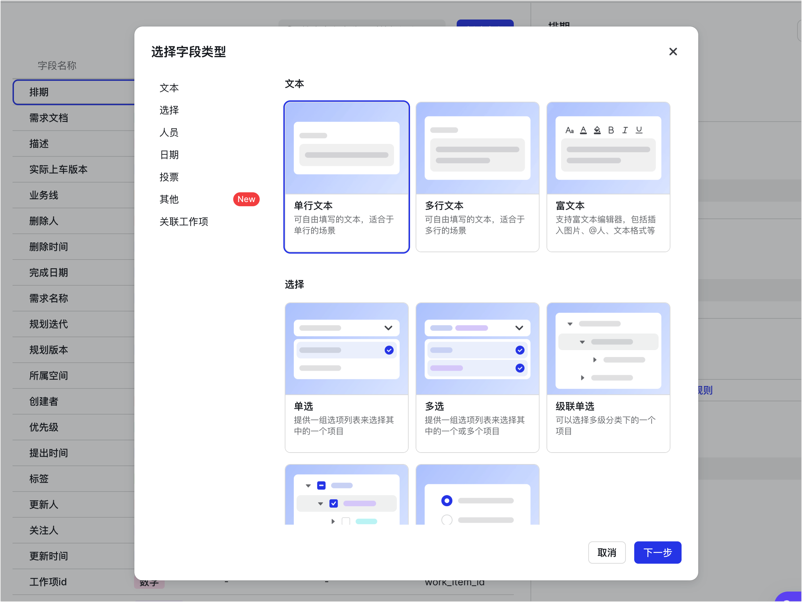

# 创建自定义字段

<!-- capability-metadata:start -->
## 平台能力标记

<a id="capability-openapi.post.open-api-project-key-field-work-item-type-key-create"></a>
- **创建自定义字段** ｜ `openapi.post.open-api-project-key-field-work-item-type-key-create` ｜ 频次：低 ｜ 状态：待运行时验证

<!-- capability-metadata:end -->

<a id="b9da194a"></a>

在指定工作项类型下创建自定义字段，成功后返回新字段的 `field_key`。创建前先确定字段类型，再配置选项来源、默认值、授权角色或数字展示规则。

## 使用前确认

- 字段名称不能重复，`field_alias` 在同一工作项类型内不能重复。
- 自定义选项与团队范围二选一：`field_value` 和 `team_option` 不可同时提交。
- 复用字段选项时，`value_type=1`，同时填写来源工作项类型和字段 key。
- 团队选项仅支持级联单选、级联多选；`team_mode=custom` 时用 `team_data_scopes` 指定范围。
- `authorized_roles` 省略时默认任何人。
- 级联选项示例中的 `config_order` 控制顺序，插入会让后续选项顺延；`color` 使用颜色名加 `1` 或 `3`，例如 `red-1`。

对应的平台功能介绍详见[字段配置](https://project.feishu.cn/1ykiuvvj/17mi85qv)。对应的权限申请在**权限管理-工作项实例**分类下，相关功能介绍详见 [权限管理](../guides/权限管理.md)。常见问题可参考[字段](../support/OpenAPI调用咨询.md#9e4750c4)。



<a id="注意事项"></a>

## 注意事项

1. 工作项关系字段默认数据可见范围为固定数据范围，不支持修改条件数据范围

2. 默认值限制见[默认值说明](#parameter-note-4)。

3. 暂不支持修改字段有效性（默认有效）

4. 不支持更新工作项类型、创建者、提出时间、完成时间、业务线字段

5. 不支持投票字段

<a id="请求说明"></a>

## 请求说明

- 请求方式：POST

- 请求地址：/open_api/:project_key/field/:work_item_type_key/create

<a id="请求参数"></a>

## 请求参数

<a id="header"></a>

### Header

接口调用的 Header 配置详见 [Header](../guides/OpenAPI概述.md#a8e43b86)。

<a id="Path"></a>

### Path

| 参数 | 类型 | 是否必须 | 说明 |
| --- | --- | --- | --- |
| `project_key` | string | 必须 | [说明](#parameter-note-1) |
| `work_item_type_key` | string | 必须 | 工作项类型，系统自动生成，可以从[获取空间下工作项类型](获取空间下工作项类型.md)接口获取。 |

<a id="parameter-note-1"></a>

**project_key：说明**

空间 ID（project_key），或者空间域名（simple_name）。
- 空间 ID（project_key），在飞书项目空间双击空间名称获取。
- 空间域名（simple_name），`simple_name` 一般在飞书项目空间 URL 中获取。例如空间 URL 为 “https://project.feishu.cn/doc/overview”，则 `simple_name`为 “doc”。

<a id="Body"></a>

### Body

| 参数 | 类型 | 是否必须 | 说明 |
| --- | --- | --- | --- |
| `field_name` | string | 必须 | 字段的名称，不允许与其他字段重复。 |
| `field_alias` | string | 可选 | 字段别名，不能够与同工作项类型其他字段重复 |
| `field_type_key` | string | 必须 | 字段的类型，具体支持的字段类型请参考[字段类型支持列表](#b38d09a7)。 |
| `value_type` | int64 | 可选 | 选项值来源，适用于字段类型为 单选、多选、级联单选、级联多选 或单选按钮的情况。默认值为 `0`。支持的取值如下所示。<br>- `0`：自定义；<br>- `1`：复用。 |
| `field_value` | `list<object>` | 可选 | [说明](#parameter-note-2) |
| `reference_work_item_type_key` | string | 可选 | 引用字段所属工作项类型 key，当 `value_type` =`1` 时必填。 |
| `reference_field_key` | string | 可选 | 引用字段 ID，当 `value_type` =`1` 时必填。 |
| `is_multi` | boolean | 可选 | 文本字段的单行或多行标识，适用于字段类型为 `text` 的情况，默认值为单行。支持的取值如下所示。<br>- `true`：多行；<br>- `false`：单行。 |
| `format` | boolean | 可选 | [说明](#parameter-note-3) |
| `free_add` | int64 | 可选 | 是否允许用户添加选项，适用于单选、多选、级联单选 和 级联多选 类型的字段，不传默认为 `2`（否）。支持的取值如下所示。<br>- `1`：是；<br>- `2`：否。 |
| `work_item_relation_uuid` | string | 可选 | 工作项关系 ID，可通过[获取字段信息](获取字段信息.md)接口获取。当字段类型为单选关联工作项或多选工作项时必传。 |
| `default_value` | 按字段类型 | 可选 | [说明](#parameter-note-4) |
| `help_description` | string | 可选 | 帮助说明 |
| `authorized_roles` | `list<string>` | 可选 | 授权角色列表，用于指定可以访问或操作该字段的角色或系统人员。若未传入则默认为「任何人」。支持传入角色 key 或系统人员 key，例如 `_master`（管理员）、`_owner`（创建人）、`_role`（需求相关人）。 |
| `team_option` | object | 可选 | [说明](#parameter-note-5) |
| `parent_field_key` | string | 可选 | 复合字段的父字段key |
| `number_config` | object | 可选 | 数字字段的配置信息，用于控制数字的显示格式和符号设置。<br>格式参考[NumberConfig](../formats/数据结构汇总.md#5f71bc91)。 |

<a id="parameter-note-2"></a>

**field_value：说明**

选项值，值结构参见 [FieldValue](../formats/数据结构汇总.md#530838f4)，支持单选、多选、级联单选、级联多选、单选按钮等结构。
注：该属性和 `team_option`互斥，不能同时填，否则报错。

<a id="parameter-note-3"></a>

**format：说明**

日期或日期+时间类型标识，适用于字段类型为 `date` 的情况，默认值为日期+时间。支持的取值如下所示。
- `true`：仅日期；
- `false`：日期+时间。

<a id="parameter-note-4"></a>

**default_value：说明**

字段的默认值，若传入则默认值为「展示统一默认值」。
不同字段类型的默认值结构不同，具体值结构参考[字段与属性解析格式](../formats/字段与属性解析格式.md)。附件、系统外信号、多值系统外信号类型字段暂不支持设置默认值。

<a id="parameter-note-5"></a>

**team_option：说明**

团队范围，遵循 [TeamOption](../formats/数据结构汇总.md#b88f37fb)结构规范。
注意：
- 只能应用于级联单选和级联多选字段。
- 该属性和 `field_value`互斥，不能同时填，否则报错。

#### `team_option` 的字段

| 参数 | 类型 | 是否必须 | 说明 |
| --- | --- | --- | --- |
| `team_data_scopes` | `list<object>` | 可选 | 遵循 [TeamDataScope](../formats/数据结构汇总.md#6e4a484d)结构规范。当 `team_mode` = `custom`时，指定团队范围。 |
| `team_mode` | string | 可选 | [说明](#parameter-note-6) |

<a id="parameter-note-6"></a>

**team_mode：说明**

团队模式，用于指定级联单选或级联多选字段的团队范围配置。支持的取值如下所示。
- `all`：所有团队；
- `custom`：自定义团队范围（需配合 `team_data_scopes`使用）。

#### `team_option.team_data_scopes` 的字段

| 参数 | 类型 | 是否必须 | 说明 |
| --- | --- | --- | --- |
| `team_id` | string | 可选 | 团队 ID |
| `cascade` | boolean | 可选 | 是否级联。级联会联动带上下级团队。支持的取值如下所示。<br>- `true`：级联；<br>- `false`：非级联。 |

#### `number_config` 的字段

| 参数 | 类型 | 是否必须 | 说明 |
| --- | --- | --- | --- |
| `thousandth` | boolean | 可选 | 是否开启千分位 |
| `scaling_ratio` | string | 可选 | 位数缩放 |
| `display_digits` | int64 | 可选 | 展示位数 |
| `symbol_setting` | object | 可选 | 符号设置 |

#### `number_config.symbol_setting` 的字段

| 参数 | 类型 | 是否必须 | 说明 |
| --- | --- | --- | --- |
| `value` | string | 可选 | 符号值 |
| `layout` | string | 可选 | 布局 |
| `display` | string | 可选 | 显示规则 |

<a id="返回参数"></a>

## 返回参数

| 参数 | 类型 | 说明 |
| --- | --- | --- |
| `data` | string | 字段 key |
| `err` | object | 请求成功时返回空值，请求失败时返回实际错误信息。 |
| `err_msg` | string | 请求成功时返回空值，请求失败时返回实际错误信息。 |
| `err_code` | int32 | 请求成功时0，请求失败返回实际错误码。 |

### `err` 的字段

| 参数 | 类型 | 说明 |
| --- | --- | --- |
| `code` | int32 | 部分场景返回更详细的错误码。 |
| `msg` | string | 部分场景返回更详细的错误描述。 |
| `log_id` | string | 错误调用链标识，用于日志记录和问题排查。 |

<a id="请求示例"></a>

## 请求示例

### 创建单行文本字段

**请求路径**：`POST /open_api/64578938065xxxxx/field/story/create`

```json
{
  "field_name": "openapi_create",
  "field_type_key": "text",
  "field_alias": "openapi_create",
  "help_description": "openapi_create_help_description",
  "authorized_roles": [
    "_master"
  ],
  "default_value": "default value of single text"
}
```

### 创建级联单选字段

**请求路径**：`POST /open_api/64578938065xxxxx/field/story/create`

```json
{
  "field_name": "openapi_create",
  "field_type_key": "tree_select",
  "value_type": 0,
  "field_value": [
    {
      "label": "111",
      "value": "a111",
      "children": [
        {
          "label": "2233",
          "value": "a2333",
          "config_order": 1,
          "color": "red-1"
        }
      ]
    },
    {
      "label": "222",
      "value": "a222"
    }
  ],
  "free_add": 1,
  "field_alias": "openapi_create",
  "help_description": "help description",
  "authorized_roles": [
    "_anyone"
  ]
}
```

### 创建普通单选复用需求下其他字段选项

**请求路径**：`POST /open_api/64578938065xxxxx/field/story/create`

```json
{
  "field_name": "openapi_create",
  "field_type_key": "select",
  "value_type": 1,
  "reference_work_item_type_key": "story",
  "reference_field_key": "field_xxx",
  "field_alias": "openapi_create",
  "help_description": "openapi_create_help_description",
  "authorized_roles": [
    "_anyone"
  ]
}
```

### 创建级联单选字段-复用团队选项

**请求路径**：`POST /open_api/64578938065xxxxx/field/story/create`

```json
{
  "field_name": "openapi_create",
  "field_type_key": "tree_select",
  "value_type": 0,
  "field_alias": "openapi_create",
  "help_description": "openapi_create_help_description",
  "authorized_roles": [
    "_anyone"
  ],
  "team_option": {
    "team_data_scopes": [
      {
        "team_id": "747039911773106xxxx",
        "cascade": true
      },
      {
        "team_id": "747079387064580xxxx",
        "cascade": true
      }
    ],
    "team_mode": "custom"
  }
}
```

### 创建数字字段

```http
POST /open_api/:project_key/field/:work_item_type_key/create
{
    "field_name":"openapi_create",
    "field_type_key":"number",
    "field_alias":"openapi_create",
    "help_description":"openapi_create_help_description",
    "authorized_roles":["_master"],
    "number_config": {
        "scaling_ratio": "0.01",
        "display_digits": -1,
        "symbol_setting": {
          "display": "custom",
          "value": "%",
          "layout": "right"
      }
    }
}
```

<a id="返回示例"></a>

## 返回示例

### 成功返回示例

```json
{
  "data": "field_73jds7",
  "err": {},
  "err_msg": "",
  "err_code": 0
}
```

### 错误返回示例

以下错误原因为存在必填参数未填写。

```json
{
  "data": "",
  "err": {
    "msg": "Invalid Param",
    "code": 400,
    "log_id": "2025080616331669D6B2BE4AB260F****"
  },
  "err_msg": "",
  "err_code": null
}
```

<a id="错误码"></a>

## 错误码

以下列出了该接口相关的错误码信息，若需查看更多通用错误码说明，参见 [Open API 错误码](../formats/Open%20API%20错误码.md)。

| `err_code` | err_msg | err.code | err.msg | 说明 |
| --- | --- | --- | --- | --- |
| `1000051468` | ErrFieldAliasRepeat | 1000051468 | Field alias repeated | 字段标识重复，`field_alias` 重复 |
| `1000051469` | ErrFieldModify | 1000051469 | Invalid Update Version | 当前字段已被其它人 并发更新中 |
| `1000051750` | ErrFieldNameHasUsed | 1000051750 | field name has been used | 字段名称重复，`field_name` 重复 |
| `1000053603` | ErrFieldNameLenExceed | 1000053603 | Up to # character can be enterd in field names | 字段名称长度超限 |

<a id="b38d09a7"></a>

## 字段类型支持列表

| **字段类型** | **对应 API 字段类型** |
| --- | --- |
| 单行文本/多行文本 | text |
| 富文本 | multi_text |
| 单选 | select |
| 多选 | multi_select |
| 级联单选 | tree_select |
| 级联多选 | tree_multi_select |
| 单选按钮 | radio |
| 单选人员 | user |
| 多选人员 | multi_user |
| 日期/日期时间 | date |
| 日期区间 | schedule |
| URL链接 | link |
| 数字 | number |
| 附件 | multi_file |
| 开关 | bool |
| 系统外信号 | signal |
| 单选关联工作项 | work_item_related_select |
| 多选关联工作项 | work_item_related_multi_select |
| 电话号码 | telephone |
| 电子邮件 | email |

更新时间：2026-09-07
官方 URL：https://project.feishu.cn/b/helpcenter/1p8d7djs/3ywaejjy
