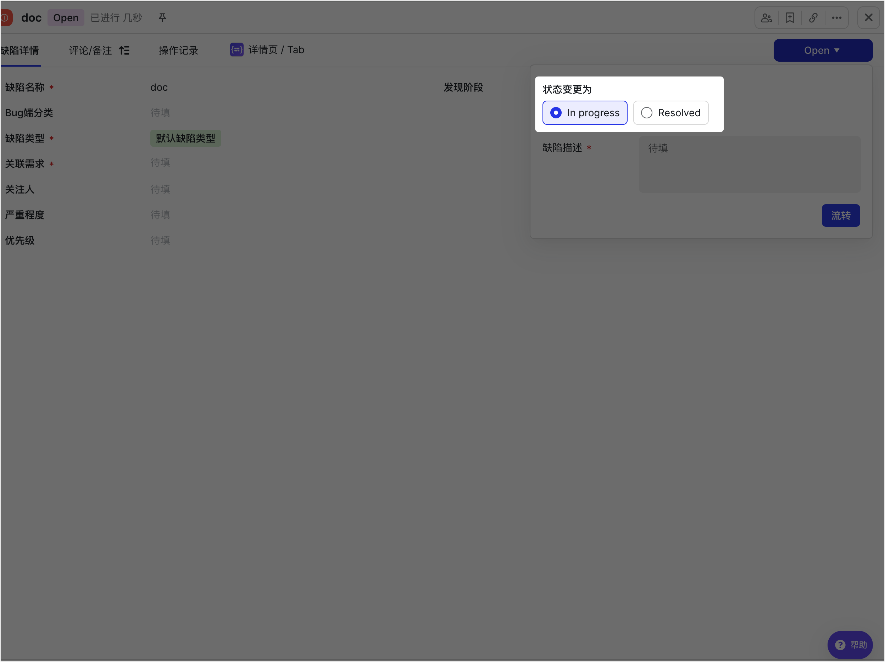

# 状态流转

<!-- capability-metadata:start -->
## 平台能力标记

<a id="capability-openapi.post.open-api-project-key-workflow-work-item-type-key-work-item-id-node-state-change"></a>
- **状态流转** ｜ `openapi.post.open-api-project-key-workflow-work-item-type-key-work-item-id-node-state-change` ｜ 频次：低 ｜ 状态：待运行时验证

<!-- capability-metadata:end -->

将状态流工作项沿指定流转路径推进到目标状态，并同时填写该状态表单中的字段和角色负责人。`transition_id` 标识一条流转路径，需要从工作流的 `connections` 中获取。

## 调用前确认

1. 工作项使用状态流，且当前状态允许执行目标流转。
2. 通过[获取工作流详情](获取工作流详情.md)取得 `connections[].transition_id`；需要预先检查必填项时，调用[获取指定节点/状态流转所需必填信息](获取指定节点与状态流转所需必填信息.md)。
3. 在插件“权限管理 → 工作项实例”中申请对应权限，见[权限管理](../guides/权限管理.md)。表单字段、条件必填规则与插件拦截规则仍会参与校验。

产品中的操作方式见[状态流转](https://project.feishu.cn/1ykiuvvj/4xycewd0#61fb4216)。



<a id="请求说明"></a>

## 请求说明

**请求方式**：`POST`
**请求地址**：`/open_api/:project_key/workflow/:work_item_type_key/:work_item_id/node/state_change`

<a id="请求参数"></a>

## 请求参数

<a id="header"></a>

### 请求头

接口调用的 Header 配置详见 [Header](../guides/OpenAPI概述.md#a8e43b86)。

<a id="Path"></a>

### 路径参数

| 参数 | 类型 | 是否必须 | 说明 |
| --- | --- | --- | --- |
| project_key | string | 必须 | [填写说明](#parameter-notes-1) |
| work_item_type_key | string | 必须 | 工作项类型，系统自动生成，可通过[获取空间下工作项类型](获取空间下工作项类型.md)接口获取。 |
| work_item_id | string | 必须 | 工作项实例 ID，在工作项实例详情中，单击右上角 **··· ，​**然后单击 **ID** 即可获取。 |

<a id="parameter-notes-1"></a>

**project_key 的填写说明**

空间 ID（project_key），或者空间域名（simple_name）。

- 空间 ID（project_key），在飞书项目空间双击空间名称获取。

- 空间域名（simple_name），`simple_name` 一般在飞书项目空间 URL 中获取。例如空间 URL 为 “https://project.feishu.cn/doc/overview”，则 `simple_name`为 “doc”。

<a id="Body"></a>

### 请求体

`fields` 只更新目标状态表单中的字段。字段标识可使用 `field_key` 或 `field_alias`，两者不能同时为空；富文本值使用 `field_value` 或 `field_value_markdown` 二选一。`update_mode` 默认 `0`，提交前需区分替换与更新的影响范围。

| 参数 | 类型 | 是否必须 | 说明 |
| --- | --- | --- | --- |
| `transition_id` | int64 | 必须 | 流转到下一状态的 ID，可通过[获取工作流详情](获取工作流详情.md)接口查询状态流获取，即返回信息中 `connections` 结构下的 `transition_id` 字段。 |
| `fields` | `list<object>` | 可选 | 要更新的字段数组，仅能更新状态表单中的字段。 |
| `role_owners` | `list<object>` | 可选 | 角色及负责人。 |

#### `fields`

| 参数 | 类型 | 是否必须 | 说明 |
| --- | --- | --- | --- |
| `field_key` | string | 必须 | 待更新的字段 ID，需与 `field_alias`二选一填写，不能同时为空。 |
| `field_alias` | string | 可选 | 待更新字段的别名 |
| `field_value` | object | 必须 | 字段值，可参考[字段与属性解析格式](../formats/字段与属性解析格式.md) |
| `update_mode` | int32 | 可选 | 字段的更新模式，用于控制字段值的更新方式。支持的取值如下所示。<br>- `0`：替换模式，提交的字段值将完全替换原有值；<br>- `1`：更新模式，仅更新提交的字段值，不影响其他字段。<br>默认值：`0`（替换模式） |
| `target_state` | object | 可选 | 指代流转至该目标状态需要填写对应字段，状态流使用 |
| `field_type_key` | string | 可选 | 字段类型表单项的字段类型 |
| `field_name` | string | 可选 | 字段名称 |
| `field_value_markdown` | object | 可选 | 富文本内容 Markdown 格式，遵循 [ ](https://arcosite.bytedance.net/sites/1698370054562/6552139f9045fa02fe4f6435/editor/6a4c9f3c029ec1050c4d18a6?docLang=zh&bv=656ef48385acee02ee573dac)[Markdown 格式说明](../formats/Markdown%20格式说明.md)结构规范，和`field_value` 二选一，仅富文本格式字段生效 |

#### `fields.target_state`

| 参数 | 类型 | 是否必须 | 说明 |
| --- | --- | --- | --- |
| `state_key` | string | 可选 | 状态 key |
| `transition_id` | int64 | 可选 | 状态流转 ID，仅状态流返回 |

#### `fields.field_value_markdown`

| 参数 | 类型 | 是否必须 | 说明 |
| --- | --- | --- | --- |
| `markdown` | string | 可选 | 富文本内容 Markdown 格式 |
| `mention_user_keys` | `list<object>` | 可选 | 富文本中 @ 提到的人员信息 |

#### `fields.field_value_markdown.mention_user_keys`

| 参数 | 类型 | 是否必须 | 说明 |
| --- | --- | --- | --- |
| `id` | string | 可选 | 富文本中对应的人员 id |
| `user_key` | string | 可选 | 对应的人员的 user_key |

#### `role_owners`

| 参数 | 类型 | 是否必须 | 说明 |
| --- | --- | --- | --- |
| `name` | string | 可选 | 名称，作为请求参数非必填。 |
| `role` | string | 必须 | 角色 ID |
| `owners` | `list<string>` | 必须 | 负责人 user_key 数组 |

<a id="返回参数"></a>

## 返回参数

| 参数 | 类型 | 说明 |
| --- | --- | --- |
| err | object | 请求成功时返回空值，请求失败时返回实际错误信息。 |
| err.code | int32 | 部分场景下，透出更详细错误对应的错误码。 |
| err.msg | string | 部分场景下，透出更详细的错误描述。 |
| err.log_id | string | 报错场景下的调用链标识符，用于追踪错误发生时的完整调用链路，便于日志记录和问题排查。 |
| err_msg | string | 请求成功时返回空值，请求失败时返回实际错误信息。 |
| err_code | int32 | 请求成功时返回0，请求失败返回实际错误码。 |

<a id="请求示例"></a>

## 请求示例

`transition_id` 是流转 ID。下方请求体已补齐 JSON 分隔符，调用前替换路径中的脱敏空间与工作项 ID。

请求路径：POST /open_api/676e6839bd3a3bcba14b\*\*\*\*/workflow/issue/12694\*\*\*\*/node/state_change

```json
{
  "transition_id": 12345,
  "role_owners": [
    {
      "owners": [],
      "role": "PM"
    }
  ],
  "fields": [
    {
      "field_alias": "sentry_link",
      "field_key": "field_658c22",
      "field_type_key": "text",
      "field_value": "23333"
    }
  ]
}
```


<a id="返回示例"></a>

## 返回示例

### 请求成功示例

```json
{
  "data": {},
  "err": {},
  "err_msg": "",
  "err_code": 0
}
```

### 请求失败示例

以下错误原因为请求体中的 `transition_id` 不正确，可通过[获取工作流详情](获取工作流详情.md)接口查询状态流获取。

```json
{
  "err_code": 20005,
  "err_msg": "Missing Param",
  "err": {
    "code": 20005,
    "msg": "transition_id can't be null or 0",
    "log_id": "2025103017350072D111EFE8D2BD5A4947"
  }
}
```

<a id="错误码"></a>

## 错误码

以下列出了该接口相关的错误码信息，若需查看更多通用错误码说明，参见 [Open API 错误码](../formats/Open%20API%20错误码.md)。

| err_code | err_msg | err.code | err.msg | 说明 |
| --- | --- | --- | --- | --- |
| 10002 | Illegal Operation | 10002 | Illegal Operation | 检查实例状态与当前请求参数，当前请求的状态流转请求与实例状态不匹配 |
| 20005 | Missing Param | 20005 | transition_id can't be null or 0 | 检查请求体中的 `transition_id` 是否正确 |
| 30005 | WorkItem Not Found | 30005 | WorkItem Not Found | 检查给定的实例 ID 是否存在对应实例。 |
| 20090 | Your request has been Intercept | 20090 | Your request has been intercepted. | 检查空间中配置的插件拦截规则，当前请求触发的修改命中了插件拦截规则 |
| 20038 | Param missing | 20038 | 状态必填-条件可见-开关(field_IcjjIfWw) Required | 检查并填写模板配置中状态流转表单的必填项 |
| 20038 | Required Field Is Not Set | 20038 | 状态必填-条件可见-级联单选(field_nC6GnmBc) Required | 检查并填写模板配置中状态流转表单的必填项 |
| 30009 | Field Not Found | 30009 | field_value_pairs field key :can not find field | 检查请求参数，确认被更新的字段在当前工作项类型上存在 |
| 30012 | State Not Found In Stateflow | 30012 | {State %!s(MISSING) Not Found In State Flow:\[systemEnded\]} | 工作流模板信息错误，可在模板升级后重试 |
| 50006 | Failed to check field | 50006 | Due to the administrator configuration update | 在`fields`中设置正确的字段更新值，当前请求中的选项值已经不存在或被禁用 |

更新时间：2026-09-07
官方 URL：https://project.feishu.cn/b/helpcenter/1p8d7djs/4xve8n8c
