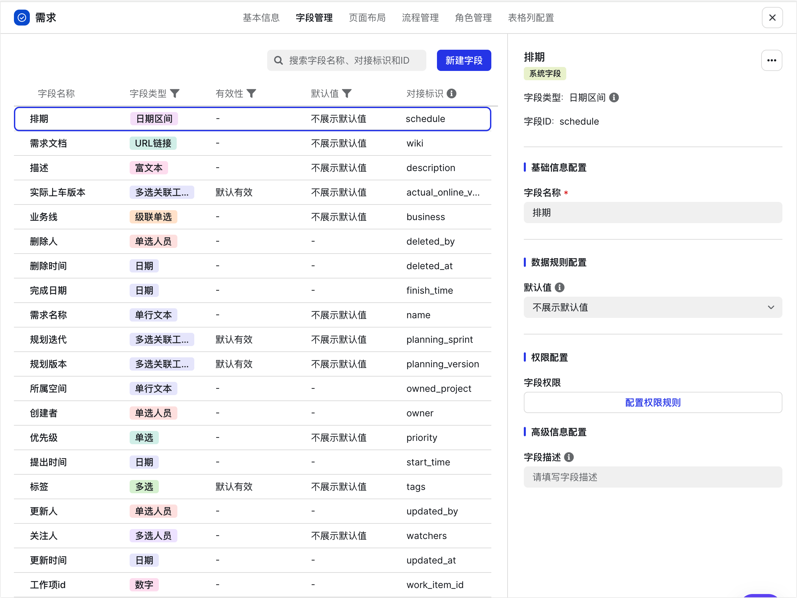

# 获取字段信息

<!-- capability-metadata:start -->
## 平台能力标记

<a id="capability-openapi.post.open-api-project-key-field-all"></a>
- **获取字段信息** ｜ `openapi.post.open-api-project-key-field-all` ｜ 频次：高 ｜ 状态：已验证 ｜ 示例：[`openapi.project-key.field-all.fixture`](<../../../fixtures/openapi/field-all.json>)

<!-- capability-metadata:end -->

获取字段的结构定义，包含字段标识、类型、选项、关联关系、复合子字段和作用范围。省略 `work_item_type_key` 可查看空间全部字段，传入该参数则按工作项类型查询。

## 使用前确认

- 使用 `field_key` 定位字段，`field_alias` 是对接标识，`field_name` 是展示名称。
- 级联选择字段的下一级选项位于 `options.children`；复合字段的成员位于 `compound_fields`。
- 多人复合字段另有 `editable_personnel_scope`，用于描述填写角色和范围。
- 工作项类型必须属于路径指定空间，否则返回 `30001`。

对应的平台功能介绍详见[字段配置](https://project.feishu.cn/1ykiuvvj/17mi85qv)，对应的权限申请在**权限管理-配置**分类下，相关功能介绍详见 [权限管理](../guides/权限管理.md)。



<a id="请求说明"></a>

## 请求说明

- 请求方式：POST

- 请求地址：/open_api/:project_key/field/all

<a id="请求参数"></a>

## 请求参数

<a id="header"></a>

### Header

接口调用的 Header 配置详见 [Header](../guides/OpenAPI概述.md#a8e43b86)。

<a id="Path"></a>

### Path

| 参数 | 类型 | 是否必须 | 说明 |
| --- | --- | --- | --- |
| `project_key` | string | 必须 | [说明](#parameter-note-1) |

<a id="parameter-note-1"></a>

**project_key：说明**

空间 ID（project_key），或者空间域名（simple_name）。
- 空间 ID（project_key），在飞书项目空间双击空间名称获取。
- 空间域名（simple_name），`simple_name` 一般在飞书项目空间 URL 中获取。例如空间 URL 为 “https://project.feishu.cn/doc/overview”，则 `simple_name`为 “doc”。

<a id="Body"></a>

### Body

| 参数 | 类型 | 是否必须 | 说明 |
| --- | --- | --- | --- |
| `work_item_type_key` | string | 可选 | 工作项类型，创建工作项时自动生成，通过[获取空间下工作项类型](获取空间下工作项类型.md)接口获取。 |

<a id="返回参数"></a>

## 返回参数

| 参数 | 类型 | 说明 |
| --- | --- | --- |
| `data` | `list<object>` | 字段信息，遵循[SimpleField](../formats/数据结构汇总.md#bf03f527)结构规范。 |
| `err` | object | 请求成功时返回空值，请求失败时返回实际错误信息。 |
| `err_msg` | string | 请求成功时返回空值，请求失败时返回实际错误信息。 |
| `err_code` | int32 | 请求成功时0，请求失败返回实际错误码。 |

### `data` 的字段

| 参数 | 类型 | 说明 |
| --- | --- | --- |
| `field_key` | string | 字段 key |
| `field_alias` | string | 字段对接标识 |
| `field_type_key` | string | 字段类型 |
| `field_name` | string | 字段名称 |
| `is_custom_field` | boolean | 是否自定义字段，非自定义字段即为系统字段，一般OAPI不消费 |
| `options` | `list<object>` | 选项，遵循[Option](../formats/数据结构汇总.md#440d0d08)结构规范 |
| `relation_id` | string | 关联工作项的关联关系ID |
| `compound_fields` | `list<object>` | 复合字段，当字段类型是复合字段时存在。数据结构示例可参考[字段](../formats/字段与属性解析格式.md#10fb2f8d)中的复合字段。 |
| `work_item_scopes` | `list<string>` | 作用范围 |
| `value_generate_mode` | string | [说明](#parameter-note-2) |
| `editable_personnel_scope` | object | 多人复合字段专有，可编辑人员范围见 [EditablePersonnelScope](../formats/数据结构汇总.md#417a101c) 规范 |

<a id="parameter-note-2"></a>

**value_generate_mode：说明**

字段值的生成方式。当前可用枚举待核实：接口参数表与官方成功响应截图使用了不同的取值体系，尚无证据确定其版本边界或兼容关系。接入时应核对目标空间的实际响应，不应据此文档硬编码计算字段的判定值。

### `data.options` 的字段

| 参数 | 类型 | 说明 |
| --- | --- | --- |
| `label` | string | 选项名称 |
| `value` | string | 自定义属性值 |
| `children` | `list<object>` | 子选项，当字段类型为级联单选/多选时存在，可参考[级联单选/多选字段的option数据结构](https://project.feishu.cn/b/helpcenter/1p8d7djs/k6nbktn1#bf019a32) |
| `color` | string | 选项颜色 |
| `order` | int64 | 选项顺序 |
| `is_disabled` | int64 | 是否禁用 |
| `is_visibility` | int64 | 是否可见 |
| `work_item_type_key` | string | 工作项类型 |

### `data.editable_personnel_scope` 的字段

| 参数 | 类型 | 说明 |
| --- | --- | --- |
| `editable_roles` | `list<string>` | 可填写角色 |
| `editable_personnel_range_type` | string | 填写范围类型 |

### `err` 的字段

| 参数 | 类型 | 说明 |
| --- | --- | --- |
| `code` | int32 | 部分场景下，透出更详细错误对应的错误码。 |
| `msg` | string | 部分场景下，透出更详细的错误描述。 |
| `log_id` | string | 报错场景下的调用链标识符，用于追踪错误发生时的完整调用链路，便于日志记录和问题排查。 |

<a id="请求示例"></a>

## 请求示例

### 服务端调用（占位示例）

```sh
curl --request POST \
  --url "https://project.feishu.cn/open_api/SPACE_ID_PLACEHOLDER/field/all" \
  --header "Content-Type: application/json" \
  --header "X-Plugin-Token: PLUGIN_ACCESS_TOKEN_PLACEHOLDER" \
  --data '{
    "work_item_type_key": "WORK_ITEM_TYPE_KEY_PLACEHOLDER"
  }'
```

### 查询该空间下所有字段信息

```http
POST /open_api/68382b399de4b0ec6c5axxxx/field/all
```

### 查询指定类型工作项的字段信息

查询 story 工作项下的字段信息。

```http
POST /open_api/68382b399de4b0ec6c5axxxx/field/all
{
    "work_item_type_key": "story"
}
```

<a id="返回示例"></a>

## 返回示例

### 查询空间下所有字段信息

```json
{
  "data": [
    {
      "field_key": "description",
      "field_type_key": "multi_text",
      "field_alias": "description",
      "is_custom_field": false,
      "work_item_scopes": [
        "chart"
      ],
      "field_name": "\u4efb\u52a1\u63cf\u8ff0",
      "relation_id": ""
    },
    {
      "relation_id": "",
      "options": [
        {
          "order": 0,
          "color": "",
          "is_visibility": 1,
          "is_disabled": 2,
          "label": "P0",
          "value": "0",
          "work_item_type_key": "chart"
        },
        {
          "is_visibility": 1,
          "is_disabled": 2,
          "label": "P1",
          "value": "1",
          "work_item_type_key": "chart",
          "order": 1,
          "color": ""
        },
        {
          "label": "P2",
          "value": "2",
          "work_item_type_key": "chart",
          "order": 2,
          "color": "",
          "is_visibility": 1,
          "is_disabled": 2
        },
        {
          "label": "\u5f85\u5b9a",
          "value": "99",
          "work_item_type_key": "chart",
          "order": 3,
          "color": "",
          "is_visibility": 1,
          "is_disabled": 2
        }
      ],
      "field_alias": "priority",
      "is_custom_field": false,
      "work_item_scopes": [
        "chart"
      ],
      "field_key": "priority",
      "field_type_key": "select",
      "field_name": "\u4f18\u5148\u7ea7"
    },
    {
      "field_type_key": "compound_field",
      "compound_fields": [
        {
          "field_type_key": "text",
          "field_alias": "",
          "field_name": "\u590d\u5408\u5b57\u6bb51",
          "is_custom_field": true,
          "relation_id": "",
          "field_key": "field_b34565"
        },
        {
          "field_key": "field_db0b07",
          "field_type_key": "text",
          "field_name": "\u590d\u5408\u5b57\u6bb52",
          "is_custom_field": true,
          "field_alias": "",
          "relation_id": ""
        }
      ],
      "is_custom_field": true,
      "field_key": "field_c9c844",
      "field_alias": "",
      "field_name": "\u590d\u5408\u5b57\u6bb5",
      "work_item_scopes": [
        "story"
      ],
      "relation_id": ""
    }
  ],
  "err": {},
  "err_msg": "",
  "err_code": 0
}
```

### 错误返回示例

以下错误原因为传入的 `project_key` 与 `work_item_type_key` 不匹配，即该空间中没有对应的工作项类型，请传入正确的值。

```json
{
  "err_code": 30001,
  "err_msg": "Data Not Found",
  "err": {
    "code": 30001,
    "msg": "Data not found in project 68382b399de4b0ec6c5a9637 with work_item_type stor",
    "log_id": "20251027180025788FCC0413B0B22Dxxxx"
  }
}
```

<a id="错误码"></a>

## 错误码

以下列出了该接口相关的错误码信息，若需查看更多通用错误码说明，参见 [Open API 错误码](../formats/Open%20API%20错误码.md)。

| `err_code` | err_msg | err.code | err.msg | 说明 |
| --- | --- | --- | --- | --- |
| `30001` | Data Not Found | 30001 | Data not found in project 62c298b6218847b5d28cxxxx with work_item_type bug | 传入的 `project_key` 与 `work_item_type_key` 不匹配，即该空间中没有对应的工作项类型。 |

## 实现边界

将本接口的返回作为字段值编解码的唯一输入：用 `field_key` 作为稳定标识，用 `field_type_key`、`options`、`compound_fields` 和 `editable_personnel_scope` 决定值形状，不能从 `field_name` 或展示文案猜测格式。`value_generate_mode` 在不同官方资料中的取值表达并不完全一致，依赖计算字段行为时应以目标空间的实际响应为准，避免硬编码未确认的枚举。

本页没有把 `X-User-Key` 或 `x-auth-mode` 定义为端点级固定要求。调用方应遵循通用鉴权规则和目标调用身份，不能将其他接口的 Header 直接复制到此处。完整的占位请求和成功、失败结果见本地 fixture：[获取字段信息](../../../fixtures/openapi/field-all.json)。

更新时间：2026-09-07
官方 URL：https://project.feishu.cn/b/helpcenter/1p8d7djs/3tsposa2
