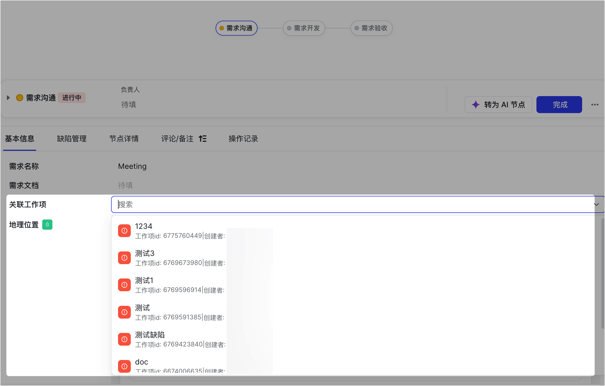

# 获取指定的关联工作项列表（单空间）

<!-- capability-metadata:start -->
## 平台能力标记

<a id="capability-openapi.post.open-api-project-key-work-item-work-item-type-key-work-item-id-search-by-relation"></a>
- **获取指定的关联工作项列表（单空间）** ｜ `openapi.post.open-api-project-key-work-item-work-item-type-key-work-item-id-search-by-relation` ｜ 频次：低 ｜ 状态：待运行时验证

<!-- capability-metadata:end -->

从一个已知工作项出发，沿指定关联字段查询另一种工作项类型的关联实例。例如从需求查询其关联缺陷。接口权限位于[权限管理](../guides/权限管理.md)的“工作项实例”分类。

## 确定关联方向

路径中的 `work_item_type_key` 和 `work_item_id` 描述起点实例；请求体中的 `relation_work_item_type_key` 描述要返回的关联实例类型。两者必须与关联字段配置匹配。

`relation_key` 可以填写字段 ID 或字段对接标识，但必须与 `relation_type` 一致：默认 `0` 表示字段 ID，`1` 表示对接标识。

分页从 `1` 开始，单页最多 `50` 条；先反向关联、后正向关联，再按工作项 ID 排序。总匹配超过 `5000` 时，即使设置分页也会报错。

如获取工作项关联为**需求**和**缺陷**的关联字段（relation_key），可查询该需求工作项实例下绑定的缺陷列表：



<a id="请求说明"></a>

## 请求说明

**请求方式**：`POST`

**请求地址**：`/open_api/:project_key/work_item/:work_item_type_key/:work_item_id/search_by_relation`

<a id="请求参数"></a>

## 请求参数

<a id="header"></a>

### 请求头

接口调用的 Header 配置详见 [Header](../guides/OpenAPI概述.md#a8e43b86)。

<a id="Path"></a>

### 路径参数

| 参数                 | 类型     | 是否必须 | 说明                                                                                                                   |
| -------------------- | -------- | -------- | ---------------------------------------------------------------------------------------------------------------------- |
| `project_key`        | `string` | 必须     | 空间 ID（project_key），或者空间域名（simple_name）。 [详细说明](#field-note-1)                                        |
| `work_item_type_key` | `string` | 必须     | 工作项类型，创建工作项时自动生成，通过[获取空间下工作项类型](获取空间下工作项类型.md)接口获取，需要与 `work_item_id`对应实例匹配。 |
| `work_item_id`       | `int64`  | 必须     | 工作项实例 ID，在工作项实例详情中，展开右上角 **··· \> ID**获取。                                                      |

<a id="field-note-1"></a>

**project_key**

空间 ID（project_key），或者空间域名（simple_name）。

- 空间 ID（project_key），在飞书项目空间双击空间名称获取。
- 空间域名（simple_name），`simple_name` 一般在飞书项目空间 URL 中获取。例如空间 URL 为 “https://project.feishu.cn/doc/overview”，则 `simple_name`为 “doc”。

<a id="Body"></a>

### 请求体

| 参数                          | 类型     | 是否必须 | 说明                                                                                                                    |
| ----------------------------- | -------- | -------- | ----------------------------------------------------------------------------------------------------------------------- |
| `relation_work_item_type_key` | `string` | 必须     | 关联的工作项类型。                                                                                                      |
| `relation_key`                | `string` | 必须     | 关联关系 key。两个工作项之间通过某个关联字段绑定，填入该字段 key 或对接标识即可。                                       |
| `relation_type`               | `int32`  | 可选     | 关联关系的类型，用于指定关联字段的标识方式。支持的取值如下所示。 [详细说明](#field-note-2)                              |
| `page_size`                   | `int64`  | 可选     | 每页返回的工作项数量，最大值为 `50`。排序方式为先按照反向在前正向在后，再按照工作项 ID 排序。 [详细说明](#field-note-3) |
| `page_num`                    | `int64`  | 可选     | 分页页码，从 1 开始，默认值为 1。                                                                                       |

<a id="field-note-2"></a>

**relation_type**

关联关系的类型，用于指定关联字段的标识方式。支持的取值如下所示。

- `0`：关联字段 ID；
- `1`：关联字段对接标识。默认值为 `0`。

<a id="field-note-3"></a>

**page_size**

每页返回的工作项数量，最大值为 `50`。排序方式为先按照反向在前正向在后，再按照工作项 ID 排序。

若查询的数据超过 5000 个，即使设置了分页依旧会报错。

<a id="返回参数"></a>

## 返回参数

`fields` 可能不包含从未配置到新建页且未修改过的字段，判空时还需考虑“字段未出现在数组中”。下方按父对象拆分，字段定义全部保留。

原表包含共享更新结构中的 `update_mode` 等说明，但本接口是查询，不因此接受更新字段。原表还描述了 Markdown 扩展开关，却没有在请求表中定义该开关，不能据此自行新增入参。

| 参数         | 类型           | 说明                                                                              |
| ------------ | -------------- | --------------------------------------------------------------------------------- |
| `data`       | `list<object>` | 返回的工作项数据列表，遵循[WorkItemInfo](../formats/数据结构汇总.md#a16fbe28)结构规范 |
| `pagination` | `object`       | 分页信息，包含当前查询的数据总数、当前页数和每页数据量。                          |
| `err`        | `object`       | 请求成功时返回空值，请求失败时返回实际错误信息。                                  |
| `err_msg`    | `string`       | 请求成功时返回空值，请求失败时返回实际错误信息。                                  |
| `err_code`   | `int32`        | 请求成功时返回0，请求失败返回实际错误码。                                         |

### `data`

| 参数                   | 类型           | 说明                                                                                           |
| ---------------------- | -------------- | ---------------------------------------------------------------------------------------------- |
| `id`                   | `int64`        | 工作项的 ID                                                                                    |
| `name`                 | `string`       | 工作项的名称                                                                                   |
| `simple_name`          | `string`       | 工作项标识。                                                                                   |
| `work_item_type_key`   | `string`       | 工作项类型                                                                                     |
| `project_key`          | `string`       | 所属空间 ID                                                                                    |
| `template_id`          | `int64`        | 使用的模板 ID                                                                                  |
| `template_type`        | `string`       | 模板类型(已废弃）                                                                              |
| `pattern`              | `string`       | 工作项的模式类型，用于区分工作项的不同管理模式。支持的取值如下所示。 [详细说明](#field-note-4) |
| `current_nodes`        | `list<object>` | 当前节点信息，查询状态流工作项时返回空值                                                       |
| `created_by`           | `string`       | 创建人 user_key                                                                                |
| `updated_by`           | `string`       | 更新人 user_key                                                                                |
| `deleted_by`           | `string`       | 删除人 user_key                                                                                |
| `created_at`           | `int64`        | 创建时间戳，毫秒精度                                                                           |
| `updated_at`           | `int64`        | 更新时间戳，毫秒精度                                                                           |
| `deleted_at`           | `int64`        | 删除时间戳，毫秒精度                                                                           |
| `fields`               | `list<object>` | 工作项的其他字段 [详细说明](#field-note-5)                                                     |
| `work_item_status`     | `object`       | 工作项状态，遵循[WorkItemStatus](../formats/数据结构汇总.md#9b44f95f)结构规范。                    |
| `sub_task_parent_info` | `object`       | 子任务的父级信息,只有在指定需要查询时才会返回                                                  |

<a id="field-note-4"></a>

**pattern**

工作项的模式类型，用于区分工作项的不同管理模式。支持的取值如下所示。

- `Node`：节点流；
- `State`：状态流。

<a id="field-note-5"></a>

**fields**

工作项的其他字段

注意：字段只有配置在新建页，或者曾经更改过，才会返回，否则，不会出现在返回值中。因此，开发者如果要基于该字段做字段值的判空处理，需要补充不在返回值中也为空的逻辑处理。

### `data.current_nodes`

| 参数     | 类型           | 说明                |
| -------- | -------------- | ------------------- |
| `id`     | `string`       | 节点 ID             |
| `name`   | `string`       | 节点名称            |
| `owners` | `list<string>` | 负责人user_key 数组 |

### `data.fields`

| 参数                   | 类型     | 说明                                                                                                                            |
| ---------------------- | -------- | ------------------------------------------------------------------------------------------------------------------------------- |
| `field_key`            | `string` | 待更新的字段 ID，需与 `field_alias`二选一填写，不能同时为空。                                                                   |
| `field_alias`          | `string` | 待更新字段的别名                                                                                                                |
| `field_value`          | `object` | 字段值，可参考[字段与属性解析格式](../formats/字段与属性解析格式.md)                                                                      |
| `update_mode`          | `int32`  | 字段的更新模式，用于控制字段值的更新方式。支持的取值如下所示。 [详细说明](#field-note-6)                                        |
| `field_type_key`       | `string` | 字段类型                                                                                                                        |
| `field_name`           | `string` | 字段名称                                                                                                                        |
| `field_value_markdown` | `object` | 富文本内容 Markdown 格式，遵循 [Markdown 格式说明](../formats/Markdown%20格式说明.md) 结构规范，`need_rich_text_mark_down`为 “true” 时返回 |

<a id="field-note-6"></a>

**update_mode**

字段的更新模式，用于控制字段值的更新方式。支持的取值如下所示。

- `0`：替换模式，提交的字段值将完全替换原有值；
- `1`：更新模式，仅更新提交的字段值，不影响其他字段。

默认值：`0`（替换模式）

### `data.fields.field_value_markdown`

| 参数                | 类型           | 说明                      |
| ------------------- | -------------- | ------------------------- |
| `markdown`          | `string`       | 富文本内容 Markdown 格式  |
| `mention_user_keys` | `list<object>` | 富文本中 @ 提到的人员信息 |

### `data.fields.field_value_markdown.mention_user_keys`

| 参数       | 类型     | 说明                  |
| ---------- | -------- | --------------------- |
| `id`       | `string` | 富文本中对应的人员 id |
| `user_key` | `string` | 对应的人员的 user_key |

### `data.work_item_status`

| 参数                | 类型      | 说明                                                                           |
| ------------------- | --------- | ------------------------------------------------------------------------------ |
| `state_key`         | `string`  | 工作项状态 key。                                                               |
| `is_archived_state` | `boolean` | 是否为**完成状态**（对应状态流工作项**流程管理**中**状态类型**为“完成”的状态） |
| `is_init_state`     | `boolean` | 是否为**初始状态**（对应状态流工作项**流程管理**中**状态类型**为”初始“的状态） |
| `updated_at`        | `int64`   | 状态更新时间，毫秒精度                                                         |
| `updated_by`        | `string`  | 状态更新人 user_key                                                            |
| `history`           | `map`     | 工作项状态的历史变更记录，包含状态变更的时间、操作人及状态标识等信息。         |

### `data.sub_task_parent_info`

| 参数                 | 类型     | 说明         |
| -------------------- | -------- | ------------ |
| `node_id`            | `string` | 关联节点UUID |
| `work_item_id`       | `int64`  | 父工作项id   |
| `work_item_name`     | `string` | 父工作项名字 |
| `work_item_type_key` | `string` | 父工作项类型 |

### `pagination`

| 参数        | 类型    | 说明                                |
| ----------- | ------- | ----------------------------------- |
| `total`     | `int64` | 查询的数据总数。                    |
| `page_num`  | `int64` | 当前分页查询页数。                  |
| `page_size` | `int64` | 当前分页查询每页数据量；请求最大值为 `50`。 |

### `err`

| 参数     | 类型     | 说明                                                                                 |
| -------- | -------- | ------------------------------------------------------------------------------------ |
| `code`   | `int32`  | 部分场景下，透出更详细错误对应的错误码。                                             |
| `msg`    | `string` | 部分场景下，透出更详细的错误描述。                                                   |
| `log_id` | `string` | 报错场景下的调用链标识符，用于追踪错误发生时的完整调用链路，便于日志记录和问题排查。 |

<a id="请求示例"></a>

## 请求示例

**请求路径**：POST /open_api/658b9f05809f644b\*\*\*\*/work_item/story/123456\*\*\*\*/search_by_relation

```json
{
  "relation_work_item_type_key": "issue",
  "relation_key": "_field_linked_story",
  "page_size": 10,
  "page_num": 1,
  "relation_type": 0
}
```

<a id="返回示例"></a>

## 返回示例

### 请求成功示例

```json
{
  "data": [
    {
      "id": 1,
      "name": "item1",
      "work_item_type_key": "issue",
      "project_key": "658b9f05809f644b****",
      "simple_name": "test",
      "template_type": "control",
      "pattern": "Node",
      "sub_stage": "started",
      "work_item_status": {},
      "current_nodes": [
        {
          "id": "state_1",
          "name": "node1",
          "owners": ["701251455513382****"]
        }
      ],
      "created_by": "700914671966122****",
      "updated_by": "700914671966122****",
      "created_at": 1633776613033,
      "updated_at": 1633776613033,
      "fields": [
        {
          "field_alias": "",
          "field_key": "aborted",
          "field_type_key": "aborted",
          "field_value": {
            "is_aborted": false,
            "reason": ""
          }
        },
        {
          "field_alias": "",
          "field_key": "role_owners",
          "field_type_key": "role_owners",
          "field_value": [
            {
              "owners": ["701251455518415****"],
              "role": "uiouiouio"
            },
            {
              "owners": null,
              "role": "test"
            },
            {
              "owners": null,
              "role": "tt"
            }
          ]
        }
      ]
    }
  ],
  "err": {},
  "err_msg": "",
  "err_code": 0,
  "pagination": {
    "page_num": 1,
    "page_size": 10,
    "total": 1
  }
}
```

### 错误返回示例

以下错误原因为传入的 `relation_key` 不存在，可通过调用[获取空间关联规则列表](获取空间关联规则列表.md)接口获取该 ID。

```json
{
  "err_code": 30018,
  "err_msg": "Config Not Found",
  "err": {
    "code": 30018,
    "msg": "RelationKey Not Exist In Configuration, please refer to https://project.feishu.cn/b/helpcenter/1p8d7djs/5aueo3jr",
    "log_id": "202510311653471EA394B2BB680567xxxx"
  }
}
```

<a id="错误码"></a>

## 错误码

以下列出了该接口相关的错误码信息，若需查看更多通用错误码说明，参见 [Open API 错误码](../formats/Open%20API%20错误码.md)。

| err_code | err_msg                                                                        | err.code | err.msg                                                                        | 说明                                                                                       |
| -------- | ------------------------------------------------------------------------------ | -------- | ------------------------------------------------------------------------------ | ------------------------------------------------------------------------------------------ |
| 20055    | Search Result Bigger Than 5000                                                 | 20055    | Search Result Bigger Than 5000,Please Check Your Search Param                  | 查询结果超过 5000 个，请重新设置筛选条件。                                                 |
| 30018    | Config Not Found                                                               | 30018    | RelationKey Not Exist In Configuration                                         | 传入的 `relation_key` 不存在，可通过调用[获取空间关联规则列表](获取空间关联规则列表.md)接口获取该 ID。 |
| 20060    | WorkItemTypeKey Or RelationWorkItemTypeKey Is Not Match In Field Configuration | 20060    | WorkItemTypeKey Or RelationWorkItemTypeKey Is Not Match In Field Configuration | 字段配置异常，请确认 `relation_key` 是否为关联工作项字段                                   |
| 50005    | Internal Server Error                                                          | 50005    | Internal Server Error                                                          | 字段所属关系异常，请确认 `relation_key` 是否为关联工作项字段                               |
| 30018    | RelationKey Not Exist In Configuration                                         | 30018    | RelationKey Not Exist In Configuration                                         | 传入的 `relation_key` 不存在，可通过调用[获取空间关联规则列表](获取空间关联规则列表.md)接口获取该 ID。 |

更新时间：2026-09-07
官方 URL：https://project.feishu.cn/b/helpcenter/1p8d7djs/39dcbh1d
