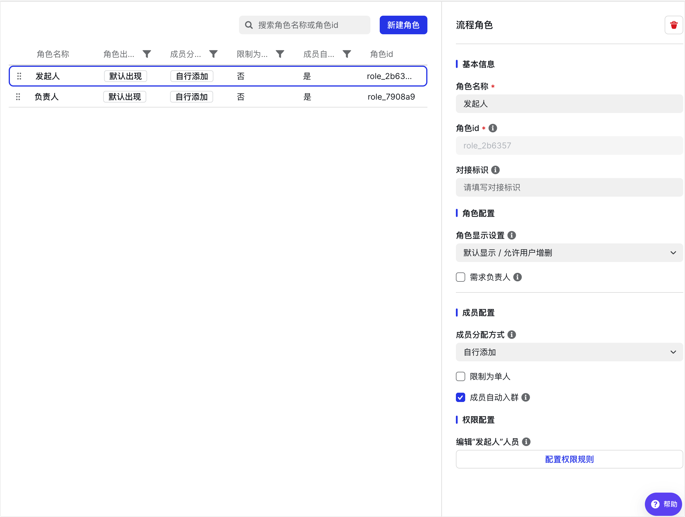

# 获取流程角色配置详情

<!-- capability-metadata:start -->
## 平台能力标记

<a id="capability-openapi.get.open-api-project-key-flow-roles-work-item-type-key"></a>
- **获取流程角色配置详情** ｜ `openapi.get.open-api-project-key-flow-roles-work-item-type-key` ｜ 频次：低 ｜ 状态：待运行时验证

<!-- capability-metadata:end -->

读取某个工作项类型下全部角色与人员配置，包括角色 ID、出现方式、成员分配、自动入群、锁定插件和授权角色。返回的角色 ID 可用于模板负责人配置及角色更新、删除接口。

## 使用前确认

- 读取结果的 `member_assign_mode` 支持 `4`（按条件分配）；创建与更新角色接口的本文档参数只列出 `1`、`2`、`3`，不能直接照搬完整读响应写回。
- `data=[]` 既可能表示没有角色，也可能表示空间中不存在该工作项类型，应结合工作项类型列表判断。
- `is_member_multi=true` 表示允许多人；`false` 才表示限制单人。

对应的平台功能介绍详见[常见问题：角色管理](https://project.feishu.cn/1ykiuvvj/py7go937)。对应的权限申请在 权限管理-流程角色 分类下，相关功能介绍详见[权限管理](../guides/权限管理.md)。



<a id="请求说明"></a>

## 请求说明

- 请求方式：GET

- 请求地址：/open_api/:project_key/flow_roles/:work_item_type_key

<a id="请求参数"></a>

## 请求参数

<a id="header"></a>

### Header

接口调用的 Header 配置详见[Header](../guides/OpenAPI概述.md#a8e43b86)。

<a id="Path"></a>

### Path

| 参数 | 类型 | 是否必须 | 说明 |
| --- | --- | --- | --- |
| `project_key` | string | 必须 | [说明](#parameter-note-1) |
| `work_item_type_key` | string | 必须 | 工作项类型，系统自动生成，可以从[获取空间下工作项类型](获取空间下工作项类型.md)接口获取。 |

<a id="parameter-note-1"></a>

**project_key：说明**

空间 ID（project_key），或者空间域名（simple_name）。
- 空间 ID（project_key），在飞书项目空间双击空间名称获取。
- 空间域名（simple_name），`simple_name` 一般在飞书项目空间 URL 中获取。例如空间 URL 为 “https://project.feishu.cn/doc/overview”，则 `simple_name`为 “doc”。

<a id="返回参数"></a>

## 返回参数

| 参数 | 类型 | 说明 |
| --- | --- | --- |
| `data` | `list<object>` | 流程角色配置列表，字段定义见下方 `data` 对象表。 |
| `err` | object | 请求成功时返回空值，请求失败时返回实际错误信息。 |
| `err_msg` | string | 请求成功时返回空值，请求失败时返回实际错误信息。 |
| `err_code` | int32 | 请求成功时0，请求失败返回实际错误码。 |

### `data` 的字段

| 参数 | 类型 | 说明 |
| --- | --- | --- |
| `id` | string | 流程角色 ID |
| `name` | string | 流程角色名称 |
| `is_owner` | boolean | 该角色是否为需求负责人，默认值为 `false`。 |
| `role_appear_mode` | int64 | 角色在流程中的出现方式。支持的取值如下所示。<br>- `1`：默认出现；<br>- `2`：默认不出现；<br>- `3`：条件出现。 |
| `deletable` | boolean | 是否允许用户自行增删角色 |
| `auto_enter_group` | boolean | 成员是否自动加入群组，默认值为 `false`。 |
| `member_assign_mode` | int64 | [说明](#parameter-note-2) |
| `members` | `list<string>` | 指定分配成员的 `userkey` 列表，当成员分配方式为 `2`（默认分配为指定人员）时存在。 |
| `is_member_multi` | boolean | 是否允许流程角色配置多人；`false` 限制单人，默认值为 `true`。 |
| `lock_scope` | `list<string>` | 锁定范围 |
| `role_alias` | string | 角色对接标识 |
| `is_required` | int32 | 必填性 |
| `lock_app_id` | string | 锁定插件id |
| `allow_delete` | boolean | 允许用户自行增删 |
| `authorization_role_keys` | `list<string>` | 授权角色key列表 |

<a id="parameter-note-2"></a>

**member_assign_mode：说明**

成员分配方式，用于指定流程角色成员的分配规则。支持的取值如下所示。
- `1`：自行添加；
- `2`：默认分配为指定人员；
- `3`：默认分配为创建人；
- `4`：按条件分配。

### `err` 的字段

| 参数 | 类型 | 说明 |
| --- | --- | --- |
| `code` | int32 | 部分场景下，透出更详细错误对应的错误码。 |
| `msg` | string | 部分场景下，透出更详细的错误描述。 |
| `log_id` | string | 报错场景下的调用链标识符，用于追踪错误发生时的完整调用链路，便于日志记录和问题排查。 |

<a id="请求示例"></a>

## 请求示例

```http
GET /open_api/68382b399de4b0ec6c5axxxx/flow_roles/story
```

<a id="返回示例"></a>

## 返回示例

### 请求成功示例

```json
{
  "data": [
    {
      "id": "PM",
      "name": "PM",
      "is_owner": true,
      "role_appear_mode": 2,
      "deletable": true,
      "auto_enter_group": true,
      "member_assign_mode": 1,
      "members": [],
      "is_member_multi": true
    }
  ],
  "err": {},
  "err_code": 0,
  "err_msg": ""
}
```

### 错误返回示例

以下错误原因为传入的 `project_key` 不正确。

```json
{
  "err_code": 1000052062,
  "err_msg": "Project Key Is Wrong",
  "err": {
    "code": 1000052062,
    "msg": "not found simple name: 68382b399de4b0ec6c5xxxx",
    "log_id": "20251106144917E5D202A90D84EFEBxxxx"
  }
}
```

### 空返回

若返回空值，原因为传入的 `work_item_type_key` 类型的工作项没有角色配置信息，或者该空间不存在对应的工作项类型。

```json
{
  "err": {},
  "err_code": 0,
  "err_msg": "",
  "data": []
}
```

<a id="错误码"></a>

## 错误码

以下列出了该接口相关的错误码信息，若需查看更多通用错误码说明，参见 [Open API 错误码](../formats/Open%20API%20错误码.md)。

| `err_code` | err_msg | err.code | err.msg | 说明 |
| --- | --- | --- | --- | --- |
| `1000052062` | Project Key Is Wrong | 1000052062 | not found simple name: xxxx | 传入的 `project_key` 不正确。 |

更新时间：2026-09-07
官方 URL：https://project.feishu.cn/b/helpcenter/1p8d7djs/2s90fy0i
