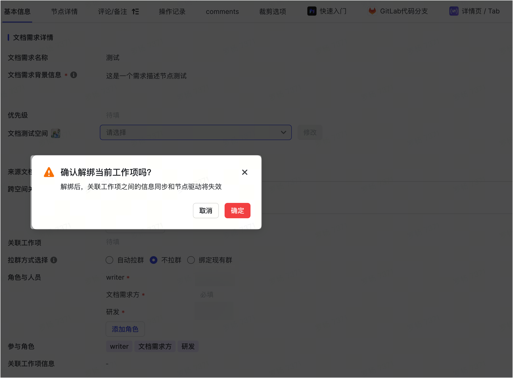

# 解绑空间关联的关联工作项实例

<!-- capability-metadata:start -->
## 平台能力标记

<a id="capability-openapi.delete.open-api-project-key-relation-work-item-type-key-work-item-id"></a>
- **解绑空间关联的关联工作项实例** ｜ `openapi.delete.open-api-project-key-relation-work-item-type-key-work-item-id` ｜ 频次：低 ｜ 状态：待运行时验证

<!-- capability-metadata:end -->

解除当前工作项与另一个工作项之间、由指定规则建立的空间关联。接口使用带 JSON 请求体的 `DELETE`：路径是当前端，请求体指定规则及待解绑的另一端。

## 确定要解除的关系

先通过[获取空间关联下的关联工作项实例列表](获取空间关联下的关联工作项实例列表.md)核对关联实例与规则。`relation_rule_id` 与 `relation_work_item_id` 都是必填项；这里接收单个目标 ID，不是批量数组。

产品中的绑定管理见[跨空间关联控件配置](https://project.feishu.cn/1ykiuvvj/4g4laxgf#16c87d68)，权限申请见[权限管理](../guides/权限管理.md)中的“工作项实例”。



<a id="请求说明"></a>

## 请求说明

**请求方式**：`DELETE`
**请求地址**：`/open_api/:project_key/relation/:work_item_type_key/:work_item_id`

<a id="请求参数"></a>

## 请求参数

<a id="header"></a>

### 请求头

接口调用的 Header 配置详见 [Header](../guides/OpenAPI概述.md#a8e43b86)。

<a id="Path"></a>

### 路径参数

| 参数 | 类型 | 是否必须 | 说明 |
| --- | --- | --- | --- |
| project_key | string | 必须 | [填写说明](#parameter-notes-1) |
| work_item_type_key | string | 必须 | 工作项类型，创建工作项时自动生成，通过[获取空间下工作项类型](获取空间下工作项类型.md)接口获取，需要与 `work_item_id`对应实例匹配。 |
| work_item_id | string | 必须 | 工作项实例 ID，在工作项实例详情中，展开右上角 **··· \> ID**获取。 |

<a id="parameter-notes-1"></a>

**project_key 的填写说明**

空间 ID（project_key），或者空间域名（simple_name）。

- 空间 ID（project_key），在飞书项目空间双击空间名称获取。

- 空间域名（simple_name），`simple_name` 一般在飞书项目空间 URL 中获取。例如空间 URL 为 “https://project.feishu.cn/doc/overview”，则 `simple_name`为 “doc”。

<a id="Body"></a>

### 请求体

| 参数 | 类型 | 是否必须 | 说明 |
| --- | --- | --- | --- |
| relation_rule_id | string | 必须 | 空间关联关系规则 ID，可通过调用[获取空间关联规则列表](获取空间关联规则列表.md)接口获取该 ID。 |
| relation_work_item_id | int64 | 必须 | 需要解绑的工作项实例 ID，在工作项实例详情中，展开右上角 **··· \> ID** 获取。 |

<a id="返回参数"></a>

## 返回参数

| 参数 | 类型 | 说明 |
| --- | --- | --- |
| err | object | 请求成功时返回空值，请求失败时返回实际错误信息。 |
| err.code | int32 | 部分场景下，透出更详细错误对应的错误码。 |
| err.msg | string | 部分场景下，透出更详细的错误描述。 |
| err.log_id | string | 报错场景下的调用链标识符，用于追踪错误发生时的完整调用链路，便于日志记录和问题排查。 |
| err_msg | string | 请求成功时返回空值，请求失败时返回实际错误信息。 |
| err_code | int32 | 请求成功时返回0，请求失败返回实际错误码。 |

<a id="请求示例"></a>

## 请求示例

`relation_work_item_id` 为 int64 数值，下方使用演示 ID。`DELETE` 请求仍必须携带请求体。

**请求路径**：`DELETE /open_api/66f11218c3b4a0b42334/relation/story/12584`

```json
{
  "relation_work_item_id": 3012280000,
  "relation_rule_id": "720286429011250xxxxx"
}
```

<a id="返回示例"></a>

## 返回示例

### 请求成功示例

```json
{
  "data": {},
  "err": {},
  "err_code": 0,
  "err_msg": ""
}
```

### 错误返回示例

该错误表示工作项或关联规则未找到，应核对 `relation_work_item_id`、`relation_rule_id`，并确认两端工作项与规则匹配。

```json
{
  "err_code": 20006,
  "err_msg": "Invalid Param",
  "err": {
    "code": 20006,
    "msg": "work_item or relation_rule_id not found ",
    "log_id": "20251107155519B2FE0C57F4615489xxxx"
  }
}
```

<a id="错误码"></a>

## 错误码

以下列出了该接口相关的错误码信息，若需查看更多通用错误码说明，参见 [Open API 错误码](https://project.feishu.cn/b/helpcenter/developer/common-error-code)。

| err_code | err_msg | err.code | err.msg | 说明 |
| --- | --- | --- | --- | --- |
| 20006 | Invalid Param | 20006 | work_item or relation_rule_id not found | 工作项或 `relation_rule_id` 不正确。 |

更新时间：2026-09-07
官方 URL：https://project.feishu.cn/b/helpcenter/1p8d7djs/3ppvsink
