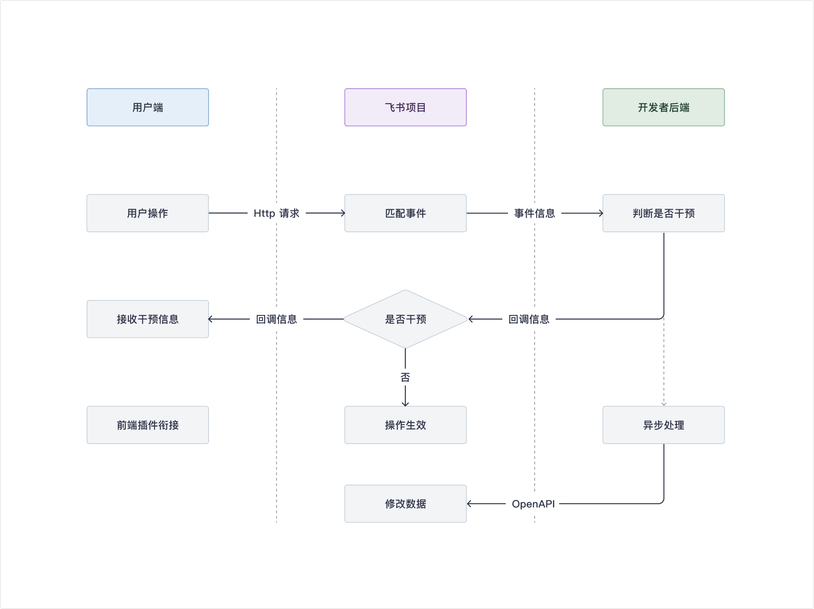
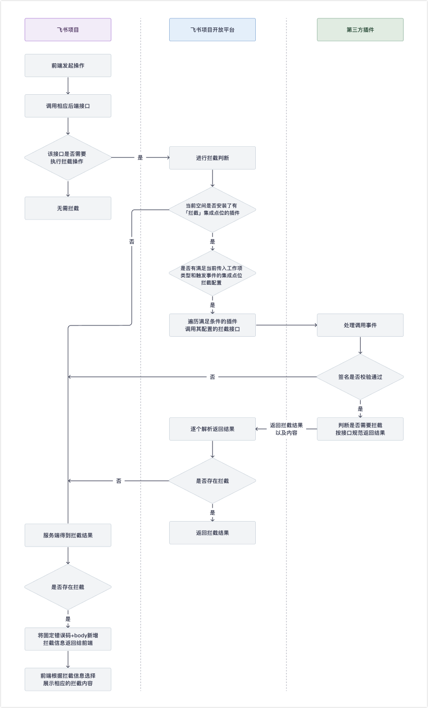
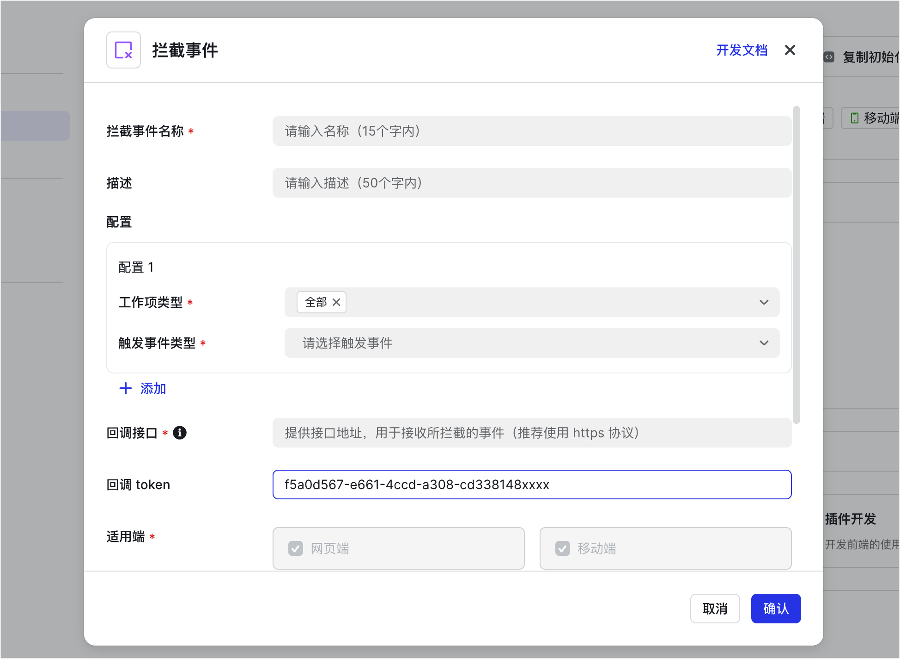
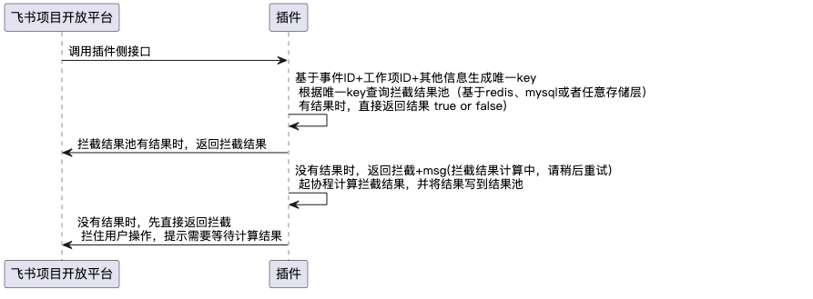

# 拦截事件

<!-- capability-metadata:start -->
## 平台能力标记

<a id="capability-event-contract.intercept"></a>
- **拦截事件** ｜ `event-contract.intercept` ｜ 频次：中 ｜ 状态：待运行时验证 ｜ 示例：[`event-contract.intercept.fixture`](<../../../fixtures/events/intercept.json>)

<!-- capability-metadata:end -->

<a id="67f9ea56"></a>

## 什么是拦截事件？

拦截事件在操作执行前同步询问插件是否放行，适用于建单资格校验、流转检查等场景。例如，插件可以按回调中的用户标识查询培训记录，阻止未完成培训的人员建单，并返回具体原因。

| 插件结果 | 平台行为 |
| --- | --- |
| `need_intercept: true` | 阻止本次操作，将提示与自定义数据传给客户端 |
| `need_intercept: false` | 放行本次操作 |
| 约定时间内未返回结论 | 按不拦截处理，放行本次操作 |

回调必须在 **1000ms** 内返回。需要进一步衔接界面流程时，接入[拦截事件 / Intercept](https://project.feishu.cn/b/helpcenter/1p8d7djs/1s5ly1az)前端点位。



<a id="8b7c6877"></a>

## 拦截流程



<a id="8d55a0b4"></a>

## 配置流程

1. 在飞书项目开放平台添加构成，选择拦截事件。

2. **配置拦截事件**。添加插件关注的事件类型和工作项类型。



3. **配置回调地址**。插件需要提供回调地址。请确保该地址公网可以访问，当事件发生时，开放平台会向该地址发送相应的 HTTP POST请求。

4. **配置回调 token**（可选），用于接收端校验签名，具体算法见[兼容性说明与验签说明](事件兼容性与验签.md)。

5. **版本发布**。要使得配置生效，开发者需要创建版本并发布。

6. **接收并处理事件**。当用户安装该插件的对应版本在空间后，用户进行对应操作时就会向插件推送事件，插件需要接收并处理事件。

发布配置后，还需要在目标空间安装对应版本；只修改后台配置并不会使已安装版本自动采用新配置。

<a id="e514bf06"></a>

## 事件列表

| 类型 | 事件 | 事件编码 |
| --- | --- | --- |
| 工作项(100) | 创建工作项 | [1001](#47eeb661) |
| 工作项(100) | 删除工作项 | [1002](#7e25029d) |
| 工作项(100) | 批量删除工作项 | [1003](#809e4d6b) |
| 工作项(100) | 恢复工作项 | [1004](#a61f8234) |
| 工作项(100) | 终止工作项 | [1005](#d76b9552) |
| 工作项(100) | 模板升级 | [1006](#d5010def) |
| 工作项(100) | 批量模板升级 | [1007](#c9f97194) |
| 工作项(100) | 导出工作项 | [1008](#0302e93e) |
| 工作项(100) | 修改字段 | [1009](#39340ea9) |
| 工作项(100) | 批量修改字段 | [1010](#66969a65) |
| 计划表（100） | 发布草稿 | [1011](#a26bad0b) |
| 计划表（100） | 创建草稿 | [1012](#ee9bcf12) |
| 节点(200) | 完成节点 | [2001](#d75a1172) |
| 节点(200) | 删除节点 | [2002](#6bd6a7dc) |
| 节点(200) | 恢复节点 | [2003](#84bb1302) |
| 节点(200) | 回滚节点 | [2004](#51ed0fa2) |
| 节点(200) | 填写排期与估分 | [2005](#c145ea1b) |
| 节点(200) | 修改节点负责人 | [2006](#14708bcf) |
| 节点(200) | 修改排期联动子项 | [2008](#45ad905b) |
| 状态(300) | 变更状态 | [3001](#82f3e928) |
| 子任务（400） | 新增子任务 | [4001](#70d29992) |
| 子任务（400） | 删除子任务 | [4002](#0a03e93b) |
| 子任务（400） | 完成子任务 | [4003](#1315a033) |
| 子任务（400） | 取消完成子任务 | [4004](#aeab419e) |
| 子任务（400） | 修改子任务负责人 | [4005](#9679ad72) |
| 子任务（400） | 修改子任务估分 | [4006](#68b65926) |
| 子任务（400） | 修改子任务排期 | [4007](#177f4439) |
| 子任务（400） | 修改子任务实际工时 | [4008](#340acbae) |

<a id="6415c40d"></a>

## 事件结构

### 请求包裹层

开放平台通过 HTTP POST 推送以下结构。所有完整样例中的中文数据均使用等义 Unicode 转义；`\u` 转义不会改变 JSON 解析后的业务值。

| 字段 | 含义 |
| --- | --- |
| `data` | 事件业务数据，公共字段见下表，专属字段见各事件 |
| `request_time` | 发送时间，样例注释定义为秒级 Unix 时间戳，通常接近事件发生时间 |
| `signature` | 使用回调 token 校验的请求签名 |
| `source` | `normal` 或 `open_api`；后者表示 OpenAPI 操作触发 |
| `source_plugin_id` / `source_plugin_name` | 来源插件 ID 与名称，仅 `source: "open_api"` 时有值 |
| `log_id` | 日志 ID，见完整事件样例 |

本篇的来源枚举是 **`open_api`**，不要替换成监听事件中的 `openapi`。

### 公共业务字段

| 字段 | 含义 |
| --- | --- |
| `data.event_type` | 本页事件列表中的数字编码 |
| `data.idempotent_key` | 幂等标识；原文说明对同一事件的多次操作可能相同 |
| `data.is_batch_check` | 是否为 WBS 批量校验 |
| `data.project_key` | 空间 key |
| `data.work_item_type_key` | 当前工作项类型 key |
| `data.work_item_info[]` | 关联工作项，包含 `work_item_id`、`work_item_name`、`work_item_type_key` |
| `data.user_info` | 操作者信息：`email`、`name_cn`、`name_en`、`user_key`；英文名可缺省或无值 |

`idempotent_key` 不仅用于投递去重：原文举例，多次流转同一工作项的同一节点时也可能复用该键。若缓存拦截结论，需要结合当前业务状态与有效期，避免将旧的放行结果永久应用于后续操作。

### 字段变更对象

工作项的 `field_info[]`、子任务的 `field_infos[]` 使用以下字段描述变更。字段值的解释参见[字段与属性解析格式](../formats/字段与属性解析格式.md)；本页样例中的数字与数组也可能以字符串传递，不能只按 `field_type` 强制推断 JSON 类型。

| 字段 | 含义 |
| --- | --- |
| `field_key` / `alias` | 字段 key 与对接标识 |
| `field_type` | 字段类型 |
| `before_field_value` / `after_field_value` | 事件触发前与触发时的值 |
| `before_field_value_markdown` / `after_field_value_markdown` | 仅富文本字段返回的 Markdown 信息 |
| `*.markdown` | 富文本的 Markdown 内容 |
| `*.metion_user_keys` | Markdown 中 @ 提及人员的 key；原文拼写如此，本文不改为 `mention_user_keys` |

```json
{
  "data": {
    "idempotent_key": "bc447199585340d1f3728d26b1c0297a",
    "event_type": 1001
  },
  "request_time": 123456,
  "signature": "41a9425ea7df4536a7623e38fa321bae",
  "source": "normal",
  "source_plugin_id": "",
  "source_plugin_name": ""
}
```

### 拦截响应

插件返回以下 JSON 结构。`msg` 的 `zh`、`en`、`ja` 分别承载中文、英文与日文提示。

```json
{
  "need_intercept": true,
  "msg": {
    "zh": "",
    "en": "",
    "ja": ""
  },
  "custom_data": "",
  "intercept_options": {
    "disable_show_plugin": true
  }
}
```

| 字段 | 含义 |
| --- | --- |
| `need_intercept` | `true` 拦截，`false` 放行 |
| `msg` | 拦截后客户端展示的多语言提示 |
| `custom_data` | 透传给插件客户端的自定义数据 |
| `intercept_options.disable_show_plugin` | `true` 隐藏插件拦截弹窗；它不改变是否拦截的判定 |

## 响应与验签边界

拦截结论必须在同一个回调响应中返回，不能先回复 HTTP `200` 再异步决定是否拦截。超过 **1000ms** 未返回时平台按不拦截处理，因此耗时校验只能在时限内完成，或接受放行的后果。官方展示的是包含 `msg`、`custom_data` 和 `intercept_options` 的完整响应结构，未定义 `need_intercept: false` 时这些字段能否省略；在获得运行时证据前，服务端应保留完整结构。

回调 token 是可选的。配置后按[兼容性说明与验签说明](事件兼容性与验签.md)验签；未配置时，来源没有定义空 token 的验签规则或 `signature` 格式，属于 `source_silent` 边界。`request_time` 在本页样例中是秒级 Unix 时间戳，`source` 的 OpenAPI 值是 `open_api`，都不能套用监听事件中的毫秒或 `openapi` 写法。预创建事件的 `work_item_info[].work_item_id` 可为 `0`，不能当作已存在实例查询。

完整请求和同步响应样例见本地 fixture：[拦截事件响应](../../../fixtures/events/intercept.json)。

<a id="601771ec"></a>

## 兼容性说明与验签说明

[兼容性说明与验签说明](事件兼容性与验签.md)

<a id="b6aafd1e"></a>

## 工作项

<a id="47eeb661"></a>

### 创建工作项（1001）

建单前校验待创建字段，样例包含名称和描述。此时工作项尚未创建，`work_item_info[].work_item_id` 为 **0**，不能按已有工作项 ID 查询；富文本同时携带 Markdown 与提及人员信息。

```json
{
  "data": {
    "event_type": 1001,
    "idempotent_key": "c79b13e88c6ace7bd2284bc3e43741ea55feace0030c647d92096d6b5de4e269",
    "is_batch_check": false,
    "project_key": "662e151cd7fd734ae1874213",
    "field_info": [
      {
        "after_field_value": "\u5de5\u4f5c\u9879178",
        "alias": "",
        "before_field_value": "",
        "field_key": "name",
        "field_type": ""
      },
      {
        "after_field_value": "\u63cf\u8ff0\u4fe1\u606f",
        "after_field_value_markdown": {
          "markdown": "\u63cf\u8ff0\u4fe1\u606f",
          "metion_user_keys": []
        },
        "alias": "",
        "before_field_value": "",
        "field_key": "description",
        "field_type": "multi_text"
      }
    ],
    "user_info": {
      "email": "",
      "name_cn": "",
      "name_en": "",
      "user_key": "73567952804XXXXXX76"
    },
    "work_item_info": [
      {
        "work_item_id": 0,
        "work_item_name": "\u5de5\u4f5c\u9879178",
        "work_item_type_key": "66b5c62c1f80XXXXXXa55a09"
      }
    ],
    "work_item_type_key": "66b5c62c1f80XXXXXXa55a09"
  },
  "request_time": 1723188804,
  "signature": "d8f19dcd92ac14d72c30aca9d6fe73f7416569a21e864138e88ed622e4d0355c",
  "source": "normal",
  "source_plugin_id": "",
  "source_plugin_name": "",
  "log_id": "2024XXXXXXXXXXXXXXXXXXXXXXXXXXXC07"
}
```


<a id="7e25029d"></a>

### 删除工作项（1002）

校验单个工作项的删除操作。样例通过 `work_item_info` 定位已有工作项，未附加删除前字段快照。

```json
{
  "data": {
    "event_type": 1002,
    "idempotent_key": "33e081440d0fd0ee92eb2cc045affa1104f3c551e410a2d3ed9cbdf96051e23c",
    "is_batch_check": false,
    "project_key": "662e151cd7fd734ae1874213",
    "user_info": {
      "email": "XXXX@bytedance.com",
      "name_cn": "XXX",
      "name_en": "XXX",
      "user_key": "73567952804XXXXXX76"
    },
    "work_item_info": [
      {
        "work_item_id": 5035024106,
        "work_item_name": "\u9700\u6c42XXXX",
        "work_item_type_key": "66b5c62c1f8072a327a55a09"
      }
    ],
    "work_item_type_key": "66b5c62c1f8072a327a55a09"
  },
  "request_time": 1723189835,
  "signature": "a17afb0461a5211be5b9a1d323aa4f6c2d65c20dc3e432a12d91084956f78596",
  "source": "normal",
  "source_plugin_id": "",
  "source_plugin_name": "",
  "log_id": "2024XXXXXXXXXXXXXXXXXXXXXXXXXXXC07"
}
```


<a id="809e4d6b"></a>

### 批量删除工作项（1003）

一次请求携带多个 `work_item_info` 成员。该事件不携带工作项名称，样例中 `work_item_name` 为空；应按工作项 ID 识别每个待删除对象。

```json
{
  "data": {
    "event_type": 1003,
    "idempotent_key": "33e081440d0fd0ee92eb2cc045affa1104f3c551e410a2d3ed9cbdf96051e23c",
    "is_batch_check": false,
    "project_key": "662e151cd7fd734ae1874213",
    "user_info": {
      "email": "XXXX@bytedance.com",
      "name_cn": "XXX",
      "name_en": "XXX",
      "user_key": "73567952804XXXXXX76"
    },
    "work_item_info": [
      {
        "work_item_id": 5036074102,
        "work_item_name": "",
        "work_item_type_key": "66b5c62c1f8072a327a55a09"
      },
      {
        "work_item_id": 5035024113,
        "work_item_name": "",
        "work_item_type_key": "66b5c62c1f8072a327a55a09"
      }
    ],
    "work_item_type_key": "66b5c62c1f8072a327a55a09"
  },
  "request_time": 1723189835,
  "signature": "a17afb0461a5211be5b9a1d323aa4f6c2d65c20dc3e432a12d91084956f78596",
  "source": "normal",
  "source_plugin_id": "",
  "source_plugin_name": "",
  "log_id": "2024XXXXXXXXXXXXXXXXXXXXXXXXXXXC07"
}
```


<a id="a61f8234"></a>

### 恢复工作项（1004）

`field_info` 描述恢复带来的字段变化：`aborted` 表示终止状态，`restore_detail` 为恢复补充原因，`restore_reason` 为恢复原因选项；`data.reason` 携带恢复原因。

```json
{
  "data": {
    "event_type": 1004,
    "idempotent_key": "33e081440d0fd0ee92eb2cc045affa1104f3c551e410a2d3ed9cbdf96051e23c",
    "is_batch_check": false,
    "project_key": "662e151cd7fd734ae1874213",
    "user_info": {
      "email": "XXXX@bytedance.com",
      "name_cn": "XXX",
      "name_en": "XXX",
      "user_key": "73567952804XXXXXX76"
    },
    "work_item_info": [
      {
        "work_item_id": 5034995666,
        "work_item_name": "XX",
        "work_item_type_key": "66b5c62c1f8072a327a55a09"
      }
    ],
    "field_info": [
      {
        "field_key": "aborted",
        "alias": "",
        "field_type": "",
        "before_field_value": "",
        "after_field_value": "\u6d4b\u8bd5\u4e00\u4e0b\uff1a\u6062\u590d\u9700\u6c42\u6d4b\u8bd5"
      },
      {
        "field_key": "restore_detail",
        "alias": "",
        "field_type": "",
        "before_field_value": "",
        "after_field_value": "\u6062\u590d\u9700\u6c42\u6d4b\u8bd5"
      },
      {
        "field_key": "restore_reason",
        "alias": "",
        "field_type": "",
        "before_field_value": "",
        "after_field_value": "test"
      }
    ],
    "reason": "\u6d4b\u8bd5\u4e00\u4e0b\uff1a\u6062\u590d\u9700\u6c42\u6d4b\u8bd5",
    "work_item_type_key": "66b5c62c1f8072a327a55a09"
  },
  "request_time": 1723189835,
  "signature": "a17afb0461a5211be5b9a1d323aa4f6c2d65c20dc3e432a12d91084956f78596",
  "source": "normal",
  "source_plugin_id": "",
  "source_plugin_name": "",
  "log_id": "2024XXXXXXXXXXXXXXXXXXXXXXXXXXXC07"
}
```


<a id="d76b9552"></a>

### 终止工作项（1005）

`field_info` 描述终止状态 `aborted`、终止补充原因 `abort_detail` 与原因选项 `abort_reason`；`data.reason` 携带终止原因。补充原因字段类型为 `multi_pure_text`，原因选项为 `select`。

```json
{
  "data": {
    "event_type": 1005,
    "idempotent_key": "33e081440d0fd0ee92eb2cc045affa1104f3c551e410a2d3ed9cbdf96051e23c",
    "is_batch_check": false,
    "project_key": "662e151cd7fd734ae1874213",
    "user_info": {
      "email": "XXXX@bytedance.com",
      "name_cn": "XXX",
      "name_en": "XXX",
      "user_key": "73567952804XXXXXX76"
    },
    "work_item_info": [
      {
        "work_item_id": 5034995666,
        "work_item_name": "XX",
        "work_item_type_key": "66b5c62c1f8072a327a55a09"
      }
    ],
    "field_info": [
      {
        "field_key": "aborted",
        "alias": "",
        "field_type": "",
        "before_field_value": "",
        "after_field_value": "\u6d4b\u8bd5\u4e00\u4e0b\uff1a\u7ec8\u6b62\u9700\u6c42\u6d4b\u8bd5"
      },
      {
        "field_key": "abort_detail",
        "alias": "",
        "field_type": "multi-pure-text",
        "before_field_value": "",
        "after_field_value": "\u7ec8\u6b62\u9700\u6c42\u6d4b\u8bd5"
      },
      {
        "field_key": "abort_reason",
        "alias": "",
        "field_type": "select",
        "before_field_value": "",
        "after_field_value": "test"
      }
    ],
    "reason": "\u6d4b\u8bd5\u4e00\u4e0b\uff1a\u7ec8\u6b62\u9700\u6c42\u6d4b\u8bd5",
    "work_item_type_key": "66b5c62c1f8072a327a55a09"
  },
  "request_time": 1723189835,
  "signature": "a17afb0461a5211be5b9a1d323aa4f6c2d65c20dc3e432a12d91084956f78596",
  "source": "normal",
  "source_plugin_id": "",
  "source_plugin_name": "",
  "log_id": "2024XXXXXXXXXXXXXXXXXXXXXXXXXXXC07"
}
```


<a id="d5010def"></a>

### 模板升级（1006）

在单个工作项升级模板前检查。样例提供工作项与操作者信息，没有给出升级前后的模板版本字段。

```json
{
  "data": {
    "event_type": 1006,
    "idempotent_key": "33e081440d0fd0ee92eb2cc045affa1104f3c551e410a2d3ed9cbdf96051e23c",
    "is_batch_check": false,
    "project_key": "662e151cd7fd734ae1874213",
    "user_info": {
      "email": "XXXX@bytedance.com",
      "name_cn": "XXX",
      "name_en": "XXX",
      "user_key": "73567952804XXXXXX76"
    },
    "work_item_info": [
      {
        "work_item_id": 5034995666,
        "work_item_name": "XX",
        "work_item_type_key": "66b5c62c1f8072a327a55a09"
      }
    ],
    "work_item_type_key": "66b5c62c1f8072a327a55a09"
  },
  "request_time": 1723189835,
  "signature": "a17afb0461a5211be5b9a1d323aa4f6c2d65c20dc3e432a12d91084956f78596",
  "source": "normal",
  "source_plugin_id": "",
  "source_plugin_name": "",
  "log_id": "2024XXXXXXXXXXXXXXXXXXXXXXXXXXXC07"
}
```


<a id="c9f97194"></a>

### 批量模板升级（1007）

批量升级在 `work_item_info` 中提供多个工作项，公共请求结构与单项升级相同；事件编码用于区分这两种操作。

```json
{
  "data": {
    "event_type": 1007,
    "idempotent_key": "33e081440d0fd0ee92eb2cc045affa1104f3c551e410a2d3ed9cbdf96051e23c",
    "is_batch_check": false,
    "project_key": "662e151cd7fd734ae1874213",
    "user_info": {
      "email": "XXXX@bytedance.com",
      "name_cn": "XXX",
      "name_en": "XXX",
      "user_key": "73567952804XXXXXX76"
    },
    "work_item_info": [
      {
        "work_item_id": 5036066666,
        "work_item_name": "XX",
        "work_item_type_key": "66b5c62c1f8072a327a55a09"
      },
      {
        "work_item_id": 5033707109,
        "work_item_name": "XX",
        "work_item_type_key": "66b5c62c1f8072a327a55a09"
      }
    ],
    "work_item_type_key": "66b5c62c1f8072a327a55a09"
  },
  "request_time": 1723189835,
  "signature": "a17afb0461a5211be5b9a1d323aa4f6c2d65c20dc3e432a12d91084956f78596",
  "source": "normal",
  "source_plugin_id": "",
  "source_plugin_name": "",
  "log_id": "2024XXXXXXXXXXXXXXXXXXXXXXXXXXXC07"
}
```


<a id="0302e93e"></a>

### 导出工作项（1008）

校验导出动作本身。原文明确该事件不携带工作项 ID 或名称，样例分别为 `0` 与空字符串；不能将这两个占位值解释为真实工作项。

```json
{
  "data": {
    "event_type": 1008,
    "idempotent_key": "33e081440d0fd0ee92eb2cc045affa1104f3c551e410a2d3ed9cbdf96051e23c",
    "is_batch_check": false,
    "project_key": "662e151cd7fd734ae1874213",
    "user_info": {
      "email": "XXXX@bytedance.com",
      "name_cn": "XXX",
      "name_en": "XXX",
      "user_key": "73567952804XXXXXX76"
    },
    "work_item_info": [
      {
        "work_item_id": 0,
        "work_item_name": "",
        "work_item_type_key": "66b5c62c1f8072a327a55a09"
      }
    ],
    "work_item_type_key": "66b5c62c1f8072a327a55a09"
  },
  "request_time": 1723189835,
  "signature": "a17afb0461a5211be5b9a1d323aa4f6c2d65c20dc3e432a12d91084956f78596",
  "source": "normal",
  "source_plugin_id": "",
  "source_plugin_name": "",
  "log_id": "2024XXXXXXXXXXXXXXXXXXXXXXXXXXXC07"
}
```


<a id="39340ea9"></a>

### 修改字段（1009）

逐字段检查 `field_info` 的变更前后值，富文本还可包含 Markdown 表达；`metion_user_keys` 是协议字段拼写。

```json
{
  "data": {
    "event_type": 1009,
    "idempotent_key": "33e081440d0fd0ee92eb2cc045affa1104f3c551e410a2d3ed9cbdf96051e23c",
    "is_batch_check": false,
    "project_key": "662e151cd7fd734ae1874213",
    "field_info": [
      {
        "after_field_value": "2223333",
        "alias": "name",
        "before_field_value": "222",
        "field_key": "name",
        "field_type": "_name"
      },
      {
        "after_field_value": "\u63cf\u8ff0\u4fe1\u606f",
        "after_field_value_markdown": {
          "markdown": "\u63cf\u8ff0\u4fe1\u606f",
          "metion_user_keys": []
        },
        "alias": "",
        "before_field_value": "",
        "before_field_value_markdown": {},
        "field_key": "description",
        "field_type": "multi_text"
      }
    ],
    "user_info": {
      "email": "XXXX@bytedance.com",
      "name_cn": "XXX",
      "name_en": "XXX",
      "user_key": "73567952804XXXXXX76"
    },
    "work_item_info": [
      {
        "work_item_id": 5036066666,
        "work_item_name": "222",
        "work_item_type_key": "66b5c62c1f8072a327a55a09"
      }
    ],
    "work_item_type_key": "66b5c62c1f8072a327a55a09"
  },
  "request_time": 1723189835,
  "signature": "a17afb0461a5211be5b9a1d323aa4f6c2d65c20dc3e432a12d91084956f78596",
  "source": "normal",
  "source_plugin_id": "",
  "source_plugin_name": "",
  "log_id": "2024XXXXXXXXXXXXXXXXXXXXXXXXXXXC07"
}
```


<a id="66969a65"></a>

### 批量修改字段（1010）

`field_info` 表示此次批量应用的字段变更，`work_item_info` 列出目标工作项，不携带工作项名称。`update_mode` 的原文枚举为 `APPEND`（追加）、`REPLACE`（替换）、`UPDATE`（覆盖）；数组型字段值也可能是 JSON 序列化后的字符串，样例中的标签值即如此。

```json
{
  "data": {
    "event_type": 1010,
    "idempotent_key": "33e081440d0fd0ee92eb2cc045affa1104f3c551e410a2d3ed9cbdf96051e23c",
    "is_batch_check": false,
    "project_key": "662e151cd7fd734ae1874213",
    "update_mode": "UPDATE",
    "field_info": [
      {
        "after_field_value": "[\"\u6d4b\u8bd5\",\"g_3zfmqwh\"]",
        "alias": "tags",
        "before_field_value": "",
        "field_key": "tags",
        "field_type": "multi-select"
      },
      {
        "after_field_value": "\u63cf\u8ff0\u4fe1\u606f",
        "after_field_value_markdown": {
          "markdown": "\u63cf\u8ff0\u4fe1\u606f",
          "metion_user_keys": []
        },
        "alias": "",
        "before_field_value": "",
        "before_field_value_markdown": {},
        "field_key": "description",
        "field_type": "multi_text"
      }
    ],
    "user_info": {
      "email": "XXXX@bytedance.com",
      "name_cn": "XXX",
      "name_en": "XXX",
      "user_key": "73567952804XXXXXX76"
    },
    "work_item_info": [
      {
        "work_item_id": 5033707109,
        "work_item_name": "",
        "work_item_type_key": "66b5c62c1f8072a327a55a09"
      },
      {
        "work_item_id": 5034995666,
        "work_item_name": "",
        "work_item_type_key": "66b5c62c1f8072a327a55a09"
      },
      {
        "work_item_id": 5036066666,
        "work_item_name": "",
        "work_item_type_key": "66b5c62c1f8072a327a55a09"
      }
    ],
    "work_item_type_key": "66b5c62c1f8072a327a55a09"
  },
  "request_time": 1723189835,
  "signature": "a17afb0461a5211be5b9a1d323aa4f6c2d65c20dc3e432a12d91084956f78596",
  "source": "normal",
  "source_plugin_id": "",
  "source_plugin_name": "",
  "log_id": "2024XXXXXXXXXXXXXXXXXXXXXXXXXXXC07"
}
```


<a id="0125afdd"></a>

## 计划表

<a id="a26bad0b"></a>

### 发布草稿（1011）

`wbs_view_info` 描述待发布草稿及其操作列表：`draft_id` 标识草稿，根工作项的空间、类型与 ID 定位整张计划表。每个 `operations[]` 成员包含 `operation_target`、`operation_type`、变更前的 `before_value` 与变更后的 `value`，并用工作项、节点及子任务标识定位目标。

样例是节点 `schedule` 的 `update` 操作，`task_id: 0` 不代表已有子任务；`value` 同时包含交付信息 `delivery`、配置中的交付项 `delivery_in_conf` 以及排期 `schedules`。排期内 `different_schedule` 决定是否按人员差异化，`schedule` 为整体排期，`schedules[]` 为各人员排期。具体时间与工时字段见“填写排期与估分”。

```json
{
  "data": {
    "event_type": 1011,
    "idempotent_key": "cdc11f51a2f8a51654232166d0921b26b92e4a1f615bd777911ac8385a9f46fa",
    "is_batch_check": false,
    "project_key": "62a047fcc63097a1690ecdc3",
    "user_info": {
      "email": "XXXX@bytedance.com",
      "name_cn": "XXX",
      "name_en": "XXX",
      "user_key": "73567952804XXXXXX76"
    },
    "wbs_view_info": {
      "draft_id": "7402817700962435076",
      "operations": [
        {
          "before_value": null,
          "node_key": "resource_7163927841791524878_5142654070_0_b2177d0a720745bb071c3a63c86a442d",
          "operation_target": "schedule",
          "operation_type": "update",
          "project_key": "62a047fcc63097a1690ecdc3",
          "task_id": 0,
          "value": {
            "delivery": {},
            "delivery_in_conf": [],
            "schedules": {
              "different_schedule": false,
              "schedule": {
                "actual_work_time": 0,
                "estimate_finish_time": 1723823999999,
                "estimate_start_time": 1723564800000,
                "planned_construction_period": 3,
                "points": 1.5
              },
              "schedules": []
            }
          },
          "work_item_id": 5142654070,
          "work_item_type_key": "636b62591e42ad4259fd3471"
        }
      ],
      "project_key": "62a047fcc63097a1690ecdc3",
      "work_item_id": 5142654070,
      "work_item_type_key": "636b62591e42ad4259fd3471"
    },
    "work_item_info": [
      {
        "work_item_id": 5142654070,
        "work_item_name": "",
        "work_item_type_key": "636b62591e42ad4259fd3471"
      }
    ],
    "work_item_type_key": "636b62591e42ad4259fd3471"
  },
  "request_time": 1723189835,
  "signature": "a17afb0461a5211be5b9a1d323aa4f6c2d65c20dc3e432a12d91084956f78596",
  "source": "normal",
  "source_plugin_id": "",
  "source_plugin_name": "",
  "log_id": "2024XXXXXXXXXXXXXXXXXXXXXXXXXXXC07"
}
```


<a id="ee9bcf12"></a>

### 创建草稿（1012）

创建前还没有可用的草稿 ID，样例中的 `wbs_view_info.draft_id` 为空、`operations` 为空数组；根工作项字段用于确定计划表所属对象。该创建事件不携带工作项名称。

```json
{
  "data": {
    "event_type": 1012,
    "idempotent_key": "4d3f1d2c980d87f5abd540b2f995afd22eca0d008b5aa3bf2e8d7a264e68e7ea",
    "is_batch_check": false,
    "project_key": "62a047fcc63097a1690ecdc3",
    "user_info": {
      "email": "XXXX@bytedance.com",
      "name_cn": "XXX",
      "name_en": "XXX",
      "user_key": "73567952804XXXXXX76"
    },
    "wbs_view_info": {
      "draft_id": "",
      "operations": [],
      "project_key": "62a047fcc63097a1690ecdc3",
      "work_item_id": 5142654070,
      "work_item_type_key": "636b62591e42ad4259fd3471"
    },
    "work_item_info": [
      {
        "work_item_id": 5142654070,
        "work_item_name": "",
        "work_item_type_key": "636b62591e42ad4259fd3471"
      }
    ],
    "work_item_type_key": "636b62591e42ad4259fd3471"
  },
  "request_time": 1723189835,
  "signature": "a17afb0461a5211be5b9a1d323aa4f6c2d65c20dc3e432a12d91084956f78596",
  "source": "normal",
  "source_plugin_id": "",
  "source_plugin_name": "",
  "log_id": "2024XXXXXXXXXXXXXXXXXXXXXXXXXXXC07"
}
```


<a id="0699b75b"></a>

## 节点

<a id="d75a1172"></a>

### 完成节点（2001）

`node_info.update_nodes` 列出待完成的节点。节点操作对象还包含删除节点 `del_nodes`、恢复节点 `recover_nodes`、负责人变更 `owner_in_charge`、操作原因 `reason` 与排期 `schedule_info`；无关字段在样例中可为 `null` 或空值。

```json
{
  "data": {
    "event_type": 2001,
    "idempotent_key": "33e081440d0fd0ee92eb2cc045affa1104f3c551e410a2d3ed9cbdf96051e23c",
    "is_batch_check": false,
    "project_key": "662e151cd7fd734ae1874213",
    "node_info": {
      "del_nodes": [],
      "owner_in_charge": [],
      "reason": "",
      "recover_nodes": [],
      "schedule_info": {},
      "update_nodes": [
        "state_0"
      ]
    },
    "user_info": {
      "email": "XXXX@bytedance.com",
      "name_cn": "XXX",
      "name_en": "XXX",
      "user_key": "73567952804XXXXXX76"
    },
    "work_item_info": [
      {
        "work_item_id": 5036066666,
        "work_item_name": "2223333",
        "work_item_type_key": "66b5c62c1f8072a327a55a09"
      }
    ],
    "work_item_type_key": "66b5c62c1f8072a327a55a09"
  },
  "request_time": 1723189835,
  "signature": "a17afb0461a5211be5b9a1d323aa4f6c2d65c20dc3e432a12d91084956f78596",
  "source": "normal",
  "source_plugin_id": "",
  "source_plugin_name": "",
  "log_id": "2024XXXXXXXXXXXXXXXXXXXXXXXXXXXC07"
}
```


<a id="6bd6a7dc"></a>

### 删除节点（2002）

`node_info.del_nodes` 列出待删除节点，`reason` 表示操作原因。不要将删除节点列表误读为 `update_nodes`。

```json
{
  "data": {
    "event_type": 2002,
    "idempotent_key": "33e081440d0fd0ee92eb2cc045affa1104f3c551e410a2d3ed9cbdf96051e23c",
    "is_batch_check": false,
    "project_key": "662e151cd7fd734ae1874213",
    "node_info": {
      "del_nodes": [
        "state_0"
      ],
      "owner_in_charge": [],
      "reason": "\u539f\u56e0",
      "recover_nodes": [],
      "schedule_info": {},
      "update_nodes": []
    },
    "user_info": {
      "email": "XXXX@bytedance.com",
      "name_cn": "XXX",
      "name_en": "XXX",
      "user_key": "73567952804XXXXXX76"
    },
    "work_item_info": [
      {
        "work_item_id": 5034967184,
        "work_item_name": "0812",
        "work_item_type_key": "66b5c62c1f8072a327a55a09"
      }
    ],
    "work_item_type_key": "66b5c62c1f8072a327a55a09"
  },
  "request_time": 1723189835,
  "signature": "a17afb0461a5211be5b9a1d323aa4f6c2d65c20dc3e432a12d91084956f78596",
  "source": "normal",
  "source_plugin_id": "",
  "source_plugin_name": "",
  "log_id": "2024XXXXXXXXXXXXXXXXXXXXXXXXXXXC07"
}
```


<a id="84bb1302"></a>

### 恢复节点（2003）

`node_info.recover_nodes` 列出待恢复节点；样例保留其他节点操作字段为空，便于区分本次恢复的目标。

```json
{
  "data": {
    "event_type": 2003,
    "idempotent_key": "33e081440d0fd0ee92eb2cc045affa1104f3c551e410a2d3ed9cbdf96051e23c",
    "is_batch_check": false,
    "project_key": "662e151cd7fd734ae1874213",
    "node_info": {
      "del_nodes": [],
      "owner_in_charge": [],
      "reason": "\u539f\u56e0",
      "recover_nodes": [
        "state_0"
      ],
      "schedule_info": {},
      "update_nodes": []
    },
    "user_info": {
      "email": "XXXX@bytedance.com",
      "name_cn": "XXX",
      "name_en": "XXX",
      "user_key": "73567952804XXXXXX76"
    },
    "work_item_info": [
      {
        "work_item_id": 5034967184,
        "work_item_name": "0812",
        "work_item_type_key": "66b5c62c1f8072a327a55a09"
      }
    ],
    "work_item_type_key": "66b5c62c1f8072a327a55a09"
  },
  "request_time": 1723189835,
  "signature": "a17afb0461a5211be5b9a1d323aa4f6c2d65c20dc3e432a12d91084956f78596",
  "source": "normal",
  "source_plugin_id": "",
  "source_plugin_name": "",
  "log_id": "2024XXXXXXXXXXXXXXXXXXXXXXXXXXXC07"
}
```


<a id="51ed0fa2"></a>

### 回滚节点（2004）

待回滚节点位于 `node_info.update_nodes`，操作原因为 `reason`。完成与回滚都使用更新节点列表，业务动作需结合 `event_type` 判断。

```json
{
  "data": {
    "event_type": 2004,
    "idempotent_key": "33e081440d0fd0ee92eb2cc045affa1104f3c551e410a2d3ed9cbdf96051e23c",
    "is_batch_check": false,
    "project_key": "662e151cd7fd734ae1874213",
    "node_info": {
      "del_nodes": [],
      "owner_in_charge": [],
      "reason": "\u56de\u6eda\u539f\u56e0",
      "recover_nodes": [],
      "schedule_info": {},
      "update_nodes": [
        "state_0"
      ]
    },
    "user_info": {
      "email": "XXXX@bytedance.com",
      "name_cn": "XXX",
      "name_en": "XXX",
      "user_key": "73567952804XXXXXX76"
    },
    "work_item_info": [
      {
        "work_item_id": 5034967184,
        "work_item_name": "0812",
        "work_item_type_key": "66b5c62c1f8072a327a55a09"
      }
    ],
    "work_item_type_key": "66b5c62c1f8072a327a55a09"
  },
  "request_time": 1723189835,
  "signature": "a17afb0461a5211be5b9a1d323aa4f6c2d65c20dc3e432a12d91084956f78596",
  "source": "normal",
  "source_plugin_id": "",
  "source_plugin_name": "",
  "log_id": "2024XXXXXXXXXXXXXXXXXXXXXXXXXXXC07"
}
```


<a id="c145ea1b"></a>

### 填写排期与估分（2005）

`node_info.schedule_info` 按节点 key 索引排期。`different_schedule` 表示是否差异化排期：`schedule` 是整体值，`schedules[]` 是包含负责人 `user_key` 的人员值。

| 排期字段 | 类型与单位 |
| --- | --- |
| `actual_work_time` | 实际工时，浮点数 |
| `estimate_start_time` | 毫秒时间戳，按天精确到 `00:00:00` |
| `estimate_finish_time` | 毫秒时间戳，按天精确到 `23:59:59` |
| `planned_construction_period` | 计划工期，整数 |
| `points` | 估分，浮点数 |

```json
{
  "data": {
    "event_type": 2005,
    "idempotent_key": "a9c55acc7cf0b32cba35d322742d30844d1b78252c8dd1721fdc9603d2c68d1b",
    "is_batch_check": false,
    "project_key": "662e151cd7fd734ae1874213",
    "node_info": {
      "del_nodes": [],
      "owner_in_charge": [],
      "reason": "",
      "recover_nodes": [],
      "schedule_info": {
        "doing": {
          "different_schedule": true,
          "schedule": {
            "actual_work_time": 0,
            "estimate_finish_time": 1723564799999,
            "estimate_start_time": 1723478400000,
            "planned_construction_period": 0,
            "points": 3.5
          },
          "schedules": [
            {
              "actual_work_time": 0,
              "estimate_finish_time": 1723564799999,
              "estimate_start_time": 1723478400000,
              "planned_construction_period": 0,
              "points": 1,
              "user_key": "7311891981507100700"
            },
            {
              "actual_work_time": 0,
              "estimate_finish_time": 1723737599999,
              "estimate_start_time": 1723478400000,
              "planned_construction_period": 0,
              "points": 2,
              "user_key": "7356795280408297476"
            }
          ]
        }
      },
      "update_nodes": [
        "doing"
      ]
    },
    "user_info": {
      "email": "XXXX@bytedance.com",
      "name_cn": "XXX",
      "name_en": "XXX",
      "user_key": "73567952804XXXXXX76"
    },
    "work_item_info": [
      {
        "work_item_id": 5034967184,
        "work_item_name": "0812",
        "work_item_type_key": "66b5c62c1f8072a327a55a09"
      }
    ],
    "work_item_type_key": "66b5c62c1f8072a327a55a09"
  },
  "request_time": 1723189835,
  "signature": "a17afb0461a5211be5b9a1d323aa4f6c2d65c20dc3e432a12d91084956f78596",
  "source": "normal",
  "source_plugin_id": "",
  "source_plugin_name": "",
  "log_id": "2024XXXXXXXXXXXXXXXXXXXXXXXXXXXC07"
}
```


<a id="14708bcf"></a>

### 修改节点负责人（2006）

`node_info.owner_in_charge` 是新的负责人 user key 列表，`update_nodes` 定位此次修改涉及的节点。

```json
{
  "data": {
    "event_type": 2006,
    "idempotent_key": "33e081440d0fd0ee92eb2cc045affa1104f3c551e410a2d3ed9cbdf96051e23c",
    "is_batch_check": false,
    "project_key": "662e151cd7fd734ae1874213",
    "node_info": {
      "del_nodes": [],
      "owner_in_charge": [
        "7311891981XXXXXX700"
      ],
      "reason": "\u56de\u6eda\u539f\u56e0",
      "recover_nodes": [],
      "schedule_info": {},
      "update_nodes": [
        "state_0"
      ]
    },
    "user_info": {
      "email": "XXXX@bytedance.com",
      "name_cn": "XXX",
      "name_en": "XXX",
      "user_key": "73567952804XXXXXX76"
    },
    "work_item_info": [
      {
        "work_item_id": 5034967184,
        "work_item_name": "0812",
        "work_item_type_key": "66b5c62c1f8072a327a55a09"
      }
    ],
    "work_item_type_key": "66b5c62c1f8072a327a55a09"
  },
  "request_time": 1723189835,
  "signature": "a17afb0461a5211be5b9a1d323aa4f6c2d65c20dc3e432a12d91084956f78596",
  "source": "normal",
  "source_plugin_id": "",
  "source_plugin_name": "",
  "log_id": "2024XXXXXXXXXXXXXXXXXXXXXXXXXXXC07"
}
```


<a id="45ad905b"></a>

### 修改排期联动子项（2008）

`schedule_info` 下的 `schedule_constraint_rules` 包含全部排期规则，包括页面不可见规则；`filter_schedule_constraint_rules` 仅包含页面可见选项。`wbs_sub_instance_type` 以工作项类型 key 映射是否联动，其他布尔规则涉及子任务、节点和子流程节点。

样例在全量规则中使用 `sub_task`，过滤规则中使用 **`subtask`**，两个对象的字段路径应分别解析。工作项信息另含 `template_id`，表示模板 ID。

```json
{
  "data": {
    "event_type": 2008,
    "idempotent_key": "a9c55acc7cf0b32cba35d322742d30844d1b78252c8dd1721fdc9603d2c68d1b",
    "is_batch_check": false,
    "project_key": "662e151cd7fd734ae1874213",
    "node_info": {
      "del_nodes": [],
      "owner_in_charge": [],
      "reason": "",
      "recover_nodes": [],
      "schedule_info": {
        "doing": {
          "schedule_constraint_rules": {
            "sub_task": false,
            "node": true,
            "sub_process_node": true,
            "wbs_sub_instance_type": {
              "66b5c62c1f8072a327a55a09": true,
              "66b5c62c1f8072a327a55a08": true,
              "66b5c62c1f8072a327a55a07": true
            }
          },
          "filter_schedule_constraint_rules": {
            "subtask": false,
            "wbs_sub_instance_type": {
              "66b5c62c1f8072a327a55a09": true,
              "66b5c62c1f8072a327a55a08": true
            }
          }
        }
      },
      "update_nodes": [
        "doing"
      ]
    },
    "user_info": {
      "email": "XXXX@bytedance.com",
      "name_cn": "XXX",
      "name_en": "XXX",
      "user_key": "73567952804XXXXXX76"
    },
    "work_item_info": [
      {
        "work_item_id": 5034967184,
        "work_item_name": "0812",
        "work_item_type_key": "66b5c62c1f8072a327a55a09",
        "template_id": "xxx"
      }
    ],
    "work_item_type_key": "66b5c62c1f8072a327a55a09"
  },
  "request_time": 1723189835,
  "signature": "a17afb0461a5211be5b9a1d323aa4f6c2d65c20dc3e432a12d91084956f78596",
  "source": "normal",
  "source_plugin_id": "",
  "source_plugin_name": "",
  "log_id": "2024XXXXXXXXXXXXXXXXXXXXXXXXXXXC07"
}
```


<a id="6194aa36"></a>

## 状态

<a id="82f3e928"></a>

### 变更状态（3001）

`transition_info.transition_id` 是状态流转 ID，`field_info` 是本次流转填写的字段及前后值。判断流转方向应使用该流转 ID，不能把它当作状态 key。

```json
{
  "data": {
    "event_type": 3001,
    "idempotent_key": "33e081440d0fd0ee92eb2cc045affa1104f3c551e410a2d3ed9cbdf96051e23c",
    "is_batch_check": false,
    "project_key": "662e151cd7fd734ae1874213",
    "field_info": [
      {
        "after_field_value": "",
        "alias": "key_version_code",
        "before_field_value": "",
        "field_key": "field_897169",
        "field_type": "text"
      },
      {
        "after_field_value": "\u63cf\u8ff0\u4fe1\u606f",
        "after_field_value_markdown": {
          "markdown": "\u63cf\u8ff0\u4fe1\u606f",
          "metion_user_keys": []
        },
        "alias": "",
        "before_field_value": "",
        "before_field_value_markdown": {},
        "field_key": "description",
        "field_type": "multi_text"
      }
    ],
    "transition_info": {
      "transition_id": 1402034
    },
    "user_info": {
      "email": "XXXX@bytedance.com",
      "name_cn": "XXX",
      "name_en": "XXX",
      "user_key": "73567952804XXXXXX76"
    },
    "work_item_info": [
      {
        "work_item_id": 5034967198,
        "work_item_name": "08121",
        "work_item_type_key": "issue"
      }
    ],
    "work_item_type_key": "issue"
  },
  "request_time": 1723189835,
  "signature": "a17afb0461a5211be5b9a1d323aa4f6c2d65c20dc3e432a12d91084956f78596",
  "source": "normal",
  "source_plugin_id": "",
  "source_plugin_name": "",
  "log_id": "2024XXXXXXXXXXXXXXXXXXXXXXXXXXXC07"
}
```


<a id="e81b9278"></a>

## 子任务

<a id="70d29992"></a>

### 新增子任务（4001）

`sub_task_info[]` 以 `link_work_item_id` 和 `node_key` 关联工作项与节点，`field_infos` 描述待创建字段。创建前 `sub_task_id` 为 **0**；`sync_to_node_owners[]` 表示同步到节点的负责人，每项包含 `user_key` 与角色列表 `roles`。

```json
{
  "data": {
    "event_type": 4001,
    "idempotent_key": "dab39760177a3a84f01ba8236cc1e164347122f26a8fc346c704065bc6b67617",
    "is_batch_check": false,
    "project_key": "662e151cd7fd734ae1874213",
    "sub_task_info": [
      {
        "field_infos": [
          {
            "after_field_value": "2222",
            "alias": "name",
            "before_field_value": "",
            "field_key": "name",
            "field_type": "_name"
          }
        ],
        "link_work_item_id": 5141740006,
        "node_key": "doing",
        "sub_task_id": 0,
        "sync_to_node_owners": [
          {
            "roles": [],
            "user_key": "7356795280408297476"
          }
        ]
      }
    ],
    "user_info": {
      "email": "XXXX@bytedance.com",
      "name_cn": "XXX",
      "name_en": "XXX",
      "user_key": "73567952804XXXXXX76"
    },
    "work_item_info": [
      {
        "work_item_id": 5034967184,
        "work_item_name": "0812",
        "work_item_type_key": "66b5c62c1f8072a327a55a09"
      }
    ],
    "work_item_type_key": "66b5c62c1f8072a327a55a09"
  },
  "request_time": 1723189835,
  "signature": "a17afb0461a5211be5b9a1d323aa4f6c2d65c20dc3e432a12d91084956f78596",
  "source": "normal",
  "source_plugin_id": "",
  "source_plugin_name": "",
  "log_id": "2024XXXXXXXXXXXXXXXXXXXXXXXXXXXC07"
}
```


<a id="0a03e93b"></a>

### 删除子任务（4002）

通过 `sub_task_info[].sub_task_id` 定位已有子任务，同时提供关联工作项与节点。样例中的 `field_infos` 为空数组，`sync_to_node_owners` 为 `null`，不包含待更新字段。

```json
{
  "data": {
    "event_type": 4002,
    "idempotent_key": "dab39760177a3a84f01ba8236cc1e164347122f26a8fc346c704065bc6b67617",
    "is_batch_check": false,
    "project_key": "662e151cd7fd734ae1874213",
    "sub_task_info": [
      {
        "field_infos": [],
        "link_work_item_id": 5141740006,
        "node_key": "doing",
        "sub_task_id": 5141737517,
        "sync_to_node_owners": null
      }
    ],
    "user_info": {
      "email": "XXXX@bytedance.com",
      "name_cn": "XXX",
      "name_en": "XXX",
      "user_key": "73567952804XXXXXX76"
    },
    "work_item_info": [
      {
        "work_item_id": 5034967184,
        "work_item_name": "0812",
        "work_item_type_key": "66b5c62c1f8072a327a55a09"
      }
    ],
    "work_item_type_key": "66b5c62c1f8072a327a55a09"
  },
  "request_time": 1723189835,
  "signature": "a17afb0461a5211be5b9a1d323aa4f6c2d65c20dc3e432a12d91084956f78596",
  "source": "normal",
  "source_plugin_id": "",
  "source_plugin_name": "",
  "log_id": "2024XXXXXXXXXXXXXXXXXXXXXXXXXXXC07"
}
```


<a id="1315a033"></a>

### 完成子任务（4003）

检查指定子任务的完成操作。样例使用已有子任务 ID，字段列表为空、同步负责人为空；与取消完成事件的结构相同，通过编码 `4003` 区分动作。

```json
{
  "data": {
    "event_type": 4003,
    "idempotent_key": "dab39760177a3a84f01ba8236cc1e164347122f26a8fc346c704065bc6b67617",
    "is_batch_check": false,
    "project_key": "662e151cd7fd734ae1874213",
    "sub_task_info": [
      {
        "field_infos": [],
        "link_work_item_id": 5141740006,
        "node_key": "doing",
        "sub_task_id": 5165128540,
        "sync_to_node_owners": null
      }
    ],
    "user_info": {
      "email": "XXXX@bytedance.com",
      "name_cn": "XXX",
      "name_en": "XXX",
      "user_key": "73567952804XXXXXX76"
    },
    "work_item_info": [
      {
        "work_item_id": 5141740006,
        "work_item_name": "0812",
        "work_item_type_key": "66b5c62c1f8072a327a55a09"
      }
    ],
    "work_item_type_key": "66b5c62c1f8072a327a55a09"
  },
  "request_time": 1723189835,
  "signature": "a17afb0461a5211be5b9a1d323aa4f6c2d65c20dc3e432a12d91084956f78596",
  "source": "normal",
  "source_plugin_id": "",
  "source_plugin_name": "",
  "log_id": "2024XXXXXXXXXXXXXXXXXXXXXXXXXXXC07"
}
```


<a id="aeab419e"></a>

### 取消完成子任务（4004）

检查已完成子任务的回滚操作，`sub_task_id` 标识目标。此处 `4004` 表示取消完成，不是删除子任务。

```json
{
  "data": {
    "event_type": 4004,
    "idempotent_key": "dab39760177a3a84f01ba8236cc1e164347122f26a8fc346c704065bc6b67617",
    "is_batch_check": false,
    "project_key": "662e151cd7fd734ae1874213",
    "sub_task_info": [
      {
        "field_infos": [],
        "link_work_item_id": 5141740006,
        "node_key": "doing",
        "sub_task_id": 5165128540,
        "sync_to_node_owners": null
      }
    ],
    "user_info": {
      "email": "XXXX@bytedance.com",
      "name_cn": "XXX",
      "name_en": "XXX",
      "user_key": "73567952804XXXXXX76"
    },
    "work_item_info": [
      {
        "work_item_id": 5141740006,
        "work_item_name": "0812",
        "work_item_type_key": "66b5c62c1f8072a327a55a09"
      }
    ],
    "work_item_type_key": "66b5c62c1f8072a327a55a09"
  },
  "request_time": 1723189835,
  "signature": "a17afb0461a5211be5b9a1d323aa4f6c2d65c20dc3e432a12d91084956f78596",
  "source": "normal",
  "source_plugin_id": "",
  "source_plugin_name": "",
  "log_id": "2024XXXXXXXXXXXXXXXXXXXXXXXXXXXC07"
}
```


<a id="9679ad72"></a>

### 修改子任务负责人（4005）

`field_infos` 中的 `assignee` 记录负责人变化，其 `before_field_value`、`after_field_value` 是 **JSON 数组序列化后的字符串**；`sync_to_node_owners` 则使用包含 `user_key` 和 `roles` 的对象数组。

```json
{
  "data": {
    "event_type": 4005,
    "idempotent_key": "dab39760177a3a84f01ba8236cc1e164347122f26a8fc346c704065bc6b67617",
    "is_batch_check": false,
    "project_key": "662e151cd7fd734ae1874213",
    "sub_task_info": [
      {
        "field_infos": [
          {
            "after_field_value": "[\"7311891XXXXXX100700\"]",
            "alias": "assignee",
            "before_field_value": "[\"73567XXXXXX8297476\"]",
            "field_key": "assignee",
            "field_type": ""
          }
        ],
        "link_work_item_id": 5141740006,
        "node_key": "doing",
        "sub_task_id": 5165128540,
        "sync_to_node_owners": [
          {
            "roles": [],
            "user_key": "7311891981507100700"
          }
        ]
      }
    ],
    "user_info": {
      "email": "XXXX@bytedance.com",
      "name_cn": "XXX",
      "name_en": "XXX",
      "user_key": "73567952804XXXXXX76"
    },
    "work_item_info": [
      {
        "work_item_id": 5141740006,
        "work_item_name": "0812",
        "work_item_type_key": "66b5c62c1f8072a327a55a09"
      }
    ],
    "work_item_type_key": "66b5c62c1f8072a327a55a09"
  },
  "request_time": 1723189835,
  "signature": "a17afb0461a5211be5b9a1d323aa4f6c2d65c20dc3e432a12d91084956f78596",
  "source": "normal",
  "source_plugin_id": "",
  "source_plugin_name": "",
  "log_id": "2024XXXXXXXXXXXXXXXXXXXXXXXXXXXC07"
}
```


<a id="68b65926"></a>

### 修改子任务估分（4006）

目标字段为 `points`。尽管 `field_type` 为 `number`，样例中的前后值仍为字符串 `"1.5"` 与 `"3"`，处理回调时应保留这一序列化层。

```json
{
  "data": {
    "event_type": 4006,
    "idempotent_key": "dab39760177a3a84f01ba8236cc1e164347122f26a8fc346c704065bc6b67617",
    "is_batch_check": false,
    "project_key": "662e151cd7fd734ae1874213",
    "sub_task_info": [
      {
        "field_infos": [
          {
            "after_field_value": "3",
            "alias": "points",
            "before_field_value": "1.5",
            "field_key": "points",
            "field_type": "number"
          }
        ],
        "link_work_item_id": 5141740006,
        "node_key": "doing",
        "sub_task_id": 5141737517,
        "sync_to_node_owners": null
      }
    ],
    "user_info": {
      "email": "XXXX@bytedance.com",
      "name_cn": "XXX",
      "name_en": "XXX",
      "user_key": "73567952804XXXXXX76"
    },
    "work_item_info": [
      {
        "work_item_id": 5141740006,
        "work_item_name": "0812",
        "work_item_type_key": "66b5c62c1f8072a327a55a09"
      }
    ],
    "work_item_type_key": "66b5c62c1f8072a327a55a09"
  },
  "request_time": 1723189835,
  "signature": "a17afb0461a5211be5b9a1d323aa4f6c2d65c20dc3e432a12d91084956f78596",
  "source": "normal",
  "source_plugin_id": "",
  "source_plugin_name": "",
  "log_id": "2024XXXXXXXXXXXXXXXXXXXXXXXXXXXC07"
}
```


<a id="177f4439"></a>

### 修改子任务排期（4007）

目标字段为 `sub_task_schedule`，前后值各自是包含两个毫秒时间戳的数组所序列化成的字符串，表示变更前后的排期范围。

```json
{
  "data": {
    "event_type": 4007,
    "idempotent_key": "dab39760177a3a84f01ba8236cc1e164347122f26a8fc346c704065bc6b67617",
    "is_batch_check": false,
    "project_key": "662e151cd7fd734ae1874213",
    "sub_task_info": [
      {
        "field_infos": [
          {
            "after_field_value": "[1723392000000,1723564799999]",
            "alias": "sub_task_schedule",
            "before_field_value": "[1723132800000,1723823999999]",
            "field_key": "sub_task_schedule",
            "field_type": "schedule"
          }
        ],
        "link_work_item_id": 5141740006,
        "node_key": "doing",
        "sub_task_id": 5141737517,
        "sync_to_node_owners": null
      }
    ],
    "user_info": {
      "email": "XXXX@bytedance.com",
      "name_cn": "XXX",
      "name_en": "XXX",
      "user_key": "73567952804XXXXXX76"
    },
    "work_item_info": [
      {
        "work_item_id": 5141740006,
        "work_item_name": "0812",
        "work_item_type_key": "66b5c62c1f8072a327a55a09"
      }
    ],
    "work_item_type_key": "66b5c62c1f8072a327a55a09"
  },
  "request_time": 1723189835,
  "signature": "a17afb0461a5211be5b9a1d323aa4f6c2d65c20dc3e432a12d91084956f78596",
  "source": "normal",
  "source_plugin_id": "",
  "source_plugin_name": "",
  "log_id": "2024XXXXXXXXXXXXXXXXXXXXXXXXXXXC07"
}
```


<a id="340acbae"></a>

### 修改子任务实际工时（4008）

目标字段为 `actual_work_time`。样例将实际工时从字符串 `"2"` 更新为 `"4"`，`field_type` 为 `number`；该事件的可订阅能力不等同于其他子任务 API 的可写字段范围。

```json
{
  "data": {
    "event_type": 4008,
    "idempotent_key": "dab39760177a3a84f01ba8236cc1e164347122f26a8fc346c704065bc6b67617",
    "is_batch_check": false,
    "project_key": "662e151cd7fd734ae1874213",
    "sub_task_info": [
      {
        "field_infos": [
          {
            "after_field_value": "4",
            "alias": "actual_work_time",
            "before_field_value": "2",
            "field_key": "actual_work_time",
            "field_type": "number"
          }
        ],
        "link_work_item_id": 5141740006,
        "node_key": "doing",
        "sub_task_id": 5141737517,
        "sync_to_node_owners": null
      }
    ],
    "user_info": {
      "email": "XXXX@bytedance.com",
      "name_cn": "XXX",
      "name_en": "XXX",
      "user_key": "73567952804XXXXXX76"
    },
    "work_item_info": [
      {
        "work_item_id": 5141740006,
        "work_item_name": "0812",
        "work_item_type_key": "66b5c62c1f8072a327a55a09"
      }
    ],
    "work_item_type_key": "66b5c62c1f8072a327a55a09"
  },
  "request_time": 1723189835,
  "signature": "a17afb0461a5211be5b9a1d323aa4f6c2d65c20dc3e432a12d91084956f78596",
  "source": "normal",
  "source_plugin_id": "",
  "source_plugin_name": "",
  "log_id": "2024XXXXXXXXXXXXXXXXXXXXXXXXXXXC07"
}
```


<a id="d8cdcf62"></a>

## 常见问题

<a id="e80d4c9f"></a>

### 验签是必须实现的吗？

是可选的，但是建议实现，否则会有安全风险。

<a id="523aaeac"></a>

### 如何使插件的拦截失效？

可以卸载或禁用插件，也可以删除拦截点位后发布新版本并重新安装。若希望保留回调但放行操作，按本篇响应定义应返回 `need_intercept: false`。

<a id="ffa43698"></a>

### 多个插件对同一事件的拦截生效时，是什么样的表现？

系统会按照安装时间，展示最先安装的那个插件的拦截页面。以及展示一共被几个插件拦截了。

<a id="073224bb"></a>

### OpenAPI 调用会被拦截吗？

会。被拦截时有固定错误码，参考：[Open API 错误码](../formats/Open%20API%20错误码.md)。

| HTTP 状态码 | 业务错误码 | 错误消息 | 含义 |
| --- | --- | --- | --- |
| 400 | 20090 | Your request has been Intercept | 请求被插件拦截 |

插件开发者应注意避免循环出现。

<a id="89ad2528"></a>

### 如何进行调试？

因为拦截是会对用户造成比较大的影响的，所以建议在开发阶段使用测试插件和测试空间进行调试。控制测试插件发版时的空间可见范围，将Dev环境和Online环境隔离。

<a id="c98cec7d"></a>

### 业务计算耗时较长，无法在同步时限内完成怎么办？

对于耗时业务，在 1000ms 内先返回拦截结论与“计算中”等提示，在后台完成计算并缓存结果，待用户再次点击时使用已有结果决定是否放行。这不是对同一次同步回调延迟补交结论。



- 插件侧实现拦截结果缓存池（基于redis或者mysql都可以）；

- 插件侧接到请求之后，根据某个唯一key（比如工作项ID+事件类型），查询缓存池是否有结果；

- 结果计算好之后，将结果写入缓存池；

以流转节点的场景举例：需要识别出来**前后两次请求是同一件事情**，即要确定幂等 key。

缓存键可以由 `project_key`、`work_item_type_key`、`work_item_info[].work_item_id`、`event_type`、`user_info.user_key` 和目标节点组成。节点完成或回滚的目标可从 `node_info.update_nodes` 提取，删除与恢复分别使用对应列表；结合实际事件确定缓存粒度。

如果它的长度过长不适合建立索引的话，可以对它取定长 hash 作为幂等 key。

<a id="e6139df8"></a>

### 我配置了接口，但是总是收不到请求，如何排查？

- 首先检查插件发版情况，以及发出的最新版本是否已在相应空间安装。

- 其次要确认配置的是公网域名（可以自己先在公网环境调一下，确认是否能调的通），以及配置了可用的https证书（域名贴到浏览器里打开，不会出现https证书飘红警告）

<a id="d58bc733"></a>

### 如果我想配置权限是否必须通过拦截事件实现？

参考权限指南： [权限点位汇总](https://project.feishu.cn/1ykiuvvj/7rgg2vro)

<a id="78ddb13d"></a>

### 拦截事件拦截成功，未唤起 Modal

相关文档：[前置准备](https://project.feishu.cn/b/helpcenter/1p8d7djs/lrml1mro)、[Interception - 拦截事件](https://project.feishu.cn/b/helpcenter/1p8d7djs/1s5ly1au)、[插件 Manifest 与开发者后台的同步](https://project.feishu.cn/b/helpcenter/1p8d7djs/gd7f4qj6)。

参考上述文档信息，判断是否开发了拦截事件前端点位：

- 未开发，按照文档开发拦截点位 UI 界面；

- 已开发，UI 界面，本地启动插件工程，拦截 Modal 可以正常唤起拦截， 发布到线上无法正常唤起， 前往开发者后台，插件发布界面，检查已发布插件版本，是否勾选产物版本以及产物是否包含拦截点位前端产物。

若发现不包含产物版本，或产物版本不包含拦截事件前端产物，重新上传产物并重新发布版本，参见[发布插件](https://project.feishu.cn/b/helpcenter/1p8d7djs/61c1qm8q)。

更新时间：2026-09-07
官方 URL：https://project.feishu.cn/b/helpcenter/1p8d7djs/5cojktgi
