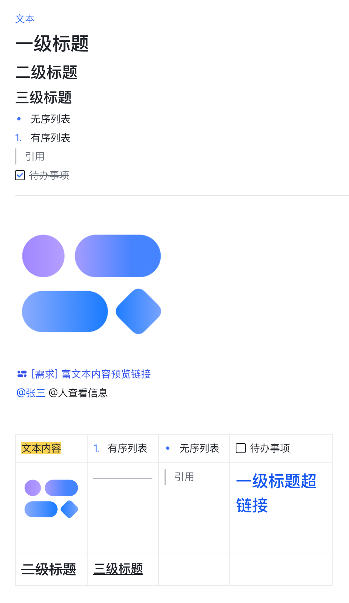

# Markdown 格式说明

<!-- capability-metadata:start -->
## 平台能力标记

> 调用频次：无直接调用频次。本页用于平台说明、格式、目录或支持信息。

<!-- capability-metadata:end -->

飞书项目 OpenAPI 可在富文本字段和评论的输入、输出中使用 Markdown，并转换为编辑器内容 `doc` 和展示内容 `doc_html`。除了通用语法，还支持人员提及、字段引用和链接预览等扩展。

各接口是否接受或返回 Markdown、对应参数名是什么，仍以接口定义为准。例如评论创建使用 `content.markdown`，查询是否返回 Markdown 由接口扩展参数控制。

**阅读导航**：[基础语法](#6cc92741) · [特殊语法](#e02417ee) · [完整示例](#4f245ffd) · [常见错误](#98a5580b)

<a id="6cc92741"></a>

## 基础语法与展示限制

| 功能 | 写法 | 限制 |
| --- | --- | --- |
| 加粗 | `**Text**` | 标题自动加粗 |
| 斜体 | `*Text*` | |
| 粗斜体 | `***Text***` | |
| 删除线 | `~~Text~~` | |
| 标题 | `#`、`##`、`###` | 四级及以下在展示态退化为普通大字号文字 |
| 无序列表 | `- Item` | 子层级缩进 4 个空格 |
| 有序列表 | `1. Item` | 子层级缩进 4 个空格 |
| 任务列表 | `- [ ] Todo`、`- [x] Done` | |
| 引用 | `> Quote` | 嵌套引用会被拉平 |
| 链接 | `[Label](https://example.com)` | |
| 图片 | `` | |
| 分割线 | `---` | |
| 表格 | GFM 表格 | 单元格默认仅放行内内容 |
| 代码块 | 三个反引号及语言名 | 行内代码不保证展示代码底色 |

<a id="e02417ee"></a>

## 特殊语法

<a id="605d0864"></a>

### 下划线

使用 `<u>` 包裹文字。**不要把 `<u>` 放进 `<span>` 内部**，否则下划线会失效。

```markdown
<u>Underlined text</u>
```

<a id="66fe8705"></a>

### 文字颜色、背景色和字号

`<span>` 只允许 `style` 属性，属性值必须加引号。颜色只接受 `rgb(R, G, B)`，不接受十六进制颜色或 `red` 等名称。

```markdown
<span style="color: rgb(245, 74, 69)">Red text</span>
<span style="background-color: rgb(53, 189, 75)">Green background</span>
<span style="font-size: 18px">Larger text</span>
```

<a id="0e67359a"></a>

### 提及人员

可见的 `@Name` 后必须紧贴 `mention` 注释，中间不能有空格；连续提及多人时，各人员片段之间也不能加空格。

| 注释字段 | 要求 |
| --- | --- |
| `id` | 必填，飞书 `lark_user_id` 或飞书项目 `user_key` |
| `cn_name` | 必填，中文名称 |
| `en_name` | 必填，英文名称 |
| `email` | 必填，邮箱 |
| `blockType` | 必填，固定为 `AT_USER_BLOCK` |

以下 JSON 注释中的 Unicode 转义表示“张三”，字段值与中文文本等义。

```markdown
@ZhangSan<!-- mention:{"id":"REPLACE_WITH_USER_ID","cn_name":"\u5f20\u4e09","en_name":"Zhang San","email":"zhangsan@example.com","blockType":"AT_USER_BLOCK"} -->
```

OpenAPI 响应或 Webhook 推送会附带 `mention_user_keys` 映射：`id` 对应 Markdown 内的提及 ID，`user_key` 对应飞书项目人员标识。下面是该字段的完整 JSON 包装示例。

```json
{
  "mention_user_keys": [
    {
      "id": "lark_user_id_7311896293000000238",
      "user_key": "731185629300000675"
    }
  ]
}
```

<a id="cc41ec1d"></a>

### 链接预览

链接后紧贴 `<!-- linkPreview -->`，中间没有空格。此扩展只对 `[Label](URL)` 生效，不适用于图片。

```markdown
[https://example.com/page](https://example.com/page)<!-- linkPreview -->
```

<a id="aa302f4e"></a>

### 对齐

开始和结束注释各自独占一行，注释与正文之间留空行。`center` 表示居中，可替换为 `right` 或 `justify`；默认左对齐，无需标记。

```markdown
<!-- center:start -->

Centered paragraph.

Another centered paragraph.

<!-- center:end -->
```

<a id="4e01e62e"></a>

### 表情

使用 `:Name:`，名称大小写不敏感，平台会归一化。

```markdown
:OK: :DONE: :SMILE: :Fire: :CheckMark:
```

<a id="7fe0535c"></a>

### 嵌套列表

每增加一级，缩进 **4 个空格**。

```markdown
1. First level
    1. Second level
        - Third level
```

<a id="646e830e"></a>

### 引用块中的复杂内容

引用内可放标题、列表等块级内容，但 `>>` 嵌套引用会被拉平成单层。

```markdown
> Context
> 1. First step
> 2. Second step
```

<a id="71bce2bd"></a>

### 表格中的复杂内容

需要在单元格内放标题、列表或代码块时，使用 HTML 表格；`<td>` 开始和结束标签与其内容之间各留一个空行。这是传给飞书项目的 Markdown 内容语法，下面用代码块展示。

```markdown
<table>
<tr>
<td>

# Cell heading

- List item

</td>
<td>

Plain text

</td>
</tr>
</table>
```

<a id="3cfa2c2d"></a>

### 动态字段引用

可见字段标记后紧贴 `mentionField` 注释。原例引用“创建者”，实际定位字段是 `field_key=owner`，不能只靠显示名称定位字段。

下例将显示名称译为 Creator；实际引用仍是 owner 字段。

```markdown
{{Creator}}<!-- mentionField:{"blockType":"field","props":{"typeKey":"field","field_key":"owner","name":"Creator"}} -->
```

<a id="4f245ffd"></a>

## 综合示例

原文效果图保留如下。其展示与下面经过校订的示例有两处差异：示例文案改为英文；原文首行把 `<u>` 嵌在 `<span>` 中，与下划线规则冲突，现拆成独立片段。



<a id="table-content-1"></a>

### 可复制的 Markdown 结构

示例中的图片 URL 为原文资源地址，提及邮箱和 ID 仍需替换为实际用户。

```markdown
<span style="color: rgb(51, 109, 244)">Colored text</span>
<u>Underlined text</u>

# Heading one
## Heading two
### Heading three

- Unordered item
1. Ordered item

> Quote

- [x] Completed item

---


[Work item](https://project.feishu.cn/tpc2hq/story/detail/7000000003)<!-- linkPreview -->

@ZhangSan<!-- mention:{"id":"lark_user_id_7310000000000008","cn_name":"\u5f20\u4e09","en_name":"Zhang San","email":"zhangsan@bytedance.com","type":0,"avatar_url":"","blockType":"AT_USER_BLOCK"} -->Please review.

<table>
<tr>
<td>

<span style="background-color: rgb(250, 211, 85)"><span style="color: rgb(51, 109, 244)">Styled text</span></span>

</td>
<td>

1. Ordered item

</td>
<td>

- Unordered item

</td>
<td>

- [ ] Todo

</td>
</tr>
<tr>
<td>


</td>
<td>

---

</td>
<td>

> Quote

</td>
<td>

# [Linked heading](https://project.feishu.cn/b/helpcenter/1p8d7djs/1tj6ggll#e01d1b22)

</td>
</tr>
<tr>
<td>

## ~~Struck heading~~

</td>
<td>

### <u>Underlined heading</u>

</td>
<td>

</td>
<td>

</td>
</tr>
</table>
```

<a id="98a5580b"></a>

## 常见错误

| 错误方式 | 正确方式 |
| --- | --- |
| `<b>Text</b>` | `**Text**` |
| `<span style="color:#ff0000">` | `<span style="color: rgb(255, 0, 0)">` |
| `<span style="color: red">` | `<span style="color: rgb(255, 0, 0)">` |
| `@Name <!-- mention:... -->` | `@Name<!-- mention:... -->` |
| `[Label](url) <!-- linkPreview -->` | `[Label](url)<!-- linkPreview -->` |
| 列表缩进 2 个空格 | 每级 4 个空格 |
| 使用 `>>` 嵌套引用 | 使用单层 `>` |
| 期待行内代码具有底色 | 需要代码样式时使用代码块 |
| 把 `<u>` 放进 `<span>` | 独立使用下划线，避免该嵌套 |

更新时间：2026-09-07
官方 URL：https://project.feishu.cn/b/helpcenter/1p8d7djs/i10jbjk4
