# 搜索参数格式及常用示例

<!-- capability-metadata:start -->
## 平台能力标记

> 调用频次：无直接调用频次。本页用于平台说明、格式、目录或支持信息。

<!-- capability-metadata:end -->

搜索条件由 `SearchGroup` 组合，组内用 `SearchParam` 指定字段、操作符和值。本篇覆盖普通字段，以及节点、节点时间、参与人员、角色、状态和模板等特殊筛选参数。

## 使用前确认

本篇对应普通搜索请求。条件视图虽然也使用筛选组合，但模板参数使用 `template` 字符串数组，而本篇使用 `template_id` 数值数组；日期参数的值格式也不同，不能直接复用同一份筛选 JSON。

**阅读导航**：[组合结构](#cc4ff848) · [固定参数](#3dc5d828) · [字段类型](#53ba11c8) · [示例](#f3102ef6)

<a id="cc4ff848"></a>

## SearchGroup 筛选组合

筛选器中一行是一个 SearchParam（图示①②③组成一个 SearchParam），一组为一个 SearchGroup（图示④），具体筛选组合的用法可参考下文示例[常用查询示例](#f3102ef6)。

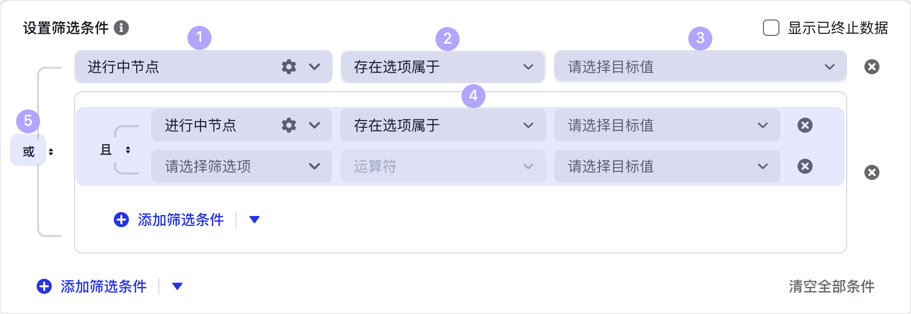

| **字段** | **类型** | **说明** |
| --- | --- | --- |
| `search_params` | `list<SearchParam>` | [筛选参数](#3ca7709a)数组；图示①②③构成一个条件，例如进行中节点、存在选项属于、待开始。 |
| `conjunction` | string | 图示⑤，枚举 AND/OR，对应筛选器中的且和或。 |
| `search_groups` | `list<SearchGroup>` | 图示④，嵌套筛选组合，由多个筛选条件组成。 |

<a id="3ca7709a"></a>

### SearchParam 筛选参数

> **说明**：筛选参数不支持字段类型为**公式计算**的字段。

| **字段** | **类型** | **说明** |
| --- | --- | --- |
| `param_key` | string | [说明](#parameter-note-1) |
| `value` | interface{} | 示图 ②，搜索字段值结构，若参数为普通字段，则 value 格式为字段值格式。若参数 key 为特殊 key，具体用法参见[固定参数及取值](#3dc5d828)。 |
| `operator` | string | 示图 ③，操作符类型，不同筛选参数支持的操作符不同，枚举可参考下文[操作符枚举值](#c9f625d4)。 |
| `pre_operator` | string | [前置操作符](#7bd4fa57)，表示每一组或存在一组，仅用于复合字段搜索。 |
| `value_search_groups` | SearchGroup | [说明](#parameter-note-2) |

<a id="parameter-note-1"></a>

**param_key：说明**

示图 ①，筛选条件可以是普通字段或一些特殊的字段（如角色和人员、进行中节点等控件）。
若筛选条件是普通字段则为字段 key（`field_key`），若为特殊字段则对应的固定参数 key。如进行中节点对应的 key 为 `current_nodes`，具体用法参见[固定参数及取值](#3dc5d828)。

<a id="parameter-note-2"></a>

**value_search_groups：说明**

出现条件：`param_key` 为**复合字段**的父字段且 `operator` 为满足/不满足。
内容：`value_search_groups` 中包含**复合字段子字段**的 `param_key`、`value`、`operator`；`value`、`operator` 跟随**复合字段子字段** `param_key`。
注意：`value_search_groups` 内部目前不支持 `pre_operator`。

<a id="c9f625d4"></a>

## 操作符枚举值

| 枚举名 | 协议值 | 含义 |
| --- | --- | --- |
| `Reg` | `~` | 匹配 |
| `NReg` | `!~` | 不匹配 |
| `Eq` | `=` | 等于 |
| `Ne` | `!=` | 不等于 |
| `Lt` | `<` | 小于 |
| `Gt` | `>` | 大于 |
| `Lte` | `<=` | 小于等于 |
| `Gte` | `>=` | 大于等于 |
| `HasAnyOf` | `HAS ANY OF` | 存在选项属于 |
| `HasNoneOf` | `HAS NONE OF` | 不存在选项属于 |
| `IsNull` | `IS NULL` | 为空 |
| `NotNull` | `IS NOT NULL` | 不为空 |
| `Contains` | `CONTAINS` | 包含 |
| `NotContains` | `NOT CONTAINS` | 不包含 |
| `Meet` | `MEET` | 满足 |
| `NotMeet` | `NOT MEET` | 不满足 |

<a id="7bd4fa57"></a>

## 前置操作符枚举值

| 枚举名 | 协议值 | 含义 |
| --- | --- | --- |
| `Every` | `EVERY` | 每一组都满足 |
| `Any` | `ANY` | 至少一组满足 |

<a id="3dc5d828"></a>

## 固定参数及取值

> **说明**：如果操作符选的是为空、不为空，不校验参数值（除流程节点时间、节点负责人、角色人员会校验参数值），只校验参数是否支持该操作符。

| **参数名** | **参数 key（`param_key`）** | **操作符可取值（`operator`）** | **参数值类型** | **参数值（`value`）** | **说明** |
| --- | --- | --- | --- | --- | --- |
| 进行中节点 | current_nodes | "="、"!="、"HAS ANY OF"、"HAS NONE OF"、"CONTAINS"、"NOT CONTAINS" | `list<string>` | 节点名称列表，可从[获取流程模板配置详情](../api/获取流程模板配置详情.md)中获取。 | [说明](#parameter-note-3) |
| 流程节点 | all_states | "="、"!="、"HAS ANY OF"、"HAS NONE OF"、"CONTAINS"、"NOT CONTAINS" | `list<string>` | 节点名称列表，可从[获取流程模板配置详情](../api/获取流程模板配置详情.md)中获取。 | [说明](#parameter-note-4) |
| 流程节点时间 | feature_state_time | "\<"、"\>"、"\<="、"\>="、"IS NULL"、"IS NOT NULL" | object | [节点时间结构](#table-content-1) | [说明](#parameter-note-5) |
| 全部人员 | people | "="、"!="、"HAS ANY OF"、"HAS NONE OF"、"IS NULL"、"IS NOT NULL"、"CONTAINS"、"NOT CONTAINS" | `list<string>` | `user_key` 列表 | [说明](#parameter-note-6) |
| 创建时间 | created_at | "="、"!="、"\<"、"\>"、"\<="、"\>=" | int64 | 毫秒时间戳，示例：1702310399000 | 毫秒时间戳 |
| 指定节点负责人 | node_owners | "="、"!="、"HAS ANY OF"、"HAS NONE OF"、"IS NULL"、"IS NOT NULL"、"CONTAINS"、"NOT CONTAINS" | `list<object>` | [节点负责人结构](#table-content-2) | [说明](#parameter-note-7) |
| 工作项 ID | work_item_id | "="、"!="、"\<"、"\>"、"\<="、"\>="、"HAS ANY OF"、"HAS NONE OF" | `list<int64>` | 工作项 ID 列表 | - |
| 工作项状态 | work_item_status | "="、"!="、"HAS ANY OF"、"HAS NONE OF" | `list<string>` | [参数值（`value`）](#parameter-note-8) | [说明](#parameter-note-9) |
| 模板 ID | template_id | "="、"!="、"HAS ANY OF"、"HAS NONE OF"、"IS NULL"、"IS NOT NULL" | `list<int64>` | 模板 ID 列表，可通过[获取工作项下的流程模板列表](../api/获取工作项下的流程模板列表.md)获取 | [说明](#parameter-note-10) |
| 业务线 | business | "="、"!="、"HAS ANY OF"、"HAS NONE OF"、"IS NULL"、"IS NOT NULL" | `list<string>` | 业务线 ID 列表，可从[获取空间下业务线详情](../api/获取空间下业务线详情.md)接口获取 | - |
| 角色人员 | role_owners | "="、"!="、"HAS ANY OF"、"HAS NONE OF"、"IS NULL"、"IS NOT NULL"、"CONTAINS"、"NOT CONTAINS" | `list<object>` | [角色人员结构](#table-content-3) | [说明](#parameter-note-11) |

<a id="parameter-note-3"></a>

**进行中节点：说明**

对应产品界面操作：


<a id="parameter-note-4"></a>

**流程节点：说明**

对应产品界面操作：
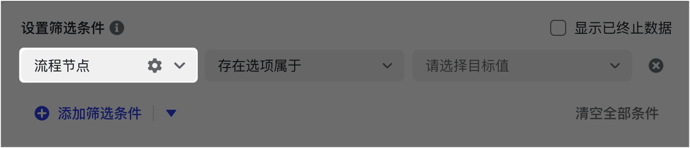

<a id="parameter-note-5"></a>

**流程节点时间：说明**

`state_name`:需要筛选的节点名称，示例："开始"。
`state_timestamp`: 需要筛选的节点时间戳，内部转成天的单位。
`state_condition`: 需要筛选的节点状态，枚举，只能选start=0，end=1。

<a id="parameter-note-6"></a>

**全部人员：说明**

对应产品界面操作：
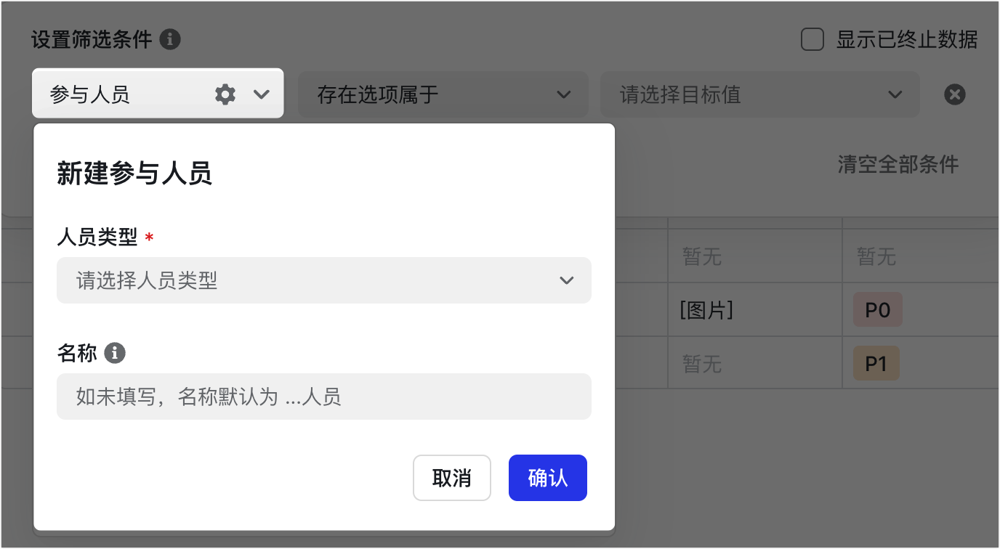

<a id="parameter-note-7"></a>

**指定节点负责人：说明**

指定节点名称和人员，多组节点之间关系用 “AND”，如果需要用“OR”，使用 group 拆分即可。
筛选时对应**参与人员**中的节点负责人：
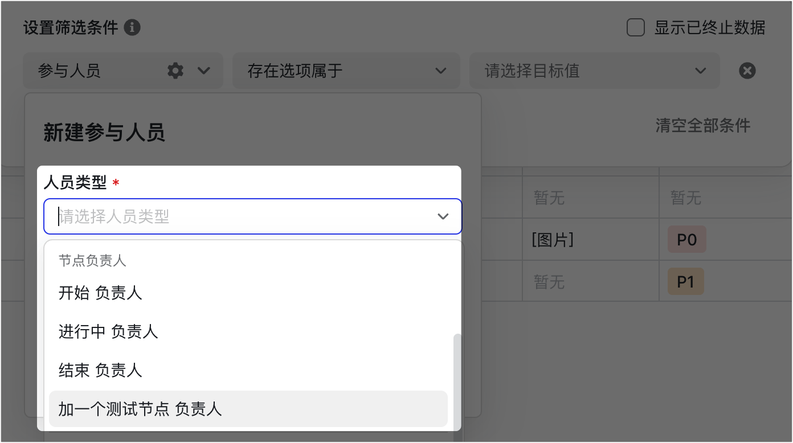

<a id="parameter-note-8"></a>

**工作项状态：参数值（`value`）**

可从以下途径获取：
1. [获取字段信息](../api/获取字段信息.md)接口中`work_item_status` 的 `options` 中获取
2. [获取创建工作项元数据](../api/获取创建工作项元数据.md)接口中的 `work_item_status` 字段的 `options` 中获取，选择对应的 `value`
> **说明**：不能同时查询“已终止”和“未终止”的工作项。

<a id="parameter-note-9"></a>

**工作项状态：说明**

在筛选已终止的工作项时，请注意：
- 若使用 `=` 或 `HAS ANY OF` 操作符，您需要在 `value` 中传入 `closed`（节点流）/`systemEnded`（状态流）。
- 若使用 `!=` 或 `HAS NONE OF` 操作符，则无需传入 `closed`（节点流）/`systemEnded`（状态流），因为系统默认会排除已终止的需求。
需求状态：
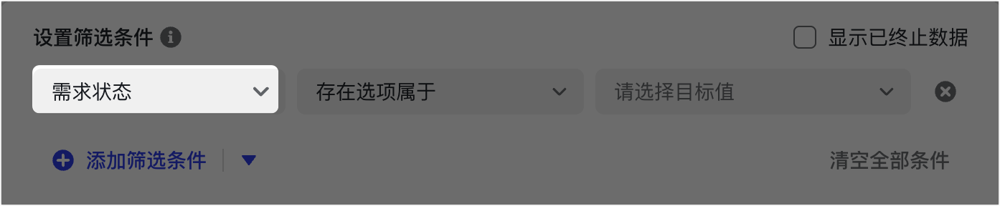
其他工作项状态：
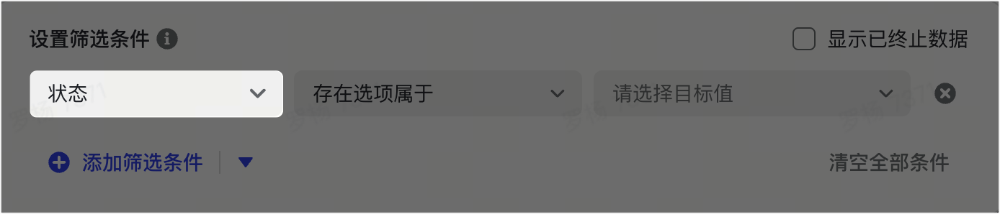

<a id="parameter-note-10"></a>

**模板 ID：说明**

对应产品界面操作：
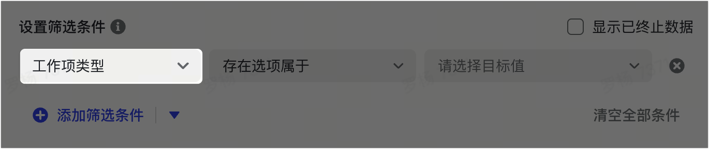

<a id="parameter-note-11"></a>

**角色人员：说明**

指定角色和人员，多个角色之间关系用 “AND”，如果需要用“OR”，使用 group 拆分即可。
对应产品界面操作：
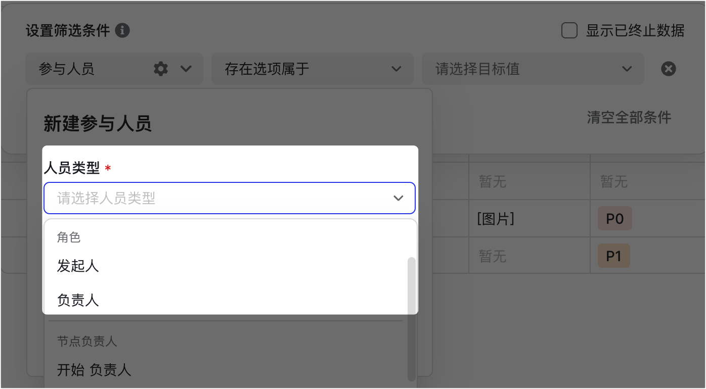

<a id="table-content-1"></a>

### 流程节点时间对象

参数示例：

```json
{
  "state_name": "Android\u5f00\u53d1\u4f30\u5206",
  "state_timestamp": 1702310399000,
  "state_condition": 1
}
```

<a id="table-content-2"></a>

### 节点负责人数组

```json
[
  {
    "state_name": "\u8282\u70b9\u540d\u79f0",
    "owners": [
      "user_key"
    ]
  }
]
```

<a id="table-content-3"></a>

### 角色人员数组

```json
[
  {
    "role": "role_id",
    "owners": [
      "user_key"
    ]
  }
]
```

<a id="53ba11c8"></a>

## 自定义类型及取值

若筛选条件是普通字段则 `param_key` 为字段 key（`field_key` ），value 为该字段值的格式。如筛选工作项名称中包含“重点”二字。则 `param_key` 为 name（系统字段的字段 key），操作符为 "~"。

> 如果操作符选的是为空/不为空，不校验字段值，只校验当前字段类型是否支持该操作符

| 参数类型 | 原文字段类型 Key | 支持操作符 | 值类型 | 说明 |
| --- | --- | --- | --- | --- |
| 单行或多行文本 | `text` | `~`、`!~`、`=`、`!=`、`IS NULL`、`IS NOT NULL` | `string` | 前后模糊匹配 |
| 数字 | `number` | `=`、`!=`、`<`、`>`、`<=`、`>=`、`IS NULL`、`IS NOT NULL` | `float64` | 数值比较 |
| 链接 | `link` | `~`、`!~`、`=`、`!=`、`IS NULL`、`IS NOT NULL` | `string` | 匹配链接字符串 |
| 开关 | `bool` | `=`、`!=`、`IS NULL`、`IS NOT NULL` | `bool` | 搜索空值使用 `IS NULL` |
| 单值系统外信号 | `signal` | `=`、`!=`、`HAS ANY OF`、`HAS NONE OF` | `list<string>` | 取值含义见下文 |
| 单选 | `select` | `=`、`!=`、`HAS ANY OF`、`HAS NONE OF`、`IS NULL`、`IS NOT NULL` | `list<string>` | 选项 value 列表 |
| 单选按钮 | `radio` | `=`、`!=`、`HAS ANY OF`、`HAS NONE OF`、`IS NULL`、`IS NOT NULL` | `list<string>` | 选项 value 列表 |
| 多选 | `multi-select` | `=`、`!=`、`HAS ANY OF`、`HAS NONE OF`、`IS NULL`、`IS NOT NULL`、`CONTAINS`、`NOT CONTAINS` | `list<string>` | 选项 value 列表 |
| 级联单选 | `tree-select` | `=`、`!=`、`HAS ANY OF`、`HAS NONE OF`、`IS NULL`、`IS NOT NULL` | `list<string>` | 选项 value 列表 |
| 级联多选 | `tree-multi-select` | `=`、`!=`、`HAS ANY OF`、`HAS NONE OF`、`IS NULL`、`IS NOT NULL` | `list<string>` | 选项 value 列表 |
| 单选人员 | `user` | `=`、`!=`、`HAS ANY OF`、`HAS NONE OF`、`IS NULL`、`IS NOT NULL` | `list<string>` | user_key 列表 |
| 多选人员 | `multi-user` | `=`、`!=`、`HAS ANY OF`、`HAS NONE OF`、`IS NULL`、`IS NOT NULL`、`CONTAINS`、`NOT CONTAINS` | `list<string>` | user_key 列表 |
| 富文本 | `multi-text` | `~`、`!~`、`IS NULL`、`IS NOT NULL` | `string` | 只匹配去掉格式后的值 |
| 单选关联工作项 | `workitem_related_select` | `=`、`!=`、`HAS ANY OF`、`HAS NONE OF`、`IS NULL`、`IS NOT NULL` | `list<int64>` | 关联工作项 ID 列表 |
| 多选关联工作项 | `workitem_related_multi_select` | `=`、`!=`、`HAS ANY OF`、`HAS NONE OF`、`IS NULL`、`IS NOT NULL`、`CONTAINS`、`NOT CONTAINS` | `list<int64>` | 关联工作项 ID 列表 |
| 日期时间 | `precise_date` | `<`、`>`、`<=`、`>=`、`IS NULL`、`IS NOT NULL` | `int64` | 毫秒时间戳 |
| 日期 | `date` | `<`、`>`、`<=`、`>=`、`IS NULL`、`IS NOT NULL` | `int64` | 毫秒时间戳 |
| 复合父字段 | `compound_field` | `IS NULL`、`IS NOT NULL`、`MEET`、`NOT MEET` | 由操作方式决定 | 子字段条件用 value_search_groups |
| 复合子字段 | 除复合类型外的本表类型 | 按子字段类型 | 按子字段类型 | 前置操作符位置见下文 |
| 电话号码 | `telephone` | `~`、`!~`、`=`、`!=`、`IS NULL`、`IS NOT NULL` | `string` | 包含或不包含、等于或不等于、为空或不为空 |
| 电子邮件 | `email` | `~`、`!~`、`=`、`!=`、`IS NULL`、`IS NOT NULL` | `string` | 包含或不包含、等于或不等于、为空或不为空 |

选项筛选提交 `value`，而非 `label`。可通过[获取字段信息](../api/获取字段信息.md)查询选项值，也可在字段配置的选项设置中查看 ID。

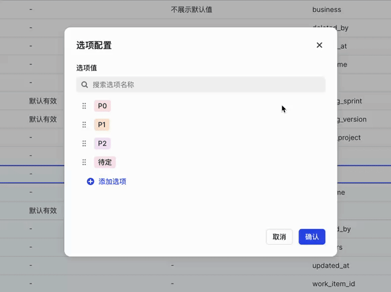

信号值必须是字符串：`"undefined"` 暂无信息，`"null"` 进行中，`"false"` 未通过，`"true"` 已通过。

日期区间筛选需要为同一字段提交上下界两条条件，并用 `AND` 组合；搜索接口的日期与日期时间使用 `int64` 数值，注意与条件视图的带时区字符串规则区分。

复合父字段的 `IS NULL`、`IS NOT NULL` 检查整个复合数据是否为空。使用 `MEET`、`NOT MEET` 时，同时填写 `pre_operator` 和 `value_search_groups`，子字段条件按自身类型解释。直接作为 SearchParam 使用复合子字段时可以填 `pre_operator`；位于 `value_search_groups` 内时不能再填。原引用见[SearchParam 筛选参数](#3ca7709a)。

<a id="f3102ef6"></a>

## 常用查询示例

<a id="b9b005dd"></a>

### 查询需求下指定状态，且创建时间在某个区间的工作项列表

```json
{
  "page_size": 50,
  "page_num": 1,
  "search_group": {
    "conjunction": "AND",
    "search_params": [
      {
        "param_key": "created_at",
        "value": 1654063482000,
        "operator": ">"
      },
      {
        "param_key": "created_at",
        "value": 1654064482000,
        "operator": "<"
      },
      {
        "param_key": "work_item_status",
        "value": [
          "start"
        ],
        "operator": "="
      }
    ]
  }
}
```

<a id="b3eff96d"></a>

### 查询需求下包含指定人员的所有工作项

```json
{
  "page_size": 50,
  "page_num": 1,
  "search_group": {
    "conjunction": "AND",
    "search_params": [
      {
        "param_key": "people",
        "value": [
          "XXX"
        ],
        "operator": "HAS ANY OF"
      }
    ]
  }
}
```

<a id="cf36083b"></a>

### 通过需求 ID 查询指定的需求

```json
{
  "page_size": 50,
  "page_num": 1,
  "search_group": {
    "conjunction": "AND",
    "search_params": [
      {
        "param_key": "work_item_id",
        "value": [
          12345,
          45678
        ],
        "operator": "HAS ANY OF"
      }
    ]
  }
}
```

<a id="4f4eef72"></a>

### 查询一个需求下关联的所有缺陷（使用_field_linked_story），路径参数的工作项类型需指定缺陷

```json
{
  "page_size": 50,
  "page_num": 1,
  "search_group": {
    "conjunction": "AND",
    "search_params": [
      {
        "param_key": "_field_linked_story",
        "value": [
          12345
        ],
        "operator": "="
      }
    ]
  }
}
```

<a id="60e17d08"></a>

### 查询一段时间内更新的工作项

```json
{
  "page_size": 50,
  "page_num": 1,
  "search_group": {
    "conjunction": "AND",
    "search_params": [
      {
        "param_key": "updated_at",
        "value": 1654064482000,
        "operator": ">"
      },
      {
        "param_key": "updated_at",
        "value": 1657064482000,
        "operator": "<"
      }
    ]
  }
}
```

<a id="9c23bbfa"></a>

### 查询角色 A 存在指定人员且角色 B 存在指定人员的工作项

```json
{
  "search_group": {
    "conjunction": "AND",
    "search_params": [
      {
        "param_key": "role_owners",
        "value": [
          {
            "role": "A",
            "owners": [
              "XXX"
            ]
          },
          {
            "role": "B",
            "owners": [
              "XXX"
            ]
          }
        ],
        "operator": "HAS ANY OF"
      }
    ]
  }
}
```

<a id="ce9ef86b"></a>

### 查询“开始”节点存在指定负责人，且“进行中”节点存在指定负责人的工作项

```json
{
  "search_group": {
    "conjunction": "AND",
    "search_params": [
      {
        "param_key": "node_owners",
        "value": [
          {
            "state_name": "\u5f00\u59cb",
            "owners": [
              "XXX"
            ]
          },
          {
            "state_name": "\u8fdb\u884c\u4e2d",
            "owners": [
              "XXX"
            ]
          }
        ],
        "operator": "HAS ANY OF"
      }
    ]
  }
}
```

<a id="b2d3c51f"></a>

### 查询使用了某个 template 的工作项

```json
{
  "search_group": {
    "conjunction": "AND",
    "search_params": [
      {
        "param_key": "template_id",
        "value": [
          123,
          456
        ],
        "operator": "HAS ANY OF"
      }
    ]
  }
}
```

<a id="2a11a9f8"></a>

### 查询除了终止和结束状态的需求（终止状态默认不返回，所以不需要传 closed）

```json
{
  "search_group": {
    "conjunction": "AND",
    "search_params": [
      {
        "param_key": "work_item_status",
        "value": [
          "end"
        ],
        "operator": "!="
      }
    ]
  }
}
```

<a id="14441b5b"></a>

### 查询（不存在优先级属于P2，或者业务线等于某个值且 PM 角色人员为指定人员）的工作项

```json
{
  "search_group": {
    "conjunction": "OR",
    "search_params": [
      {
        "param_key": "priority",
        "value": [
          "2"
        ],
        "operator": "HAS NONE OF"
      }
    ],
    "search_groups": [
      {
        "conjunction": "AND",
        "search_params": [
          {
            "param_key": "business",
            "value": [
              "xxx"
            ],
            "operator": "="
          },
          {
            "param_key": "role_owners",
            "value": [
              {
                "role": "pm",
                "owners": [
                  "xxx"
                ]
              }
            ],
            "operator": "="
          }
        ]
      }
    ]
  }
}
```

<a id="5a9addb5"></a>

### 查询提出时间大于等于且小于等于某时间范围，或更新时间大于等于且小于等于某时间范围

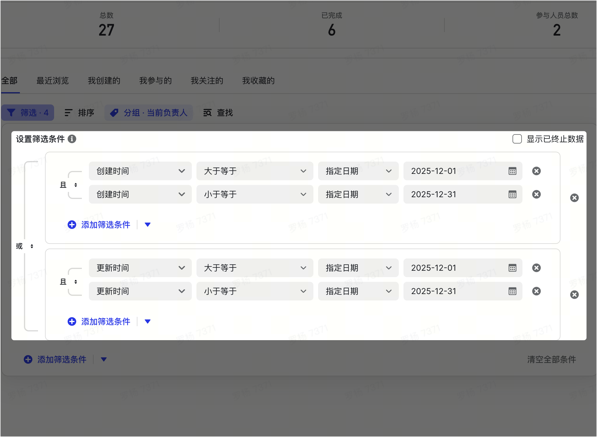

### 对应筛选 JSON 格式

```json
{
  "search_group": {
    "conjunction": "OR",
    "search_groups": [
      {
        "conjunction": "AND",
        "search_params": [
          {
            "param_key": "start_time",
            "value": 1696089600000,
            "operator": ">="
          },
          {
            "param_key": "start_time",
            "value": 1698767999000,
            "operator": "<="
          }
        ]
      },
      {
        "conjunction": "AND",
        "search_params": [
          {
            "param_key": "updated_at",
            "value": 1696089600000,
            "operator": ">="
          },
          {
            "param_key": "updated_at",
            "value": 1698767999000,
            "operator": "<="
          }
        ]
      }
    ]
  }
}
```

<a id="cf7378cc"></a>

### 筛选条件包含多层筛选组

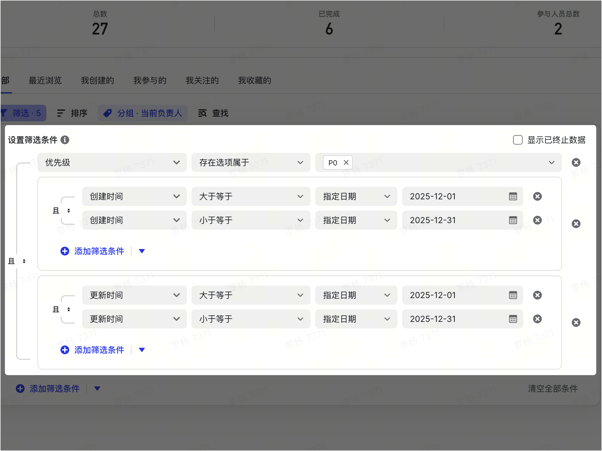

### 对应筛选参数的格式

```json
{
  "search_group": {
    "conjunction": "AND",
    "search_params": [
      {
        "param_key": "priority",
        "value": [
          "2"
        ],
        "operator": "HAS NONE OF"
      }
    ],
    "search_groups": [
      {
        "conjunction": "AND",
        "search_params": [
          {
            "param_key": "start_time",
            "value": 1696089600000,
            "operator": ">="
          },
          {
            "param_key": "start_time",
            "value": 1698767999000,
            "operator": "<="
          }
        ]
      },
      {
        "conjunction": "AND",
        "search_params": [
          {
            "param_key": "updated_at",
            "value": 1696089600000,
            "operator": ">="
          },
          {
            "param_key": "updated_at",
            "value": 1698767999000,
            "operator": "<="
          }
        ]
      }
    ]
  }
}
```

<a id="7c858290"></a>

### 筛选流程节点时间

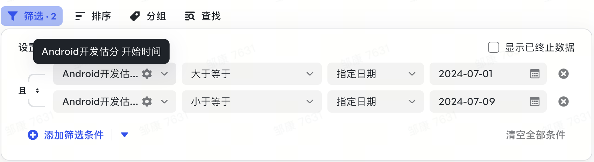

调用示例：

```json
{
  "search_group": {
    "conjunction": "AND",
    "search_params": [
      {
        "param_key": "feature_state_time",
        "value": {
          "state_name": "ANDroid\u5f00\u53d1\u4f30\u5206",
          "state_timestamp": 1701792000000,
          "state_condition": 0
        },
        "operator": ">="
      },
      {
        "param_key": "feature_state_time",
        "value": {
          "state_name": "ANDroid\u5f00\u53d1\u4f30\u5206",
          "state_timestamp": 1702310399000,
          "state_condition": 1
        },
        "operator": "<="
      }
    ]
  }
}
```

<a id="c82f1273"></a>

### 按创建者搜索工作项

1. 通过 [获取字段信息](../api/获取字段信息.md) API，获取到创建者的 **field_key** (字段 ID)。

2. 搜索结构体参考以下格式调整：

```json
{
  "search_group": {
    "conjunction": "AND",
    "search_params": [
      {
        "param_key": "owner",
        "value": [
          "xxxxxx"
        ],
        "operator": "HAS ANY OF"
      }
    ]
  }
}
```

<a id="eea23fbd"></a>

### 根据"需求/工作项状态"筛选

```json
{
  "search_group": {
    "conjunction": "AND",
    "search_params": [
      {
        "param_key": "work_item_status",
        "value": [
          "started"
        ],
        "operator": "HAS ANY OF"
      }
    ]
  }
}
```

<a id="e2382e3a"></a>

### 复合字段数据为空

```json
{
  "page_size": 50,
  "page_num": 1,
  "search_group": {
    "conjunction": "AND",
    "search_params": [
      {
        "param_key": "field_xxxxxx",
        "operator": "IS NULL"
      }
    ]
  }
}
```

<a id="62471d6c"></a>

### 复合字段数据 每一组文本子字段都等于1

```json
{
  "page_size": 50,
  "page_num": 1,
  "search_group": {
    "conjunction": "AND",
    "search_params": [
      {
        "param_key": "field_xxxxxx",
        "operator": "MEET",
        "pre_operator": "EVERY",
        "value_search_groups": {
          "conjunction": "AND",
          "search_params": [
            {
              "param_key": "field_xxxxxx",
              "operator": "=",
              "value": "1"
            }
          ]
        }
      }
    ]
  }
}
```

或

```json
{
  "page_size": 50,
  "page_num": 1,
  "search_group": {
    "conjunction": "AND",
    "search_params": [
      {
        "param_key": "field_4396f8",
        "operator": "=",
        "pre_operator": "EVERY",
        "value": "1"
      }
    ]
  }
}
```

<a id="0932acb8"></a>

### 复合字段数据存在一组文本子字段等于1

```json
{
  "page_size": 50,
  "page_num": 1,
  "search_group": {
    "conjunction": "AND",
    "search_params": [
      {
        "param_key": "field_ba8f2e",
        "operator": "MEET",
        "pre_operator": "ANY",
        "value_search_groups": {
          "conjunction": "AND",
          "search_params": [
            {
              "param_key": "field_4396f8",
              "operator": "=",
              "value": "1"
            }
          ]
        }
      }
    ]
  }
}
```

或

```json
{
  "page_size": 50,
  "page_num": 1,
  "search_group": {
    "conjunction": "AND",
    "search_params": [
      {
        "param_key": "field_4396f8",
        "operator": "=",
        "pre_operator": "ANY",
        "value": "1"
      }
    ]
  }
}
```

更新时间：2026-09-07
官方 URL：https://project.feishu.cn/b/helpcenter/1p8d7djs/1l8il0l6
