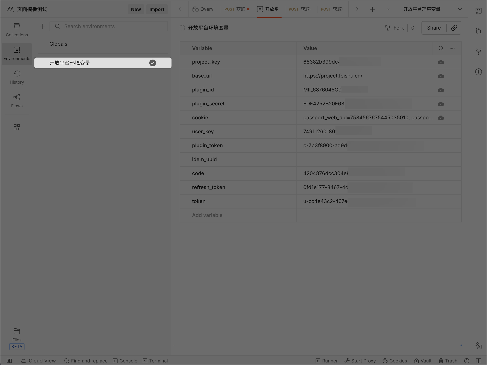
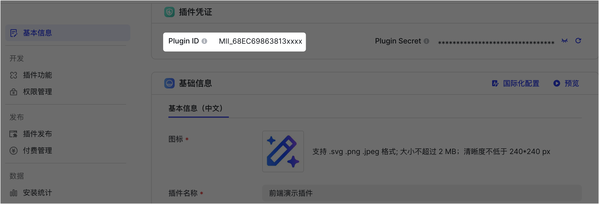
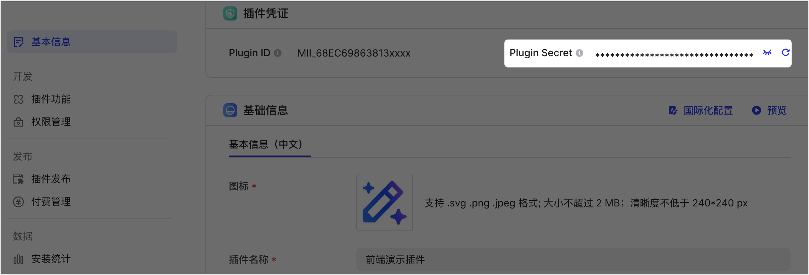
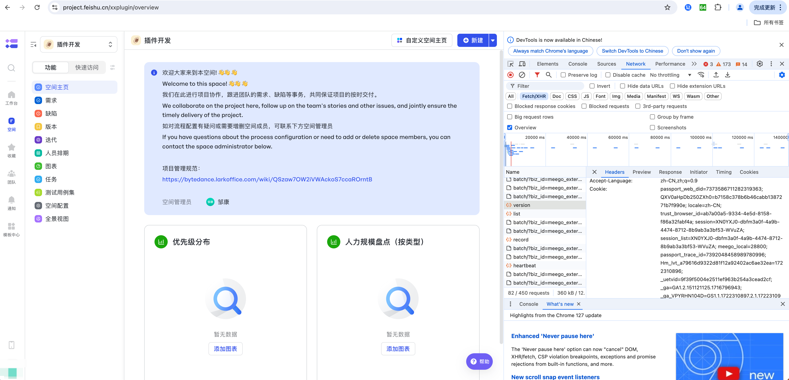
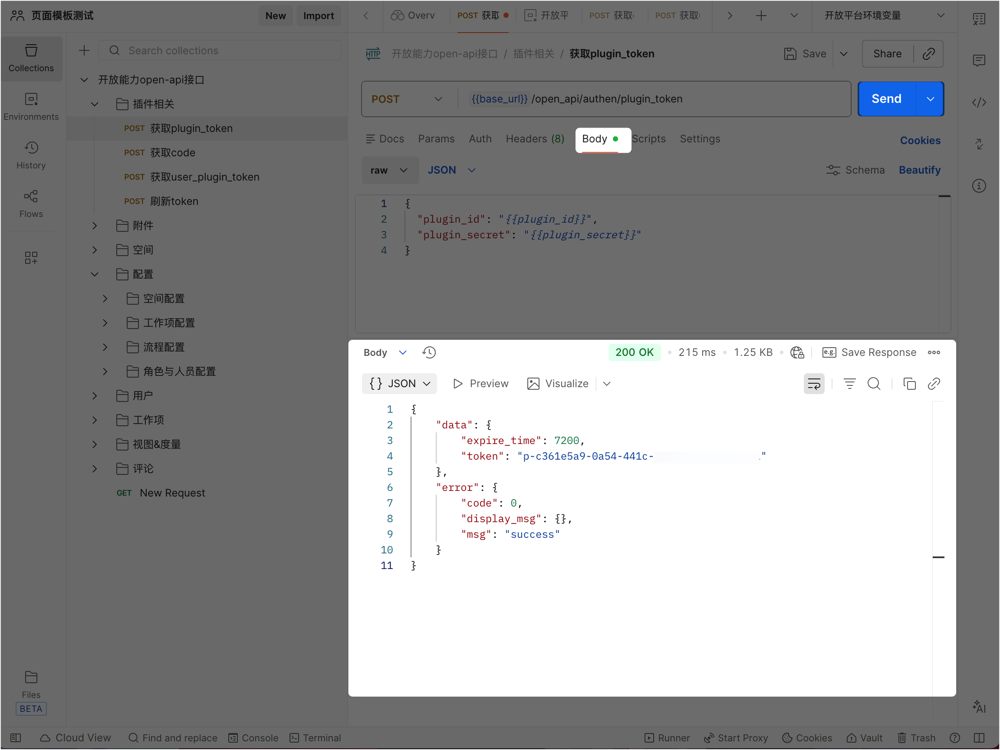
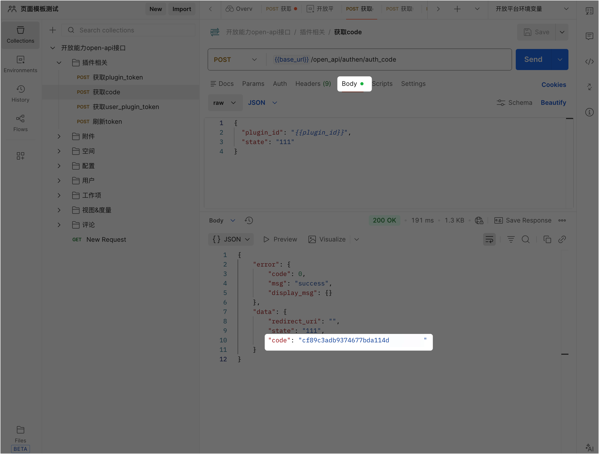
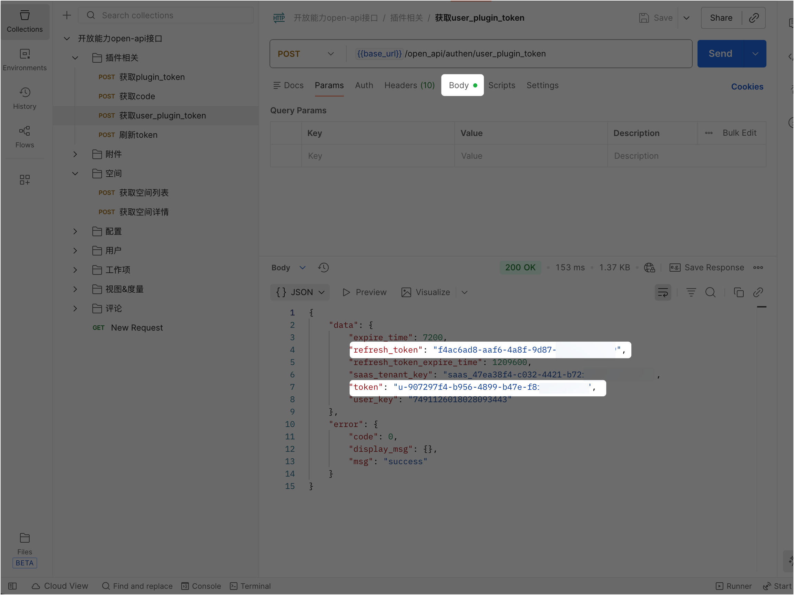
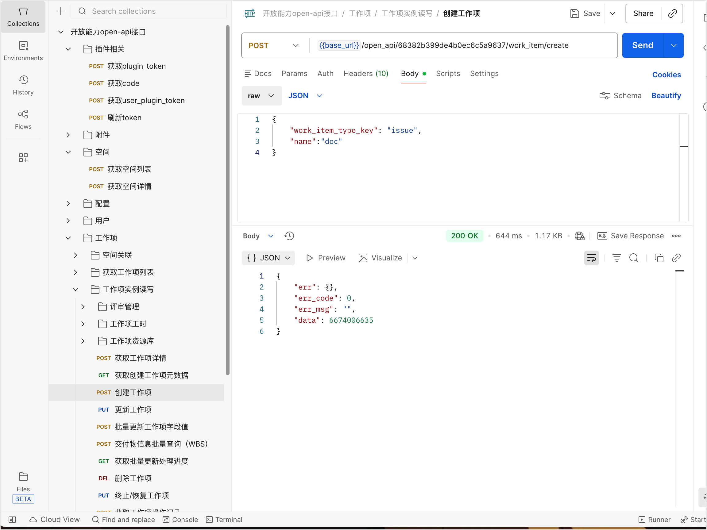
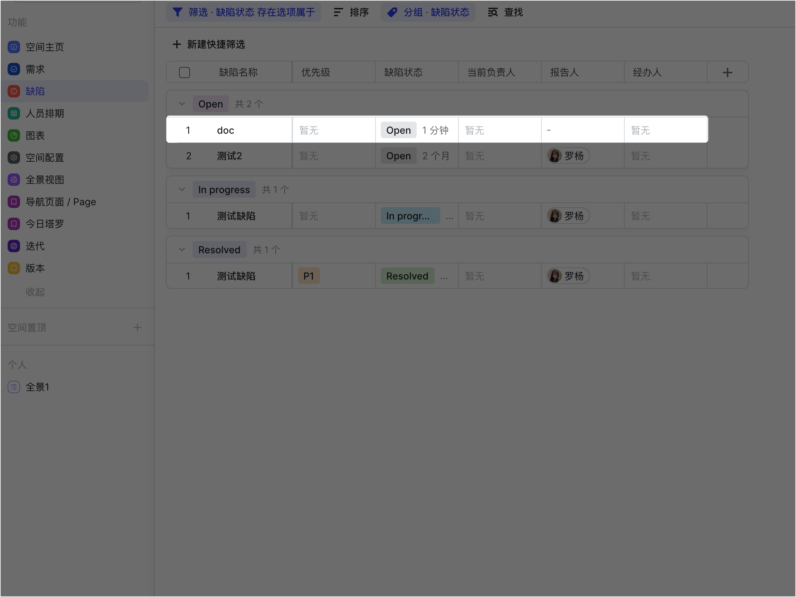

# 使用 postman 调用 API 接口

<!-- capability-metadata:start -->
## 平台能力标记

> 调用频次：无直接调用频次。本页用于平台说明、格式、目录或支持信息。

<!-- capability-metadata:end -->

官方 Postman 模板包含环境变量和 API 请求集合，可用于检查凭证、权限和业务参数。本篇以创建需求工作项为例，说明从导入模板到核对结果的完整过程。

本篇同时核对了随原文下载的模板：正文中的 `base url` 实际对应模板键 `base_url`；业务请求引用的是 `plugin_token`，仅填写另一个 `token` 变量不会自动切换请求身份。

**阅读导航**：[准备与导入](#import) · [环境变量](#environment) · [插件凭证](#plugin-identity) · [用户凭证](#user-identity) · [创建工作项](#create-work-item) · [排查](#troubleshooting)

## 前提条件

- 已在开放平台[创建插件](https://project.feishu.cn/b/helpcenter/1p8d7djs/49k1ojm9)。
- 已申请目标接口权限，并满足当前调试或正式安装场景的授权条件，见[权限管理](权限管理.md)。
- 已安装 [Postman](https://www.postman.com/downloads/)。

## 导入环境与请求集合

1. 打开[本地官方 Postman 模板 ZIP](../assets/88e7ebbf71bd8732dff6.zip)，解压到本地。
2. 在 Postman 中创建一个 Workspace。
3. 导入后缀为 `.postman_environment.json` 的环境文件。
4. 导入后缀为 `.postman_collection.json` 的请求集合。

ZIP 内还包含 macOS 生成的 `.DS_Store` 和 `__MACOSX` 文件，这些不是 Postman 配置，不需要导入。环境和请求集合都要导入，仅导入请求集合不会自动提供其引用的变量值。

## 配置环境变量

在 “Environments” 中打开“开放平台环境变量”，填写并保存后，将其选为当前请求使用的环境。

### 首次调用前填写

| 模板中的键 | 含义 | 获取或填写方式 |
| --- | --- | --- |
| `project_key` | 空间标识 | 在飞书项目空间双击空间图标获取 |
| `base_url` | 带协议的飞书项目服务地址 | 例如 `https://project.feishu.cn`；模板在其后拼接 `/open_api/...`，不必再添加尾斜杠 |
| `plugin_id` | 插件 ID | 插件详情的“基本信息”页 |
| `plugin_secret` | 插件密钥 | 插件详情的“基本信息”页 |
| `user_key` | 调用用户的标识 | 悬停用户头像，待信息浮框出现后单击浮框中的头像获取 |
| `cookie` | 模板调试取 code 所需的登录 Cookie | 按原文，在开放平台调试时从浏览器 Network 的请求头中获取；会过期，不适用于长期运行 |

`user_key` 是用户标识，原文表格称其为“用户密钥”，容易与 `plugin_secret` 混淆。它们分别用于指定用户与证明插件身份，不能互换。

### 调用过程中产生的变量

| 模板中的键 | 用途 | 本地模板核对结果 |
| --- | --- | --- |
| `plugin_token` | 保存后续请求引用的插件凭证 | 业务请求的 `X-Plugin-Token` 使用该变量 |
| `code` | 保存授权码 | 用户凭证交换请求引用该变量 |
| `refresh_token` | 保存用户刷新凭证 | 刷新请求引用该变量 |
| `idem_uuid` | 预留的幂等值 | 环境文件中存在，但当前请求集合未引用 |
| `token` | 环境文件中的另一个凭证键 | 环境文件中存在，但当前请求集合未引用 |

上表是对本地 ZIP 的检查结果。判断请求到底使用哪个凭证，应打开该请求的 Headers 查看变量引用，不能只依据环境变量的名称。

## 选择调用身份

| 方式 | 适用场景 | 注意事项 |
| --- | --- | --- |
| 插件凭证 | 多数服务端 OpenAPI 调用 | 通常配合 `X-User-Key`；部分用户组接口不接受插件凭证 |
| 用户凭证 | 代表获得授权的用户调用 | 用户身份包含在凭证中；仍需满足插件权限和资源权限要求 |

原文概括为用户凭证可调用全部 OpenAPI，插件凭证不能调用部分用户组或用户更新接口。实际使用应核对具体接口的凭证要求，不能把该概括理解为已经获得全部接口权限。

## 获取插件凭证

1. 在集合中打开“获取 plugin_token”请求。
2. 查看 Body，确认 `plugin_id`、`plugin_secret` 已引用正确的环境变量。
3. 若要获取虚拟调试凭证，在请求体中增加 `"type": 1`；默认获取正式插件凭证。
4. 发送请求，检查返回结果。
5. 选中响应中 `data.token` 的值，保存到当前环境的 `plugin_token`。

原文使用右键菜单 “Set → 开放平台环境变量 → plugin_token” 保存值。不同 Postman 版本的菜单位置可能不同，也可直接在当前环境中填写变量。

凭证接口定义、`type` 的取值与开发数据范围见[获取插件凭证](获取访问凭证.md#plugin-token)。

## 获取用户凭证

### 使用模板完成一次调试交换

1. 先获取插件凭证，并确保用户凭证交换请求的 `X-Plugin-Token` 引用该插件凭证。
2. 填写当前有效的 `cookie` 环境变量。
3. 打开模板中的“获取 code”请求，检查 Body 后发送，将返回的 code 保存到环境变量 `code`。
4. 打开“获取 user_plugin_token”请求，检查 code 与 `grant_type` 后发送。
5. 保存响应中的用户凭证和 `refresh_token`，并确认后续业务请求实际引用的是用户凭证。

### 对齐响应字段和请求头

原文使用 `user_plugin_token` 描述用户凭证，但[凭证接口文档](获取访问凭证.md#user-token)中的响应字段是 `data.token`。应读取接口实际返回的字段，不要凭名称猜测响应结构。

模板业务请求默认引用 `{{plugin_token}}`。若需要同时保留两种身份，建议新增环境变量 `user_access_token` 保存用户凭证，并将**需要用户身份的业务请求**的 `X-Plugin-Token` 改为 `{{user_access_token}}`。交换用户凭证的请求仍应引用插件凭证，避免混用。

### 调试流程与正式接入的区别

模板中的取 code 请求使用 Cookie，适合原文描述的临时调试。正式插件 2.0 通过 `window.JSSDK.utils.getAuthCode()` 获取授权码，再由自己的服务端交换凭证。授权码有效期为 5 分钟且只可使用一次，见[用户凭证获取流程](获取访问凭证.md#user-token)。

## 调用创建工作项接口

以下过程会在目标空间创建实际工作项。先确认当前环境指向计划使用的空间，再发送请求。

1. **确定空间。** 核对环境中的 `project_key`。
2. **确定类型。** 调用[获取空间下工作项类型](../api/获取空间下工作项类型.md)，取得 `work_item_type_key`。原文演示的是需求类型 `story`，实际值以空间配置为准。
3. **填写创建信息。** 打开[创建工作项](../api/创建工作项.md)请求，按接口定义填写类型、名称及其他必填字段。
4. **发送并检查响应。** 核对返回的业务错误码和工作项标识。
5. **在平台核对。** 打开同一空间，确认工作项已创建且字段符合请求内容。

## 配置不生效时先检查什么

| 现象 | 优先核对 |
| --- | --- |
| URL 中仍出现变量占位符 | 当前是否选中了导入的环境；实际键是否为 `base_url`、`project_key` |
| 更新凭证后调用身份未变化 | 请求头引用的是 `plugin_token`、自建的用户凭证变量，还是硬编码值 |
| code 获取或交换失败 | Cookie 是否仍有效；code 是否已过期或已经使用 |
| 有 Token 但出现权限错误 | 插件接口权限、目标空间安装版本、调试数据范围与操作者权限 |
| 响应成功但找不到创建结果 | 查询的空间、工作项类型与请求环境是否一致 |

这些检查是根据本篇流程和本地模板整理的排查顺序；具体业务错误仍应查[错误码排查](../support/OpenAPI错误码排查.md)。

更新时间：2026-09-07
官方 URL：https://project.feishu.cn/b/helpcenter/1p8d7djs/5kwry3yy
