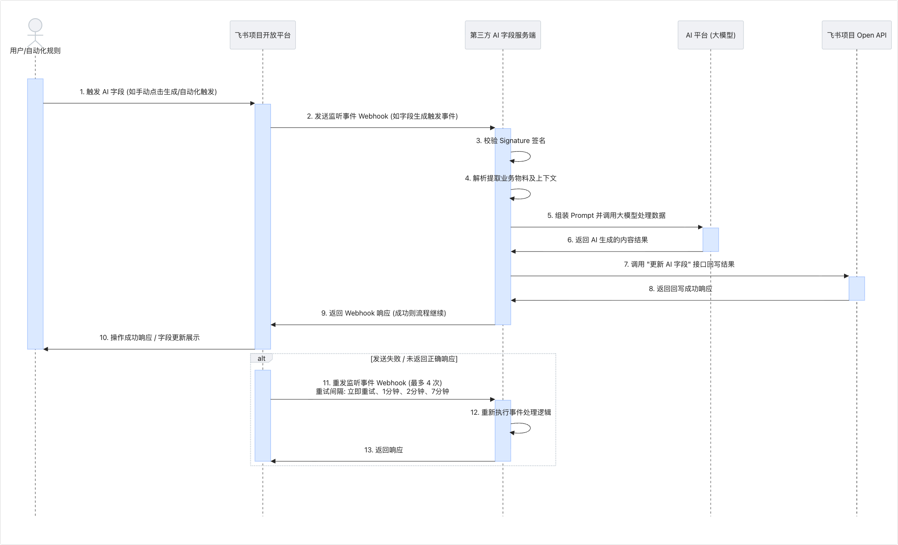

# AI 字段事件说明

AI 字段应用通过 Webhook 接收正式计算与配置预览事件。服务端验签后，从事件上下文提取输入，异步执行计算，再将结果回写到事件对应的 AI 任务。

**事件速查**：`8101` 为正式计算，`8102` 为配置预览；两者的数据结构一致，触发场景不同。

<a id="6f314bae"></a>

## 订阅、响应与结果回写

创建 AI 字段应用并配置 Webhook 地址后，平台自动订阅这两种事件，无需额外逐项订阅。

1. **校验签名。** 使用配置的回调 token 校验请求中的 `signature`，规则见[事件验签](../events/事件兼容性与验签.md)。
2. **及时确认接收。** 在 `1000 ms` 内返回 HTTP `200`；响应结构不限。原文说明未响应时会重发 4 次，本页未给出具体重试间隔。
3. **提取输入。** 按事件类型读取 `field_ai_entity.reference_changed` 与 `custom_property`，取得依赖字段和自定义属性。
4. **执行并回写。** 完成后调用[更新 AI 字段](更新AI字段.md)，传入本次任务 ID 和字段值。

事件重发可能导致重复消费。`data.idempotent_key` 用于消费端的幂等处理；`field_ai_entity.task_id` 用于定位计算任务，二者用途不同。

<a id="0a4fbebc"></a>

## 监听流程



快速返回 HTTP 200 表示确认收到事件，不代表已经计算完成；实际结果通过 OpenAPI 回写。

<a id="0fe95628"></a>

## 公共事件外层

| 字段 | 原文类型 | 含义 |
| --- | --- | --- |
| `log_id` | `String` | 推送日志标识，用于排查 |
| `source_plugin_version` | `String` | AI 字段应用版本 |
| `request_time` | `Number` | 请求生成的毫秒级时间戳 |
| `signature` | `String` | 回调签名 |
| `source` | `String` | 事件来源，取值见下表 |
| `source_plugin_id` | `String` | 触发事件的 AI 插件应用 ID |
| `source_plugin_name` | `String` | 触发事件的 AI 插件应用名称 |
| `data` | `Object` | 具体业务上下文 |

### source 枚举

| 值 | 来源 |
| --- | --- |
| `normal` | 普通用户操作 |
| `openapi` | OpenAPI 调用 |
| `system` | 系统内部行为 |
| `automation` | 自动化规则 |

### data 中的标识与上下文

原文只为公共外层提供了独立参数表。下列业务字段根据两个完整示例及其注释整理，不补造必填标记或未列出的枚举。

| 字段 | 示例所表达的用途 |
| --- | --- |
| `event_type` | 事件类型，`8101` 或 `8102` |
| `idempotent_key` | 事件幂等标识 |
| `project_name`、`project_key` | 空间名称与标识 |
| `tenant_id` | 租户标识 |
| `flow_type` | 流程类型，示例为 `0`；本页未定义完整枚举 |
| `work_item_type_key` | 工作项类型 |
| `link_work_item_type_key` | 示例包含的关联类型字段，值为空字符串；本页未详细定义 |
| `user_info` | 触发事件的用户，含 `user_key`、`name_cn`、`name_en`、`email` |
| `work_item_info` | 工作项列表，元素含 `work_item_id`、`work_item_type_key` |
| `field_ai_entity` | AI 字段任务的核心上下文，见下节 |

## field_ai_entity：计算输入与任务标识

| 字段 | 含义 |
| --- | --- |
| `field_name`、`field_key` | 当前触发计算的 AI 字段名称和键 |
| `field_value`、`field_type` | 当前字段值与类型 |
| `internal`、`updated_at` | 示例包含的字段属性；本页未进一步说明其业务规则 |
| `reference_changed` | 依赖字段的变更，按依赖字段 key 组织 |
| `task_id` | 本次 AI 计算任务 ID，回写时使用 |
| `custom_property` | 管理员配置的自定义属性列表，如提示词或模型参数 |

### 依赖字段变更

`reference_changed` 中每个依赖字段包含 `before` 与 `after`。示例中 `before` 可以为 `null`，`after` 记录字段的 `field_value`、`field_key`、`field_type`、`field_name`、`internal`、`updated_at`。

富文本依赖的 `field_value` 在原例中是**包含 JSON 内容的字符串**，不是直接嵌入的对象。字段解析需对照[字段与属性格式](../formats/字段与属性解析格式.md)，不能对所有类型执行同一种字符串转换。

### 自定义属性

每个 `custom_property` 元素包含 `key`、`value`、`type`。原例演示了：

- `custom_input_select`：`value` 为字符串。
- `custom_input_multi_select`：`value` 为序列化后的数组字符串，例如字符串内容表示多个选项。

本页没有给出完整类型枚举，以上只是示例覆盖的两种情况。

### 结果回写的字段映射

| 事件字段 | 回写接口参数 |
| --- | --- |
| `data.field_ai_entity.task_id` | `ai_task_id` |
| 计算产生的结果 | `field_value`，结构取决于目标字段类型 |

原事件页笼统写“携带 task_id 回传”；实际请求参数名来自[更新 AI 字段](更新AI字段.md)。不要把事件字段名原样作为回写接口参数名。

<a id="28c1faf5"></a>
<a id="aa2f945d"></a>

## 8101：正式计算

以下场景触发正式计算：

| 触发场景 | 条件 |
| --- | --- |
| 创建包含 AI 字段的工作项 | 该字段已启用 AI 字段自动计算 |
| 在列表视图中添加 AI 字段列 | 添加字段列时触发 |
| 更新视图中的 AI 字段 | 按配置的触发方式，如手动更新或访问视图列时更新 |
| AI 字段依赖的字段值变化 | 该字段已启用 AI 字段自动计算 |

### 完整示例

以下保留原例全部字段与值。中文字符串使用等义 Unicode 转义，解析后的内容不变；原注释的解释已移到上文。

```json
{
  "log_id": "20260415231612000000000000041xxxx",
  "source_plugin_version": "0.0.1",
  "request_time": 1776266172537,
  "signature": "4883f64c554b39975375a3f9f8c03a59e657c31b79946d842c433dd7ab7bxxxx",
  "source": "normal",
  "source_plugin_id": "MII_xxxx",
  "source_plugin_name": "AiFieldTest",
  "data": {
    "project_name": "linAITest",
    "tenant_id": "DeepCollaboration",
    "flow_type": 0,
    "idempotent_key": "9b78469376f81f1b41189b222f267fa41c4600eb4a424caa352d7dd4f0bxxxx",
    "project_key": "6953c01exxxxxxxxxbd9eace",
    "work_item_type_key": "story",
    "link_work_item_type_key": "",
    "event_type": 8101,
    "user_info": {
      "user_key": "7563923xxxxxxx9147799",
      "name_cn": "\u6d4b\u8bd5",
      "name_en": "\u6d4b\u8bd5",
      "email": "test@example.com"
    },
    "work_item_info": [
      {
        "work_item_id": 175031061,
        "work_item_type_key": "story"
      }
    ],
    "field_ai_entity": {
      "field_name": "\u6211\u7684AI\u5b57\u6bb5",
      "field_key": "field_b26993",
      "field_value": "",
      "field_type": "text",
      "internal": false,
      "updated_at": 0,
      "reference_changed": {
        "description": {
          "before": null,
          "after": {
            "field_value": "{\"doc\":\"...\",\"doc_html\":\"...\"}",
            "field_key": "description",
            "field_type": "multi-text",
            "field_name": "\u63cf\u8ff0",
            "internal": true,
            "updated_at": 1776266171000
          }
        },
        "name": {
          "before": null,
          "after": {
            "field_value": "AI\u5b57\u6bb5\u6d4b\u8bd5",
            "field_key": "name",
            "field_type": "_name",
            "field_name": "\u6807\u9898",
            "internal": true,
            "updated_at": 1776266171000
          }
        }
      },
      "task_id": "7629005114472926736",
      "custom_property": [
        {
          "key": "8im7v0",
          "value": "31231",
          "type": "custom_input_select"
        },
        {
          "key": "g95b7o",
          "value": "[\"\u591a\u90091\",\"\u591a\u90092\"]",
          "type": "custom_input_multi_select"
        }
      ]
    }
  }
}
```

<a id="514d41f5"></a>
<a id="6cc151c4"></a>

## 8102：配置预览

用户在字段管理页面配置 AI 字段，并单击“效果预览”中的“生成”时触发。该事件用于调试和验证配置，结构与 `8101` 相同，`data.event_type` 为 `8102`。

原文两份示例的字段集合和值并非逐字一致，例如预览示例只列出一项依赖与一项自定义属性；这不构成两类事件采用不同 schema 的证明。

### 完整示例

```json
{
  "log_id": "20260415231612000000000000041xxxx",
  "source_plugin_version": "0.0.1",
  "request_time": 1776266172537,
  "signature": "4883f64c554b39975375a3f9f8c03a59e657c31b79946d842c433dd7ab7bxxxx",
  "source": "normal",
  "source_plugin_id": "MII_xxxx",
  "source_plugin_name": "AiFieldTest",
  "data": {
    "project_name": "linAITest",
    "tenant_id": "DeepCollaboration",
    "flow_type": 0,
    "idempotent_key": "9b78469376f81f1b41189b222f267fa41c4600eb4a424caa352d7dd4f0b5xxxx",
    "project_key": "6953c01exxxxxxxxxbd9eace",
    "work_item_type_key": "story",
    "link_work_item_type_key": "",
    "event_type": 8102,
    "user_info": {
      "user_key": "7563923xxxxxxx9147799",
      "name_cn": "\u6d4b\u8bd5",
      "name_en": "\u6d4b\u8bd5",
      "email": "test@example.com"
    },
    "work_item_info": [
      {
        "work_item_id": 175031061,
        "work_item_type_key": "story"
      }
    ],
    "field_ai_entity": {
      "field_name": "\u6211\u7684AI\u5b57\u6bb5",
      "field_key": "field_b26993",
      "field_value": "",
      "field_type": "text",
      "internal": false,
      "updated_at": 0,
      "reference_changed": {
        "description": {
          "before": null,
          "after": {
            "field_value": "{\"doc\":\"...\",\"doc_html\":\"...\"}",
            "field_key": "description",
            "field_type": "multi-text",
            "field_name": "\u63cf\u8ff0",
            "internal": true,
            "updated_at": 1776266171000
          }
        }
      },
      "task_id": "762900511447292xxxx",
      "custom_property": [
        {
          "key": "8im7v0",
          "value": "31231",
          "type": "custom_input_select"
        }
      ]
    }
  }
}
```

更新时间：2026-09-07
官方 URL：https://project.feishu.cn/b/helpcenter/1p8d7djs/9kfb8nr5
