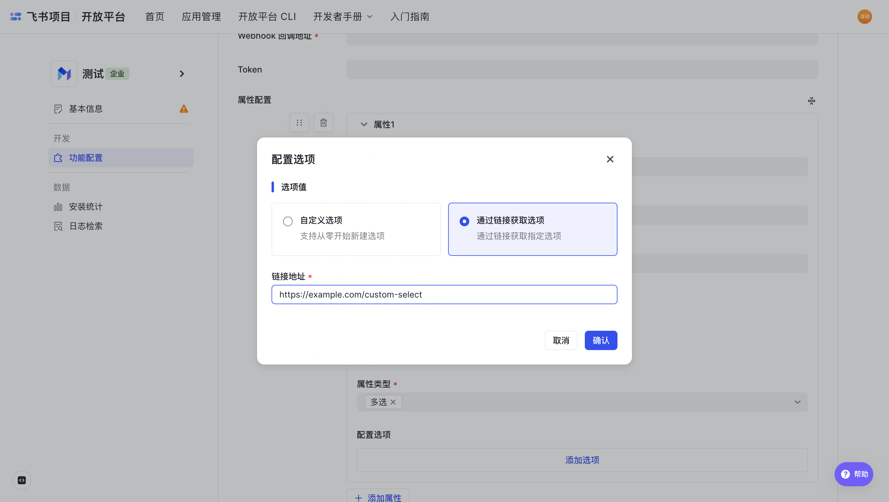

# AI 操作链接选项

通过链接为 AI 操作的单选、多选属性提供动态候选项。用户配置属性时，飞书项目向开发者 URL 发起 `POST`，开发者根据当前空间、用户返回可选值。

原文后半部分是**联动能力的提前适配通知**，没有正式上线日期。本页将现有候选项协议与预告的 `init/change` 协议分别说明，尤其区分“空数组不覆盖静态选项”和“联动更新可清空选项”。

<a id="a49edf46"></a>
<a id="b0654e59"></a>

## 选择静态录入或动态链接

| 选项来源 | 建议 |
| --- | --- |
| 固定优先级等稳定列表 | 手动录入选项名称和值 |
| 随项目、空间变化的模块或团队成员 | 动态链接 |
| 大量且频繁变化的产品线、客户名单 | 动态链接 |
| CRM、ERP 等外部系统 | 动态链接 |

<a id="a938f185"></a>
<a id="e516ad9d"></a>
<a id="96ece690"></a>

## 在 AI 操作应用中配置

先准备接受 `POST` 并返回 JSON 的接口，然后进入「功能配置 → 属性配置 → 添加选项」，在弹窗选择「通过链接获取选项」，填写 URL 并确认。



<a id="350d6f40"></a>
<a id="381bdeac"></a>

## 当前请求：空间与用户上下文

```json
{
  "project_key": "project_key",
  "user_key": "user_key"
}
```

`project_key` 为当前空间 key，`user_key` 为当前操作用户的 user key。请求发送到开发者配置的 URL，没有平台固定路径。

<a id="337e7e62"></a>

## 当前响应：候选项列表

| 字段 | 含义及约束 |
| --- | --- |
| `code` | 成功为 `0`，应显式返回 |
| `msg` | 响应说明 |
| `data.options` | 候选项数组，非空时优先采用 |
| 顶层 `options` | 兼容位置；`data.options` 为空数组时继续尝试此处 |
| `label` | 字符串，前端展示文案 |
| `value` | 字符串，属性实际保存值 |
| `translation` 或 `translations` | 可选的字符串 Map，多语言文案 |

<a id="f4891af8"></a>

### 普通响应

候选项应同时提供非空 `label/value`。以下将原示例展示文案译为英文，保存值保持不变。

```json
{
  "code": 0,
  "msg": "success",
  "data": {
    "options": [
      {"label": "Option A", "value": "option_a"},
      {"label": "Option B", "value": "option_b"}
    ]
  }
}
```

<a id="2b621a9c"></a>

### 多语言响应

支持 `zh`（中文）、`en`（英文）、`ja`（日文）。原示例在 `en` 项后缺少逗号，已补齐；Unicode 转义保留原中文、日文值，解析后不变。

```json
{
  "code": 0,
  "msg": "success",
  "data": {
    "options": [
      {
        "label": "\u9009\u9879 A",
        "value": "option_a",
        "translation": {
          "zh": "\u9009\u9879 A",
          "en": "Option A",
          "ja": "\u9078\u629e\u80a2 A"
        }
      }
    ]
  }
}
```

<a id="40b1a6bb"></a>

### 顶层兼容响应

```json
{
  "code": 0,
  "msg": "success",
  "options": [{"label": "Option A", "value": "option_a"}]
}
```

<a id="108d4b8e"></a>

### 响应处理规则

| 项目 | 限制与处理 |
| --- | --- |
| HTTP 状态 | 必须为 `200–299`，否则失败 |
| Body | 必须为可解析的 JSON 对象 |
| 大小 | 基础协议写最大 1 MB；只读取前 1 MB，截断后不能解析则失败 |
| 业务码 | `code != 0` 判失败；缺失时实现虽使用零值，也不能作为协议依赖 |
| 数量 | 默认最多 200 项；超出只截断，不使整个请求失败 |
| 类型 | `options` 必须为数组；多语言字段必须为字符串 Map，否则解析失败 |
| 字段类型 | 对外要求 `label/value` 为字符串，实现兼容转为字符串 |

原表中“候选项数量”的说明停在“实际限制由”，缺失的配置来源不作推测。

平台丢弃 `null` 候选项；缺少 `label` 时用 `value` 补齐，缺少 `value` 时用 `label` 补齐，两者都为空则丢弃。返回顺序与重复 `value` 都会保留，不去重。未定义字段被忽略，当前响应不支持设置默认选中值或更新其他属性。

<a id="2d1d5499"></a>

### 空结果的含义

原文所称“当前 Master 版本”不能通过空数组清空既有静态候选项。不返回 `options` 与返回空数组处理相同。

```json
{
  "code": 0,
  "msg": "success",
  "data": {"options": []}
}
```

<a id="fdf762fd"></a>

### 失败不会中断 AI 配置查询

超时、非 2xx、非法 JSON、非零 `code`、无效 URL、网络不可达均导致本次链接请求失败。平台记录 Warning 日志并继续 AI 配置查询，不采用此次动态结果；保留静态选项，若无静态选项则显示为空。

<a id="01a11aef"></a>

## 联动能力预告：请求扩展

原文要求先让接口兼容新增字段，避免严格 JSON 反序列化因 DTO 未扩展而报错。只提供动态候选项的接口无需立即实现联动逻辑。

<a id="ed588d24"></a>

### 新请求体

旧请求仅含 `project_key/user_key`，通知用 `xxx` 作为两者占位值。新增协议示例如下：

```json
{
  "project_key": "xxx",
  "user_key": "xxx",
  "app": {
    "app_key": "MII_6A8E5D3449000E1B",
    "point_key": "ai_operation_va1u63"
  },
  "scene": "ai_operation",
  "event": "init",
  "trigger_prop_key": "bx3tfz",
  "properties": {"bx3tfz": null, "dggf4b": null, "wvloj9": []}
}
```

| 字段 | 类型 | 说明 |
| --- | --- | --- |
| `project_key` | string | 原有空间标识；通知称“项目标识” |
| `user_key` | string | 原有用户标识 |
| `app` | object | 应用信息 |
| `app.app_key` | 原文未单列类型 | 应用标识 |
| `app.point_key` | 原文未单列类型 | 点位标识 |
| `scene` | string | `ai_operation`（AI 操作）或 `ai_node`（AI 节点） |
| `event` | string | `init` 初始化候选项；`change` 选项联动，原文标注阶段二上线 |
| `trigger_prop_key` | string | 触发联动的属性 key |
| `properties` | object | 全部选项类型属性当前值 |

`properties` 不包含文本、数字、Prompt 等非选项属性。单选 `select` 是字符串或 `null`，如 `"option_a"`；多选 `multiSelect` 是字符串数组、空数组或 `null`，如 `["opt1", "opt2"]`、`[]`。

<a id="5f9cf202"></a>
<a id="e04e2dbb"></a>

## 联动能力预告：初始化与变更

以下能力原文注明正式上线后可用，本地整理未验证发布状态。

### init 返回当前属性的选项

```json
{
  "code": 0,
  "msg": "success",
  "data": {
    "options": [{"label": "Option A", "value": "option_a"}],
    "has_linkage": true
  }
}
```

`options` 对应当前 `trigger_prop_key`。`has_linkage: true` 表示用户选择该属性后再次请求开发者，省略按 `false` 处理。初始化只更新候选项，不改变存量选中值，响应中的 `updates` 不执行。

<a id="da22fe37"></a>

### change 返回其他属性的更新

选择开启联动的属性后，开发者收到以下业务上下文。原示例省略了空间、用户和应用公共字段。

```json
{
  "scene": "ai_operation",
  "event": "change",
  "trigger_prop_key": "bx3tfz",
  "properties": {"bx3tfz": "option_a", "dggf4b": null, "wvloj9": []}
}
```

响应通过 `data.updates` 定位目标属性：第一项替换候选项并选中一个值，第二项清空选中值。

```json
{
  "code": 0,
  "msg": "success",
  "data": {
    "updates": [
      {
        "prop_key": "dggf4b",
        "options": [{"label": "Linked option", "value": "linked_option"}],
        "selected_values": ["linked_option"]
      },
      {"prop_key": "wvloj9", "selected_values": []}
    ]
  }
}
```

每个 update 用 `prop_key` 指定属性，可包含 `options`（替换候选项）、`selected_values`（替换选中值）、`has_linkage`（更新后续联动开关）。

<a id="680bf229"></a>

### 整批更新的约束

| 检查项 | 要求 |
| --- | --- |
| 目标类型 | 只能更新单选、多选，不能更新文本、数字、Prompt |
| 目标范围 | 必须在当前应用定义中，且不能是本次 `trigger_prop_key` 自身 |
| 唯一性 | 同一 `prop_key` 只能出现一次 |
| 更新内容 | 每项至少包含 `options/selected_values/has_linkage` 之一 |
| 单选值 | `selected_values` 最多一个值 |
| 数量 | 单次最多 50 项 update，每个属性默认最多 200 个候选项 |
| 失败处理 | 任意一项不合法，整批不执行 |

<a id="d7cc2a91"></a>

### 联动响应的省略与清空

| 写法 | 结果 |
| --- | --- |
| 省略 `options` | 候选项不变 |
| `options: []` | 清空候选项 |
| 省略 `selected_values` | 选中值不变 |
| `selected_values: []` | 清空选中值 |

这是预告的联动更新语义，与现有动态候选项响应的空数组行为不同。

<a id="67cf21b9"></a>

## 联动接口约束与适配范围

继续使用原开发者链接和 `POST`，不增加 `protocol_version`。HTTP 状态必须为 2xx、响应 `code` 必须为 `0`，处理时间不超过 **3 秒**，响应体不超过 **1 MiB**。原顶层 `options` 与 `data.options` 继续兼容。

仅提供候选项时，先兼容新增请求字段即可；需要联动时再实现 `has_linkage` 和 `event=change` 的 `data.updates`。基础协议写 1 MB，预告写 1 MiB，原文没有解释单位差异。

更新时间：2026-09-07
官方 URL：https://project.feishu.cn/b/helpcenter/1p8d7djs/21c9ip0n
