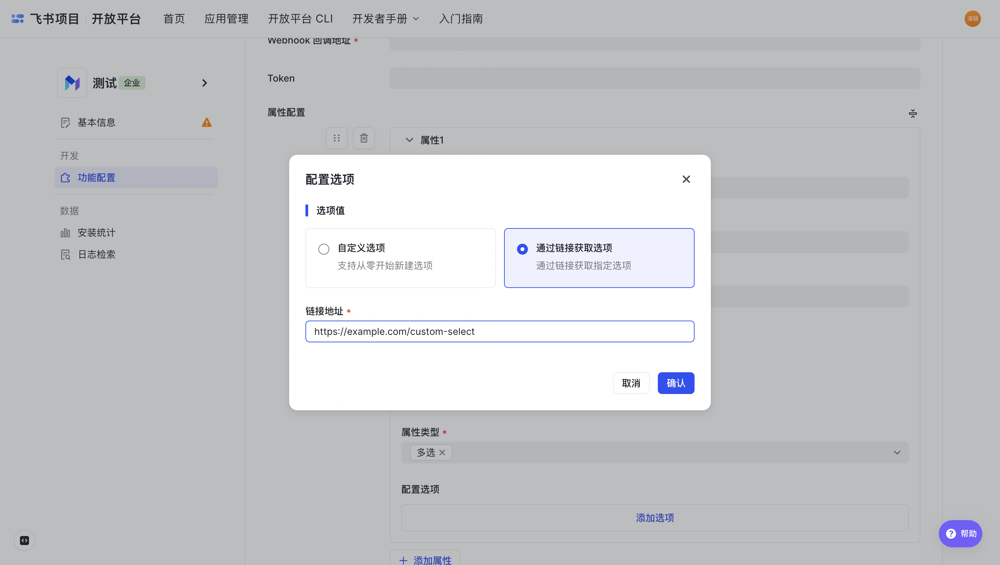

# AI 节点链接选项

AI 节点的单选、多选输入属性可以通过开发者提供的 HTTP 接口获取候选项。平台在用户配置属性时请求该接口，将返回值作为选项列表。

本页包含两套不同阶段的行为：**已有的动态候选项协议**和**原文预告的属性联动协议**。原文未给出联动功能的正式上线日期，不能把预告中的清空、选中值更新能力当作现有协议的保证。

<a id="309015d6"></a>
<a id="f4246a98"></a>

## 使用场景

| 情况 | 配置方式 |
| --- | --- |
| 固定优先级等长期不变的选项 | 后台手动录入名称与值 |
| 依赖空间或项目的模块、成员列表 | 通过链接获取 |
| 数量多、经常更新的产品线或客户名单 | 通过链接获取 |
| 来自 CRM、ERP 等外部系统 | 通过链接获取 |

<a id="a9399af1"></a>
<a id="2d83732a"></a>
<a id="77f0de94"></a>

## 配置入口

1. 准备可通过 `POST` 访问的 URL，返回下述 JSON 响应。
2. 在 AI 节点应用中进入「功能配置 → 属性配置 → 添加选项」。
3. 选择「通过链接获取选项」，填写接口 URL 并确认。



<a id="b175028c"></a>
<a id="845718e0"></a>

## 现有请求协议

平台向配置的 URL 发送 `POST`，请求体中的 `project_key` 是当前空间 key，`user_key` 是当前操作用户的 user key。

```json
{
  "project_key": "project_key",
  "user_key": "user_key"
}
```

<a id="2d8b049c"></a>

## 现有响应协议

| 字段 | 要求 |
| --- | --- |
| `code` | 显式返回 `0` 表示成功 |
| `msg` | 响应说明 |
| `data.options` 或顶层 `options` | 候选项数组 |
| `options[].label` | 字符串，展示文案 |
| `options[].value` | 字符串，属性实际保存值 |
| `options[].translation` | 可选，字符串 Map；也兼容 `translations` |

每个选项应同时提供非空 `label` 与 `value`。

<a id="24c59285"></a>

### 普通候选项

示例展示文案译为英文，协议值 `option_a/option_b` 保持不变。

```json
{
  "code": 0,
  "msg": "success",
  "data": {
    "options": [
      {"label": "Option A", "value": "option_a"},
      {"label": "Option B", "value": "option_b"}
    ]
  }
}
```

<a id="a6dd7b41"></a>

### 多语言候选项

语言键支持 `zh`（中文）、`en`（英文）、`ja`（日文）。以下用 JSON Unicode 转义保留原中文、日文文案，解析后内容不变。

```json
{
  "code": 0,
  "msg": "success",
  "data": {
    "options": [
      {
        "label": "\u9009\u9879 A",
        "value": "option_a",
        "translation": {
          "zh": "\u9009\u9879 A",
          "en": "Option A",
          "ja": "\u9078\u629e\u80a2 A"
        }
      }
    ]
  }
}
```

<a id="05305dde"></a>

### 兼容的顶层 options

```json
{
  "code": 0,
  "msg": "success",
  "options": [{"label": "Option A", "value": "option_a"}]
}
```

<a id="d1839098"></a>

### 校验、选择与归一化

| 检查项 | 规则 | 不满足时 |
| --- | --- | --- |
| HTTP 状态 | `200–299` | 请求失败 |
| 响应体 | 可解析的 JSON 对象 | 请求失败 |
| 大小 | 原文基础协议写“最大 1 MB” | 仅读取前 1 MB，截断后不能解析则失败 |
| `code` | 必须为 `0` | 请求失败 |
| 候选项位置 | 非空 `data.options` 优先；空数组时再读取顶层 `options` | 未获取到动态候选项 |
| `options` 类型 | 数组 | 无法解析则失败 |
| 数量 | 默认最多 200 项 | 超出部分截断，不使整个请求失败 |
| `label/value` | 对外协议使用字符串 | 平台兼容转为字符串 |
| 多语言 | `translation/translations` 为字符串 Map | 无法解析则失败 |

原表“实际限制由”后缺少内容，因此这里只保留默认 200 项，不推测配置来源。`code` 缺失时当前实现使用整数零值，但原文明确要求调用方不要依赖此兼容行为。

候选项处理顺序和空值规则如下：

- 丢弃 `null` 项；`label` 为空用 `value` 补齐，`value` 为空用 `label` 补齐，两者都为空则丢弃。
- 保留开发者返回的顺序，也保留重复 `value`，不会自动去重。
- 忽略未定义字段。现有协议不能设置默认选中值，也不能更新其他属性。

<a id="07a9aa1f"></a>

### 空列表不会清空静态选项

原文所称“当前 Master 版本”中，下列响应不会覆盖原有静态候选项。不返回 `options` 与返回空数组的效果相同。

```json
{
  "code": 0,
  "msg": "success",
  "data": {"options": []}
}
```

<a id="a3495f58"></a>

### 请求失败后的行为

请求超时、非 2xx、非法 JSON、`code != 0`、无效 URL 或网络不可达均判为失败。平台记录 Warning 日志，AI 配置查询继续执行，本次动态结果不生效：保留原有静态候选项；没有静态候选项则显示为空。

<a id="1087b902"></a>

## 联动协议预告：先兼容新增字段

原文要求提前适配严格 JSON 反序列化：DTO 应能接收新增字段，即使尚未实现属性联动。此处是预告，不表示本地已确认发布状态。以下使用本页对应的 `ai_node` 场景及节点点位占位符。

<a id="c80d85ee"></a>

### 扩展请求体

旧请求体仍是上文的 `project_key/user_key` 两字段；原通知中的两个值均为占位符 `xxx`。新请求如下：

```json
{
  "project_key": "xxx",
  "user_key": "xxx",
  "app": {
    "app_key": "MII_6A8E5D3449000E1B",
    "point_key": "ai_node_example"
  },
  "scene": "ai_node",
  "event": "init",
  "trigger_prop_key": "bx3tfz",
  "properties": {"bx3tfz": null, "dggf4b": null, "wvloj9": []}
}
```

| 字段 | 类型 | 含义 |
| --- | --- | --- |
| `project_key` | string | 原有空间标识；通知表称“项目标识” |
| `user_key` | string | 原有用户标识 |
| `app` | object | 应用信息，含应用标识 `app_key`、点位标识 `point_key` |
| `scene` | string | `ai_node` 或 `ai_operation` |
| `event` | string | `init` 初始化；`change` 联动，原文注明阶段二上线 |
| `trigger_prop_key` | string | 本次触发属性的 key |
| `properties` | object | 当前全部选项类型属性的键值集合 |

`properties` 仅包含单选和多选，不包含文本、数字、Prompt 等属性。单选 `select` 的值是字符串或 `null`，如 `"option_a"`；多选 `multiSelect` 的值是字符串数组、`[]` 或 `null`，如 `["opt1", "opt2"]`。

<a id="f6344136"></a>
<a id="41dccccd"></a>

### init：初始化当前属性

返回 `trigger_prop_key` 对应属性的候选项。`has_linkage: true` 表示用户选择后需要再次请求开发者；省略时为 `false`。初始化只修改候选项，不修改存量选中值，也不执行响应里的 `updates`。

```json
{
  "code": 0,
  "msg": "success",
  "data": {
    "options": [{"label": "Option A", "value": "option_a"}],
    "has_linkage": true
  }
}
```

<a id="87d1fda1"></a>

### change：更新其他选项属性

用户选择启用联动的属性后，平台发送 `event=change`。原文以下示例省略了公共空间、用户和应用字段，是请求业务部分的展示。

```json
{
  "scene": "ai_node",
  "event": "change",
  "trigger_prop_key": "bx3tfz",
  "properties": {"bx3tfz": "option_a", "dggf4b": null, "wvloj9": []}
}
```

通过 `data.updates` 指定其他属性的新候选项、选中值或后续联动开关。

```json
{
  "code": 0,
  "msg": "success",
  "data": {
    "updates": [
      {
        "prop_key": "dggf4b",
        "options": [{"label": "Linked option", "value": "linked_option"}],
        "selected_values": ["linked_option"]
      },
      {"prop_key": "wvloj9", "selected_values": []}
    ]
  }
}
```

| update 字段 | 作用 |
| --- | --- |
| `prop_key` | 目标属性 key |
| `options` | 替换候选项列表 |
| `selected_values` | 替换选中值 |
| `has_linkage` | 更新该属性是否支持后续联动 |

<a id="bac9f817"></a>

### updates 的整体校验

- 只允许更新当前应用中存在的单选、多选属性，不能更新文本、数字或 Prompt，不能更新本次 `trigger_prop_key` 自身。
- 同一 `prop_key` 不能重复；每项至少包含 `options`、`selected_values`、`has_linkage` 之一。
- 单选的 `selected_values` 最多一个值；单次最多 50 个 update，单个属性默认最多 200 个候选项。
- 任意一项不合法，整批 `updates` 都不执行。

<a id="c2be8c7a"></a>

### 联动更新中的空值

| 返回方式 | 含义 |
| --- | --- |
| 省略 `options` | 保持候选项 |
| `options: []` | 清空候选项 |
| 省略 `selected_values` | 保持选中值 |
| `selected_values: []` | 清空选中值 |

这里的清空规则属于预告的 `updates`，不能套用到现有顶层动态候选项响应。

<a id="cb1537e8"></a>

### 联动接口约束

继续使用原 URL 和 `POST`，不新增 `protocol_version`。处理时间不超过 **3 秒**，响应不超过 **1 MiB**，HTTP 状态须为 2xx 且 `code` 为 `0`。顶层 `options` 和 `data.options` 继续兼容。

只提供动态候选项的接口先兼容新增请求字段即可；实现联动还需处理 `has_linkage` 与 `event=change` 下的 `data.updates`。基础部分写 1 MB，预告写 1 MiB，原文未解释单位差异，接入时应留出余量。

更新时间：2026-09-07
官方 URL：https://project.feishu.cn/b/helpcenter/1p8d7djs/9nqnv8jk
