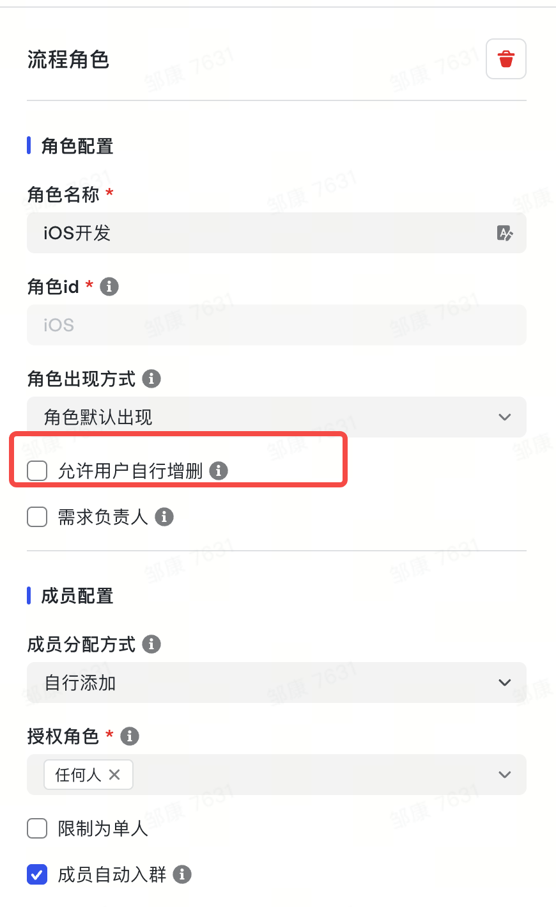

# 创建工作项

在指定空间内创建一个需求、缺陷等工作项实例，成功后直接返回实例 ID。对应产品操作见[新建需求](https://project.feishu.cn/1ykiuvvj/49727jya)，接口权限位于[权限管理](../guides/权限管理.md)的“工作项”分类。

## 创建前准备

1. 获取工作项类型和[创建元数据](获取创建工作项元数据.md)，确定字段格式、可选值、级联层级和流程模板。
2. 选择 `template_id`；省略时使用该类型的第一个流程模板。名称可放顶层 `name` 或字段列表，但非空顶层名称与列表中的 `name` 不能重复。
3. 需要执行新建页必填校验时设 `required_mode: 1`；默认 `0` 不校验必填项。需在角色未传值时采用配置默认值，可使用 `role_mode: 1`。

字段标识使用 `field_key` 或 `field_alias` 二选一。选项字段写 `value` 中的选项 ID，不写展示名称 `label`。富文本的 `field_value` 与 `field_value_markdown` 二选一；`template_id` 应在顶层传入，不能作为 `field_value_pairs` 的字段。

<a id="请求说明"></a>

## 请求说明

**请求方式**：`POST`

**请求地址**：`/open_api/:project_key/work_item/create`

<a id="请求参数"></a>

## 请求参数

<a id="header"></a>

### 请求头

接口调用的 Header 配置详见 [Header](../guides/OpenAPI概述.md#a8e43b86)。

<a id="Path"></a>

### 路径参数

| 参数          | 类型     | 是否必须 | 说明                                                                            |
| ------------- | -------- | -------- | ------------------------------------------------------------------------------- |
| `project_key` | `string` | 必须     | 空间 ID（project_key），或者空间域名（simple_name）。 [详细说明](#field-note-1) |

<a id="field-note-1"></a>

**project_key**

空间 ID（project_key），或者空间域名（simple_name）。

- 空间 ID（project_key），在飞书项目空间双击空间名称获取。
- 空间域名（simple_name），`simple_name` 一般在飞书项目空间 URL 中获取。例如空间 URL 为 “https://project.feishu.cn/doc/overview”，则 `simple_name`为 “doc”。

<a id="Body"></a>

### 请求体

| 参数                 | 类型           | 是否必须 | 说明                                                                                                                                                       |
| -------------------- | -------------- | -------- | ---------------------------------------------------------------------------------------------------------------------------------------------------------- |
| `work_item_type_key` | `string`       | 必须     | 工作项类型，可以从[获取空间下工作项类型](获取空间下工作项类型.md)接口获取。                                                                                            |
| `field_value_pairs`  | `list<object>` | 可选     | 配置工作项的字段，符合[FieldValuePair](../formats/数据结构汇总.md#10c42182)结构规范，创建工作项的具体字段可以从[获取创建工作项元数据](获取创建工作项元数据.md)接口中获取。 |
| `template_id`        | `int64`        | 可选     | 工作项流程模板 ID，未传值时默认使用该工作项类型的第一个流程模板。可通过以下方式获取： [详细说明](#field-note-2)                                            |
| `name`               | `string`       | 可选     | 工作项名称                                                                                                                                                 |
| `required_mode`      | `int32`        | 可选     | 创建工作项必填模式 [详细说明](#field-note-3)                                                                                                               |
| `role_mode`          | `int32`        | 可选     | 角色可见性计算模式，表示当某角色新建未传值时，是否要使用配置侧的角色默认值 [详细说明](#field-note-4)                                                       |

<a id="field-note-2"></a>

**template_id**

工作项流程模板 ID，未传值时默认使用该工作项类型的第一个流程模板。可通过以下方式获取：

- 从[获取创建工作项元数据](获取创建工作项元数据.md)接口中的 `template` 字段的 `options` 中获取，选择对应的 `value`；
- 从[获取工作项下的流程模板列表](获取工作项下的流程模板列表.md)接口的 `template_id` 获取；
- 从[获取字段信息](获取字段信息.md)接口中的 `template` 字段的 `options` 中获取，选择对应的 `value`。

<a id="field-note-3"></a>

**required_mode**

创建工作项必填模式

- 默认为0，不校验必填项
- 1：校验新建页必填项，对于未填字段返回创建失败，提示哪些字段未填

<a id="field-note-4"></a>

**role_mode**

角色可见性计算模式，表示当某角色新建未传值时，是否要使用配置侧的角色默认值

- 默认为0，不使用
- 1：新建角色未传值时，使用配置侧的角色默认值

#### `field_value_pairs`

| 参数                   | 类型     | 是否必须 | 说明                                                                                                                             |
| ---------------------- | -------- | -------- | -------------------------------------------------------------------------------------------------------------------------------- |
| `field_key`            | `string` | 必须     | 待更新的字段 ID，需与 `field_alias`二选一填写，不能同时为空。                                                                    |
| `field_alias`          | `string` | 可选     | 待更新字段的别名                                                                                                                 |
| `field_value`          | `object` | 必须     | 字段值，可参考[字段与属性解析格式](../formats/字段与属性解析格式.md)                                                                       |
| `update_mode`          | `int32`  | 可选     | 字段的更新模式，用于控制字段值的更新方式。支持的取值如下所示。 [详细说明](#field-note-5)                                         |
| `field_type_key`       | `string` | 可选     | 字段类型                                                                                                                         |
| `field_name`           | `string` | 可选     | 字段名称                                                                                                                         |
| `field_value_markdown` | `object` | 可选     | 富文本内容 Markdown 格式，遵循 [Markdown 格式说明](../formats/Markdown%20格式说明.md)结构规范，和`field_value` 二选一，仅富文本格式字段生效 |

<a id="field-note-5"></a>

**update_mode**

字段的更新模式，用于控制字段值的更新方式。支持的取值如下所示。

- `0`：替换模式，提交的字段值将完全替换原有值；
- `1`：更新模式，仅更新提交的字段值，不影响其他字段。

默认值：`0`（替换模式）

#### `field_value_pairs.field_value_markdown`

| 参数       | 类型     | 是否必须 | 说明                     |
| ---------- | -------- | -------- | ------------------------ |
| `markdown` | `string` | 可选     | 富文本内容 Markdown 格式 |

<a id="返回参数"></a>

## 返回参数

| 参数       | 类型     | 说明                                             |
| ---------- | -------- | ------------------------------------------------ |
| `data`     | `int64`  | 返回工作项 ID                                    |
| `err`      | `object` | 请求成功时返回空值，请求失败时返回实际错误信息。 |
| `err_msg`  | `string` | 请求成功时返回空值，请求失败时返回实际错误信息。 |
| `err_code` | `int32`  | 请求成功时0，请求失败返回实际错误码。            |

### `err`

| 参数     | 类型     | 说明                                                                                 |
| -------- | -------- | ------------------------------------------------------------------------------------ |
| `code`   | `int32`  | 部分场景下，透出更详细错误对应的错误码。                                             |
| `msg`    | `string` | 部分场景下，透出更详细的错误描述。                                                   |
| `log_id` | `string` | 报错场景下的调用链标识符，用于追踪错误发生时的完整调用链路，便于日志记录和问题排查。 |

<a id="请求示例"></a>

## 请求示例

### 创建节点流工作项

**请求路径**：`POST /open_api/68382b399de4b0ec6c5axxxx/work_item/create`

该示例选择 Markdown 写入描述；若选择普通字段值，可将整个 `field_value_markdown` 替换为 `"field_value": "2333"`，两种写法不能并存。

```json
{
  "work_item_type_key": "story",
  "template_id": 123123,
  "name": "2333",
  "field_value_pairs": [
    {
      "field_key": "description",
      "field_value_markdown": {
        "markdown": "2333"
      }
    },
    {
      "field_key": "priority",
      "field_value": {
        "value": "xxxxxx"
      }
    },
    {
      "field_key": "role_owners",
      "field_value": [
        {
          "role": "rd",
          "owners": ["testuser"]
        }
      ]
    }
  ]
}
```

### 创建状态流工作项

**请求路径**：`POST /open_api/68382b399de4b0ec6c5axxxx/work_item/create`

```json
{
  "work_item_type_key": "issue",
  "name": "2333",
  "field_value_pairs": [
    {
      "field_key": "description",
      "field_value_markdown": {
        "markdown": "2333"
      }
    },
    {
      "field_key": "priority",
      "field_value": {
        "value": "xxxxxx"
      }
    },
    {
      "field_key": "role_owners",
      "field_value": [
        {
          "role": "rd",
          "owners": ["testuser"]
        }
      ]
    }
  ]
}
```

<a id="返回示例"></a>

## 返回示例

### 成功返回示例

```json
{
  "data": 19781,
  "err": {},
  "err_msg": "",
  "err_code": 0
}
```

<a id="错误码"></a>

## 错误码

以下列出了该接口相关的错误码信息，若需查看更多通用错误码说明，参见 [Open API 错误码](../formats/Open%20API%20错误码.md)。

| err_code | err_msg                       | err.code | err.msg                          | 说明                                                                             |
| -------- | ----------------------------- | -------- | -------------------------------- | -------------------------------------------------------------------------------- |
| 30014    | WorkItem Type Not Found       | 30014    | Work item not found              | `work_item_type_key` 不正确，请通过[获取空间下工作项类型](获取空间下工作项类型.md)接口获取。 |
| 50006    | Failed to process role owners | 50006    | Failed to process role owners    | 角色与人员解析失败，即传入的人员信息不正确。                                     |
| 50006    | Current Template is Disable   | 50006    | Current template has been banned | 当前模版被禁用。                                                                 |
| 50006    | Template not found            | 50006    | template not found               | 找不到对应的模板，请输入正确的 `template_id`。                                   |
| 30014    | WorkItemTypeKey Not Found     | 30014    | Work item not found              | 工作项类型不存在，请传入正确的 `work_item_type_key`。                            |
| 20083    | Duplication Field Exist       | 20083    | Duplication Field Exist          | 创建工作项时，传入的字段重复。                                                   |
| 20038    | Required Field Is Not Set     | 20038    | Required Field Is Not Set        | 必填项校验未通过。                                                               |

<a id="7ae7b99e"></a>

## 注意事项

1. 当请求参数中存在**级联单选**或**级联多选**字段时，传入的选项值需满足空间配置中该字段的“**可选层级**”配置。


2. **创建和更新工作项**接口中**选项类型**字段的field_value应传入的是选项id（value），而非选项的名称（label）。


3. **角色和人员**字段（`role_owners`）

未传入角色值时是否采用配置默认值，由本接口的 `role_mode` 控制。它与“允许用户自行增删”配置的组合规则尚待核实；依赖精确角色结果时应显式提供目标角色与成员。



4. 参数补充说明
   1. 在 `name` 传参不为空，且 `field_value_pairs` 中包含 `field_key` 为 `name` 的对象时，会报错。

   2. `field_value_pairs` 中不允许出现 `field_key` 为 `template_id` 的对象，出现则报错。

更新时间：2026-09-07
官方 URL：https://project.feishu.cn/b/helpcenter/1p8d7djs/6c8et3fg
