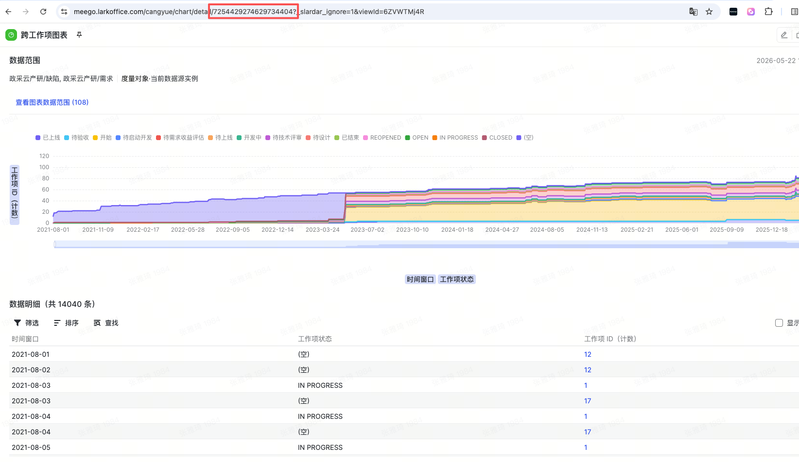

# 获取度量图表明细数据

读取指定度量图表的明细数据，响应包含维度标题、指标标题，以及二维数据列表。先从视图图表列表或图表详情 URL 取得 `chart_id`。

## 使用前确认

`chart_data_list` 有两层数组，内部数据点的 `dim` 表示维度、`value` 表示指标值。示例的指标值是字符串，读取后不要假定天然为数值类型；`is_zero_spec` 可区分补零数据。

对应的平台功能，如度量的功能使用可参考[飞书项目度量介绍](https://project.feishu.cn/1ykiuvvj/swa2zqrb)。对应的权限申请在**权限管理-度量&视图**分类下，相关功能介绍详见 [权限管理](../guides/权限管理.md)。

<a id="使用说明"></a>

## 使用说明

- chart_id 可通过请求[通过视图ID查询所有图表](通过视图ID查询所有图表.md)接口获取，或通过图表详情页URL获取。



- 复杂图表需要较多计算资源，HTTP 超时应设置为 **60 秒以上**。

- 度量采用并发度限流，**并发度必须控制在 1**。原文要求单机单线程串行调用；同时发起多个请求会被限流。

<a id="请求说明"></a>

## 请求说明

- 请求方式：GET

- 请求地址：/open_api/:project_key/measure/:chart_id

<a id="请求参数"></a>

## 请求参数

<a id="header"></a>

### Header

接口调用的 Header 配置详见 [Header](../guides/OpenAPI概述.md#a8e43b86)。

<a id="Path"></a>

### Path

| 参数 | 类型 | 是否必须 | 说明 |
| --- | --- | --- | --- |
| `project_key` | string | 必须 | [说明](#parameter-note-1) |
| `chart_id` | string | 必须 | 度量图表 ID，可以从前端浏览器 URL 中获取，参见[请求说明](#%E8%AF%B7%E6%B1%82%E8%AF%B4%E6%98%8E)。 |

<a id="parameter-note-1"></a>

**project_key：说明**

空间 ID（project_key），或者空间域名（simple_name）。
- 空间 ID（project_key），在飞书项目空间双击空间名称获取。
- 空间域名（simple_name），`simple_name` 一般在飞书项目空间 URL 中获取。例如空间 URL 为 “https://project.feishu.cn/doc/overview”，则 `simple_name`为 “doc”。

<a id="返回参数"></a>

## 返回参数

| 参数 | 类型 | 说明 |
| --- | --- | --- |
| `data` | object | 图表数据。 |
| `err` | object | 请求成功时返回空值，请求失败时返回实际错误信息。 |
| `err_msg` | string | 请求成功时返回空值，请求失败时返回实际错误信息。 |
| `err_code` | int32 | 请求成功时0，请求失败返回实际错误码。 |

### `data` 的字段

| 参数 | 类型 | 说明 |
| --- | --- | --- |
| `name` | string | 图表名称。 |
| `chart_id` | string | 图表 ID。 |
| `dim_titles` | `list<string>` | 维度标题。 |
| `quota_titles` | `list<string>` | 指标标题。 |
| `chart_data_list` | `list<list<object>>` | 图表数据。 |

### `data.chart_data_list` 的字段

| 参数 | 类型 | 说明 |
| --- | --- | --- |
| `dim` | map | 图表数据中的维度信息，以键值对形式存储，键为维度标识，值为维度值。 |
| `value` | map | 图表数据中的指标值信息，以键值对形式存储，键为指标标识，值为指标值。 |
| `is_zero_spec` | boolean | 标识该数据是否为补零的特殊标记，用于区分正常数据和补零数据。 |

### `err` 的字段

| 参数 | 类型 | 说明 |
| --- | --- | --- |
| `code` | int32 | 部分场景下，透出更详细错误对应的错误码。 |
| `msg` | string | 部分场景下，透出更详细的错误描述。 |
| `log_id` | string | 报错场景下的调用链标识符，用于追踪错误发生时的完整调用链路，便于日志记录和问题排查。 |

<a id="请求示例"></a>

## 请求示例

```http
GET /open_api/680dc978eaf703f19c63xxxx/measure/746005077549069xxxx
```

<a id="返回示例"></a>

## 返回示例

### 请求成功返回

```json
{
  "err": {},
  "err_code": 0,
  "err_msg": "",
  "data": {
    "name": "\u4f18\u5148\u7ea7\u5206\u5e03",
    "chart_id": "7529862074084622339",
    "chart_data_list": [
      [
        {
          "dim": {
            "0": "P0"
          },
          "value": {
            "0": "2"
          },
          "is_zero_spec": false
        },
        {
          "dim": {
            "0": "P1"
          },
          "value": {
            "0": "3"
          },
          "is_zero_spec": false
        },
        {
          "dim": {
            "0": "P2"
          },
          "value": {
            "0": "2"
          },
          "is_zero_spec": false
        }
      ]
    ],
    "dim_titles": [
      "\u4f18\u5148\u7ea7"
    ],
    "quota_titles": [
      "\u5de5\u4f5c\u9879id(\u8ba1\u6570)"
    ]
  }
}
```

<a id="错误码"></a>

## 错误码

以下列出了该接口相关的错误码信息，若需查看更多通用错误码说明，参见 [Open API 错误码](https://project.feishu.cn/b/helpcenter/developer/common-error-code)。

| `err_code` | err_msg | err.code | err.msg | 说明 |
| --- | --- | --- | --- | --- |
| `50006` | ErrMeasureCommonBizError | 待核实 | business error | 图表配置异常，请检查是否存在标红配置，根据标红提示信息调整配置。 |
| 待核实 | ErrNilChartCfg | 1000050535 | chartCfg is nil | 图表配置错误，请检查 `chart_id` 是否正确有效，并确认图表是否被删除。 |

更新时间：2026-09-07
官方 URL：https://project.feishu.cn/b/helpcenter/1p8d7djs/374vhy4w
