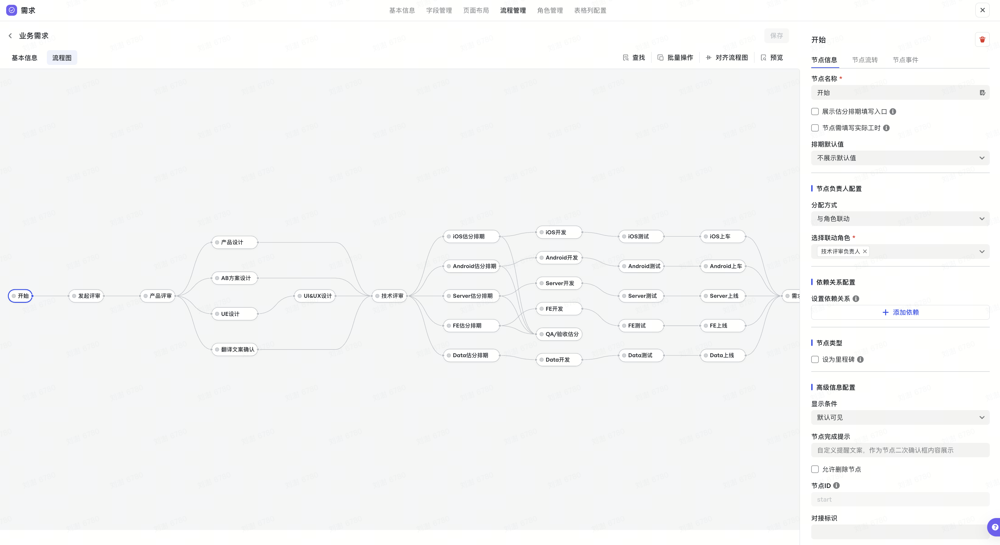

# 获取流程模板配置详情

读取流程模板的节点或状态配置，以及连接关系和流转表单。响应按流程模式分为 `workflow_confs` 与 `state_flow_confs`；节点事件配置不在本接口支持范围内。

## 使用前确认

| 阅读对象 | 关注内容 |
| --- | --- |
| `workflow_confs` | 节点负责人、排期、完成与删除权限、完成任务、节点表单 |
| `state_flow_confs` | 状态 ID、名称、起始/过程/归档类型和授权角色 |
| `connections` | 前后节点；状态流还包含流转 ID 与表单 |
| 字段配置 | 必填性、可见性、有效性、角色分配、默认值和选项 |

条件可见、条件必填、条件有效及条件分配的具体条件需在空间配置中查看，不能仅凭返回的模式枚举重建全部条件。

原节点流示例还包含 `done_actual_point`（实际工时是否必填）、`done_finish_time`（截止时间是否必填）、`is_milestone`（里程碑）、`sub_work_items`（子工作项关系与类型）和 `sub_tasks`（子任务负责人配置）。这些字段未在本篇原参数表完整展开，示例仍保留。`sub_tasks.owners` 的原注释限定为 mode=1 且统一展示时有值。

对应的平台功能介绍详见[节点流程规则配置](https://project.feishu.cn/1ykiuvvj/3bv61iew)或[状态流程规则配置](https://project.feishu.cn/1ykiuvvj/2lgf2cd8)，对应的权限申请 权限管理-流程类型 分类下，相关功能介绍详见 [权限管理](../guides/权限管理.md)。



<a id="请求说明"></a>

## 请求说明

- 请求方式：GET

- 请求地址：/open_api/:project_key/template_detail/:template_id

<a id="请求参数"></a>

## 请求参数

<a id="header"></a>

### Header

接口调用的 Header 配置详见 [Header](../guides/OpenAPI概述.md#a8e43b86)。

<a id="Path"></a>

### Path

| 参数 | 类型 | 是否必须 | 说明 |
| --- | --- | --- | --- |
| `project_key` | string | 必须 | [说明](#parameter-note-1) |
| `template_id` | string | 必须 | [说明](#parameter-note-2) |

<a id="parameter-note-1"></a>

**project_key：说明**

空间 ID（project_key），或者空间域名（simple_name）。
- 空间 ID（project_key），在飞书项目空间双击空间名称获取。
- 空间域名（simple_name），`simple_name` 一般在飞书项目空间 URL 中获取。例如空间 URL 为 “https://project.feishu.cn/doc/overview”，则 `simple_name`为 “doc”。

<a id="parameter-note-2"></a>

**template_id：说明**

工作项流程模板 ID，必须在路径中显式填写。可通过以下方式获取：
- 从[获取创建工作项元数据](获取创建工作项元数据.md)接口中的 `template` 字段的 `options` 中获取，选择对应的 `value`；
- 从[获取工作项下的流程模板列表](获取工作项下的流程模板列表.md)接口的 `template_id` 获取；
- 从[获取字段信息](获取字段信息.md)接口中的 `template` 字段的 `options` 中获取，选择对应的 `value`。

<a id="返回参数"></a>

## 返回参数

| 参数 | 类型 | 说明 |
| --- | --- | --- |
| `data` | object | 流程模版信息，遵循[TemplateDetail](../formats/数据结构汇总.md#891dbc5d)结构规范 |
| `err` | object | 请求成功时返回空值，请求失败时返回实际错误信息。 |
| `err_msg` | string | 请求成功时返回空值，请求失败时返回实际错误信息。 |
| `err_code` | int32 | 请求成功时返回0，请求失败返回实际错误码。 |

### `data` 的字段

| 参数 | 类型 | 说明 |
| --- | --- | --- |
| `workflow_confs` | `list<object>` | 节点流配置，遵循[WorkflowConf](../formats/数据结构汇总.md#5d317343)结构规范 |
| `state_flow_confs` | `list<object>` | 状态流配置，遵循[StateFlowConf](../formats/数据结构汇总.md#64916340)结构规范 |
| `connections` | `list<object>` | 连接信息，遵循[Connection](../formats/数据结构汇总.md#99f7187e)结构规范 |
| `template_id` | int64 | 模板 ID |
| `template_name` | string | 模板名 |
| `version` | int64 | 版本号 |
| `is_disabled` | int64 | 是否禁用，1禁用2启用 |

### `data.workflow_confs` 的字段

| 参数 | 类型 | 说明 |
| --- | --- | --- |
| `action` | int64 | [说明](#parameter-note-3) |
| `state_key` | string | 节点 ID |
| `name` | string | 节点名称 |
| `tags` | `list<string>` | 对接标识 |
| `pre_node_state_key` | `list<string>` | 前序节点 ID |
| `owner_usage_mode` | int64 | 负责人的分配方式，支持的取值如下所示。<br>- `1`：自行添加；<br>- `2`：指定角色；<br>- `3`：全部默认分配；<br>- `4`：条件默认分配。 |
| `owner_roles` | `list<string>` | 负责人角色 key，可通过[获取流程角色配置详情](获取流程角色配置详情.md)接口获取，即返回值中 `id` 字段值。也可以在**空间配置\>工作项管理\>角色管理**页面查看**角色 ID**。 |
| `owners` | `list<string>` | 负责人 user_key |
| `need_schedule` | boolean | 标识节点是否需要填写排期与估分。支持的取值如下所示。<br>- `true`：需要填写排期与估分；<br>- `false`：不需要填写排期与估分。 |
| `different_schedule` | boolean | 标识当节点负责人为多人时，是否默认开启差异化排期。支持的取值如下所示。<br>- `true`：需要差异化排期；<br>- `false`：不需要差异化排期。 |
| `visibility_usage_mode` | int64 | 节点的可见性模式，用于控制节点在工作流中的显示条件。支持的取值如下所示。<br>- `1`：默认可见；<br>- `2`：条件可见（具体条件需在空间配置中查看）。 |
| `completion_tips` | string | 节点完成提示 |
| `deletable` | boolean | 是否允许删除节点 |
| `deletable_operation_role` | `list<string>` | 删除操作授权角色 |
| `pass_mode` | int64 | 节点的完成方式，用于控制节点在工作流中的完成确认机制。支持的取值如下所示。<br>- `1`：自动完成；<br>- `2`：单人确认；<br>- `3`：多人确认。 |
| `is_limit_node` | boolean | 是否为限制节点 |
| `done_operation_role` | `list<string>` | 完成操作授权角色 |
| `done_schedule` | boolean | 节点流转估分排期是否必填 |
| `done_allocate_owner` | boolean | 节点流转负责人是否必填 |
| `task_confs` | `list<object>` | 完成任务，遵循[TaskConf](../formats/数据结构汇总.md#1da29d93)结构规范 |
| `fields` | `list<object>` | 节点表单字段，参见[FieldConf](../formats/数据结构汇总.md#92c2e781)结构规范。 |

<a id="parameter-note-3"></a>

**action：说明**

节点操作类型，用于标识对节点的操作行为。支持的取值如下所示。
- `1`：新增节点；
- `2`：删除节点（仅需传入 `state_key`）；
- `3`：修改节点。

### `data.workflow_confs.task_confs` 的字段

| 参数 | 类型 | 说明 |
| --- | --- | --- |
| `action` | int64 | 任务操作类型，用于标识对任务的操作行为。支持的取值如下所示。<br>- `1`：新增任务；<br>- `2`：删除任务（仅需传入任务 ID）；<br>- `3`：修改任务。 |
| `name` | string | 任务名称 |
| `id` | string | 任务 ID |
| `deliverable_field_id` | string | 交付物字段 ID |
| `pass_mode` | int64 | 任务的完成方式，用于控制任务在工作流中的完成确认机制。支持的取值如下所示。<br>- `1`：人工确认完成；<br>- `2`：自动完成。 |
| `node_pass_required_mode` | int64 | 标识任务是否作为节点完成的必要条件。支持的取值如下所示。<br>- `1`：是；<br>- `2`：否。 |

### `data.workflow_confs.fields` 的字段

| 参数 | 类型 | 说明 |
| --- | --- | --- |
| `field_key` | string | 字段 key |
| `field_name` | string | 字段名称。 |
| `field_alias` | string | 字段别名 |
| `field_type_key` | string | 若[字段与属性解析格式](../formats/字段与属性解析格式.md)中没有，则与 `field_key` 一致。 |
| `field_uuid` | string | 字段唯一标识 |
| `is_required` | int32 | 标识表单项的必填状态，支持的取值如下所示。<br>- `1`：必填；<br>- `2`：非必填；<br>- `3`：条件必填（具体条件需在空间配置中查看）。 |
| `is_visibility` | int32 | 标识表单项的可见性状态。支持的取值如下所示。<br>- `1`：默认可见；<br>- `2`：条件可见（具体条件需在空间配置中查看）。 |
| `is_validity` | int32 | 标识表单项的有效性状态。支持的取值如下所示。<br>- `1`：有效；<br>- `2`：无效；<br>- `3`：条件有效（具体条件需在空间配置中查看）。 |
| `field_tips` | string | 字段描述 |
| `free_add` | boolean | 标识选项字段是否允许用户自行添加选项。支持的取值如下所示。<br>- `true`：允许用户添加选项；<br>- `false`：不允许用户添加选项。 |
| `role_assign` | `list<object>` | 字段是 role_owners，遵循[RoleAssign](../formats/数据结构汇总.md#7c74bc87)展现角色出现方式 。 |
| `default_value` | object | 默认值，遵循[DefaultValue](../formats/数据结构汇总.md#1bbfb47d)结构规范 |
| `options` | `list<object>` | 选项，遵循[Option](../formats/数据结构汇总.md#440d0d08)结构规范 |
| `label` | string | 表单项名称。 |
| `compound_fields` | `list<object>` | 当字段类型是复合字段时存在，参见[FieldConf](../formats/数据结构汇总.md#92c2e781)结构规范。数据结构示例可参见[复合字段的数据结构](https://project.feishu.cn/b/helpcenter/1p8d7djs/k6nbktn1#2c7c2933)。 |
| `sub_type_level_mode` | string | 层级模式 |
| `sub_type_level_class` | int64 | 最少选到指定层级 |

### `data.workflow_confs.fields.role_assign` 的字段

| 参数 | 类型 | 说明 |
| --- | --- | --- |
| `role` | string | 角色 ID。 |
| `name` | string | 角色名称。 |
| `default_appear` | int32 | 控制角色在字段中的默认展现方式。支持的取值如下所示。<br>- `1`：默认出现；<br>- `2`：默认不出现；<br>- `3`：条件出现（具体条件需在空间配置中查看）。 |
| `members` | `list<string>` | 角色关联的成员列表，表示该角色下包含的具体成员 ID 集合。 |
| `deletable` | int32 | 标识角色是否可删除。支持的取值如下所示。<br>- `1`：可删除；<br>- `2`：不可删除。 |
| `member_assign` | int32 | [说明](#parameter-note-4) |

<a id="parameter-note-4"></a>

**member_assign：说明**

标识角色成员的分配方式。支持的取值如下所示。
- `1`：可添加成员；
- `2`：默认用户；
- `3`：默认创建者；
- `4`：条件分配（具体条件需在空间配置中查看）。

### `data.workflow_confs.fields.default_value` 的字段

| 参数 | 类型 | 说明 |
| --- | --- | --- |
| `default_appear` | int32 | 控制默认值在字段中的默认展现方式。支持的取值如下所示。<br>- `1`：默认出现；<br>- `2`：默认不出现；<br>- `3`：条件出现（具体条件需在空间配置中查看）。 |
| `value` | 按字段类型 | 默认值，可参考[字段与属性解析格式](../formats/字段与属性解析格式.md)。 |

### `data.workflow_confs.fields.options` 的字段

| 参数 | 类型 | 说明 |
| --- | --- | --- |
| `label` | string | 选项标签 |
| `value` | string | 选项值 |
| `is_visibility` | int32 | 标识选项的可见性状态。支持的取值如下所示。<br>- `1`：默认可见；<br>- `2`：条件可见（具体条件需在空间配置中查看）。 |
| `is_disabled` | int32 | 标识选项是否被禁用。支持的取值如下所示。<br>- `1`：禁用；<br>- `2`：启用。 |
| `children` | `list<object>` | 子选项 |

### `data.state_flow_confs` 的字段

| 参数 | 类型 | 说明 |
| --- | --- | --- |
| `state_key` | string | 状态 ID |
| `name` | string | 状态名称 |
| `state_type` | int64 | 状态类型，用于标识状态在工作流中的分类。支持的取值如下所示。<br>- `1`：起始状态；<br>- `2`：过程状态；<br>- `3`：归档状态。 |
| `authorized_roles` | `list<string>` | 状态授权角色 key，可通过[获取流程角色配置详情](获取流程角色配置详情.md)接口获取，即返回值中 `id` 字段值。也可以在**空间配置\>工作项管理\>角色管理**页面查看**角色 ID**。 |
| `action` | int64 | 状态操作类型，支持以下类型<br>- `1`：添加；<br>- `2`：删除；<br>- `3`：修改。 |

### `data.connections` 的字段

| 参数 | 类型 | 说明 |
| --- | --- | --- |
| `fields` | `list<object>` | 状态流表单中的字段类表单信息，遵循[FieldValuePair](../formats/数据结构汇总.md#10c42182)规范，仅状态流工作项返回 |
| `transition_id` | int64 | 状态流转 ID，仅状态流工作项返回 |
| `source_state_key` | string | 开始节点 ID |
| `target_state_key` | string | 目标节点标识 |

### `data.connections.fields` 的字段

| 参数 | 类型 | 说明 |
| --- | --- | --- |
| `field_key` | string | 字段 key |
| `field_name` | string | 字段名称。 |
| `field_alias` | string | 字段别名 |
| `field_type_key` | string | 若[字段与属性解析格式](../formats/字段与属性解析格式.md)中没有，则与 `field_key` 一致。 |
| `field_uuid` | string | 字段唯一标识 |
| `is_required` | int32 | 标识表单项的必填状态，支持的取值如下所示。<br>- `1`：必填；<br>- `2`：非必填；<br>- `3`：条件必填（具体条件需在空间配置中查看）。 |
| `is_visibility` | int32 | 标识表单项的可见性状态。支持的取值如下所示。<br>- `1`：默认可见；<br>- `2`：条件可见（具体条件需在空间配置中查看）。 |
| `is_validity` | int32 | 标识表单项的有效性状态。支持的取值如下所示。<br>- `1`：有效；<br>- `2`：无效；<br>- `3`：条件有效（具体条件需在空间配置中查看）。 |
| `field_tips` | string | 字段描述 |
| `free_add` | boolean | 标识选项字段是否允许用户自行添加选项。支持的取值如下所示。<br>- `true`：允许用户添加选项；<br>- `false`：不允许用户添加选项。 |
| `role_assign` | `list<object>` | 字段是 role_owners，遵循[RoleAssign](../formats/数据结构汇总.md#7c74bc87)展现角色出现方式 。 |
| `default_value` | object | 默认值，遵循[DefaultValue](../formats/数据结构汇总.md#1bbfb47d)结构规范 |
| `options` | `list<object>` | 选项，遵循[Option](../formats/数据结构汇总.md#440d0d08)结构规范 |
| `label` | string | 表单项名称。 |
| `compound_fields` | `list<object>` | 当字段类型是复合字段时存在，参见[FieldConf](../formats/数据结构汇总.md#92c2e781)结构规范。数据结构示例可参见[复合字段的数据结构](https://project.feishu.cn/b/helpcenter/1p8d7djs/k6nbktn1#2c7c2933)。 |
| `sub_type_level_mode` | string | 层级模式 |
| `sub_type_level_class` | int64 | 最少选到指定层级 |

### `data.connections.fields.role_assign` 的字段

| 参数 | 类型 | 说明 |
| --- | --- | --- |
| `role` | string | 角色 ID。 |
| `name` | string | 角色名称。 |
| `default_appear` | int32 | 控制角色在字段中的默认展现方式。支持的取值如下所示。<br>- `1`：默认出现；<br>- `2`：默认不出现；<br>- `3`：条件出现（具体条件需在空间配置中查看）。 |
| `members` | `list<string>` | 角色关联的成员列表，表示该角色下包含的具体成员 ID 集合。 |
| `deletable` | int32 | 标识角色是否可删除。支持的取值如下所示。<br>- `1`：可删除；<br>- `2`：不可删除。 |
| `member_assign` | int32 | [说明](#parameter-note-5) |

<a id="parameter-note-5"></a>

**member_assign：说明**

标识角色成员的分配方式。支持的取值如下所示。
- `1`：可添加成员；
- `2`：默认用户；
- `3`：默认创建者；
- `4`：条件分配（具体条件需在空间配置中查看）。

### `data.connections.fields.default_value` 的字段

| 参数 | 类型 | 说明 |
| --- | --- | --- |
| `default_appear` | int32 | 控制默认值在字段中的默认展现方式。支持的取值如下所示。<br>- `1`：默认出现；<br>- `2`：默认不出现；<br>- `3`：条件出现（具体条件需在空间配置中查看）。 |
| `value` | 按字段类型 | 默认值，可参考[字段与属性解析格式](../formats/字段与属性解析格式.md)。 |

### `data.connections.fields.options` 的字段

| 参数 | 类型 | 说明 |
| --- | --- | --- |
| `label` | string | 选项标签 |
| `value` | string | 选项值 |
| `is_visibility` | int32 | 标识选项的可见性状态。支持的取值如下所示。<br>- `1`：默认可见；<br>- `2`：条件可见（具体条件需在空间配置中查看）。 |
| `is_disabled` | int32 | 标识选项是否被禁用。支持的取值如下所示。<br>- `1`：禁用；<br>- `2`：启用。 |
| `children` | `list<object>` | 子选项 |

### `err` 的字段

| 参数 | 类型 | 说明 |
| --- | --- | --- |
| `code` | int32 | 部分场景下，透出更详细错误对应的错误码。 |
| `msg` | string | 部分场景下，透出更详细的错误描述。 |
| `log_id` | string | 报错场景下的调用链标识符，用于追踪错误发生时的完整调用链路，便于日志记录和问题排查。 |

<a id="请求示例"></a>

## 请求示例

### 获取节点流工作项模板

```http
GET /open_api/676e6839bd3a3bcba14bxxxx/template_detail/322091xxxx
```

### 获取状态流工作项模板

```http
GET /open_api/676e6839bd3a3bcba14bxxxx/template_detail/304xxxx
```

<a id="返回示例"></a>

## 返回示例

### 获取节点流工作项模板

```text
{
    "err": {},
    "err_code": 0,
    "err_msg": "",
    "data": {
        "template_id": 322091xxxx,
        "template_name": "\u6d41\u7a0b\u540d\u79f0",
        "version": 12,
        "is_disabled": 2,
        "work_item_type_key": "story",
        "workflow_confs": [
            {
                "name": "\u5f00\u59cb",
                "owner_usage_mode": 1,
                "done_allocate_owner": false,
                "different_schedule": false,
                "done_operation_role": [
                    "_space_manager",
                    "Data"
                ],
                "done_actual_point": false,
                "tags": [
                    "tag_start"
                ],
                "pass_mode": 1,
                "done_schedule": false,
                "need_schedule": false,
                "is_limit_node": false,
                "fields": [
                    {
                        "field_key": "field_897169",
                        "field_type_key": "text",
                        "is_required": 2,
                        "field_name": "\u7248\u672c\u53f7",
                        "field_alias": "key_version_code"
                    }
                ],
                "state_key": "start",
                "deletable": false,
                "deletable_operation_role": [
                    "_node_owner",
                    "Data"
                ],
                "done_finish_time": false,
                "is_milestone": false,
                "sub_work_items": [
                    {
                        "name": "\u5b50\u5de5\u4f5c\u98791",
                        "relation_uuid": "662e151cd7fd734ae1874213:work_item_relation:relation_1726676869909",
                        "relation_name": "\u5b50\u7f3a\u9677",
                        "work_item_type_key": "issue",
                        "work_item_type_name": "\u7f3a\u9677"
                    }
                ],
                "visibility_usage_mode": 1,
                "sub_tasks": [
                    {
                        "owner_roles": [],
                        "owners": [],
                        "name": "\u5b50\u4efb\u52a1",
                        "owner_usage_mode": 4
                    }
                ]
            },
            {
                "fields": [],
                "state_key": "doing",
                "is_milestone": false,
                "visibility_usage_mode": 1,
                "done_operation_role": [
                    "_node_owner",
                    "_space_manager",
                    "_creator"
                ],
                "done_allocate_owner": false,
                "different_schedule": true,
                "is_limit_node": false,
                "need_schedule": true,
                "pass_mode": 2,
                "deletable_operation_role": [
                    "_node_owner",
                    "_space_manager"
                ],
                "sub_tasks": [],
                "deletable": false,
                "sub_work_items": [],
                "done_schedule": true,
                "done_actual_point": false,
                "name": "\u8fdb\u884c\u4e2d",
                "owner_usage_mode": 1
            },
            {
                "different_schedule": false,
                "done_operation_role": [
                    "_node_owner",
                    "_space_manager",
                    "_creator"
                ],
                "fields": [],
                "need_schedule": false,
                "visibility_usage_mode": 1,
                "deletable_operation_role": [
                    "_node_owner",
                    "_space_manager"
                ],
                "done_actual_point": false,
                "sub_work_items": [],
                "name": "\u7ed3\u675f",
                "pass_mode": 1,
                "done_allocate_owner": true,
                "is_milestone": false,
                "sub_tasks": [],
                "state_key": "end",
                "deletable": false,
                "is_limit_node": false,
                "done_schedule": false,
                "owner_usage_mode": 1
            }
        ],
        "connections": [
            {
                "source_state_key": "start",
                "target_state_key": "doing"
            },
            {
                "target_state_key": "end",
                "source_state_key": "doing"
            }
        ]
    }
}
```

### 获取状态流工作项模板

```text
{
    "err": {},
    "err_code": 0,
    "err_msg": "",
    "data": {
        "template_name": "\u9ed8\u8ba4\u7f3a\u9677\u7c7b\u578b",
        "version": 6,
        "is_disabled": 2,
        "work_item_type_key": "issue",
        "template_id": 304xxxx,
        "state_flow_confs": [
            {
                "state_key": "OPEN",
                "name": "Open",
                "state_type": 1,
                "authorized_roles": [
                    "role_68382b399de4b0ec6c5axxxx_issue_role_22xxxx"
                ]
            },
            {
                "state_key": "IN PROGRESS",
                "name": "In progress",
                "state_type": 2,
                "authorized_roles": [
                    "role_68382b399de4b0ec6c5axxxx_issue_role_22xxxx"
                ]
            },
            {
                "state_key": "RESOLVED",
                "name": "Resolved",
                "state_type": 3,
                "authorized_roles": [
                    "role_68382b399de4b0ec6c5axxxx_issue_role_22xxxx"
                ]
            }
        ],
        "connections": [ // Connection configuration
            {
                "target_state_key": "IN PROGRESS",
                "transition_id": 18089635,
                "fields": [
                    {
                        "field_name": "\u7f3a\u9677\u63cf\u8ff0",
                        "field_alias": "description",
                        "is_required": 1,
                        "field_key": "description",
                        "field_type_key": "multi_text"
                    }
                ],
                "source_state_key": "OPEN"
            },
            {
                "source_state_key": "OPEN",
                "target_state_key": "RESOLVED",
                "transition_id": 18089636,
                "fields": [
                    {
                        "field_type_key": "multi_user",
                        "is_required": 2,
                        "field_key": "watchers",
                        "field_alias": "watchers",
                        "field_name": "\u5173\u6ce8\u4eba"
                    }
                ]
            },
            {
                "source_state_key": "IN PROGRESS",
                "target_state_key": "RESOLVED",
                "transition_id": 18089637,
                "fields": [
                    {
                        "field_key": "description",
                        "field_name": "\u7f3a\u9677\u63cf\u8ff0",
                        "field_type_key": "multi_text",
                        "is_required": 1,
                        "field_alias": "description"
                    }
                ]
            }
        ]
    }
}
```

### 错误返回示例

以下错误原因为在传入的 `project_key` 空间下找不到对应的 `template_id` 。

```json
{
  "err_code": 30001,
  "err_msg": "Data Not Found",
  "err": {
    "code": 30001,
    "msg": "Data Not Found, please refer to https://project.feishu.cn/b/helpcenter/1p8d7djs/5aueo3jr",
    "log_id": "202510311724468E4D68006AB3D06Axxxx"
  }
}
```

<a id="错误码"></a>

## 错误码

以下列出了该接口相关的错误码信息，若需查看更多通用错误码说明，参见 [Open API 错误码](../formats/Open%20API%20错误码.md)。

| `err_code` | err_msg | err.code | err.msg | 说明 |
| --- | --- | --- | --- | --- |
| `50006` | template not found | 50006 | template not found | 请检查模版 ID 是否正确。 |
| `30001` | Data Not Found | 30001 | Data Not Found | 传入的 `project_key` 空间下找不到对应的 `template_id` 。 |

更新时间：2026-09-07
官方 URL：https://project.feishu.cn/b/helpcenter/1p8d7djs/2vyv76g6
