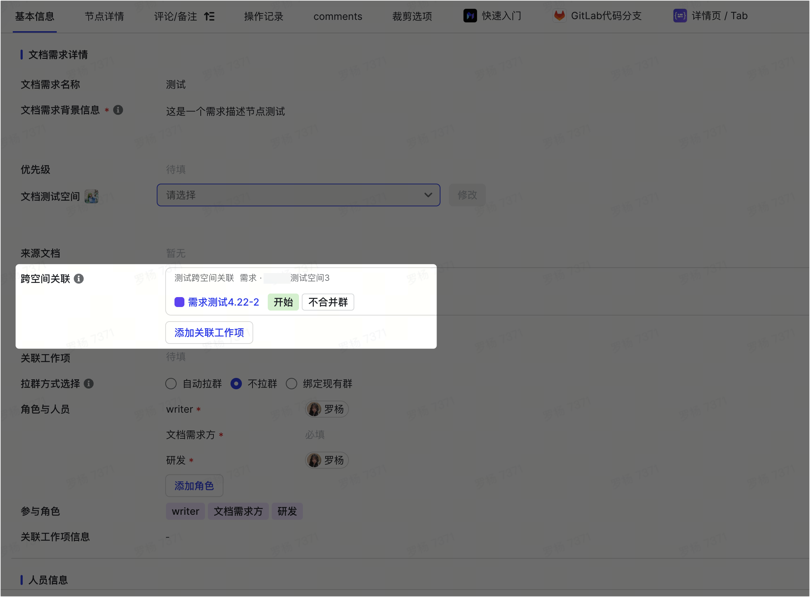

# 获取空间关联下的关联工作项实例列表

读取指定工作项已经绑定的跨空间关联实例。路径定位当前工作项，请求体中的规则 ID、关联空间和关联工作项类型用于筛选另一端。

## 关联方向与标识

| 所在位置 | 表示哪一端 |
| --- | --- |
| 路径 `project_key`、`work_item_type_key`、`work_item_id` | 当前工作项 |
| 请求体 `relation_project_key`、`relation_work_item_type_key` | 关联工作项所在空间与类型 |
| 请求体 `relation_rule_id` | 用于筛选的空间关联规则 ID |
| 响应 `project_relation_rule_id` | 返回该实例关系使用的规则 ID，字段名与请求不同 |

规则 ID 可通过[获取空间关联规则列表](获取空间关联规则列表.md)读取。绑定与解绑的产品操作见[跨空间关联控件配置](https://project.feishu.cn/1ykiuvvj/4g4laxgf#16c87d68)，插件权限见[权限管理](../guides/权限管理.md)中的“工作项实例”。

如下图，通过跨空间关联控件，建立一个需求实例和两个缺陷实例的绑定关系。



<a id="请求说明"></a>

## 请求说明

**请求方式**：`POST`
**请求地址**：`/open_api/:project_key/relation/:work_item_type_key/:work_item_id/work_item_list`

<a id="请求参数"></a>

## 请求参数

<a id="header"></a>

### 请求头

接口调用的 Header 配置详见 [Header](../guides/OpenAPI概述.md#a8e43b86)。

<a id="Path"></a>

### 路径参数

| 参数 | 类型 | 是否必须 | 说明 |
| --- | --- | --- | --- |
| project_key | string | 必须 | [填写说明](#parameter-notes-1) |
| work_item_type_key | string | 必须 | 工作项类型，创建工作项时自动生成，通过[获取空间下工作项类型](获取空间下工作项类型.md)接口获取，需要与 `work_item_id`对应实例匹配。 |
| work_item_id | int64 | 必须 | 工作项实例 ID，在工作项实例详情中，单击右上角 **··· ，​**然后单击 **ID** 即可获取。 |

<a id="parameter-notes-1"></a>

**project_key 的填写说明**

空间 ID（project_key），或者空间域名（simple_name）。

- 空间 ID（project_key），在飞书项目空间双击空间名称获取。

- 空间域名（simple_name），`simple_name` 一般在飞书项目空间 URL 中获取。例如空间 URL 为 “https://project.feishu.cn/doc/overview”，则 `simple_name`为 “doc”。

<a id="Body"></a>

### 请求体

| 参数 | 类型 | 是否必须 | 说明 |
| --- | --- | --- | --- |
| relation_rule_id | string | 可选 | 空间关联关系规则 ID，可通过调用[获取空间关联规则列表](获取空间关联规则列表.md)接口获取该 ID。 |
| relation_work_item_type_key | string | 可选 | 关联工作项的类型 key。 |
| relation_project_key | string | 可选 | 关联空间的 `project_key`。 |

<a id="返回参数"></a>

## 返回参数

每个 `data` 元素同时包含关联工作项、关联空间与使用的规则。原文没有提供分页参数或明确数量阈值；虽然 `Too many records` 的说明建议减少记录或分批处理，不能据此自行添加 `page_size`、`page_num` 等未定义参数。

| 参数 | 类型 | 说明 |
| --- | --- | --- |
| `data` | `list<object>` | 包含关联工作项信息的数组，遵循[RelationInstance](https://project.feishu.cn/b/helpcenter/1p8d7djs/1x1d372l#2eb833f0)结构规范 |
| `err` | object | 请求成功时返回空值，请求失败时返回实际错误信息。 |
| `err_code` | int32 | 请求成功时返回0，请求失败返回实际错误码。 |

### `data`

| 参数 | 类型 | 说明 |
| --- | --- | --- |
| `relation_work_item_id` | int64 | 关联工作项 ID |
| `relation_work_item_name` | string | 关联工作项名称 |
| `relation_work_item_type_name` | string | 关联工作项类型名称 |
| `relation_work_item_type_key` | string | 关联工作项类型 key |
| `project_relation_rule_id` | string | 空间关联规则 ID |
| `project_relation_rule_name` | string | 空间关联规则名称 |
| `relation_project_key` | string | 联动空间的 project_key |
| `relation_project_name` | string | 联动空间名称 |

### `err`

| 参数 | 类型 | 说明 |
| --- | --- | --- |
| `code` | int32 | 部分场景下，透出更详细错误对应的错误码。 |
| `msg` | string | 部分场景下，透出更详细的错误描述。 |
| `log_id` | string | 报错场景下的调用链标识符，用于追踪错误发生时的完整调用链路，便于日志记录和问题排查。 |

<a id="请求示例"></a>

## 请求示例

示例中的数值型脱敏标识已用等长演示数字替代，调用时填写真实 ID；中文数据采用等义 Unicode 转义。

**请求路径**：/open_api/68382b399de4b0ec6c5a9637/relation/story/6437115800/work_item_list

```json
{
  "relation_work_item_type_key": "issue",
  "relation_rule_id": "732745513523483xxx",
  "relation_project_key": "658b9f05809f644bebxxxx"
}
```


<a id="返回示例"></a>

## 返回示例

中文名称以等义 Unicode 转义显示；数值型标识使用演示数字，保留参数定义的数据类型。

### 请求成功示例

```json
{
  "data": [
    {
      "relation_project_name": "xx\u7a7a\u95f4",
      "relation_work_item_id": 3000647000,
      "relation_work_item_name": "\u5173\u8054\u7f3a\u96771",
      "relation_work_item_type_name": "\u7f3a\u9677",
      "relation_work_item_type_key": "issue",
      "project_relation_rule_id": "732745513523483xxx",
      "project_relation_rule_name": "\u89c4\u5219\u540d\u79f0",
      "relation_project_key": "658b9f05809f644bebxxxx"
    }
  ],
  "err": {},
  "err_code": 0,
  "err_msg": ""
}
```


### 错误返回示例

以下错误原因为 `work_item_id` 填写不正确，或者与 `work_item_type_key` 不匹配。

```json
{
  "err_code": 30005,
  "err_msg": "WorkItem Not Found",
  "err": {
    "code": 30005,
    "msg": "WorkItem Not Found, please refer to https://project.feishu.cn/b/helpcenter/1p8d7djs/5aueo3jr",
    "log_id": "202510311640462AE9E4A60BD98763xxxx"
  }
}
```

<a id="错误码"></a>

## 错误码

以下列出了该接口相关的错误码信息，若需查看更多通用错误码说明，参见 [Open API 错误码](../formats/Open%20API%20错误码.md)。

| err_code | err_msg | err.code | err.msg | 说明 |
| --- | --- | --- | --- | --- |
| 10001 | Operation Not Permitted | 10001 | Operation Not Permitted | 操作不被允许，通常表示用户没有足够的权限执行该操作。 |
| 30005 | WorkItem Not Found | 30005 | WorkItem Not Found | 因为 `work_item_id` 填写不正确，或者与 `work_item_type_key` 不匹配。 |
| 50006 | Too many records | 50006 | 操作失败，请重试或联系平台 | 关联的记录数量超过系统限制，请减少关联记录数量或分批处理。 |

更新时间：2026-09-07
官方 URL：https://project.feishu.cn/b/helpcenter/1p8d7djs/5sxml78p
