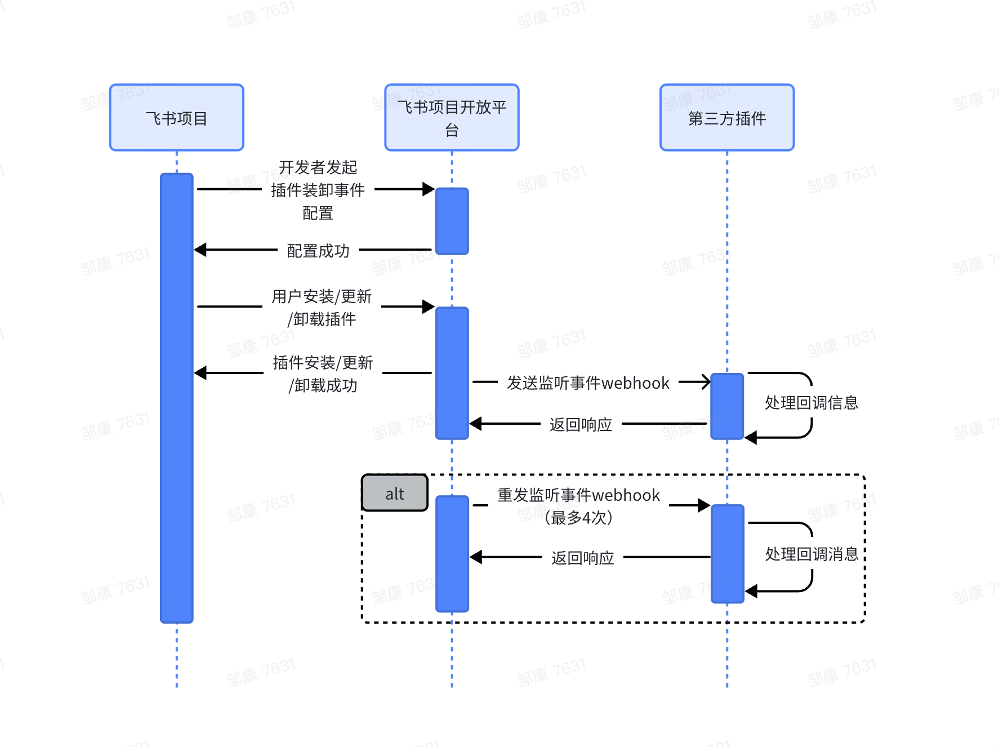
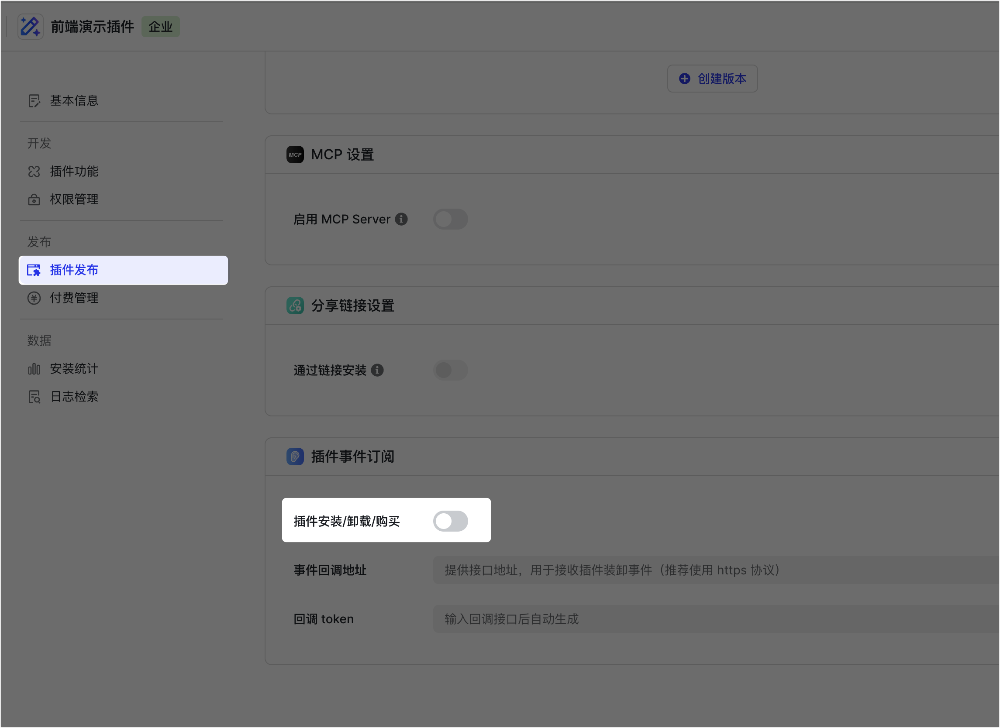

# 插件装卸监听

<a id="12bd78e3"></a>

## 什么是插件装卸监听

插件装卸监听向开发者通知本插件在空间中的安装、卸载和更新操作，可用于初始化空间数据、处理版本变化和清理关联状态。此外，ISV 场景可以接收插件购买事件。

<a id="859036bc"></a>

## 监听流程



<a id="568b85c6"></a>

## 配置流程

<a id="f0ccb4cb"></a>

### 插件安装卸载相关配置

1. 在插件发布板块开启安装/卸载监听。开关立即生效，无需发布版本。
2. 配置公网可访问的回调地址，平台通过 HTTP/HTTPS POST 推送事件。
3. 按需配置回调 token，接收端据此校验请求签名 `signature`。
4. 接收空间中安装、卸载和更新本插件产生的事件。



回调地址支持热配置：修改后对所有插件版本生效，无需重新发版。这里的配置机制与普通事件组件的版本发布流程不同。

<a id="37d60d4c"></a>

## 投递约定与处理策略

| 事项 | 约定 |
| --- | --- |
| 成功确认 | 接收请求后 **1000ms** 内返回 HTTP **200**，响应体结构不限 |
| 失败重试 | 初次发送失败后最多再重试 **4 次**，间隔依次为立即、1 分钟、2 分钟、7 分钟；仍失败则停止 |
| 事件顺序 | 无序投递，可参考 `request_time` 判断事件时间 |
| 重复投递 | 同一事件可能多次发送，以 `data.idempotent_key` 过滤重复事件 |
| OpenAPI 回查 | 原文明确本功能保证 OpenAPI 回查实时性 |

耗时处理可以放入异步逻辑：先完成接收并及时返回 HTTP 200，再进行后续业务处理，以减少超时触发的重复投递。原文也建议使用中国大陆服务器，减少网络链路耗时。`request_time` 的含义是发送时间，通常接近发生时间；原文未提供严格排序序号或同毫秒事件的顺序保证。

<a id="acc71262"></a>

## 事件列表

| 类型 | 事件 | 编码 |
| --- | --- | --- |
| 插件（600） | 插件安装 | [6001](#79fb5e0a) |
| 插件（600） | 插件卸载 | [6002](#ae5f6449) |
| 插件（600） | 插件更新 | [6003](#5cbe6bef) |
| 插件（600） | 插件购买，仅 ISV | [6004](#686867c6) |

<a id="8d512968"></a>

## 事件结构

### 请求包裹层

| 字段 | 含义 |
| --- | --- |
| `log_id` | 事件对应的日志 ID |
| `source_plugin_version` | 插件版本 |
| `request_time` | 发送时间，完整样例定义为**毫秒级**时间戳 |
| `signature` | 请求签名，使用配置的回调 token 验签 |
| `source` | 本类事件只返回 `normal`，表示普通用户操作 |
| `source_plugin_id` | 插件 ID |
| `source_plugin_name` | 插件名称 |
| `data` | 事件专属业务数据 |
| `data.event_type` | 6001、6002、6003 或 6004 |
| `data.idempotent_key` | 事件唯一标识，用于重复投递去重 |

原文公共来源说明还列出 `openapi`（OpenAPI）、`system`（系统行为）、`automation`（自动化），但明确装卸监听只返回 `normal`。这些名称不能用来推断装卸监听支持其他来源，且此处通用枚举的 `openapi` 与拦截事件的 `open_api` 拼写不同。

以下以安装事件的编码 `6001` 展示公共结构，专属业务字段见各事件的完整样例。

```json
{
  "log_id": "2024XXXXXXXXXXXXXXXXXXXXXXXXXXXC07",
  "source_plugin_version": "1.0.6",
  "request_time": 1730184005453,
  "signature": "4eae10ac752c9b564b9060d50650fd4c60ad3cbc917218440f04e9a94a39xxxx",
  "source": "normal",
  "source_plugin_id": "MII_XXXXX",
  "source_plugin_name": "XXXXX",
  "data": {
    "event_type": 6001,
    "idempotent_key": "90d94fba3a8f14e372b0a0e7446fefc761056ef3dcf9d777271cc1c16b10xxxx"
  }
}
```

### 空间事件的公共数据

安装、卸载、更新三个事件的 `data` 都包含以下字段；购买事件的数据见其专节。

| 字段 | 含义 |
| --- | --- |
| `tenant_id` | 租户 ID |
| `project_name` | 空间名称 |
| `project_key` | 空间 key |

三个样例重复使用同一个脱敏幂等键，仅用于展示结构。实际处理使用收到的 `data.idempotent_key` 去重。

<a id="f77dfb51"></a>

### 兼容性说明与验签说明

签名算法与兼容性要求见[兼容性说明与验签说明](事件兼容性与验签.md)。

<a id="79fb5e0a"></a>

## 插件安装（6001）

安装事件在空间公共数据之外提供 `install_channel`。原文列出的安装渠道为 `share_url`、`app_market`、`app_center`、`resolution`、`template`、`project_replicate`、`recomandation`；最后一个枚举保留原文拼写，不改为 `recommendation`。

```json
{
  "log_id": "2024XXXXXXXXXXXXXXXXXXXXXXXXXXXC07",
  "source_plugin_version": "1.0.6",
  "request_time": 1730184005453,
  "signature": "4eae10ac752c9b564b9060d50650fd4c60ad3cbc917218440f04e9a94a39xxxx",
  "source": "normal",
  "source_plugin_id": "MII_XXXXX",
  "source_plugin_name": "XXXXX",
  "data": {
    "event_type": 6001,
    "idempotent_key": "dfeca02665da4f1aa599e407f4f1b885dc0becb01497b011445b39b49d9cxxxx",
    "tenant_id": "test_tenant",
    "project_name": "XXXXX",
    "project_key": "62a047fcc63097a1690exxxx",
    "install_channel": "share_url"
  }
}
```

<a id="ae5f6449"></a>

## 插件卸载（6002）

卸载事件以租户和空间标识告知插件被卸载的位置。原样例没有 `install_channel`，也没有卸载原因字段。

```json
{
  "log_id": "2024XXXXXXXXXXXXXXXXXXXXXXXXXXXC07",
  "source_plugin_version": "1.0.6",
  "request_time": 1730184005453,
  "signature": "4eae10ac752c9b564b9060d50650fd4c60ad3cbc917218440f04e9a94a39xxxx",
  "source": "normal",
  "source_plugin_id": "MII_XXXXX",
  "source_plugin_name": "XXXXX",
  "data": {
    "event_type": 6002,
    "idempotent_key": "dfeca02665da4f1aa599e407f4f1b885dc0becb01497b011445b39b49d9cxxxx",
    "tenant_id": "test_tenant",
    "project_name": "XXXXX",
    "project_key": "62a047fcc63097a1690ecdc3"
  }
}
```

<a id="5cbe6bef"></a>

## 插件更新（6003）

更新事件提供空间标识及包裹层的 `source_plugin_version`。原文没有另行定义更新前版本字段，不能从样例补推一组前后版本值。

```json
{
  "log_id": "2024XXXXXXXXXXXXXXXXXXXXXXXXXXXC07",
  "source_plugin_version": "1.0.6",
  "request_time": 1730184005453,
  "signature": "4eae10ac752c9b564b9060d50650fd4c60ad3cbc917218440f04e9a94a39xxxx",
  "source": "normal",
  "source_plugin_id": "MII_XXXXX",
  "source_plugin_name": "XXXXX",
  "data": {
    "event_type": 6003,
    "idempotent_key": "dfeca02665da4f1aa599e407f4f1b885dc0becb01497b011445b39b49d9cxxxx",
    "tenant_id": "test_tenant",
    "project_name": "XXXXX",
    "project_key": "62a047fcc63097a1690ecdc3"
  }
}
```

<a id="686867c6"></a>

## 插件购买（6004）

仅用于 **ISV 场景**。该事件以租户和订单为核心，不沿用安装事件的空间字段。

| `data` 字段 | 含义 |
| --- | --- |
| `event_type` | 固定为 `6004` |
| `idempotent_key` | 事件唯一标识 |
| `tenant_id` | 租户 ID |
| `order_id` | 订单 ID，样例按数值传递 |
| `price_key` | 付费方案 key |
| `buy_type` | `FirstBuy` 首次购买、`Upgrade` 升级购买、`Renew` 续费购买 |
| `payment_amount` | 订单支付价格，单位为**分** |
| `is_trial` | 是否试用；样例为 `0`，原文未定义完整枚举 |

以下使用演示订单 ID `123132131000` 与支付金额 `100` 分替换源文的脱敏数值占位符，仅用于说明数据结构。

```json
{
  "log_id": "2024XXXXXXXXXXXXXXXXXXXXXXXXXXXC07",
  "source_plugin_version": "1.0.6",
  "request_time": 1730184005453,
  "signature": "4eae10ac752c9b564b9060d50650fd4c60ad3cbc917218440f04e9a94a39xxxx",
  "source": "normal",
  "source_plugin_id": "MII_XXXXX",
  "source_plugin_name": "XXXXX",
  "data": {
    "event_type": 6004,
    "idempotent_key": "dfeca02665da4f1aa599e407f4f1b885dc0becb01497b011445b39b49d9cxxxx",
    "tenant_id": "test_tenant",
    "order_id": 123132131000,
    "price_key": "price_abcsxxxx",
    "buy_type": "FirstBuy",
    "payment_amount": 100,
    "is_trial": 0
  }
}
```

更新时间：2026-09-07
官方 URL：https://project.feishu.cn/b/helpcenter/1p8d7djs/lswla3b5
