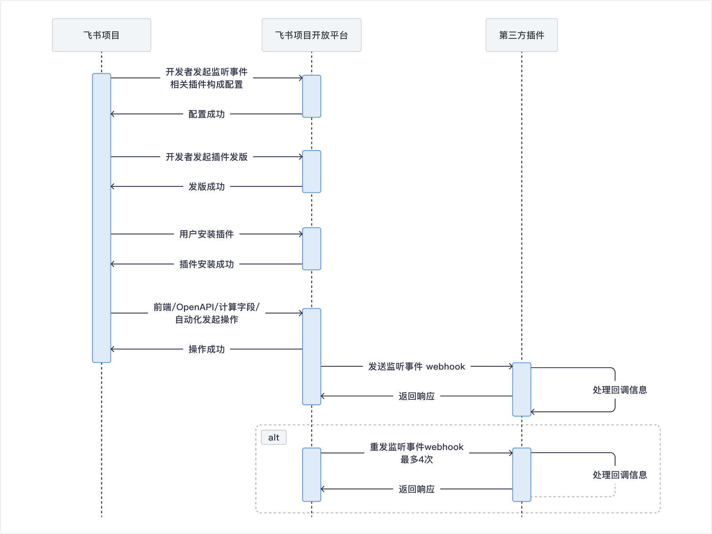
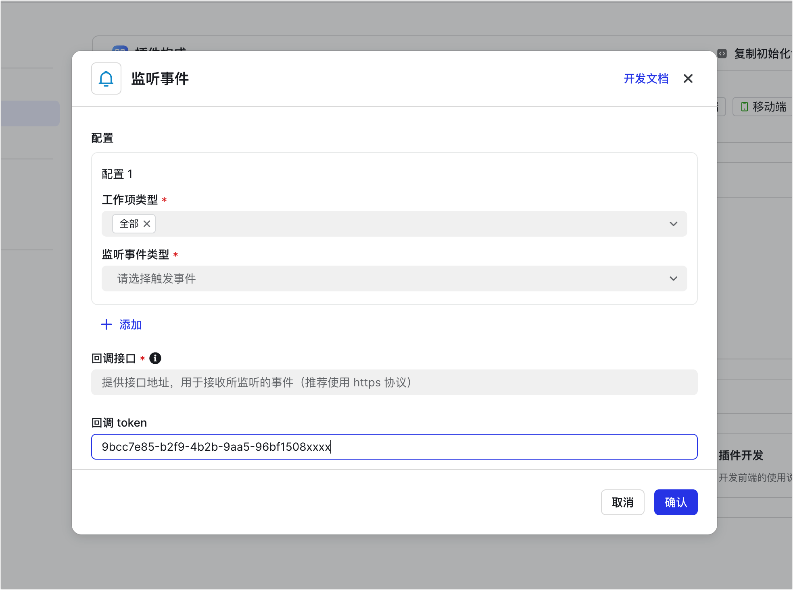

# 监听事件

<a id="6cd37592"></a>

## 什么是监听事件？

监听事件在工作项、节点、状态、子任务或空间数据发生变化后，通过回调通知插件。接收端可以据此同步业务数据、更新外部系统或启动后续处理；它不负责阻止已经发生的操作。

<a id="bb181267"></a>

## 监听流程



<a id="d09c5c41"></a>

## 配置流程

<a id="bbf22f09"></a>

### 插件构成相关配置

1. 在插件功能板块添加监听事件组件，选择需要接收的数据变更。



2. **配置监听事件：**添加插件需监听的工作项类型及其对应事件类型。

| 配置选项 | 对应工作项类型 |
| --- | --- |
| 需求 | 系统预设 `story` |
| 缺陷 | 系统预设 `issue` |
| 迭代 | 系统预设 `sprint` |
| 版本 | 系统预设 `version` |
| 其他工作项 | 上述类型以外的工作项 |

3. **配置回调地址：**插件需要提供回调地址。当事件发生时，开放平台会向该地址发送相应的HTTP/HTTPS POST请求。

> **说明**：请确保该地址公网可以访问；回调地址支持热更，修改配置并保存后会**立刻生效，无需新发版。**

4. **配置回调 token**（可选）：配置 token 后，开放平台在向回调地址发送请求时，加密校验字段（**signature**）将包含所配token。

5. **版本发布：**要使得配置生效，开发者需要创建版本并发布。

6. **接收事件：**用户在空间安装插件的对应版本后，发生相关数据变化会向配置的回调地址推送事件。

事件订阅与工作项类型配置需要发版并在空间安装对应版本；**仅回调地址的修改支持热更新**，保存后立即生效。

<a id="d07da6a4"></a>

## 稳定性说明

| 事项 | 平台约定 |
| --- | --- |
| 突发请求 | 某些用户操作会瞬间触发大量事件，接收端可能遇到较高 QPS |
| 投递失败 | 最多重试 4 次，间隔依次为立即、1 分钟、2 分钟、7 分钟，之后停止 |
| 事件顺序 | 无序投递，可参考 `request_time` 判断事件时间 |
| 重复投递 | 同一事件可能多次发送，以 `data.idempotent_key` 去重 |
| 回查一致性 | 基本保证 OpenAPI 回查实时性，但有下列明确例外 |

视图操作查询存在 **2 秒**延迟；[获取指定的关联工作项列表（单空间）](../api/获取指定的关联工作项列表（单空间）.md)存在 **1 分钟**延迟。收到通知后立即查询这些接口，结果可能尚未反映此次变更。`request_time` 是发送时间，通常接近发生时间；原文未提供严格递增序号。

<a id="72f1e5c9"></a>

## 接收确认与处理策略

接收请求后必须在 **1000ms** 内返回 HTTP **200**，响应体结构不限。超时或未返回要求的状态码会触发上述失败重试。

你可以参考以下策略优化你的服务。

1. **将耗时操作异步处理**

对于某些耗时的操作，你可能无法在 1000 ms内回复请求，从而导致飞书项目认为请求失败，再次请求服务。你可以将某些耗时操作转换为异步处理，先返回 HTTP 200，并在随后的异步逻辑中处理请求。

2. **使用位于中国大陆的服务器**

飞书项目需要你在 1000 ms内回复 HTTP 200 状态码用以判断请求是否成功。使用位于中国大陆的服务器可以有效减少在链路上所消耗的时间，为服务内部处理逻辑提供余量，从而减少你的服务器返回响应超时的可能性。

<a id="75cdbed8"></a>

## 事件列表

| 类型 | 事件 | 事件编码 |
| --- | --- | --- |
| 工作项（100） | 创建工作项 | [1001](#3e22a2fc) |
| 工作项（100） | 删除工作项 | [1002](#03887319) |
| 工作项（100） | 恢复工作项 | [1004](#2359a674) |
| 工作项（100） | 终止工作项 | [1005](#c3fe2e0e) |
| 工作项（100） | 模版升级 | [1006](#94edd661) |
| 工作项（100） | 修改字段 | [1009](#b674f6ea) |
| 节点（200） | 完成节点 | [2001](#4b6f4ecd) |
| 节点（200） | 删除节点 | [2002](#51b93711) |
| 节点（200） | 恢复节点 | [2003](#79b09ae0) |
| 节点（200） | 回滚节点 | [2004](#4d7b694e) |
| 节点（200） | 修改估分与排期 | [2005](#d928f174) |
| 节点（200） | 修改节点负责人 | [2006](#66dc0092) |
| 节点（200） | 修改实际工时 | [2007](#15d6f4e6) |
| 节点（200） | 多人确认节点流转事件 | [2009](#5edac4ad) |
| 状态（300） | 状态变更 | [3001](#915c5422) |
| 子任务（400） | 新建子任务 | [4001](#dd00f1b4) |
| 子任务（400） | 删除子任务 | [4002](#31c7d295) |
| 子任务（400） | 完成子任务 | [4003](#eafe91d8) |
| 子任务（400） | 取消完成子任务 | [4004](#b68ea006) |
| 子任务（400） | 修改子任务负责人 | [4005](#e2a52df3) |
| 子任务（400） | 修改子任务估分 | [4006](#b189ef92) |
| 子任务（400） | 修改子任务排期 | [4007](#7468c7f2) |
| 子任务（400） | 修改子任务实际工时 | [4008](#997c7f80) |
| 子任务（400） | 修改子任务字段 | [4009](#e7344daa) |
| 空间（500） | 添加空间成员 | [5001](#5557082c) |
| 空间（500） | 删除空间成员 | [5002](#f74def81) |
| 空间（500） | 完成工作移交 | [5003](#358b4ccf) |
| 空间（500） | 拒绝工作移交 | [5004](#fa04d42b) |

> **说明**：批量操作引发的数据变化，会发送对应的多个数据变更事件，而非一个批量操作事件。

<a id="dafc27f8"></a>

## 事件结构

### 请求包裹层

回调使用 HTTP POST。下表是所有事件共有的包裹层，事件专属内容放在 `data` 中。

| 字段 | 含义 |
| --- | --- |
| `log_id` | 事件对应的日志 ID |
| `source_plugin_version` | 插件版本 |
| `request_time` | 发送时间，**毫秒级** Unix 时间戳 |
| `signature` | 请求签名，使用回调 token 验签 |
| `source` | 来源：`normal` 普通用户、`openapi` OpenAPI、`system` 系统行为、`automation` 自动化 |
| `source_plugin_id` / `source_plugin_name` | 来源插件 ID 与名称 |
| `data.event_type` | 本页事件列表中的数字编码 |
| `data.idempotent_key` | 本事件的唯一标识，用于重复投递去重 |

监听事件使用 **`openapi`**；拦截事件的对应来源值是 `open_api`，两者应按各自协议解析。工作移交 5003、5004 的 `source` 固定为 `system`。

### 公共业务字段

| 字段 | 含义 |
| --- | --- |
| `project_key` / `project_name` | 空间 key 与名称 |
| `tenant_id` | 租户 ID |
| `flow_type` | 工作流类型：`0` 节点流、`1` 状态流 |
| `user_info` | 操作者：`user_key`、`name_cn`、`name_en`、`email` |
| `work_item_info[]` | 工作项信息：`work_item_id`、`work_item_name`、`work_item_type_key` |
| `work_item_type_key` | 当前事件对应的工作项类型；子任务事件中指子任务类型 |

空间事件只提供其对应的成员或工作移交数据，不保证包含工作项事件的所有公共字段。

### 字段变更结构

工作项事件使用 `field_info[]`，子任务事件使用 `sub_task_info[].field_infos[]`。字段值解析详见[字段与属性解析格式](../formats/字段与属性解析格式.md)。

| 字段 | 含义 |
| --- | --- |
| `field_key` / `alias` | 字段 key 与对接标识 |
| `field_type` | 字段类型 |
| `before_field_value` / `after_field_value` | 事件触发前与触发时的值，常为字符串 |
| `before_field_value_markdown` / `after_field_value_markdown` | 富文本的 Markdown 信息，仅富文本字段返回 |
| `*.markdown` | Markdown 内容 |
| `*.metion_user_keys` | Markdown 中 @ 提及的人员；按原协议拼写保留 |

数字、布尔值、数组或对象可能被序列化为字段值字符串，解析时先区分外层 JSON 与字段自身的值格式。下文中文样例数据统一使用等义 Unicode 转义。源文的缺逗号、中文分隔符及 `nil` 已按 JSON 语法校正，业务字段和值保持原含义。

```json
{
  "log_id": "2024XXXXXXXXXXXXXXXXXXXXXXXXXXXC07",
  "source_plugin_version": "1.0.6",
  "request_time": 1730184005453,
  "signature": "4eae10ac752c9b564b9060d50650fd4c60ad3cbc917218440f04e9a94a3934c8",
  "source": "normal",
  "source_plugin_id": "MII_XXXXX",
  "source_plugin_name": "XXXXX",
  "data": {
    "event_type": 1001,
    "idempotent_key": "90d94fba3a8f14e372b0a0e7446fefc761056ef3dcf9d777271cc1c16b10c5d6"
  }
}
```


<a id="a5375fd9"></a>

## 兼容性说明与验签说明

[兼容性说明与验签说明](事件兼容性与验签.md)

<a id="01f0c015"></a>

## 工作项

<a id="3e22a2fc"></a>

### 创建工作项（1001）

创建完成后推送，`work_item_info[].work_item_id` 已是实际创建的工作项 ID。`field_info` 提供建单字段，样例包含名称和描述，富文本描述另附 Markdown 与提及人员信息。

```json
{
  "log_id": "2024XXXXXXXXXXXXXXXXXXXXXXXXXXXC07",
  "source_plugin_version": "1.0.6",
  "request_time": 1730184005453,
  "signature": "4eae10ac752c9b564b9060d50650fd4c60ad3cbc917218440f04e9a94a3934c8",
  "source": "normal",
  "source_plugin_id": "MII_XXXXX",
  "source_plugin_name": "XXXXX",
  "data": {
    "event_type": 1001,
    "idempotent_key": "90d94fba3a8f14e372b0a0e7446fefc761056ef3dcf9d777271cc1c16b10c5d6",
    "project_name": "XXXXX",
    "project_key": "62a047fcc63097a1690ecdc3",
    "tenant_id": "ByteDance",
    "flow_type": 0,
    "field_info": [
      {
        "after_field_value": "\u5de5\u4f5c\u9879178",
        "alias": "",
        "before_field_value": "",
        "field_key": "name",
        "field_type": ""
      },
      {
        "after_field_value": "\u63cf\u8ff0\u4fe1\u606f",
        "after_field_value_markdown": {
          "markdown": "\u63cf\u8ff0\u4fe1\u606f",
          "metion_user_keys": []
        },
        "alias": "description",
        "before_field_value": "",
        "field_key": "description",
        "field_type": "multi_text"
      }
    ],
    "user_info": {
      "user_key": "73567952804XXXXXX76",
      "name_cn": "XXX",
      "name_en": "XXX",
      "email": "XXXX@bytedance.com"
    },
    "work_item_info": [
      {
        "work_item_id": 5390584662,
        "work_item_name": "XX",
        "work_item_type_key": "62eb2cff38a66d197ac17d2f"
      }
    ],
    "work_item_type_key": "62eb2cff38a66d197ac17d2f"
  }
}
```


<a id="03887319"></a>

### 删除工作项（1002）

删除后通知目标工作项和操作者。样例没有字段快照；需要保存删除前内容的接收端不能假设可在事件后通过详情接口重新取得该工作项。

```json
{
  "log_id": "2024XXXXXXXXXXXXXXXXXXXXXXXXXXXC07",
  "source_plugin_version": "1.0.6",
  "request_time": 1730184005453,
  "signature": "4eae10ac752c9b564b9060d50650fd4c60ad3cbc917218440f04e9a94a3934c8",
  "source": "normal",
  "source_plugin_id": "MII_XXXXX",
  "source_plugin_name": "XXXXX",
  "data": {
    "event_type": 1002,
    "idempotent_key": "90d94fba3a8f14e372b0a0e7446fefc761056ef3dcf9d777271cc1c16b10c5d6",
    "project_name": "XXXXX",
    "project_key": "62a047fcc63097a1690ecdc3",
    "tenant_id": "ByteDance",
    "flow_type": 0,
    "user_info": {
      "user_key": "73567952804XXXXXX76",
      "name_cn": "XXX",
      "name_en": "XXX",
      "email": "XXXX@bytedance.com"
    },
    "work_item_info": [
      {
        "work_item_id": 5390584662,
        "work_item_name": "XX",
        "work_item_type_key": "62eb2cff38a66d197ac17d2f"
      }
    ],
    "work_item_type_key": "62eb2cff38a66d197ac17d2f"
  }
}
```


<a id="2359a674"></a>

### 恢复工作项（1004）

`field_info` 包含终止状态 `aborted`、恢复补充原因 `restore_detail` 与原因选项 `restore_reason`，`data.reason` 提供恢复原因。`aborted` 的前后值为 JSON 对象序列化后的字符串，内部 `isAborted` 从 `true` 变为 `false`。

```json
{
  "log_id": "2024XXXXXXXXXXXXXXXXXXXXXXXXXXXC07",
  "source_plugin_version": "1.0.6",
  "request_time": 1730184005453,
  "signature": "4eae10ac752c9b564b9060d50650fd4c60ad3cbc917218440f04e9a94a3934c8",
  "source": "normal",
  "source_plugin_id": "MII_XXXXX",
  "source_plugin_name": "XXXXX",
  "data": {
    "event_type": 1004,
    "idempotent_key": "90d94fba3a8f14e372b0a0e7446fefc761056ef3dcf9d777271cc1c16b10c5d6",
    "project_name": "XXXXX",
    "project_key": "62a047fcc63097a1690ecdc3",
    "tenant_id": "ByteDance",
    "flow_type": 0,
    "user_info": {
      "user_key": "73567952804XXXXXX76",
      "name_cn": "XXX",
      "name_en": "XXX",
      "email": "XXXX@bytedance.com"
    },
    "work_item_info": [
      {
        "work_item_id": 5390584662,
        "work_item_name": "XX",
        "work_item_type_key": "62eb2cff38a66d197ac17d2f"
      }
    ],
    "field_info": [
      {
        "field_key": "aborted",
        "alias": "",
        "field_type": "",
        "before_field_value": "{\"isAborted\":true,\"reason\":\"\u6d4b\u8bd5\u4e00\u4e0b\uff1a\u7ec8\u6b62\u9700\u6c42\u6d4b\u8bd5\"}",
        "after_field_value": "{\"isAborted\":false,\"reason\":\"\u6d4b\u8bd5\u4e00\u4e0b\uff1a\u6062\u590d\u9700\u6c42\u6d4b\u8bd5\"}"
      },
      {
        "field_key": "restore_detail",
        "alias": "",
        "field_type": "",
        "before_field_value": "",
        "after_field_value": "\u6062\u590d\u9700\u6c42\u6d4b\u8bd5"
      },
      {
        "field_key": "restore_reason",
        "alias": "",
        "field_type": "",
        "before_field_value": "",
        "after_field_value": "test"
      }
    ],
    "reason": "\u6d4b\u8bd5\u4e00\u4e0b\uff1a\u6062\u590d\u9700\u6c42\u6d4b\u8bd5",
    "work_item_type_key": "62eb2cff38a66d197ac17d2f"
  }
}
```


<a id="c3fe2e0e"></a>

### 终止工作项（1005）

终止状态字段 `aborted` 的新值包含 `isAborted: true`；`abort_detail` 是补充原因，`abort_reason` 是原因选项，`data.reason` 是终止原因。此监听样例的补充原因类型为 `text`，应按本事件实际值解析。

```json
{
  "log_id": "2024XXXXXXXXXXXXXXXXXXXXXXXXXXXC07",
  "source_plugin_version": "1.0.6",
  "request_time": 1730184005453,
  "signature": "4eae10ac752c9b564b9060d50650fd4c60ad3cbc917218440f04e9a94a3934c8",
  "source": "normal",
  "source_plugin_id": "MII_XXXXX",
  "source_plugin_name": "XXXXX",
  "data": {
    "event_type": 1005,
    "idempotent_key": "90d94fba3a8f14e372b0a0e7446fefc761056ef3dcf9d777271cc1c16b10c5d6",
    "project_name": "XXXXX",
    "project_key": "62a047fcc63097a1690ecdc3",
    "tenant_id": "ByteDance",
    "flow_type": 0,
    "user_info": {
      "user_key": "73567952804XXXXXX76",
      "name_cn": "XXX",
      "name_en": "XXX",
      "email": "XXXX@bytedance.com"
    },
    "work_item_info": [
      {
        "work_item_id": 5390584662,
        "work_item_name": "XX",
        "work_item_type_key": "62eb2cff38a66d197ac17d2f"
      }
    ],
    "field_info": [
      {
        "field_key": "aborted",
        "alias": "",
        "field_type": "",
        "before_field_value": "",
        "after_field_value": "{\"isAborted\":true,\"reason\":\"\u6d4b\u8bd5\u4e00\u4e0b\uff1a\u7ec8\u6b62\u9700\u6c42\u6d4b\u8bd5\"}"
      },
      {
        "field_key": "abort_detail",
        "alias": "",
        "field_type": "text",
        "before_field_value": "",
        "after_field_value": "\u7ec8\u6b62\u9700\u6c42\u6d4b\u8bd5"
      },
      {
        "field_key": "abort_reason",
        "alias": "",
        "field_type": "select",
        "before_field_value": "",
        "after_field_value": "test"
      }
    ],
    "reason": "\u6d4b\u8bd5\u4e00\u4e0b\uff1a\u7ec8\u6b62\u9700\u6c42\u6d4b\u8bd5",
    "work_item_type_key": "62eb2cff38a66d197ac17d2f"
  }
}
```


<a id="94edd661"></a>

### 模版升级（1006）

工作项完成模板升级后通知，样例提供工作项和操作者。此事件未定义升级前后版本字段，不应把包裹层的插件版本 `source_plugin_version` 当作工作项模板版本。

```json
{
  "log_id": "2024XXXXXXXXXXXXXXXXXXXXXXXXXXXC07",
  "source_plugin_version": "1.0.6",
  "request_time": 1730184005453,
  "signature": "4eae10ac752c9b564b9060d50650fd4c60ad3cbc917218440f04e9a94a3934c8",
  "source": "normal",
  "source_plugin_id": "MII_XXXXX",
  "source_plugin_name": "XXXXX",
  "data": {
    "event_type": 1006,
    "idempotent_key": "90d94fba3a8f14e372b0a0e7446fefc761056ef3dcf9d777271cc1c16b10c5d6",
    "project_name": "XXXXX",
    "project_key": "62a047fcc63097a1690ecdc3",
    "tenant_id": "ByteDance",
    "flow_type": 0,
    "user_info": {
      "user_key": "73567952804XXXXXX76",
      "name_cn": "XXX",
      "name_en": "XXX",
      "email": "XXXX@bytedance.com"
    },
    "work_item_info": [
      {
        "work_item_id": 5390584662,
        "work_item_name": "XX",
        "work_item_type_key": "62eb2cff38a66d197ac17d2f"
      }
    ],
    "work_item_type_key": "62eb2cff38a66d197ac17d2f"
  }
}
```


<a id="b674f6ea"></a>

### 修改字段（1009）

在 `field_info` 中逐字段读取变更前后值。富文本可能同时返回前后两份 Markdown 信息，字段 `metion_user_keys` 表示其中提及的人员。

```json
{
  "log_id": "2024XXXXXXXXXXXXXXXXXXXXXXXXXXXC07",
  "source_plugin_version": "1.0.6",
  "request_time": 1730184005453,
  "signature": "4eae10ac752c9b564b9060d50650fd4c60ad3cbc917218440f04e9a94a3934c8",
  "source": "normal",
  "source_plugin_id": "MII_XXXXX",
  "source_plugin_name": "XXXXX",
  "data": {
    "event_type": 1009,
    "idempotent_key": "90d94fba3a8f14e372b0a0e7446fefc761056ef3dcf9d777271cc1c16b10c5d6",
    "project_name": "XXXXX",
    "project_key": "62a047fcc63097a1690ecdc3",
    "tenant_id": "ByteDance",
    "flow_type": 0,
    "field_info": [
      {
        "after_field_value": "2223333",
        "alias": "name",
        "before_field_value": "222",
        "field_key": "name",
        "field_type": "_name"
      },
      {
        "after_field_value": "\u63cf\u8ff0\u4fe1\u606f",
        "after_field_value_markdown": {
          "markdown": "\u63cf\u8ff0\u4fe1\u606f",
          "metion_user_keys": []
        },
        "alias": "description",
        "before_field_value": "",
        "before_field_value_markdown": {
          "markdown": "\u66f4\u65b0\u524d\u63cf\u8ff0\u4fe1\u606f",
          "metion_user_keys": []
        },
        "field_key": "description",
        "field_type": "multi_text"
      }
    ],
    "user_info": {
      "user_key": "73567952804XXXXXX76",
      "name_cn": "XXX",
      "name_en": "XXX",
      "email": "XXXX@bytedance.com"
    },
    "work_item_info": [
      {
        "work_item_id": 5390584662,
        "work_item_name": "XX",
        "work_item_type_key": "62eb2cff38a66d197ac17d2f"
      }
    ],
    "work_item_type_key": "62eb2cff38a66d197ac17d2f"
  }
}
```


<a id="4b2030f1"></a>

## 节点

<a id="4b6f4ecd"></a>

### 完成节点（2001）

`node_info.update_nodes` 列出完成的节点。公共节点对象还包含 `del_nodes`（删除）、`recover_nodes`（恢复）、`reason`（操作原因）、`owner_in_charge`（负责人变更）与 `schedule_info`（排期）；未涉及的部分在样例中为 `null` 或空值。

```json
{
  "log_id": "2024XXXXXXXXXXXXXXXXXXXXXXXXXXXC07",
  "source_plugin_version": "1.0.6",
  "request_time": 1730184005453,
  "signature": "4eae10ac752c9b564b9060d50650fd4c60ad3cbc917218440f04e9a94a3934c8",
  "source": "normal",
  "source_plugin_id": "MII_XXXXX",
  "source_plugin_name": "XXXXX",
  "data": {
    "event_type": 2001,
    "idempotent_key": "90d94fba3a8f14e372b0a0e7446fefc761056ef3dcf9d777271cc1c16b10c5d6",
    "project_name": "XXXXX",
    "project_key": "62a047fcc63097a1690ecdc3",
    "tenant_id": "ByteDance",
    "flow_type": 0,
    "node_info": {
      "del_nodes": null,
      "owner_in_charge": null,
      "reason": "",
      "recover_nodes": null,
      "schedule_info": null,
      "update_nodes": [
        "state_0"
      ]
    },
    "user_info": {
      "user_key": "73567952804XXXXXX76",
      "name_cn": "XXX",
      "name_en": "XXX",
      "email": "XXXX@bytedance.com"
    },
    "work_item_info": [
      {
        "work_item_id": 5390584662,
        "work_item_name": "XX",
        "work_item_type_key": "62eb2cff38a66d197ac17d2f"
      }
    ],
    "work_item_type_key": "62eb2cff38a66d197ac17d2f"
  }
}
```


<a id="51b93711"></a>

### 删除节点（2002）

已删除节点位于 `node_info.del_nodes`；`reason` 为操作原因，其他节点操作字段不代表本次删除的目标。

```json
{
  "log_id": "2024XXXXXXXXXXXXXXXXXXXXXXXXXXXC07",
  "source_plugin_version": "1.0.6",
  "request_time": 1730184005453,
  "signature": "4eae10ac752c9b564b9060d50650fd4c60ad3cbc917218440f04e9a94a3934c8",
  "source": "normal",
  "source_plugin_id": "MII_XXXXX",
  "source_plugin_name": "XXXXX",
  "data": {
    "event_type": 2002,
    "idempotent_key": "90d94fba3a8f14e372b0a0e7446fefc761056ef3dcf9d777271cc1c16b10c5d6",
    "project_name": "XXXXX",
    "project_key": "62a047fcc63097a1690ecdc3",
    "tenant_id": "ByteDance",
    "flow_type": 0,
    "node_info": {
      "update_nodes": null,
      "del_nodes": [
        "ee98bfd6278fee09eed80f61979ba73c"
      ],
      "recover_nodes": null,
      "reason": "XXX",
      "owner_in_charge": null,
      "schedule_info": null
    },
    "user_info": {
      "user_key": "73567952804XXXXXX76",
      "name_cn": "XXX",
      "name_en": "XXX",
      "email": "XXXX@bytedance.com"
    },
    "work_item_info": [
      {
        "work_item_id": 5390584662,
        "work_item_name": "XX",
        "work_item_type_key": "62eb2cff38a66d197ac17d2f"
      }
    ],
    "work_item_type_key": "62eb2cff38a66d197ac17d2f"
  }
}
```


<a id="79b09ae0"></a>

### 恢复节点（2003）

已恢复节点位于 `node_info.recover_nodes`，样例中的更新与删除列表为空。

```json
{
  "log_id": "2024XXXXXXXXXXXXXXXXXXXXXXXXXXXC07",
  "source_plugin_version": "1.0.6",
  "request_time": 1730184005453,
  "signature": "4eae10ac752c9b564b9060d50650fd4c60ad3cbc917218440f04e9a94a3934c8",
  "source": "normal",
  "source_plugin_id": "MII_XXXXX",
  "source_plugin_name": "XXXXX",
  "data": {
    "event_type": 2003,
    "idempotent_key": "90d94fba3a8f14e372b0a0e7446fefc761056ef3dcf9d777271cc1c16b10c5d6",
    "project_name": "XXXXX",
    "project_key": "62a047fcc63097a1690ecdc3",
    "tenant_id": "ByteDance",
    "flow_type": 0,
    "node_info": {
      "update_nodes": null,
      "del_nodes": null,
      "recover_nodes": [
        "ee98bfd6278fee09eed80f61979ba73c"
      ],
      "reason": "",
      "owner_in_charge": null,
      "schedule_info": null
    },
    "user_info": {
      "user_key": "73567952804XXXXXX76",
      "name_cn": "XXX",
      "name_en": "XXX",
      "email": "XXXX@bytedance.com"
    },
    "work_item_info": [
      {
        "work_item_id": 5390584662,
        "work_item_name": "XX",
        "work_item_type_key": "62eb2cff38a66d197ac17d2f"
      }
    ],
    "work_item_type_key": "62eb2cff38a66d197ac17d2f"
  }
}
```


<a id="4d7b694e"></a>

### 回滚节点（2004）

回滚节点位于 `node_info.update_nodes`，`reason` 提供操作原因。完成与回滚都可使用此列表，需根据 `event_type` 区分动作。

```json
{
  "log_id": "2024XXXXXXXXXXXXXXXXXXXXXXXXXXXC07",
  "source_plugin_version": "1.0.6",
  "request_time": 1730184005453,
  "signature": "4eae10ac752c9b564b9060d50650fd4c60ad3cbc917218440f04e9a94a3934c8",
  "source": "normal",
  "source_plugin_id": "MII_XXXXX",
  "source_plugin_name": "XXXXX",
  "data": {
    "event_type": 2004,
    "idempotent_key": "90d94fba3a8f14e372b0a0e7446fefc761056ef3dcf9d777271cc1c16b10c5d6",
    "project_name": "XXXXX",
    "project_key": "62a047fcc63097a1690ecdc3",
    "tenant_id": "ByteDance",
    "flow_type": 0,
    "node_info": {
      "update_nodes": [
        "ee98bfd6278fee09eed80f61979ba73c"
      ],
      "del_nodes": null,
      "recover_nodes": null,
      "reason": "88",
      "owner_in_charge": null,
      "schedule_info": null
    },
    "user_info": {
      "user_key": "73567952804XXXXXX76",
      "name_cn": "XXX",
      "name_en": "XXX",
      "email": "XXXX@bytedance.com"
    },
    "work_item_info": [
      {
        "work_item_id": 5390584662,
        "work_item_name": "XX",
        "work_item_type_key": "62eb2cff38a66d197ac17d2f"
      }
    ],
    "work_item_type_key": "62eb2cff38a66d197ac17d2f"
  }
}
```


<a id="d928f174"></a>

### 修改估分与排期（2005）

`node_info.schedule_info` 按节点 key 映射更新后的估分和排期。`different_schedule` 表示是否开启差异化排期，`schedule` 是整体排期，`schedules[]` 是包含负责人 `user_key` 的人员排期。

| 排期字段 | 含义与单位 |
| --- | --- |
| `estimate_start_time` | 开始时间，毫秒时间戳，按天取 `00:00:00` |
| `estimate_finish_time` | 结束时间，毫秒时间戳，按天取 `23:59:59` |
| `points` | 估分，浮点数 |
| `actual_work_time` | 实际工时，浮点数 |
| `planned_construction_period` | 计划工期，整数 |
| `user_key` | 人员排期对应的负责人 key |

```json
{
  "log_id": "2024XXXXXXXXXXXXXXXXXXXXXXXXXXXC07",
  "source_plugin_version": "1.0.6",
  "request_time": 1730184005453,
  "signature": "4eae10ac752c9b564b9060d50650fd4c60ad3cbc917218440f04e9a94a3934c8",
  "source": "normal",
  "source_plugin_id": "MII_XXXXX",
  "source_plugin_name": "XXXXX",
  "data": {
    "event_type": 2005,
    "idempotent_key": "90d94fba3a8f14e372b0a0e7446fefc761056ef3dcf9d777271cc1c16b10c5d6",
    "project_name": "XXXXX",
    "project_key": "62a047fcc63097a1690ecdc3",
    "tenant_id": "ByteDance",
    "flow_type": 0,
    "node_info": {
      "update_nodes": [
        "ee98bfd6278fee09eed80f61979ba73c"
      ],
      "del_nodes": null,
      "recover_nodes": null,
      "reason": "",
      "owner_in_charge": null,
      "schedule_info": {
        "ee98bfd6278fee09eed80f61979ba73c": {
          "different_schedule": false,
          "schedule": {
            "estimate_start_time": 1730124000000,
            "estimate_finish_time": 1730383199999,
            "points": 9,
            "actual_work_time": 0,
            "planned_construction_period": 0
          },
          "schedules": [
            {
              "estimate_start_time": 1730124000000,
              "estimate_finish_time": 1730383199999,
              "points": 3,
              "actual_work_time": 0,
              "planned_construction_period": 0,
              "user_key": "709704346987665XXXX"
            },
            {
              "estimate_start_time": 1730124000000,
              "estimate_finish_time": 1730383199999,
              "points": 3,
              "actual_work_time": 0,
              "planned_construction_period": 0,
              "user_key": "709704346987665XXXX"
            }
          ]
        }
      }
    },
    "user_info": {
      "user_key": "73567952804XXXXXX76",
      "name_cn": "XXX",
      "name_en": "XXX",
      "email": "XXXX@bytedance.com"
    },
    "work_item_info": [
      {
        "work_item_id": 5390584662,
        "work_item_name": "XX",
        "work_item_type_key": "62eb2cff38a66d197ac17d2f"
      }
    ],
    "work_item_type_key": "62eb2cff38a66d197ac17d2f"
  }
}
```


<a id="66dc0092"></a>

### 修改节点负责人（2006）

`node_info.owner_in_charge` 列出变更后的负责人 user key，`update_nodes` 定位节点。负责人增减也应通过此事件感知，不属于多人确认的完成状态事件。

```json
{
  "log_id": "2024XXXXXXXXXXXXXXXXXXXXXXXXXXXC07",
  "source_plugin_version": "1.0.6",
  "request_time": 1730184005453,
  "signature": "4eae10ac752c9b564b9060d50650fd4c60ad3cbc917218440f04e9a94a3934c8",
  "source": "normal",
  "source_plugin_id": "MII_XXXXX",
  "source_plugin_name": "XXXXX",
  "data": {
    "event_type": 2006,
    "idempotent_key": "90d94fba3a8f14e372b0a0e7446fefc761056ef3dcf9d777271cc1c16b10c5d6",
    "project_name": "XXXXX",
    "project_key": "62a047fcc63097a1690ecdc3",
    "tenant_id": "ByteDance",
    "flow_type": 0,
    "node_info": {
      "update_nodes": [
        "end"
      ],
      "del_nodes": null,
      "recover_nodes": null,
      "reason": "",
      "owner_in_charge": [
        "7311891981507100700"
      ],
      "schedule_info": null
    },
    "user_info": {
      "user_key": "73567952804XXXXXX76",
      "name_cn": "XXX",
      "name_en": "XXX",
      "email": "XXXX@bytedance.com"
    },
    "work_item_info": [
      {
        "work_item_id": 5390584662,
        "work_item_name": "XX",
        "work_item_type_key": "62eb2cff38a66d197ac17d2f"
      }
    ],
    "work_item_type_key": "62eb2cff38a66d197ac17d2f"
  }
}
```


<a id="15d6f4e6"></a>

### 修改实际工时（2007）

该事件沿用节点排期结构，变化字段是 `actual_work_time`。整体值位于 `schedule`，人员值位于 `schedules[]`；样例整体实际工时为 `5`，人员值为 `1.67`。样例的工作项 ID 已脱敏，下面采用同类型演示 ID 展示完整 JSON，不代表真实对象。

```json
{
  "log_id": "2024XXXXXXXXXXXXXXXXXXXXXXXXXXXC07",
  "source_plugin_version": "1.0.6",
  "request_time": 1730184005453,
  "signature": "4eae10ac75xxxxxxxf04e9a94a3934c8",
  "source": "normal",
  "source_plugin_id": "MII_XXXXX",
  "source_plugin_name": "XXXXX",
  "data": {
    "event_type": 2007,
    "idempotent_key": "90d94fba3a8f14e372bxxxxxx271cc1c16b10c5d6",
    "project_name": "XXXXX",
    "project_key": "62a047xxxxxx690ecdc3",
    "tenant_id": "Bxxxxce",
    "flow_type": 0,
    "node_info": {
      "update_nodes": [
        "ee98bfd6278fee09eed80f61979ba73c"
      ],
      "del_nodes": null,
      "recover_nodes": null,
      "reason": "",
      "owner_in_charge": null,
      "schedule_info": {
        "ee98bfd6278fee09eed80f61979ba73c": {
          "different_schedule": false,
          "schedule": {
            "estimate_start_time": 1730124000000,
            "estimate_finish_time": 1730383199999,
            "points": 9,
            "actual_work_time": 5,
            "planned_construction_period": 0
          },
          "schedules": [
            {
              "estimate_start_time": 1730124000000,
              "estimate_finish_time": 1730383199999,
              "points": 3,
              "actual_work_time": 1.67,
              "planned_construction_period": 0,
              "user_key": "709704346987665XXXX"
            },
            {
              "estimate_start_time": 1730124000000,
              "estimate_finish_time": 1730383199999,
              "points": 3,
              "actual_work_time": 1.67,
              "planned_construction_period": 0,
              "user_key": "709704346987665XXXX"
            }
          ]
        }
      }
    },
    "user_info": {
      "user_key": "73567952804XXXXXX76",
      "name_cn": "XXX",
      "name_en": "XXX",
      "email": "XXXX@bytedance.com"
    },
    "work_item_info": [
      {
        "work_item_id": 123456,
        "work_item_name": "XX",
        "work_item_type_key": "62eb2xxxxx97ac17d2f"
      }
    ],
    "work_item_type_key": "62eb2cfxxxxxc17d2f"
  }
}
```


<a id="5edac4ad"></a>

### 多人确认节点流转事件（2009）

仅当多人确认节点中的人员执行“完成”或“取消完成”时触发。新增人员 D 或删除人员 A 都不触发本事件；负责人变化应订阅[修改节点负责人（2006）](#66dc0092)。

以节点初始负责人 A、B、C 为例，完成者列表按以下顺序变化：

| 操作 | 变更前 `checker` | 变更后 `checker` |
| --- | --- | --- |
| A 完成 | 空 | A，完成时间 `1761555344419` |
| B 完成 | A，`1761555344419` | A，`1761555344419`；B，`1761555345419` |
| A 取消完成 | A，`1761555344419`；B，`1761555345419` | B，`1761555345419` |

`change_node` 以节点 key 索引变化内容，`before_node_info.checker[]` 与 `after_node_info.checker[]` 分别记录变更前后的完成者。每项的 `owner.user_key` 标识人员，`checked_time` 是**毫秒级**完成时间。下方样例采用演示工作项 ID 替换原脱敏数值占位符。

```json
{
  "log_id": "2025102716xxxxxxxxxxxxxxxxC38",
  "source_plugin_version": "1.0.5",
  "request_time": 1761555383689,
  "signature": "935fc5538a44765955xxxxxxxxxxxxxxx687237a172d4ab3",
  "source": "normal",
  "source_plugin_id": "MII_xxxxxxxx2",
  "source_plugin_name": "\u76d1\u542c\u4e8b\u4ef6\u63d2\u4ef6",
  "data": {
    "project_name": "\u6d4b\u8bd5\u7a7a\u95f41",
    "tenant_id": "saas_xxx",
    "flow_type": 0,
    "idempotent_key": "42bba49d125abb422xxxxxxxxxxx569b749c16c7ed",
    "project_key": "65de83xxxxxxxff1c",
    "work_item_type_key": "story",
    "event_type": 2009,
    "user_info": {
      "user_key": "700765xxxxxx65076",
      "name_cn": "\u674exx",
      "name_en": "Amyxx",
      "email": "user@example.com"
    },
    "work_item_info": [
      {
        "work_item_id": 123456,
        "work_item_name": "\u6d4b\u8bd5",
        "work_item_type_key": "story"
      }
    ],
    "change_node": {
      "end": {
        "before_node_info": {
          "checker": [
            {
              "owner": {
                "user_key": "700765xxxxxx5076"
              },
              "checked_time": 1761555344419
            }
          ]
        },
        "after_node_info": {
          "checker": [
            {
              "owner": {
                "user_key": "7007xxxxxxx5076"
              },
              "checked_time": 1761555344419
            },
            {
              "owner": {
                "user_key": "700765xxxxx077"
              },
              "checked_time": 1761555381833
            }
          ]
        }
      }
    }
  }
}
```


<a id="0d01b0ea"></a>

<a id="83af7665"></a>

## 状态

<a id="915c5422"></a>

### 状态变更（3001）

状态流事件的 `flow_type` 为 `1`，`transition_info.transition_id` 表示状态流转 ID；`field_info` 记录流转中的字段变化。样例布尔字段值仍用字符串 `"true"`、`"false"` 表达，不能与外层 JSON 布尔值混淆。

```json
{
  "log_id": "2024XXXXXXXXXXXXXXXXXXXXXXXXXXXC07",
  "source_plugin_version": "1.0.6",
  "request_time": 1730184005453,
  "signature": "4eae10ac752c9b564b9060d50650fd4c60ad3cbc917218440f04e9a94a3934c8",
  "source": "normal",
  "source_plugin_id": "MII_XXXXX",
  "source_plugin_name": "XXXXX",
  "data": {
    "event_type": 3001,
    "idempotent_key": "90d94fba3a8f14e372b0a0e7446fefc761056ef3dcf9d777271cc1c16b10c5d6",
    "project_name": "XXXXX",
    "project_key": "62a047fcc63097a1690ecdc3",
    "tenant_id": "ByteDance",
    "flow_type": 1,
    "field_info": [
      {
        "field_key": "archiving_status",
        "alias": "archiving_status",
        "field_type": "bool",
        "before_field_value": "true",
        "after_field_value": "false"
      },
      {
        "after_field_value": "\u63cf\u8ff0\u4fe1\u606f",
        "after_field_value_markdown": {
          "markdown": "\u63cf\u8ff0\u4fe1\u606f",
          "metion_user_keys": []
        },
        "alias": "description",
        "before_field_value": "",
        "before_field_value_markdown": {
          "markdown": "\u66f4\u65b0\u524d\u63cf\u8ff0\u4fe1\u606f",
          "metion_user_keys": []
        },
        "field_key": "description",
        "field_type": "multi_text"
      }
    ],
    "transition_info": {
      "transition_id": 882747
    },
    "user_info": {
      "user_key": "73567952804XXXXXX76",
      "name_cn": "XXX",
      "name_en": "XXX",
      "email": "XXXX@bytedance.com"
    },
    "work_item_info": [
      {
        "work_item_id": 5390588812,
        "work_item_name": "XX",
        "work_item_type_key": "issue"
      }
    ],
    "work_item_type_key": "issue"
  }
}
```


<a id="6755518a"></a>

## 子任务

子任务事件中的 `work_item_info` 与 `work_item_type_key` 描述**子任务自身**。父工作项类型位于 `link_work_item_type_key`，父工作项 ID 位于 `sub_task_info[].link_work_item_id`。

| `sub_task_info[]` 字段 | 含义 |
| --- | --- |
| `sub_task_id` | 子任务 ID |
| `link_work_item_id` | 所属工作项 ID |
| `node_key` | 所属节点 key |
| `field_infos[]` | 子任务字段变更，沿用公共字段变更结构 |
| `sync_to_node_owners` | 同步到节点的负责人；可为 `null` 或含 `user_key`、`roles` 的对象数组 |

<a id="dd00f1b4"></a>

### 新建子任务（4001）

创建完成后的子任务已获得实际 ID。样例中 `sub_task_id` 与 `work_item_info[].work_item_id` 相同，父工作项则由 `link_work_item_id` 指定；名称变更位于 `field_infos`。

```json
{
  "log_id": "2024XXXXXXXXXXXXXXXXXXXXXXXXXXXC07",
  "source_plugin_version": "1.0.6",
  "request_time": 1730184005453,
  "signature": "4eae10ac752c9b564b9060d50650fd4c60ad3cbc917218440f04e9a94a3934c8",
  "source": "normal",
  "source_plugin_id": "MII_XXXXX",
  "source_plugin_name": "XXXXX",
  "data": {
    "event_type": 4001,
    "idempotent_key": "90d94fba3a8f14e372b0a0e7446fefc761056ef3dcf9d777271cc1c16b10c5d6",
    "project_name": "XXXXX",
    "project_key": "62a047fcc63097a1690ecdc3",
    "tenant_id": "ByteDance",
    "flow_type": 0,
    "link_work_item_type_key": "story",
    "sub_task_info": [
      {
        "field_infos": [
          {
            "field_key": "name",
            "alias": "name",
            "field_type": "_name",
            "before_field_value": "",
            "after_field_value": "e"
          }
        ],
        "sub_task_id": 5390588643,
        "link_work_item_id": 5390584662,
        "sync_to_node_owners": null,
        "node_key": "ee98bfd6278fee09eed80f61979ba73c"
      }
    ],
    "user_info": {
      "user_key": "73567952804XXXXXX76",
      "name_cn": "XXX",
      "name_en": "XXX",
      "email": "XXXX@bytedance.com"
    },
    "work_item_info": [
      {
        "work_item_id": 5390588643,
        "work_item_name": "XX",
        "work_item_type_key": "62eb2cff38a66d197ac17d2f"
      }
    ],
    "work_item_type_key": "62eb2cff38a66d197ac17d2f"
  }
}
```


<a id="31c7d295"></a>

### 删除子任务（4002）

通过子任务 ID、父工作项 ID 和节点 key 定位已删除对象。样例没有字段变更内容，`field_infos` 为空数组。

```json
{
  "log_id": "2024XXXXXXXXXXXXXXXXXXXXXXXXXXXC07",
  "source_plugin_version": "1.0.6",
  "request_time": 1730184005453,
  "signature": "4eae10ac752c9b564b9060d50650fd4c60ad3cbc917218440f04e9a94a3934c8",
  "source": "normal",
  "source_plugin_id": "MII_XXXXX",
  "source_plugin_name": "XXXXX",
  "data": {
    "event_type": 4002,
    "idempotent_key": "90d94fba3a8f14e372b0a0e7446fefc761056ef3dcf9d777271cc1c16b10c5d6",
    "project_name": "XXXXX",
    "project_key": "62a047fcc63097a1690ecdc3",
    "tenant_id": "ByteDance",
    "flow_type": 0,
    "link_work_item_type_key": "story",
    "sub_task_info": [
      {
        "sub_task_id": 5390588643,
        "link_work_item_id": 5390584662,
        "field_infos": [],
        "sync_to_node_owners": null,
        "node_key": "ee98bfd6278fee09eed80f61979ba73c"
      }
    ],
    "user_info": {
      "user_key": "73567952804XXXXXX76",
      "name_cn": "XXX",
      "name_en": "XXX",
      "email": "XXXX@bytedance.com"
    },
    "work_item_info": [
      {
        "work_item_id": 5390588643,
        "work_item_name": "XX",
        "work_item_type_key": "62eb2cff38a66d197ac17d2f"
      }
    ],
    "work_item_type_key": "62eb2cff38a66d197ac17d2f"
  }
}
```


<a id="eafe91d8"></a>

### 完成子任务（4003）

通知子任务已完成，目标信息与删除事件结构相近，必须用 `event_type: 4003` 判断本次动作。

```json
{
  "log_id": "2024XXXXXXXXXXXXXXXXXXXXXXXXXXXC07",
  "source_plugin_version": "1.0.6",
  "request_time": 1730184005453,
  "signature": "4eae10ac752c9b564b9060d50650fd4c60ad3cbc917218440f04e9a94a3934c8",
  "source": "normal",
  "source_plugin_id": "MII_XXXXX",
  "source_plugin_name": "XXXXX",
  "data": {
    "event_type": 4003,
    "idempotent_key": "90d94fba3a8f14e372b0a0e7446fefc761056ef3dcf9d777271cc1c16b10c5d6",
    "project_name": "XXXXX",
    "project_key": "62a047fcc63097a1690ecdc3",
    "tenant_id": "ByteDance",
    "flow_type": 0,
    "link_work_item_type_key": "story",
    "sub_task_info": [
      {
        "sub_task_id": 5390588643,
        "link_work_item_id": 5390584662,
        "field_infos": [],
        "sync_to_node_owners": null,
        "node_key": "ee98bfd6278fee09eed80f61979ba73c"
      }
    ],
    "user_info": {
      "user_key": "73567952804XXXXXX76",
      "name_cn": "XXX",
      "name_en": "XXX",
      "email": "XXXX@bytedance.com"
    },
    "work_item_info": [
      {
        "work_item_id": 5390588643,
        "work_item_name": "XX",
        "work_item_type_key": "62eb2cff38a66d197ac17d2f"
      }
    ],
    "work_item_type_key": "62eb2cff38a66d197ac17d2f"
  }
}
```


<a id="b68ea006"></a>

### 取消完成子任务（4004）

通知子任务完成状态被取消。该事件不会把父工作项 ID 当作子任务 ID，两个标识分别保存在对应字段中。

```json
{
  "log_id": "2024XXXXXXXXXXXXXXXXXXXXXXXXXXXC07",
  "source_plugin_version": "1.0.6",
  "request_time": 1730184005453,
  "signature": "4eae10ac752c9b564b9060d50650fd4c60ad3cbc917218440f04e9a94a3934c8",
  "source": "normal",
  "source_plugin_id": "MII_XXXXX",
  "source_plugin_name": "XXXXX",
  "data": {
    "event_type": 4004,
    "idempotent_key": "90d94fba3a8f14e372b0a0e7446fefc761056ef3dcf9d777271cc1c16b10c5d6",
    "project_name": "XXXXX",
    "project_key": "62a047fcc63097a1690ecdc3",
    "tenant_id": "ByteDance",
    "flow_type": 0,
    "link_work_item_type_key": "story",
    "sub_task_info": [
      {
        "sub_task_id": 5390594808,
        "link_work_item_id": 5390581155,
        "field_infos": [],
        "sync_to_node_owners": null,
        "node_key": "e66c45254c6897ea51c1bd929d32e739"
      }
    ],
    "user_info": {
      "user_key": "73567952804XXXXXX76",
      "name_cn": "XXX",
      "name_en": "XXX",
      "email": "XXXX@bytedance.com"
    },
    "work_item_info": [
      {
        "work_item_id": 5390594808,
        "work_item_name": "XX",
        "work_item_type_key": "62eb2cff38a66d197ac17d2f"
      }
    ],
    "work_item_type_key": "62eb2cff38a66d197ac17d2f"
  }
}
```


<a id="e2a52df3"></a>

### 修改子任务负责人（4005）

变更字段为 `assignee`，前后值是人员 key 数组序列化成的字符串。原样例缺失字符串闭合符，下方已按该数组语义补全，保留两个人员 key。

```json
{
  "log_id": "2024XXXXXXXXXXXXXXXXXXXXXXXXXXXC07",
  "source_plugin_version": "1.0.6",
  "request_time": 1730184005453,
  "signature": "4eae10ac752c9b564b9060d50650fd4c60ad3cbc917218440f04e9a94a3934c8",
  "source": "normal",
  "source_plugin_id": "MII_XXXXX",
  "source_plugin_name": "XXXXX",
  "data": {
    "event_type": 4005,
    "idempotent_key": "90d94fba3a8f14e372b0a0e7446fefc761056ef3dcf9d777271cc1c16b10c5d6",
    "project_name": "XXXXX",
    "project_key": "62a047fcc63097a1690ecdc3",
    "tenant_id": "ByteDance",
    "flow_type": 0,
    "link_work_item_type_key": "story",
    "sub_task_info": [
      {
        "sub_task_id": 5390594808,
        "link_work_item_id": 5390581155,
        "field_infos": [
          {
            "field_key": "assignee",
            "alias": "",
            "field_type": "",
            "before_field_value": "[\"7311891XXXXXX100700\"]",
            "after_field_value": "[\"73567XXXXXX8297476\"]"
          }
        ],
        "sync_to_node_owners": null,
        "node_key": "e66c45254c6897ea51c1bd929d32e739"
      }
    ],
    "user_info": {
      "user_key": "73567952804XXXXXX76",
      "name_cn": "XXX",
      "name_en": "XXX",
      "email": "XXXX@bytedance.com"
    },
    "work_item_info": [
      {
        "work_item_id": 5390594808,
        "work_item_name": "XX",
        "work_item_type_key": "62eb2cff38a66d197ac17d2f"
      }
    ],
    "work_item_type_key": "62eb2cff38a66d197ac17d2f"
  }
}
```


<a id="b189ef92"></a>

### 修改子任务估分（4006）

变更字段为 `points`，样例从字符串 `"6"` 更新为 `"8"`；虽然字段类型为 `number`，回调值仍保留字符串序列化层。

```json
{
  "log_id": "2024XXXXXXXXXXXXXXXXXXXXXXXXXXXC07",
  "source_plugin_version": "1.0.6",
  "request_time": 1730184005453,
  "signature": "4eae10ac752c9b564b9060d50650fd4c60ad3cbc917218440f04e9a94a3934c8",
  "source": "normal",
  "source_plugin_id": "MII_XXXXX",
  "source_plugin_name": "XXXXX",
  "data": {
    "event_type": 4006,
    "idempotent_key": "90d94fba3a8f14e372b0a0e7446fefc761056ef3dcf9d777271cc1c16b10c5d6",
    "project_name": "XXXXX",
    "project_key": "62a047fcc63097a1690ecdc3",
    "tenant_id": "ByteDance",
    "flow_type": 0,
    "link_work_item_type_key": "story",
    "sub_task_info": [
      {
        "sub_task_id": 5390594808,
        "link_work_item_id": 5390581155,
        "field_infos": [
          {
            "field_key": "points",
            "alias": "",
            "field_type": "number",
            "before_field_value": "6",
            "after_field_value": "8"
          }
        ],
        "sync_to_node_owners": null,
        "node_key": "e66c45254c6897ea51c1bd929d32e739"
      }
    ],
    "user_info": {
      "user_key": "73567952804XXXXXX76",
      "name_cn": "XXX",
      "name_en": "XXX",
      "email": "XXXX@bytedance.com"
    },
    "work_item_info": [
      {
        "work_item_id": 5390594808,
        "work_item_name": "XX",
        "work_item_type_key": "62eb2cff38a66d197ac17d2f"
      }
    ],
    "work_item_type_key": "62eb2cff38a66d197ac17d2f"
  }
}
```


<a id="7468c7f2"></a>

### 修改子任务排期（4007）

变更字段为 `sub_task_schedule`，样例从字符串 `"[null,null]"` 更新为两个毫秒时间戳组成的数组字符串，表示原先未安排时间、本次写入排期。

```json
{
  "log_id": "2024XXXXXXXXXXXXXXXXXXXXXXXXXXXC07",
  "source_plugin_version": "1.0.6",
  "request_time": 1730184005453,
  "signature": "4eae10ac752c9b564b9060d50650fd4c60ad3cbc917218440f04e9a94a3934c8",
  "source": "normal",
  "source_plugin_id": "MII_XXXXX",
  "source_plugin_name": "XXXXX",
  "data": {
    "event_type": 4007,
    "idempotent_key": "90d94fba3a8f14e372b0a0e7446fefc761056ef3dcf9d777271cc1c16b10c5d6",
    "project_name": "XXXXX",
    "project_key": "62a047fcc63097a1690ecdc3",
    "tenant_id": "ByteDance",
    "flow_type": 0,
    "link_work_item_type_key": "story",
    "sub_task_info": [
      {
        "sub_task_id": 5390576124,
        "link_work_item_id": 5390584662,
        "field_infos": [
          {
            "field_key": "sub_task_schedule",
            "alias": "",
            "field_type": "schedule",
            "before_field_value": "[null,null]",
            "after_field_value": "[1730124000000,1730383199999]"
          }
        ],
        "sync_to_node_owners": null,
        "node_key": "ee98bfd6278fee09eed80f61979ba73c"
      }
    ],
    "user_info": {
      "user_key": "73567952804XXXXXX76",
      "name_cn": "XXX",
      "name_en": "XXX",
      "email": "XXXX@bytedance.com"
    },
    "work_item_info": [
      {
        "work_item_id": 5390576124,
        "work_item_name": "XX",
        "work_item_type_key": "62eb2cff38a66d197ac17d2f"
      }
    ],
    "work_item_type_key": "62eb2cff38a66d197ac17d2f"
  }
}
```


<a id="997c7f80"></a>

### 修改子任务实际工时（4008）

变更字段为 `actual_work_time`，样例从字符串 `"6"` 更新为 `"8"`。字段级监听使用此事件，节点实际工时则使用 2007。

```json
{
  "log_id": "2024XXXXXXXXXXXXXXXXXXXXXXXXXXXC07",
  "source_plugin_version": "1.0.6",
  "request_time": 1730184005453,
  "signature": "4eae10ac752c9b564b9060d50650fd4c60ad3cbc917218440f04e9a94a3934c8",
  "source": "normal",
  "source_plugin_id": "MII_XXXXX",
  "source_plugin_name": "XXXXX",
  "data": {
    "event_type": 4008,
    "idempotent_key": "90d94fba3a8f14e372b0a0e7446fefc761056ef3dcf9d777271cc1c16b10c5d6",
    "project_name": "XXXXX",
    "project_key": "62a047fcc63097a1690ecdc3",
    "tenant_id": "ByteDance",
    "flow_type": 0,
    "link_work_item_type_key": "story",
    "sub_task_info": [
      {
        "sub_task_id": 5390594808,
        "link_work_item_id": 5390581155,
        "field_infos": [
          {
            "field_key": "actual_work_time",
            "alias": "",
            "field_type": "number",
            "before_field_value": "6",
            "after_field_value": "8"
          }
        ],
        "sync_to_node_owners": null,
        "node_key": "e66c45254c6897ea51c1bd929d32e739"
      }
    ],
    "user_info": {
      "user_key": "73567952804XXXXXX76",
      "name_cn": "XXX",
      "name_en": "XXX",
      "email": "XXXX@bytedance.com"
    },
    "work_item_info": [
      {
        "work_item_id": 5390594808,
        "work_item_name": "XX",
        "work_item_type_key": "62eb2cff38a66d197ac17d2f"
      }
    ],
    "work_item_type_key": "62eb2cff38a66d197ac17d2f"
  }
}
```


<a id="e7344daa"></a>

### 修改子任务字段（4009）

一次事件可以包含多个字段变更。样例同时更新 `task_schedule` 与富文本 `description`：前者是包含排期、估分、实际工时与计划工期的对象字符串，本次将实际工时写为 `9`；后者附带前后 Markdown 与提及人员信息。

该样例的 `sync_to_node_owners` 为对象数组，`roles` 保存同步负责人的角色 key；不要把它替换成仅含 user key 的字符串数组。

```json
{
  "log_id": "2024XXXXXXXXXXXXXXXXXXXXXXXXXXXC07",
  "source_plugin_version": "1.0.6",
  "request_time": 1730184005453,
  "signature": "4eae10ac752c9b564b9060d50650fd4c60ad3cbc917218440f04e9a94a3934c8",
  "source": "normal",
  "source_plugin_id": "MII_XXXXX",
  "source_plugin_name": "XXXXX",
  "data": {
    "event_type": 4009,
    "idempotent_key": "90d94fba3a8f14e372b0a0e7446fefc761056ef3dcf9d777271cc1c16b10c5d6",
    "project_name": "XXXXX",
    "project_key": "62a047fcc63097a1690ecdc3",
    "tenant_id": "ByteDance",
    "flow_type": 0,
    "link_work_item_type_key": "story",
    "sub_task_info": [
      {
        "sub_task_id": 5390588674,
        "link_work_item_id": 5390594670,
        "field_infos": [
          {
            "field_key": "task_schedule",
            "alias": "",
            "field_type": "",
            "before_field_value": "{\"estimate_start_time\":null,\"estimate_finish_time\":null,\"points\":null,\"actual_work_time\":null,\"planned_construction_period\":null}",
            "after_field_value": "{\"estimate_start_time\":null,\"estimate_finish_time\":null,\"points\":null,\"actual_work_time\":9,\"planned_construction_period\":null}"
          },
          {
            "after_field_value": "\u63cf\u8ff0\u4fe1\u606f",
            "after_field_value_markdown": {
              "markdown": "\u63cf\u8ff0\u4fe1\u606f",
              "metion_user_keys": []
            },
            "alias": "description",
            "before_field_value": "",
            "before_field_value_markdown": {
              "markdown": "\u66f4\u65b0\u524d\u63cf\u8ff0\u4fe1\u606f",
              "metion_user_keys": []
            },
            "field_key": "description",
            "field_type": "multi_text"
          }
        ],
        "sync_to_node_owners": [
          {
            "user_key": "7097043469876658204",
            "roles": [
              "role_2ec62a",
              "role_49b91b",
              "role_72396a"
            ]
          }
        ],
        "node_key": "e66c45254c6897ea51c1bd929d32e739"
      }
    ],
    "user_info": {
      "user_key": "73567952804XXXXXX76",
      "name_cn": "XXX",
      "name_en": "XXX",
      "email": "XXXX@bytedance.com"
    },
    "work_item_info": [
      {
        "work_item_id": 5390588674,
        "work_item_name": "XX",
        "work_item_type_key": "62eb2cff38a66d197ac17d2f"
      }
    ],
    "work_item_type_key": "62eb2cff38a66d197ac17d2f"
  }
}
```


<a id="8cbac377"></a>

## 空间

<a id="5557082c"></a>

### 添加空间成员（5001）

`data.user_keys` 列出本次新增的空间成员，空间和租户由 `project_key`、`project_name`、`tenant_id` 定位。这里列出的是发生变化的成员，不是空间完整成员清单。

```json
{
  "log_id": "2024XXXXXXXXXXXXXXXXXXXXXXXXXXXC07",
  "source_plugin_version": "1.0.6",
  "request_time": 1730184005453,
  "signature": "4eae10ac752c9b564b9060d50650fd4c60ad3cbc917218440f04e9a94a3934c8",
  "source": "normal",
  "source_plugin_id": "MII_XXXXX",
  "source_plugin_name": "XXXXX",
  "data": {
    "idempotent_key": "6df20c0331dd44b8f016d9163eb248dc8187304bf60fc1467bcfcce18dfde49b",
    "event_type": 5001,
    "tenant_id": "DeepCollaboration",
    "project_key": "6694c7b01da8005dd7650a64",
    "project_name": "\u65b0\u624b\u4efb\u52a1\u7a7a\u95f4",
    "user_keys": [
      "7387995593844523027"
    ]
  }
}
```


<a id="f74def81"></a>

### 删除空间成员（5002）

`data.user_keys` 列出本次移除的空间成员。该事件不包含工作项、节点或子任务字段。

```json
{
  "log_id": "2024XXXXXXXXXXXXXXXXXXXXXXXXXXXC07",
  "source_plugin_version": "1.0.6",
  "request_time": 1730184005453,
  "signature": "4eae10ac752c9b564b9060d50650fd4c60ad3cbc917218440f04e9a94a3934c8",
  "source": "normal",
  "source_plugin_id": "MII_XXXXX",
  "source_plugin_name": "XXXXX",
  "data": {
    "event_type": 5002,
    "idempotent_key": "dfeca02665da4f1aa599e407f4f1b885dc0becb01497b011445b39b49d9cf4e8",
    "tenant_id": "ByteDance",
    "project_name": "XXXXX",
    "project_key": "62a047fcc63097a1690ecdc3",
    "user_keys": [
      "7311891981507100700"
    ]
  }
}
```


<a id="358b4ccf"></a>

### 完成工作移交（5003）

来源 `source` 固定为 `system`。`handover_id` 标识移交单，`name` 为名称，`description` 为移交原因，`view_id` 为关联视图；`created_at` 和 `finished_at` 使用**秒级**时间戳，与包裹层毫秒级 `request_time` 不同。

`applicant_info`、`transferor_info`、`transferee_info` 分别是申请人、移交人、接收人，各包含 `user_key`、`name_cn`、`name_en`、`email`。

当工作移交单**实际完成移交**后触发。下方演示的 `request_time` 已按完成时间对齐为毫秒值，避免早于移交单创建时间。

**触发时机：**审批已通过，且后续移交流程执行成功，移交单状态最终落定。

**不触发场景：**

- 审批通过但尚未完成移交

- 工作移交单被拒绝

- 工作移交单被撤回

- 移交流程执行失败

```json
{
  "log_id": "2024XXXXXXXXXXXXXXXXXXXXXXXXXXXC07",
  "source_plugin_version": "1.0.6",
  "request_time": 1777348950000,
  "signature": "sha256_signature",
  "source": "system",
  "source_plugin_id": "MII_XXXXX",
  "source_plugin_name": "XXXXX",
  "data": {
    "event_type": 5003,
    "idempotent_key": "90d94fba3a8f14e372b0a0e7446fefc761056ef3dcf9d777271cc1c16b10xxxx",
    "tenant_id": "ByteDance",
    "project_key": "62a047fcc63097a1690xxxx",
    "project_name": "XXXXX",
    "handover_id": "handover_763365514829263xxxx",
    "name": "\u6d4b\u8bd5\u4e0b\u6210\u529f\u6d41\u7a0b",
    "description": "\u79fb\u4ea4\u539f\u56e0",
    "view_id": "Qs7IrKoDR",
    "created_at": 1777348867,
    "finished_at": 1777348950,
    "applicant_info": {
      "user_key": "73567952804XXXXXX76",
      "name_cn": "XXX",
      "name_en": "XXX",
      "email": "example@example.com"
    },
    "transferor_info": {
      "user_key": "73567952804XXXXXX76",
      "name_cn": "XXX",
      "name_en": "XXX",
      "email": "example@example.com"
    },
    "transferee_info": {
      "user_key": "73567952804XXXXXX76",
      "name_cn": "XXX",
      "name_en": "XXX",
      "email": "example@example.com"
    }
  }
}
```


<a id="fa04d42b"></a>

### 拒绝工作移交（5004）

来源 `source` 固定为 `system`。该事件沿用移交单和三方人员信息，以秒级 `rejected_at` 记录拒绝时间；`operator` 是执行拒绝的人员，结构同其他人员信息。样例中的 `status` 为 `Rejected`，`approver_role` 为 `ProjectAdmin`；原文未定义后者的完整枚举。

当工作移交单在审批阶段被**明确拒绝**时触发。下方演示的 `request_time` 已按拒绝时间对齐为毫秒值。

**触发时机：**审批流中任一有效审批人执行拒绝，移交单状态最终变为拒绝。

**不触发场景：**

- 工作移交单被撤回

- 审批通过

- 移交流程执行失败

```json
{
  "log_id": "2024XXXXXXXXXXXXXXXXXXXXXXXXXXXC07",
  "source_plugin_version": "1.0.6",
  "request_time": 1777348950000,
  "signature": "sha256_signature",
  "source": "system",
  "source_plugin_id": "MII_XXXXX",
  "source_plugin_name": "XXXXX",
  "data": {
    "event_type": 5004,
    "idempotent_key": "90d94fba3a8f14e372b0a0e7446fefc761056ef3dcf9d777271cc1c16b1xxxx",
    "tenant_id": "ByteDance",
    "project_key": "62a047fcc63097a1690exxxx",
    "project_name": "XXXXX",
    "handover_id": "handover_76336551482926xxxx",
    "name": "\u6d4b\u8bd5\u4e0b\u6210\u529f\u6d41\u7a0b",
    "description": "\u79fb\u4ea4\u539f\u56e0",
    "view_id": "Qs7IrKoDR",
    "created_at": 1777348867,
    "rejected_at": 1777348950,
    "status": "Rejected",
    "approver_role": "ProjectAdmin",
    "operator": {
      "user_key": "73567952804XXXXXX76",
      "name_cn": "XXX",
      "name_en": "XXX",
      "email": "example@example.com"
    },
    "applicant_info": {
      "user_key": "73567952804XXXXXX76",
      "name_cn": "XXX",
      "name_en": "XXX",
      "email": "example@example.com"
    },
    "transferor_info": {
      "user_key": "73567952804XXXXXX76",
      "name_cn": "XXX",
      "name_en": "XXX",
      "email": "example@example.com"
    },
    "transferee_info": {
      "user_key": "73567952804XXXXXX76",
      "name_cn": "XXX",
      "name_en": "XXX",
      "email": "example@example.com"
    }
  }
}
```

更新时间：2026-09-07
官方 URL：https://project.feishu.cn/b/helpcenter/1p8d7djs/lvojfwht
