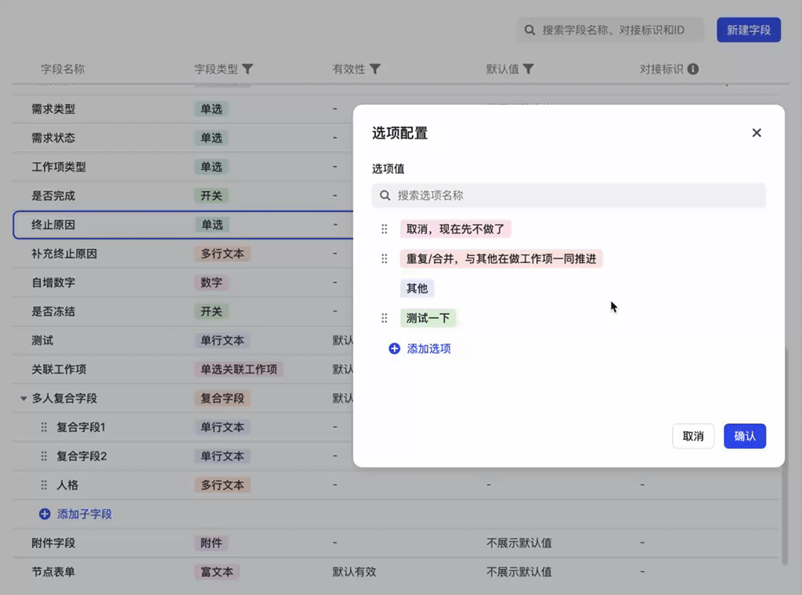
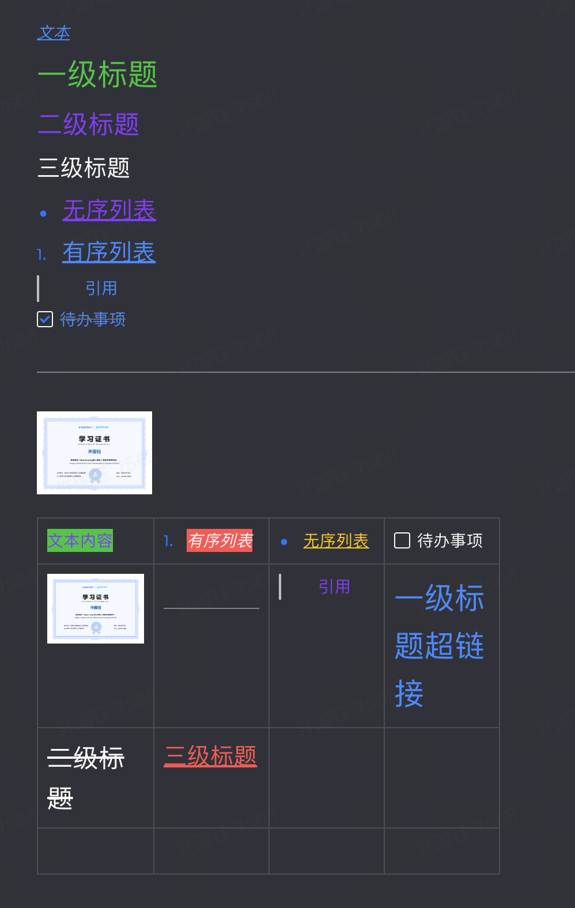
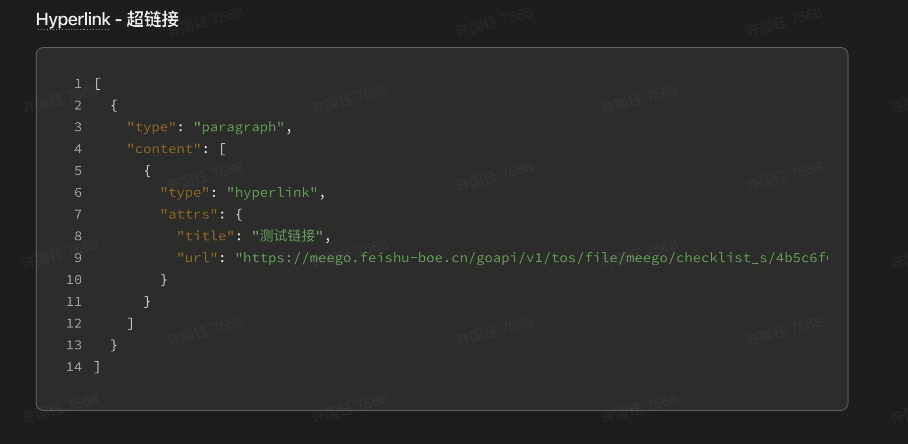
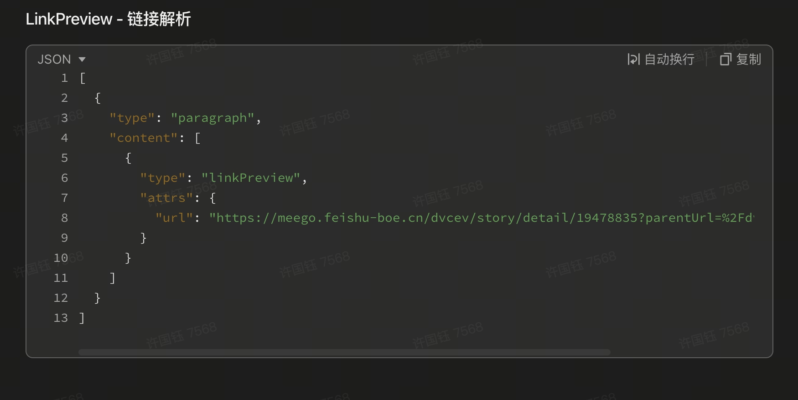

# 字段与属性解析格式

本页定义工作项属性、字段值以及富文本的读写格式。属性直接出现在实例对象上，例如 `id`、`project_key`；字段通过 `field_key`、`field_type_key` 和 `field_value` 描述，例如优先级和自定义字段。系统字段与自定义字段都可以通过[获取字段信息](../api/获取字段信息.md)查询配置。

## 使用前确认

| 要解决的问题                    | 查阅位置                                                                                |
| ------------------------------- | --------------------------------------------------------------------------------------- |
| 实例 ID、名称、状态及系统时间   | [属性](#c69a4529)                                                                       |
| API 类型与事件类型的对应关系    | [字段类型索引](#10fb2f8d)                                                               |
| 选择类字段的 `value` 与 `label` | [单选](#table-content-20)至[单选按钮](#table-content-24)                                |
| 时间戳与日期区间                | [日期](#table-content-27)、[日期时间](#table-content-28)、[日期区间](#table-content-29) |
| 信号三态                        | [系统外信号](#table-content-35)                                                         |
| 普通复合与多人复合              | [复合字段](#table-content-37)、[多人复合字段值](#table-content-62)                      |
| 富文本、表格、图片、链接        | [富文本格式](#110a33af)                                                                 |

读写接口的外层请求体不同，本页大部分代码展示的是单个字段对象，不是完整 HTTP 请求。提交时使用具体接口要求的 `fields`、`field_value_pairs` 等容器；`field_key` 与 `field_alias` 按接口约定选用，展示名称不能代替字段标识。

“不支持更新”指不能把该属性或字段直接作为普通字段写入，不代表平台没有专用操作。例如附件使用[添加附件](../api/添加附件.md)，终止与恢复使用[终止/恢复工作项](../api/终止与恢复工作项.md)，删除实例使用[删除工作项](../api/删除工作项.md)。公式结果、系统创建时间等由系统计算。

代码中的中文展示字符串采用等义 Unicode 转义。带 `xxxx` 的 ID、域名或地址是示例占位值，调用时需替换；JSON `null`、字符串 `"null"`、空数组和省略字段是不同的值，不应自动互换。

<a id="c69a4529"></a>

## 属性

| **属性类型**   | **API 属性类型**   | **value 数据类型&示例**            |
| -------------- | ------------------ | ---------------------------------- |
| 工作项 ID      | id                 | [工作项 ID](#table-content-1)      |
| 工作项名称     | name               | [工作项名称](#table-content-2)     |
| 工作项状态     | work_item_status   | [工作项状态](#table-content-3)     |
| 工作项模板id   | template_id        | [工作项模板id](#table-content-4)   |
| 工作项模板类型 | template_type      | [工作项模板类型](#table-content-5) |
| 空间 key       | project_key        | [空间 key](#table-content-6)       |
| 工作项类型     | work_item_type_key | [工作项类型](#table-content-7)     |
| 工作项模式     | pattern            | [工作项模式](#table-content-8)     |
| 当前节点       | current_nodes      | [当前节点](#table-content-9)       |
| 创建者         | created_by         | [创建者](#table-content-10)        |
| 更新者         | updated_by         | [更新者](#table-content-11)        |
| 删除者         | deleted_by         | [删除者](#table-content-12)        |
| 创建时间       | created_at         | [创建时间](#table-content-13)      |
| 更新时间       | updated_at         | [更新时间](#table-content-14)      |
| 删除时间       | deleted_at         | [删除时间](#table-content-15)      |
| 所属空间       | project_key        | [所属空间](#table-content-16)      |

<a id="table-content-1"></a>

### 工作项 ID

入参：不支持自定义

出参：int（64位）

```json
{
  "id": 4831452515
}
```

<a id="table-content-2"></a>

### 工作项名称

入参：string

出参：string

```json
{
  "name": "\u65b0\u5efa\u9009\u9879XXXX"
}
```

<a id="table-content-3"></a>

### 工作项状态

读接口返回当前状态及更新时间、更新人等元数据。作为状态筛选条件时只提交 `state_key`，不要把读取到的整个状态对象回写为普通字段更新。

出参：结构体

入参：结构体

```json
{
  "state_key": "doing",
  "is_archived_state": true,
  "is_init_state": false,
  "updated_at": 1721960280400,
  "updated_by": "73567952xxxx8297476"
}
```

```json
{
  "state_key": "doing"
}
```

<a id="table-content-4"></a>

### 工作项模板id

入参：int（64位）

出参：int（64位）

```json
{
  "template_id": 267706
}
```

<a id="table-content-5"></a>

### 工作项模板类型

该历史属性已废弃，新接入使用 `template_id` 与[模板字段](#table-content-49)中的版本信息；以下仅保留旧数据读取格式。

入参：不支持自定义

出参：string

```json
{
  "template_type": "662e151cd7fd734ae1874213_template_1714296096561110193"
}
```

<a id="table-content-6"></a>

### 空间 key

入参：不支持自定义

出参：string

```json
{
  "project_key": "662e151cd7fd734ae1874213"
}
```

<a id="table-content-7"></a>

### 工作项类型

入参：不支持定义

出参：string

```json
{
  "work_item_type_key": "story"
}
```

<a id="table-content-8"></a>

### 工作项模式

入参：不支持自定义

出参：string（节点流：Node，状态流：State）

```json
{
  "pattern": "State"
}
```

<a id="table-content-9"></a>

### 当前节点

入参：系统计算不支持自定义

出参：结构体数组

```json
{
  "current_nodes": [
    {
      "id": "doing",
      "name": "\u8fdb\u884c\u4e2d",
      "owners": ["73567952xxxx8297476"],
      "milestone": false
    }
  ]
}
```

<a id="table-content-10"></a>

### 创建者

入参：系统计算不可自定义更新

出参：string

```json
{
  "created_by": "73567952xxxx8297476"
}
```

<a id="table-content-11"></a>

### 更新者

入参：系统计算不可自定义更新

出参：string

```json
{
  "updated_by": "73567952xxxx8297476"
}
```

<a id="table-content-12"></a>

### 删除者

入参：系统计算不可自定义更新

出参：string

```json
{
  "deleted_by": ""
}
```

<a id="table-content-13"></a>

### 创建时间

入参：系统计算不可自定义更新

出参：int(毫秒时间戳，毫秒精度，64位)

```json
{
  "created_at": 1721960280821
}
```

<a id="table-content-14"></a>

### 更新时间

入参：系统计算不可自定义更新

出参：int(毫秒时间戳，毫秒精度，64位)

```json
{
  "updated_at": 1722323775247
}
```

<a id="table-content-15"></a>

### 删除时间

入参：系统计算不可自定义更新

出参：int(毫秒时间戳，毫秒精度，64位)

```json
{
  "deleted_at": 0
}
```

<a id="table-content-16"></a>

### 所属空间

入参：系统计算不可自定义更新

出参：字符串

```json
{
  "project_key": "662e151cd7fd734ae1874213"
}
```

<a id="10fb2f8d"></a>

## 字段类型索引

API 类型和事件类型是两套标识：例如多行文本在 API 中是 `text`，事件中是 `multi-pure-text`；日期和日期时间在 API 中同为 `date`，事件类型分别是 `date` 与 `precise_date`。转换时按下表映射，不能仅做连字符与下划线替换。

| **字段类型**             | **类别**         | **API 字段类型**                                      | **事件字段类型**              | **value 数据类型&示例**                             |
| ------------------------ | ---------------- | ----------------------------------------------------- | ----------------------------- | --------------------------------------------------- |
| 单行文本                 | 自定义类型       | text                                                  | text                          | [单行文本](#table-content-17)                       |
| 多行文本                 | 自定义类型       | text                                                  | multi-pure-text               | [多行文本](#table-content-18)                       |
| 富文本                   | 自定义类型       | multi_text                                            | multi-text                    | [富文本](#table-content-19)                         |
| 单选                     | 自定义类型       | select                                                | select                        | [单选](#table-content-20)                           |
| 多选                     | 自定义类型       | multi_select                                          | multi-select                  | [多选](#table-content-21)                           |
| 级联单选                 | 自定义类型       | tree_select                                           | tree-select                   | [级联单选](#table-content-22)                       |
| 级联多选                 | 自定义类型       | tree_multi_select                                     | tree_multi_select             | [级联多选](#table-content-23)                       |
| 单选按钮                 | 自定义类型       | radio                                                 | radio                         | [单选按钮](#table-content-24)                       |
| 单选人员                 | 自定义类型       | user                                                  | user                          | [单选人员](#table-content-25)                       |
| 多选人员                 | 自定义类型       | multi_user                                            | multi_user                    | [多选人员](#table-content-26)                       |
| 日期                     | 自定义类型       | date                                                  | date                          | [日期](#table-content-27)                           |
| 日期时间                 | 自定义类型       | date                                                  | precise_date                  | [日期时间](#table-content-28)                       |
| 日期区间                 | 自定义类型       | schedule                                              | schedule                      | [日期区间](#table-content-29)                       |
| 公式计算                 | 自定义类型       | number、bool、string 等                               | number、bool、string 等       | [公式计算](#table-content-30)                       |
| URL 链接                 | 自定义类型       | link                                                  | link                          | [URL 链接](#table-content-31)                       |
| 数字                     | 自定义类型       | number                                                | number                        | [数字](#table-content-32)                           |
| 附件                     | 自定义类型       | multi_file                                            | multi-file                    | [附件](#table-content-33)                           |
| 开关                     | 自定义类型       | bool                                                  | bool                          | [开关](#table-content-34)                           |
| 系统外信号               | 自定义类型       | signal                                                | signal                        | [系统外信号](#table-content-35)                     |
| ~~多值系统外信号~~       | 自定义类型       | ~~multi_signal（已废弃）~~                            | ~~multi-signal（已废弃）~~    | [多值系统外信号](#table-content-36)                 |
| 复合字段                 | 自定义类型       | compound_field                                        | compound_field                | [复合字段](#table-content-37)                       |
| 单选关联工作项           | 自定义类型       | work_item_related_select                              | workitem_related_select       | [单选关联工作项](#table-content-38)                 |
| 多选关联工作项           | 自定义类型       | work_item_related_multi_select                        | workitem_related_multi_select | [多选关联工作项](#table-content-39)                 |
| 飞书云文档               | 自定义类型       | link_cloud_doc                                        | link_cloud_doc                | [飞书云文档](#table-content-40)                     |
| 终止                     | 系统内置类型     | aborted                                               | aborted                       | [终止](#table-content-41)                           |
| 删除                     | 系统内置类型     | deleted                                               | deleted                       | [删除](#table-content-42)                           |
| 角色与人员               | 系统内置类型     | role_owners                                           | role_owners                   | [角色与人员](#table-content-43)                     |
| ~~关联工作项（已废弃）~~ | ~~系统内置类型~~ | ~~linked_work_item~~                                  | ~~linked_work_item~~          | [关联工作项（已废弃）](#table-content-44)           |
| 业务线                   | 系统内置类型     | business                                              | business                      | [业务线](#table-content-45)                         |
| 群ID(推荐使用)           | 系统内置类型     | chat_group                                            | chat_group                    | [群ID(推荐使用)](#table-content-46)                 |
| 群ID（不推荐使用）       | 系统内置类型     | group_id                                              | group_id                      | [群ID（不推荐使用）](#table-content-47)             |
| 拉群方式                 | 系统内置类型     | group_type                                            | group_type                    | [拉群方式](#table-content-48)                       |
| 模板类型                 | 系统内置类型     | work_item_template                                    | template                      | [模板类型](#table-content-49)                       |
| 优先级                   | 系统内置类型     | 字段 key：priority；类型：select                    | 类型：select                  | [优先级](#table-content-50)                         |
| 当前负责人               | 系统内置类型     | 字段 key：current_status_operator；类型：multi_user | 类型：multi_user              | [当前负责人](#table-content-51)                     |
| 提出时间                 | 系统内置类型     | 字段 key：start_time；类型：date                    | 类型：date                    | [提出时间](#table-content-52)                       |
| 完成时间                 | 系统内置类型     | 字段 key：finish_time；类型：date                   | 类型：date                    | [完成时间](#table-content-53)                       |
| 关注人                   | 系统内置类型     | 字段 key：watchers；类型：multi_user                | 类型：multi-user              | [关注人](#table-content-54)                         |
| 描述                     | 系统内置类型 | 字段 key：description；类型：multi_text             | 类型：multi-text              | 富文本类型，参考自定义富文本字段出参&入参说明及示例 |
| 创建者                   | 系统内置类型 | 字段 key：owner；类型：user                         | 类型：user                    | [创建者](#table-content-55)                         |
| 排期                     | 系统内置字段     | schedule                                              | schedule                      | [排期](#table-content-56)                           |
| 归档日期                 | 系统内置字段     | 字段 key：archiving_date；类型：date                | 类型：date                    | [归档日期](#table-content-57)                       |
| 报告人                   | 系统内置字段     | 字段 key：issue_reporter；类型：multi_user          | 类型：multi_user              | [报告人](#table-content-58)                         |
| 是否归档                 | 系统内置字段     | 字段 key：archiving_status；类型：bool              | 类型：bool                    | [是否归档](#table-content-59)                       |
| 电话号码                 | 自定义类型       | telephone                                             | telephone                     | [电话号码](#table-content-60)                       |
| 电子邮件                 | 自定义类型       | email                                                 | email                         | [电子邮件](#table-content-61)                       |
| 多人复合字段值           | 自定义类型       | multi_user_compound_field                             | multi_user_compound_field     | [多人复合字段值](#table-content-62)                 |

<a id="table-content-17"></a>

### 单行文本

入参类型：string

出参类型：string

```json
{
  "field_key": "field_a2697f",
  "field_type_key": "text",
  "field_alias": "",
  "field_value": "\u5355\u884c\u6587\u672c"
}
```

<a id="table-content-18"></a>

### 多行文本

使用字符串中的 `\n` 表示换行，API 类型仍是 `text`。

入参类型：string

出参类型：string

```json
{
  "field_key": "field_347e4e",
  "field_type_key": "text",
  "field_alias": "",
  "field_value": "\u591a\u884c\u6587\u672c\n\u591a\u884c\u6587\u672c\n\u591a\u884c\u6587\u672c"
}
```

<a id="table-content-19"></a>

### 富文本

写入使用下面的节点数组，读取可能返回简化字符串，也可能在开启扩展查询后返回 `doc`、`doc_text`、`doc_html` 等内容。读取对象不能直接作为写入对象回传；Markdown 方式见[Markdown 格式说明](Markdown%20格式说明.md)。

入参类型：结构体数组，详细语法参考[富文本格式](#110a33af)

```json
{
  "field_key": "field_1e9078",
  "field_value": [
    {
      "type": "paragraph",
      "content": [
        {
          "type": "text",
          "text": "\u6587\u672c",
          "attrs": {
            "fontColor": "blue",
            "italic": "true",
            "underline": "true"
          }
        }
      ]
    }
  ],
  "field_type_key": "multi_text",
  "field_alias": ""
}
```

出参类型（简单内容）：string

```json
{
  "field_key": "field_1e9078",
  "field_value": "\u6587\u672c\n",
  "field_type_key": "multi_text",
  "field_alias": ""
}
```

出参类型（详细内容，如获取工作项实例时请求携带expand相关参数）：结构体

```json
{
  "field_key": "field_1e9078",
  "field_value": {
    "doc": "{\"0\":{\"ops\":[{\"attributes\":{\"lmkr\":\"1\"},\"insert\":\"*\"},{\"attributes\":{\"fontcolor\":\"rgb(76, 136, 255)\",\"italic\":\"true\",\"underline\":\"true\"},\"insert\":\"\u6587\u672c\"},{\"insert\":\"\\n\"}],\"zoneId\":\"0\",\"zoneType\":\"Z\"}}",
    "doc_text": "\u6587\u672c\n",
    "is_empty": false,
    "doc_html": "<div class=\"ace-line\" data-node=\"true\" dir=\"auto\"><span data-string=\"true\" style=\"color:rgb(76, 136, 255);font-style:italic;text-decoration: underline;\" class=\" MAIL_EDITOR_DARK_COLOR underline\" data-color=\"rgb(76, 136, 255)\" data-leaf=\"true\">\u6587\u672c</span><span data-string=\"true\" data-enter=\"true\" data-leaf=\"true\"></span></div>"
  }
}
```

<a id="table-content-20"></a>

### 单选

写入必须提供选项 ID `value`，`label` 是可选展示名称。先通过[获取字段信息](../api/获取字段信息.md)取得配置中的选项 ID；不要将界面名称当作 ID。此规则也适用于多选、级联选择和单选按钮。

入参类型：结构体

出参类型：结构体

```json
{
  "field_type_key": "select",
  "field_alias": "",
  "field_key": "field_312244",
  "field_value": {
    "label": "\u9009\u98791",
    "value": "8lheuaepp"
  }
}
```

**注意涉及选项字段中，选项名称和选项id之间的区别。可通过**[获取字段信息](../api/获取字段信息.md)**获取。**

出参格式代表读接口如[获取工作项详情](../api/获取工作项详情.md)，入参接口代表写接口格式如[创建工作项](../api/创建工作项.md)



<a id="table-content-21"></a>

### 多选

`field_value` 是选项对象数组；每一项包含必填的 `value`，可附带 `label`。

入参类型：结构体数组

出参类型：结构体数组

```json
{
  "field_key": "field_c4d17a",
  "field_value": [
    {
      "label": "\u9009\u98791",
      "value": "b0gzgge5o"
    },
    {
      "label": "\u9009\u98794",
      "value": "et15_j7yl"
    }
  ],
  "field_type_key": "multi_select",
  "field_alias": ""
}
```

<a id="table-content-22"></a>

### 级联单选

一个选择结果是一条从父选项到子选项的路径：`children` 是下一级对象，末级为 `null`。它与字段配置里“全部子选项”的数组不同。

入参类型：结构体

出参类型：结构体

```json
{
  "field_key": "field_511b0c",
  "field_value": {
    "value": "drvmnhhb0",
    "label": "\u9009\u98791",
    "children": {
      "value": "xcmczov_k",
      "label": "\u5b50\u9009\u98792",
      "children": null
    }
  },
  "field_type_key": "tree_select",
  "field_alias": ""
}
```

<a id="table-content-23"></a>

### 级联多选

最外层是路径数组，每条路径的 `children` 仍是单个下级对象。下面两条路径共享父选项，分别选择不同子选项。

入参类型：结构体数组

出参类型：结构体数组

```json
{
  "field_key": "field_38c836",
  "field_value": [
    {
      "value": "ejhouugxx",
      "label": "\u9009\u98791",
      "children": {
        "label": "\u5b50\u9009\u98792",
        "children": null,
        "value": "2jks8ykdf"
      }
    },
    {
      "value": "ejhouugxx",
      "label": "\u9009\u98791",
      "children": {
        "value": "cao254c6n",
        "label": "\u5b50\u9009\u98793",
        "children": null
      }
    }
  ],
  "field_type_key": "tree_multi_select",
  "field_alias": ""
}
```

<a id="table-content-24"></a>

### 单选按钮

入参类型：结构体

出参类型：结构体

```json
{
  "field_key": "field_0dae57",
  "field_value": {
    "label": "\u9009\u98791",
    "value": "zgw2edjby"
  },
  "field_type_key": "radio",
  "field_alias": ""
}
```

<a id="table-content-25"></a>

### 单选人员

入参类型：string

出参类型：string

```json
{
  "field_key": "field_05723d",
  "field_value": "735679528XXXXX",
  "field_type_key": "user",
  "field_alias": ""
}
```

<a id="table-content-26"></a>

### 多选人员

入参类型：字符串数组

出参类型：字符串数组

```json
{
  "field_key": "field_8b18fd",
  "field_value": ["735679528XXXXX", "731189198XXXXX"],
  "field_type_key": "multi_user",
  "field_alias": ""
}
```

<a id="table-content-27"></a>

### 日期

数值单位为毫秒，但业务精度为天；建议提交目标日期零点对应的时间戳。日期的时区应与业务空间配置保持一致，原文未单独规定统一时区。

入参类型：int（毫秒时间戳，天精度，64位）

出参类型：int（毫秒时间戳，天精度，64位）

```json
{
  "field_type_key": "date",
  "field_alias": "",
  "field_key": "field_2fbca6",
  "field_value": 1722182400000
}
```

<a id="table-content-28"></a>

### 日期时间

仍使用毫秒时间戳，业务精度为秒；不要因为事件类型名为 `precise_date` 而把 API 的 `field_type_key` 改为该值。

入参类型：int（毫秒时间戳，秒精度，64位）

出参类型：int（毫秒时间戳，秒精度，64位）

```json
{
  "field_alias": "",
  "field_key": "field_0e381c",
  "field_value": 1722220183000,
  "field_type_key": "date"
}
```

<a id="table-content-29"></a>

### 日期区间

`start_time` 与 `end_time` 为 64 位毫秒时间戳，按整天表达；开始日取零点，结束日取当天末尾。字段值使用这两个键，和节点排期的 `estimate_start_date` / `estimate_end_date` 不是同一结构。

入参类型：结构体

出参类型：结构体

```json
{
  "field_type_key": "schedule",
  "field_alias": "",
  "field_key": "field_3d786b",
  "field_value": {
    "start_time": 1722182400000,
    "end_time": 1722355199999
  }
}
```

<a id="table-content-30"></a>

### 公式计算

入参类型：不允许作为入参

出参类型：number、bool、string等

```json
{
  "field_key": "field_b9d821",
  "field_value": false,
  "field_type_key": "bool",
  "field_alias": ""
}
```

<a id="table-content-31"></a>

### URL 链接

入参类型：string

出参类型：string

```json
{
  "field_key": "field_ec6e0b",
  "field_value": "https://project.feishu.cn/home",
  "field_type_key": "link",
  "field_alias": ""
}
```

<a id="table-content-32"></a>

### 数字

入参类型：float

出参类型：float

```json
{
  "field_key": "field_3724e6",
  "field_value": 11.11111111111111,
  "field_type_key": "number",
  "field_alias": ""
}
```

<a id="table-content-33"></a>

### 附件

附件返回数组中，`uid` 是可用于下载的文件标识，`type` 为 MIME 类型，`size` 是示例中的展示字符串；不要将带单位的 `size` 直接当作字节数。`FieldKey` 保留接口示例的大小写。

入参类型：不支持直接作为更新实例字段，单独接口:[添加附件](../api/添加附件.md)

出参类型：结构体数组

```json
{
  "field_alias": "",
  "field_key": "field_b1ea4b",
  "field_value": [
    {
      "type": "image/jpeg",
      "size": "266.6KB",
      "uid": "7ac51ca6-2a7b-4123-9970-ca73c58b444f",
      "url": "https://meego.larkoffice.com/goapi/v1/tos/file/ad-qa-mission/checklist/ccf1e3ec-72e9-44a7-8189-8a10760d8e9b.jpeg?isSaas=1",
      "FieldKey": "",
      "name": "20240729-103310.jpeg"
    }
  ],
  "field_type_key": "multi_file"
}
```

<a id="table-content-34"></a>

### 开关

入参：bool

出参：bool

```json
{
  "field_key": "field_b9d821",
  "field_value": false,
  "field_type_key": "bool",
  "field_alias": ""
}
```

<a id="table-content-35"></a>

### 系统外信号

信号使用可空布尔值：`true` 已通过、`false` 未通过、JSON `null` 处理中。处理中应写 `"field_value": null`，不能写字符串 `"null"`。这一点由本页类型定义和下方示例共同确定。

入参：可选 bool（已通过：true，未通过：false，处理中：null）

出参：可选 bool

```json
{
  "field_key": "field_1c7e08",
  "field_value": null,
  "field_type_key": "signal",
  "field_alias": ""
}
```

<a id="table-content-36"></a>

### 多值系统外信号

此类型已废弃，仅供维护历史数据时查阅。`update_type` 的枚举为 `create`（新增）、`update`（更新）、`delete`（删除）；明细 `status` 使用 `passed`、`processing`、`rejected`，不能与单值信号的布尔三态混用。查询链接 `query_link` 已下线，下面不再将其列为可用入参。

单独接口提供更新

入参：details（结构体数组）、update_type（字符串枚举）

出参：details（结构体数组）、status（字符串枚举）

```json
{
  "field_key": "field_773c0e",
  "details": [
    {
      "view_link": "https://xxx",
      "id": "1",
      "title": "\u6d4b\u8bd5",
      "status": "processing"
    },
    {
      "id": "2",
      "title": "\u6d4b\u8bd5",
      "status": "processing",
      "view_link": "https://xxx"
    }
  ],
  "update_type": "create"
}
```

<a id="table-content-37"></a>

### 复合字段

`field_value` 的外层每个数组是一行，内层是这一行的子字段。示例有两行，每行分别保存文本和日期。仅修改某组时可使用[按组更新复合字段值](../api/按组更新复合字段值.md)，不要把行序号当成持久组标识。

入参：二维结构体数组（外层数组为多行数据，内层为多种类型字段）

出参：二维结构体数组（外层数组为多行数据，内层为多种类型字段）

```json
{
  "field_key": "field_5a711c",
  "field_value": [
    [
      {
        "field_key": "field_fdd359",
        "field_value": "\u5b50\u5b57\u6bb51\u5185\u5bb9",
        "field_type_key": "text",
        "field_alias": ""
      },
      {
        "field_key": "field_284451",
        "field_value": 1722355200000,
        "field_type_key": "date",
        "field_alias": ""
      }
    ],
    [
      {
        "field_value": "\u5b50\u5b57\u6bb52\u5185\u5bb9",
        "field_type_key": "text",
        "field_alias": "",
        "field_key": "field_fdd359"
      },
      {
        "field_key": "field_284451",
        "field_value": 1722355200000,
        "field_type_key": "date",
        "field_alias": ""
      }
    ]
  ],
  "field_type_key": "compound_field",
  "field_alias": ""
}
```

<a id="table-content-38"></a>

### 单选关联工作项

入参：int（关联实例ID，64位）

出参：int（关联实例ID，64位）

```json
{
  "field_alias": "",
  "field_key": "field_7872c9",
  "field_value": 4812084224,
  "field_type_key": "work_item_related_select"
}
```

<a id="table-content-39"></a>

### 多选关联工作项

入参：int数组（关联实例ID数组，64位）

出参：int数组（关联实例ID数组，64位）

```json
{
  "field_key": "field_971f4e",
  "field_value": [4831452515, 4812084224],
  "field_type_key": "work_item_related_multi_select",
  "field_alias": ""
}
```

<a id="table-content-40"></a>

### 飞书云文档

`field_value` 是链接字符串数组。以下域名为示例占位值，实际写入使用有效的飞书文档 URL。

```json
{
  "field_key": "field_347e4e",
  "field_type_key": "link_cloud_doc",
  "field_alias": "",
  "field_value": ["https://ydrp2xxxxm.feishu.cn.com/wiki/CxiuwrvbXXXXXXk8idacjXj3nfc"]
}
```

备注：工作项实例搜索相关接口暂不支持

- [获取指定的工作项列表（单空间）](../api/获取指定的工作项列表（单空间）.md)

- [获取指定的工作项列表（跨空间）](../api/获取指定的工作项列表（跨空间）.md)

- [获取指定的工作项列表（单空间-复杂传参）](../api/获取指定的工作项列表（单空间-复杂传参）.md)

- [获取指定的工作项列表（全局搜索）](../api/获取指定的工作项列表（全局搜索）.md)

- [获取指定的关联工作项列表（单空间）](../api/获取指定的关联工作项列表（单空间）.md)

<a id="table-content-41"></a>

### 终止

入参：不支持更新

出参：结构体

```json
{
  "field_value": {
    "reason": "\u7ec8\u6b62\u539f\u56e0",
    "is_aborted": true
  },
  "field_type_key": "aborted",
  "field_alias": "",
  "field_key": "aborted"
}
```

<a id="table-content-42"></a>

### 删除

入参：不支持

出参：bool

```json
{
  "field_type_key": "deleted",
  "field_alias": "",
  "field_key": "deleted",
  "field_value": false
}
```

<a id="table-content-43"></a>

### 角色与人员

每项 `role` 为角色 ID，`owners` 为该角色的 `user_key` 列表。更新工作项时角色信息按接口规则整体覆盖，需要保留的角色也应提交，见[更新工作项](../api/更新工作项.md)。读取示例中的 `owners: null` 不应被当作所有写接口通用的清空协议。

入参：结构体数组

出参：结构体数组

```json
{
  "field_alias": "",
  "field_key": "role_owners",
  "field_value": [
    {
      "role": "Data",
      "owners": ["7311891981507100700"]
    },
    {
      "role": "Server",
      "owners": ["7311891981507100700"]
    },
    {
      "role": "UX_Writer",
      "owners": ["7311891981507100700", "7374823452487794692"]
    },
    {
      "owners": null,
      "role": "role_bb4853"
    }
  ],
  "field_type_key": "role_owners"
}
```

<a id="table-content-44"></a>

### 关联工作项（已废弃）

```json
{
  "wi_object_id": 111,
  "id": 111,
  "type": "",
  "name": ""
}
```

<a id="table-content-45"></a>

### 业务线

入参：string

出参：string

```json
{
  "field_key": "business",
  "field_value": "662f0e13b1a20d5dd5fb3320",
  "field_type_key": "business",
  "field_alias": "business"
}
```

<a id="table-content-46"></a>

### 群ID(推荐使用)

入参：不支持更新

出参：string

```json
{
  "field_type_key": "chat_group",
  "field_alias": "",
  "field_key": "chat_group",
  "field_value": "oc_41d0756888aea5b4b73fb1f571d8dd95"
}
```

<a id="table-content-47"></a>

### 群ID（不推荐使用）

入参：不支持更新

出参：string

```json
{
  "field_key": "group_id",
  "field_value": "oc_41d0756888aea5b4b73fb1f571d8dd95",
  "field_type_key": "group_id",
  "field_alias": ""
}
```

注：历史数据原因，value值格式不统一，建议使用chat_group类型

<a id="table-content-48"></a>

### 拉群方式

入参：字符串枚举（自动拉群："auto"；不拉群："disabled"；绑定群："bind"）

出参：字符串枚举（自动拉群："auto"；不拉群："disabled"；绑定群："bind"）

```json
{
  "field_value": "disabled",
  "field_type_key": "group_type",
  "field_alias": "",
  "field_key": "group_type"
}
```

<a id="table-content-49"></a>

### 模板类型

入参：不支持更新

出参：结构体

```json
{
  "field_key": "template",
  "field_value": {
    "id": 267706,
    "version": 38
  },
  "field_type_key": "work_item_template",
  "field_alias": "template"
}
```

<a id="table-content-50"></a>

### 优先级

入参：结构体

出参：结构体

```json
{
  "field_key": "priority",
  "field_value": {
    "label": "P0",
    "value": "0"
  },
  "field_type_key": "select",
  "field_alias": "priority"
}
```

<a id="table-content-51"></a>

### 当前负责人

入参：系统计算，不支持自定义

出参：字符串数组

```json
{
  "field_key": "current_status_operator",
  "field_value": ["735679528040XXXXXX", "731189198150XXXXXX"],
  "field_type_key": "multi_user",
  "field_alias": "current_status_operator"
}
```

<a id="table-content-52"></a>

### 提出时间

入参：系统计算，不支持自定义

出参：64 位整数，毫秒时间戳

```json
{
  "field_type_key": "date",
  "field_alias": "start_time",
  "field_key": "start_time",
  "field_value": 1721960280250
}
```

<a id="table-content-53"></a>

### 完成时间

入参：系统计算，不支持自定义

出参：64 位整数，毫秒时间戳

```json
{
  "field_alias": "finish_time",
  "field_key": "finish_time",
  "field_value": 1721960280250,
  "field_type_key": "date"
}
```

<a id="table-content-54"></a>

### 关注人

入参：字符串数组

出参：字符串数组

```json
{
  "field_value": ["735679528040XXXXXX"],
  "field_type_key": "multi_user",
  "field_alias": "watchers",
  "help_description": "\u9700\u6c42\u5173\u6ce8\u8005\u53ef\u901a\u8fc7bot\u79c1\u4fe1&\u4e2a\u4eba\u770b\u677f\u4e86\u89e3\u9700\u6c42\u76f8\u5173\u8fdb\u5ea6",
  "field_key": "watchers"
}
```

<a id="table-content-55"></a>

### 创建者

入参：系统计算，不支持自定义

出参：字符串

```json
{
  "field_type_key": "user",
  "field_alias": "owner",
  "field_key": "owner",
  "field_value": "7356795280408XXXXXX"
}
```

<a id="table-content-56"></a>

### 排期

本系统字段与自定义日期区间都使用 `start_time` / `end_time`。开始与结束分别按整天边界填写，不能把工作流 Schedule 对象中的估分或负责人直接放入此字段值。

入参：结构体

出参：结构体

```json
{
  "field_key": "schedule",
  "field_value": {
    "start_time": 1723478400000,
    "end_time": 1723651199999
  },
  "field_type_key": "schedule",
  "field_alias": "schedule"
}
```

<a id="table-content-57"></a>

### 归档日期

入参：系统计算，不支持自定义

出参：int（毫秒时间戳）

```json
{
  "field_key": "archiving_date",
  "field_value": 1723651199999,
  "field_type_key": "date",
  "field_alias": "archiving_date"
}
```

<a id="table-content-58"></a>

### 报告人

入参：系统计算，不支持自定义

出参：字符串数组

```json
{
  "field_key": "issue_reporter",
  "field_value": ["73567952804082XXXXX"],
  "field_type_key": "multi_user",
  "field_alias": "issue_reporter"
}
```

<a id="table-content-59"></a>

### 是否归档

入参：系统计算，不支持自定义

出参：bool

```json
{
  "field_key": "archiving_status",
  "field_value": false,
  "field_type_key": "bool",
  "field_alias": "archiving_status"
}
```

<a id="table-content-60"></a>

### 电话号码

入参类型: string

出参类型: string

入参正则：`(?:\+?[0-9]{1,4})?(?:[-()\*#]*[0-9]){3,50}`

入参限制：不能超过54字符

```json
{
  "field_key": "field_a2697f",
  "field_type_key": "telephone",
  "field_alias": "",
  "field_value": "10086"
}
```

<a id="table-content-61"></a>

### 电子邮件

入参类型: string

出参类型: string

入参正则：`^[^@\r\n]+@[^@\r\n]+$`

入参限制：不能超过254字符

```json
{
  "field_key": "field_a2697f",
  "field_type_key": "email",
  "field_alias": "",
  "field_value": "test@gmail.com"
}
```

<a id="table-content-62"></a>

### 多人复合字段值

值是“填写人 `user_key` → 该人员填写的子字段数组”的映射。`UserKey1`、`UserKey2` 为占位标识，需要替换为填写人真实 `user_key`；写入子字段的 `field_type_key` 可选。

下例的子字段使用单选类型，因此 `field_value` 按本页单选协议写为含选项 ID `value` 的对象。`update_mode=0` 为替换，`1` 为按人员更新；自由填写与固定范围的清空、越界规则见[FieldValuePair](数据结构汇总.md#10c42182)，不要把普通复合字段的二维数组用于此处。

入参类型: map\[string\]\[\][FieldValuePair](数据结构汇总.md#10c42182)

出参类型: map\[string\]\[\][FieldValuePair](数据结构汇总.md#10c42182)

```json
{
  "UserKey1": [
    {
      "field_key": "field_son1",
      "field_value": { "value": "xxxx" },
      "field_type_key": "select",
      "field_alias": ""
    },
    {
      "field_key": "field_son2",
      "field_value": { "value": "xxxx" },
      "field_type_key": "select",
      "field_alias": ""
    }
  ],
  "UserKey2": [
    {
      "field_key": "field_son1",
      "field_value": { "value": "xxxx2" },
      "field_type_key": "select",
      "field_alias": ""
    },
    {
      "field_key": "field_son2",
      "field_value": { "value": "xxxx2" },
      "field_type_key": "select",
      "field_alias": ""
    }
  ]
}
```

<a id="110a33af"></a>

## 富文本格式

富文本字段和评论写入使用本节定义的节点数组。不要把读接口返回的 `doc` / `doc_html` / `doc_text` 对象直接回传：这些表示之间需要一致的转换关系，直接回写可能造成视图、度量和自动化无法正确读取。

> **说明：**富文本字段和评论场景还支持 Markdown 格式写入，参见[Markdown 格式说明](Markdown%20格式说明.md)。

<a id="6ceda057"></a>

### 传参规则

段落节点的 `content` 数组承载文本或行内元素，节点的 `lineAttrs` 承载行属性，文本元素的 `attrs` 承载样式。

<a id="e4319058"></a>
<a id="26031f84"></a>

| 字段路径          | 类型与说明                                                                                                                              |
| ----------------- | --------------------------------------------------------------------------------------------------------------------------------------- |
| `type`            | 字符串。`paragraph` 文本段落、`blank` 空白行、`checklist` 待办列表、`ul` 无序列表、`ol` 有序列表、`horizontalLine` 分割线、`table` 表格 |
| `content`         | 内容元素数组                                                                                                                            |
| `content[].type`  | `text` 文本、`hyperlink` 超链接、`img` 图片、`linkPreview` 链接解析                                                                     |
| `content[].text`  | 文本内容                                                                                                                                |
| `content[].attrs` | 内容样式：`backgroundColor`、`bold`、`fontColor`、`fontSize`、`italic`、`strikethrough`、`underline`                                    |
| `lineAttrs`       | 行属性：`indent` 缩进数、`align` 对齐、`blockquote` 引用                                                                                |

<a id="13e56241"></a>

### 富文本分类

1. 叶子结点（可插入在行内任意位置）：hyperlink、image、linkPreview

2. 行结构：align、blockquote、indent

3. 行内容：blank、checklist、horizontalLine、ol、ul、table

4. 文字属性：backgroundColor、bold、fontColor、fontSize、italic、textDecoration、text

<a id="9af64022"></a>

#### 颜色列表

| **Color** | **Rgb**            |
| --------- | ------------------ |
| black     | rgb(26, 26, 26)    |
| white     | rgb(255, 255, 255) |
| blue      | rgb(76, 136, 255)  |
| green     | rgb(84, 194, 72)   |
| purple    | rgb(127, 59, 245)  |
| yellow    | rgb(250, 200, 35)  |
| red       | rgb(240, 91, 86)   |

<a id="8b62937b"></a>

#### 富文本示例索引

| 组合层次 | 示例                                                                                                                                           |
| -------- | ---------------------------------------------------------------------------------------------------------------------------------------------- |
| 行内容   | [空行](#rich-1)、[待办](#rich-2)、[分割线](#rich-3)、[有序列表](#rich-4)、[无序列表](#rich-5)、[表格](#rich-6)                                 |
| 行属性   | [对齐](#rich-7)、[引用](#rich-8)、[缩进](#rich-9)                                                                                              |
| 文本样式 | [背景色](#rich-10)、[文字色](#rich-11)、[字号](#rich-12)、[粗体](#rich-13)、[斜体](#rich-14)、[删除线与下划线](#rich-15)、[普通文本](#rich-16) |
| 行内元素 | [超链接](#rich-17)、[图片](#rich-18)、[链接卡片](#rich-19)                                                                                     |

### 行内容

行内容通过节点 `type` 选择。`checklist` 的完成状态写在 `lineAttrs.list`；有序列表用 `list` 描述层级编号，无序列表可用 `indent` 缩进。表格使用 `tableInfo`，`colWidths` 中 `0` 表示自适应列宽。

<a id="rich-1"></a>

#### blank

```json
[
  {
    "type": "blank"
  }
]
```

<a id="rich-2"></a>

#### checklist

```json
[
  {
    "type": "checklist",
    "content": [
      {
        "type": "text",
        "text": "meego"
      }
    ],
    "lineAttrs": {
      "list": "done"
    }
  }
]
```

<a id="rich-3"></a>

#### horizontalLine

```json
[
  {
    "type": "horizontalLine"
  }
]
```

<a id="rich-4"></a>

#### ol

```json
[
  {
    "type": "ol",
    "content": [
      {
        "type": "text",
        "text": "meego",
        "attrs": {
          "bold": "true"
        }
      }
    ],
    "lineAttrs": {
      "list": "1"
    }
  },
  {
    "type": "ol",
    "content": [
      {
        "type": "text",
        "text": "123",
        "attrs": {
          "bold": "true"
        }
      }
    ],
    "lineAttrs": {
      "list": "1-1"
    }
  }
]
```

<a id="rich-5"></a>

#### ul

```json
[
  {
    "type": "ul",
    "content": [
      {
        "type": "text",
        "text": "Meego",
        "attrs": {
          "bold": "true"
        }
      }
    ]
  },
  {
    "type": "ul",
    "content": [
      {
        "type": "text",
        "text": "123",
        "attrs": {
          "bold": "true"
        }
      }
    ],
    "lineAttrs": {
      "indent": "1"
    }
  }
]
```

<a id="rich-6"></a>

#### table

```json
[
  {
    "type": "table",
    "tableInfo": {
      "rowSize": 4,
      "colSize": 4,
      "colWidths": [300, 200, 300, 100],
      "cellList": [
        {
          "row": 1,
          "col": 1,
          "cellContent": [
            {
              "type": "paragraph",
              "content": [
                {
                  "type": "text",
                  "text": "1",
                  "attrs": {
                    "bold": "true",
                    "backgroundColor": "green"
                  }
                }
              ]
            }
          ]
        },
        {
          "row": 1,
          "col": 2,
          "cellContent": [
            {
              "type": "paragraph",
              "content": [
                {
                  "type": "text",
                  "text": "2",
                  "attrs": {
                    "bold": "true",
                    "backgroundColor": "yellow"
                  }
                }
              ]
            }
          ]
        },
        {
          "row": 2,
          "col": 1,
          "cellContent": [
            {
              "type": "paragraph",
              "content": [
                {
                  "type": "text",
                  "text": "3",
                  "attrs": {
                    "bold": "true",
                    "backgroundColor": "yellow"
                  }
                }
              ]
            }
          ]
        },
        {
          "row": 2,
          "col": 2,
          "cellContent": [
            {
              "type": "paragraph",
              "content": [
                {
                  "type": "text",
                  "text": "4",
                  "attrs": {
                    "bold": "true",
                    "backgroundColor": "yellow"
                  }
                }
              ]
            }
          ]
        }
      ]
    }
  }
]
```

### 行属性

`align`、`blockquote`、`indent` 写在节点的 `lineAttrs` 中。示例中的缩进和引用开关使用字符串值，保留原协议形式。

<a id="rich-7"></a>

#### align

```json
[
  {
    "type": "ol",
    "content": [
      {
        "type": "text",
        "text": "meego3",
        "attrs": {
          "bold": "true",
          "fontSize": "h1"
        }
      }
    ],
    "lineAttrs": {
      "align": "left",
      "list": "1"
    }
  }
]
```

<a id="rich-8"></a>

#### blockquote

```json
[
  {
    "type": "paragraph",
    "content": [
      {
        "type": "text",
        "text": "meego3",
        "attrs": {
          "bold": "true",
          "fontSize": "h1"
        }
      }
    ],
    "lineAttrs": {
      "blockquote": "true"
    }
  }
]
```

<a id="rich-9"></a>

#### indent

```json
[
  {
    "type": "paragraph",
    "content": [
      {
        "type": "text",
        "text": "meego1",
        "attrs": {
          "bold": "true",
          "fontSize": "h1"
        }
      }
    ],
    "lineAttrs": {
      "indent": "2"
    }
  },
  {
    "type": "ul",
    "content": [
      {
        "type": "text",
        "text": "meego2"
      }
    ],
    "lineAttrs": {
      "indent": "2"
    }
  }
]
```

### 文本样式

样式写在内容元素的 `attrs` 中。`fontSize` 的示例值为 `h1`；粗体、斜体、删除线和下划线使用字符串 `"true"`。`textDecoration` 是下方样例分类名称，实际写入字段为 `strikethrough` 和 `underline`。

<a id="rich-10"></a>

#### backgroundColor

```json
[
  {
    "type": "paragraph",
    "content": [
      {
        "type": "text",
        "text": "\u6d4b\u8bd5\u6587\u672c",
        "attrs": {
          "backgroundColor": "red"
        }
      }
    ]
  }
]
```

<a id="rich-11"></a>

#### fontColor

```json
[
  {
    "type": "paragraph",
    "content": [
      {
        "type": "text",
        "text": "\u6d4b\u8bd5\u6587\u672c",
        "attrs": {
          "fontColor": "red"
        }
      }
    ]
  }
]
```

<a id="rich-12"></a>

#### fontSize

```json
[
  {
    "type": "paragraph",
    "content": [
      {
        "type": "text",
        "text": "\u6d4b\u8bd5\u6587\u672c",
        "attrs": {
          "fontSize": "h1"
        }
      }
    ]
  }
]
```

<a id="rich-13"></a>

#### bold

```json
[
  {
    "type": "paragraph",
    "content": [
      {
        "type": "text",
        "text": "\u6d4b\u8bd5\u6587\u672c",
        "attrs": {
          "bold": "true"
        }
      }
    ]
  }
]
```

<a id="rich-14"></a>

#### italic

```json
[
  {
    "type": "paragraph",
    "content": [
      {
        "type": "text",
        "text": "\u6d4b\u8bd5\u6587\u672c",
        "attrs": {
          "italic": "true"
        }
      }
    ]
  }
]
```

<a id="rich-15"></a>

#### textDecoration

```json
[
  {
    "type": "paragraph",
    "content": [
      {
        "type": "text",
        "text": "\u6d4b\u8bd5\u6587\u672c",
        "attrs": {
          "strikethrough": "true",
          "underline": "true"
        }
      }
    ]
  }
]
```

<a id="rich-16"></a>

#### text

```json
[
  {
    "type": "paragraph",
    "content": [
      {
        "type": "text",
        "text": "\u6d4b\u8bd5\u6587\u672c"
      }
    ]
  }
]
```

### 行内元素

超链接使用 `type=hyperlink` 与 `attrs.title` / `attrs.url`；图片实际类型为 `img`；链接卡片使用 `linkPreview` 与 `attrs.url`。`image` 是示例分类名称，不是实际 JSON 中的类型值。

<a id="rich-17"></a>

#### hyperlink (超链接)

```json
[
  {
    "type": "paragraph",
    "content": [
      {
        "type": "hyperlink",
        "attrs": {
          "title": "\u6d4b\u8bd5\u94fe\u63a5",
          "url": "https://project.feishu.cn/b/helpcenter/1p8d7djs/16ejynnw"
        }
      }
    ]
  }
]
```

<a id="rich-18"></a>

#### image

```json
[
  {
    "type": "paragraph",
    "content": [
      {
        "type": "img",
        "attrs": {
          "src": "https://meego.feishu.cn/goapi/v1/tos/file/meego/checklist_s/4b5c6f62-0899-4930-b7b3-38b5ed9af728.jpeg?isSaas=1"
        }
      }
    ]
  }
]
```

<a id="rich-19"></a>

#### linkPreview （链接解析）

```json
[
  {
    "type": "paragraph",
    "content": [
      {
        "type": "linkPreview",
        "attrs": {
          "url": "https://meego.feishu.cn/dvcev/story/detail/19478835?parentUrl=%2Fdvcev%2Fstory%2Fhomepage"
        }
      }
    ]
  }
]
```

<a id="e01d1b22"></a>

### 传参示例

下面完整示例组合了空行、段落、标题样式、列表、引用、待办、分割线、图片和表格。截图对应最终显示效果，代码保留原始节点顺序与单元格坐标。



```json
[
  {
    "type": "blank"
  },
  {
    "type": "paragraph",
    "content": [
      {
        "type": "text",
        "text": "\u6587\u672c",
        "attrs": {
          "fontColor": "blue",
          "italic": "true",
          "underline": "true"
        }
      }
    ]
  },
  {
    "type": "paragraph",
    "content": [
      {
        "type": "text",
        "text": "\u4e00\u7ea7\u6807\u9898",
        "attrs": {
          "fontColor": "green",
          "fontSize": "h1"
        }
      }
    ]
  },
  {
    "type": "paragraph",
    "content": [
      {
        "type": "text",
        "text": "\u4e8c\u7ea7\u6807\u9898",
        "attrs": {
          "fontColor": "purple",
          "fontSize": "h2"
        }
      }
    ]
  },
  {
    "type": "paragraph",
    "content": [
      {
        "type": "text",
        "text": "\u4e09\u7ea7\u6807\u9898",
        "attrs": {
          "fontSize": "h3"
        }
      }
    ]
  },
  {
    "type": "ul",
    "content": [
      {
        "type": "text",
        "text": "\u65e0\u5e8f\u5217\u8868",
        "attrs": {
          "fontColor": "purple",
          "underline": "true",
          "fontSize": "h3"
        }
      }
    ]
  },
  {
    "type": "ol",
    "content": [
      {
        "type": "text",
        "text": "\u6709\u5e8f\u5217\u8868",
        "attrs": {
          "fontColor": "blue",
          "underline": "true",
          "fontSize": "h3"
        }
      }
    ],
    "lineAttrs": {
      "list": "1"
    }
  },
  {
    "type": "paragraph",
    "content": [
      {
        "type": "text",
        "text": "\u5f15\u7528",
        "attrs": {
          "fontColor": "blue"
        }
      }
    ],
    "lineAttrs": {
      "blockquote": "true",
      "indent": "1"
    }
  },
  {
    "type": "checklist",
    "content": [
      {
        "type": "text",
        "text": "\u5f85\u529e\u4e8b\u9879",
        "attrs": {
          "fontColor": "blue"
        }
      }
    ],
    "lineAttrs": {
      "list": "done"
    }
  },
  {
    "type": "horizontalLine"
  },
  {
    "type": "paragraph",
    "content": [
      {
        "type": "img",
        "attrs": {
          "src": "https://meego.feishu.cn/goapi/v1/tos/file/meego/checklist_s/1df60ab2-328b-4d2e-9ff3-bddbee388105.jpeg?isSaas=1",
          "width": "100"
        }
      }
    ]
  },
  {
    "type": "table",
    "tableInfo": {
      "rowSize": 4,
      "colSize": 4,
      "cellList": [
        {
          "row": 1,
          "col": 1,
          "cellContent": [
            {
              "type": "paragraph",
              "content": [
                {
                  "type": "text",
                  "text": "\u6587\u672c\u5185\u5bb9",
                  "attrs": {
                    "fontColor": "purple",
                    "backgroundColor": "green"
                  }
                }
              ]
            }
          ]
        },
        {
          "row": 1,
          "col": 2,
          "cellContent": [
            {
              "type": "ol",
              "content": [
                {
                  "type": "text",
                  "text": "\u6709\u5e8f\u5217\u8868",
                  "attrs": {
                    "backgroundColor": "red",
                    "italic": "true"
                  }
                }
              ],
              "lineAttrs": {
                "list": "1"
              }
            }
          ]
        },
        {
          "row": 1,
          "col": 3,
          "cellContent": [
            {
              "type": "ul",
              "content": [
                {
                  "type": "text",
                  "text": "\u65e0\u5e8f\u5217\u8868",
                  "attrs": {
                    "fontColor": "yellow",
                    "underline": "true"
                  }
                }
              ]
            }
          ]
        },
        {
          "row": 1,
          "col": 4,
          "cellContent": [
            {
              "type": "checklist",
              "content": [
                {
                  "type": "text",
                  "text": "\u5f85\u529e\u4e8b\u9879"
                }
              ]
            }
          ]
        },
        {
          "row": 2,
          "col": 1,
          "cellContent": [
            {
              "type": "paragraph",
              "content": [
                {
                  "type": "img",
                  "attrs": {
                    "src": "https://meego.feishu.cn/goapi/v1/tos/file/meego/checklist_s/1df60ab2-328b-4d2e-9ff3-bddbee388105.jpeg?isSaas=1"
                  }
                }
              ]
            }
          ]
        },
        {
          "row": 2,
          "col": 2,
          "cellContent": [
            {
              "type": "horizontalLine"
            }
          ]
        },
        {
          "row": 2,
          "col": 3,
          "cellContent": [
            {
              "type": "paragraph",
              "content": [
                {
                  "type": "text",
                  "text": "\u5f15\u7528",
                  "attrs": {
                    "fontColor": "purple"
                  }
                }
              ],
              "lineAttrs": {
                "blockquote": "true",
                "align": "center"
              }
            }
          ]
        },
        {
          "row": 2,
          "col": 4,
          "cellContent": [
            {
              "type": "paragraph",
              "content": [
                {
                  "type": "text",
                  "text": "\u4e00\u7ea7\u6807\u9898\u8d85\u94fe\u63a5",
                  "attrs": {
                    "fontColor": "blue",
                    "fontSize": "h1"
                  }
                }
              ]
            }
          ]
        },
        {
          "row": 3,
          "col": 1,
          "cellContent": [
            {
              "type": "paragraph",
              "content": [
                {
                  "type": "text",
                  "text": "\u4e8c\u7ea7\u6807\u9898",
                  "attrs": {
                    "fontSize": "h2",
                    "strikethrough": "true"
                  }
                }
              ]
            }
          ]
        },
        {
          "row": 3,
          "col": 2,
          "cellContent": [
            {
              "type": "paragraph",
              "content": [
                {
                  "type": "text",
                  "text": "\u4e09\u7ea7\u6807\u9898",
                  "attrs": {
                    "fontSize": "h3",
                    "fontColor": "red",
                    "underline": "true"
                  }
                }
              ]
            }
          ]
        }
      ]
    }
  }
]
```

<a id="a794e5fe"></a>

## 常见问题

<a id="f46fcff4"></a>

### **关注人（watchers）字段属于什么类型**

关注人属于多选人员（multi_user），类似字段可以参考字段管理页面的字段类型

---

<a id="e850904d"></a>

### **如何更新富文本字段文本加图片格式**

1. 通过 Open API [添加附件](../api/添加附件.md)在富文本字段中增加图片。

2. 更新富文本字段，按照上述链接中给出的富文本更新格式进行传递。

---

<a id="4446b2b8"></a>

### 超链接更新格式



<a id="62abc68c"></a>

### 将链接自动解析成标题格式



<a id="91caf6de"></a>

### 新增/更新评论 API 支持富文本

新增 body 体的 key "rich_text"。

```json
{
  "rich_text": [
    {
      "type": "paragraph",
      "content": [
        {
          "type": "text",
          "text": "editor sdk"
        }
      ]
    }
  ]
}
```

更新时间：2026-09-07
官方 URL：https://project.feishu.cn/b/helpcenter/1p8d7djs/1tj6ggll
