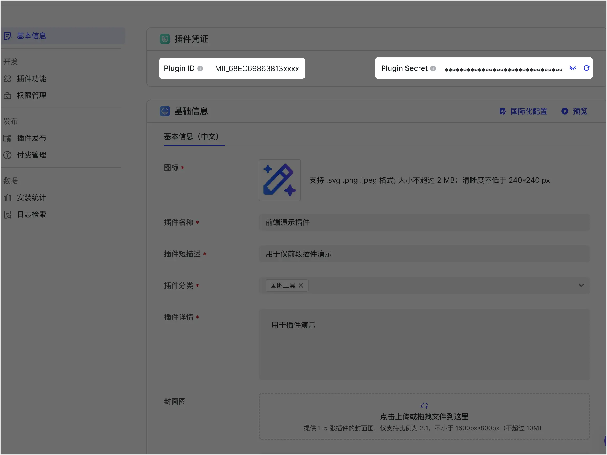
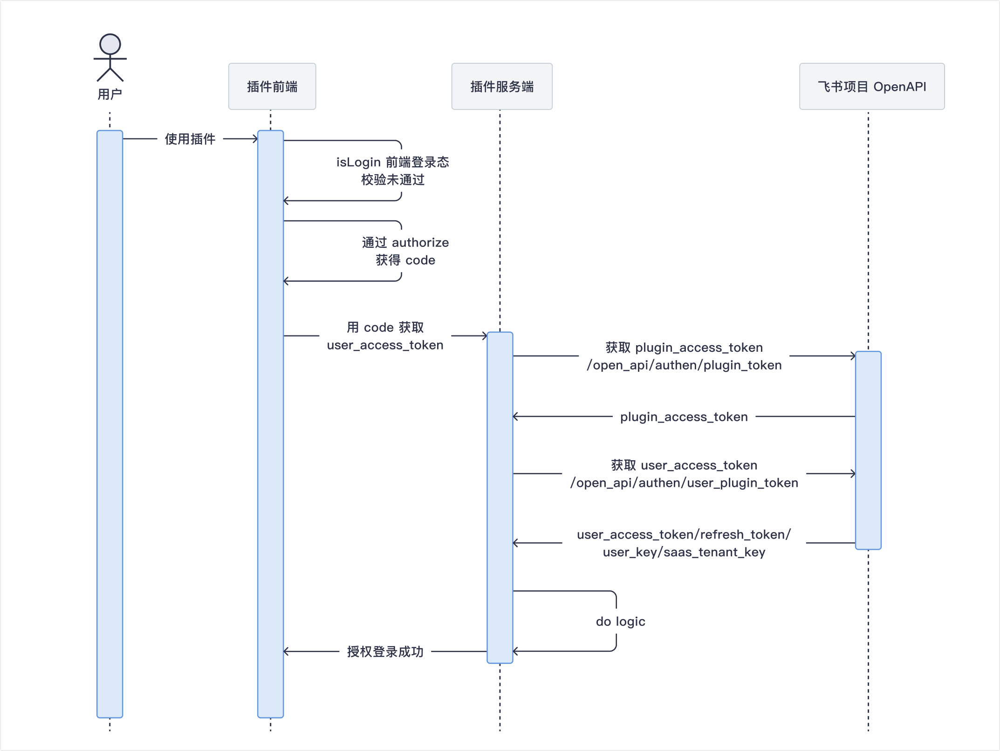
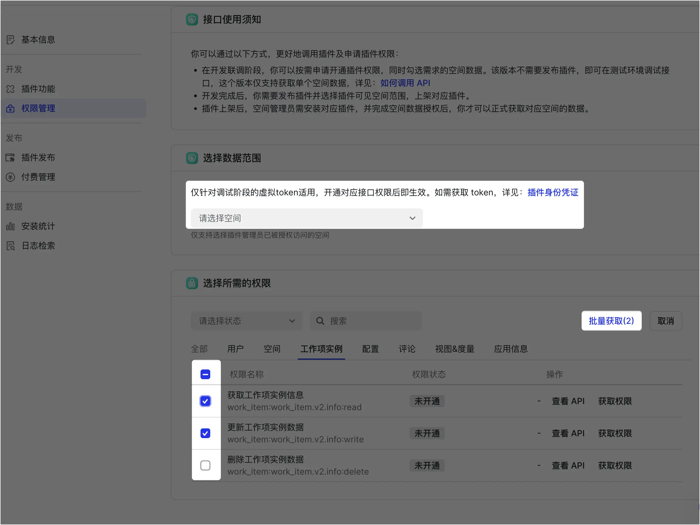

# 获取访问凭证

飞书项目使用访问凭证识别插件及其调用身份。插件服务端可以使用插件凭证配合用户标识调用接口，也可以在用户授权后使用用户凭证。开发调试另有受数据范围限制的虚拟插件凭证。

本篇按“选择凭证 → 获取插件凭证 → 交换用户凭证 → 刷新 → 客户端登录态”的顺序说明。凭证不会替代插件权限、空间授权和用户自身权限。

**阅读导航**：[凭证类型](#token-types) · [如何携带](#token-headers) · [插件凭证](#plugin-token) · [用户凭证](#user-token) · [刷新](#refresh-token) · [登录态](#client-session) · [资源权限](#resource-permissions)

<a id="2a1d4e7f"></a>
<a id="token-types"></a>

## 选择凭证类型

| 凭证 | 前缀示例 | 适用场景 | 用户身份 |
| --- | --- | --- | --- |
| `plugin_access_token` | `p-...` | 正式安装后的服务端接口调用，也用于交换用户凭证 | 按目标接口要求额外传 `X-User-Key` |
| `virtual_plugin_token` | `v-...` | 插件开发与调试 | 与插件凭证类似，但只能访问配置的数据范围 |
| `user_access_token` | `u-...` | 用户临时授权插件代表自己操作 | 包含授权用户的身份 |

虚拟凭证是特殊的插件凭证，通过获取插件凭证接口的 `type` 参数选择。不要把它理解成可访问任意空间的测试凭证。

<a id="947b5e1c"></a>
<a id="token-headers"></a>

## 在请求中携带凭证

两种调用方式均使用 `X-Plugin-Token`。区别是：传入插件凭证时，通常还需要 `X-User-Key`；传入用户凭证时，用户身份已包含在凭证中。

以下使用原文的空间详情接口作为示例。`user_key` 是该接口的请求体参数，与请求头中的用户身份是不同位置的参数，应分别按接口定义填写。

### 使用用户凭证

```bash
curl --location 'https://project.feishu.cn/open_api/projects/detail' \
  --header "X-Plugin-Token: ${USER_ACCESS_TOKEN}" \
  --header 'Content-Type: application/json' \
  --data '{
    "simple_names": ["test_new"],
    "user_key": "test"
  }'
```

### 使用插件凭证

```bash
curl --location 'https://project.feishu.cn/open_api/projects/detail' \
  --header "X-Plugin-Token: ${PLUGIN_ACCESS_TOKEN}" \
  --header "X-User-Key: ${USER_KEY}" \
  --header 'Content-Type: application/json' \
  --data '{
    "simple_names": ["test_new"],
    "user_key": "test"
  }'
```

开发调试时，将第二段示例的凭证值替换为虚拟插件凭证。两段示例中的域名、空间别名和用户标识都需按实际环境替换；`X-User-Key` 的接口级例外见[OpenAPI 概述](OpenAPI概述.md#authentication)。

<a id="4c4a1a1a"></a>
<a id="dd03503d"></a>
<a id="plugin-token"></a>

## 获取插件凭证

### 准备插件 ID 与密钥

在开放平台进入插件详情页，打开“基本信息”，获取 `Plugin ID` 与 `Plugin Secret`。这两个值用于服务端换取插件凭证。



### 请求定义

**请求方式**：`POST`
**请求地址**：`/open_api/authen/plugin_token`

请求头：`Content-Type: application/json`。

| 请求体参数 | 类型 | 必填 | 说明 |
| --- | --- | --- | --- |
| `plugin_id` | `string` | 是 | 插件唯一标识，即 Plugin ID |
| `plugin_secret` | `string` | 是 | 插件密钥，即 Plugin Secret |
| `type` | `int` | 否 | 可选 `0`、`1`。默认返回正式插件凭证；`1` 返回虚拟插件凭证 |

### 请求示例

```bash
curl --location 'https://project.feishu.cn/open_api/authen/plugin_token' \
  --header 'Content-Type: application/json' \
  --data '{
    "plugin_id": "MII_REPLACE_WITH_PLUGIN_ID",
    "plugin_secret": "REPLACE_WITH_PLUGIN_SECRET",
    "type": 0
  }'
```

### 响应结构

```json
{
  "data": {
    "expire_time": 7200,
    "token": "p-REPLACE_WITH_PLUGIN_TOKEN"
  },
  "error": {
    "code": 0,
    "msg": "success"
  }
}
```

| 字段 | 含义 |
| --- | --- |
| `data.token` | 插件访问凭证 |
| `data.expire_time` | 凭证有效期，原文为 `7200` 秒，即 2 小时 |
| `error.code` | 返回码；`0` 表示成功，非 `0` 表示失败 |
| `error.msg` | 返回码描述 |

### 缓存与再次获取

服务端应缓存插件凭证，用于后续调用，避免每次业务请求都重新获取。

缓存每次返回的 token 与有效期，过期前重新获取。官方[凭证 FAQ](../reference/插件访问凭证咨询.md)具体说明：剩余不足 5 分钟时可返回新凭证，旧凭证在原有效期内仍有效；不要依赖重复获取始终返回同一字符串。缓存期限以实际响应为准。

<a id="3df3fccd"></a>
<a id="user-token"></a>

## 获取用户凭证

用户凭证表示用户对插件的临时授权。获取流程需要插件具有[客户端构成](https://project.feishu.cn/b/helpcenter/1p8d7djs/41jvuw3r#e3ac4ff2)，以便识别当前用户并取得授权码。



### 第一步：客户端获取授权码

插件 2.0 使用 `window.JSSDK.utils.getAuthCode()`：

```javascript
const { code } = await window.JSSDK.utils.getAuthCode();
```

授权码可重新获取，但**每个 code 只可使用一次，有效期为 5 分钟**。客户端 API 的完整定义见官方 [getAuthCode](https://project.feishu.cn/b/helpcenter/1p8d7djs/hcok4x6h#21b31584)。

客户端将 code 发给自己的插件服务端，再由服务端调用下面的接口。不能直接在前端插件中调用 OpenAPI 完成交换。

### 第二步：服务端交换用户凭证

**请求方式**：`POST`
**请求地址**：`/open_api/authen/user_plugin_token`

| 请求头 | 必填 | 值 |
| --- | --- | --- |
| `Content-Type` | 是 | `application/json` |
| `X-Plugin-Token` | 是 | 已获取的 `plugin_access_token` |

| 请求体参数 | 类型 | 必填 | 说明 |
| --- | --- | --- | --- |
| `code` | `string` | 是 | 客户端获取的单次授权码 |
| `grant_type` | `string` | 是 | 固定为 `authorization_code` |

```bash
curl --location 'https://project.feishu.cn/open_api/authen/user_plugin_token' \
  --header "X-Plugin-Token: ${PLUGIN_ACCESS_TOKEN}" \
  --header 'Content-Type: application/json' \
  --data '{
    "code": "REPLACE_WITH_AUTH_CODE",
    "grant_type": "authorization_code"
  }'
```

### 响应结构

```json
{
  "data": {
    "token": "u-REPLACE_WITH_USER_TOKEN",
    "expire_time": 7200,
    "refresh_token": "REPLACE_WITH_REFRESH_TOKEN",
    "refresh_token_expire_time": 1209600,
    "saas_tenant_key": "DeepCollaboration",
    "user_key": "he"
  },
  "error": {
    "code": 0,
    "msg": "success"
  }
}
```

| 字段 | 含义 |
| --- | --- |
| `data.token` | 用户访问凭证 `user_access_token` |
| `data.expire_time` | 用户凭证有效期，示例为 `7200` 秒 |
| `data.refresh_token` | 刷新用户凭证时使用的刷新凭证 |
| `data.refresh_token_expire_time` | 刷新凭证有效期，示例为 `1209600` 秒，即 14 天 |
| `data.saas_tenant_key` | 用户所属租户 |
| `data.user_key` | 用户唯一标识 |
| `error.code`、`error.msg` | 返回码及说明，`code` 非 `0` 表示失败 |

<a id="refresh-token"></a>

## 刷新用户凭证

刷新接口用于延长用户访问凭证的有效时间。它不用于刷新插件凭证；插件凭证到期后重新获取。

**请求方式**：`POST`
**请求地址**：`/open_api/authen/refresh_token`

### 请求参数与示例

使用 `X-Plugin-Token: <plugin_access_token>` 和 `Content-Type: application/json`。请求体 `type` 为整数 `1`。

| 请求体参数 | 类型 | 必填 | 说明 |
| --- | --- | --- | --- |
| `refresh_token` | `string` | 是 | 交换用户凭证时获得的刷新凭证 |
| `type` | `int` | 是 | 固定为数字 `1`，刷新用户凭证 |

```bash
curl --location 'https://project.feishu.cn/open_api/authen/refresh_token' \
  --header "X-Plugin-Token: ${PLUGIN_ACCESS_TOKEN}" \
  --header 'Content-Type: application/json' \
  --data '{
    "refresh_token": "REPLACE_WITH_REFRESH_TOKEN",
    "type": 1
  }'
```

校订依据：官方 Go SDK `v1.0.28` 的 [RefreshTokenReqBody](https://github.com/larksuite/project-oapi-sdk-golang/blob/v1.0.28/service/plugin/builder.go) 将 `type` 定义为整数；[RefreshToken](https://github.com/larksuite/project-oapi-sdk-golang/blob/v1.0.28/service/plugin/api.go) 使用普通鉴权请求，经[请求转换器](https://github.com/larksuite/project-oapi-sdk-golang/blob/v1.0.28/core/reqtranslator.go)与[凭证管理器](https://github.com/larksuite/project-oapi-sdk-golang/blob/v1.0.28/core/tokenmanager.go)注入插件凭证。已据此修正原表类型与旧 Header 示例。

### 响应结构

```json
{
  "data": {
    "expire_time": 7200,
    "token": "u-REPLACE_WITH_USER_TOKEN",
    "refresh_token": "REPLACE_WITH_REFRESH_TOKEN",
    "refresh_token_expire_time": 1209600
  },
  "error": {
    "code": 0,
    "msg": "success"
  }
}
```

响应字段含义与前一节一致。缓存应按此次返回结果更新，不应从示例值推断刷新凭证永远不变，或每次都会延长固定时长。

<a id="1e67778a"></a>
<a id="client-session"></a>

## 客户端登录态衔接

### 插件 2.0

原文示例的流程是：先检查客户端缓存；若登录态无效，则获取 code，交由自己的后端交换用户凭证，再缓存后端返回的登录态信息。

这里必须区分两个时间概念：OpenAPI 返回的 `expire_time` 是有效期秒数，而客户端与 `Date.now()` 比较的应是**毫秒级绝对过期时间**。原文建议后端完成这一换算，但两处都使用 `expire_time` 命名，容易误用。

下面将自有后端返回字段明确命名为 `expires_at_ms`。这是本地示例约定，**不是新增的飞书项目 API 字段**。后端需校验平台响应，并根据返回的有效期计算该时间戳。

```javascript
function isValidSession(session) {
  return (
    session !== null &&
    typeof session === 'object' &&
    typeof session.token === 'string' &&
    session.token.length > 0 &&
    Number.isFinite(session.expires_at_ms) &&
    session.expires_at_ms > Date.now()
  );
}

async function hasValidSession() {
  try {
    const stored = await window.JSSDK.storage.getItem('user_access_token');
    return typeof stored === 'string' && isValidSession(JSON.parse(stored));
  } catch {
    return false;
  }
}

export async function authorize() {
  if (await hasValidSession()) return true;

  try {
    const { code } = await window.JSSDK.utils.getAuthCode();
    if (typeof code !== 'string' || code.length === 0) return false;

    const response = await fetch('/api/auth/feishu-project', {
      method: 'POST',
      headers: { 'Content-Type': 'application/json' },
      body: JSON.stringify({ code }),
    });
    if (!response.ok) return false;

    const session = await response.json();
    if (!isValidSession(session)) return false;

    try {
      await window.JSSDK.storage.setItem(
        'user_access_token',
        JSON.stringify(session),
      );
    } catch {
      // Cache failure does not invalidate the completed authorization.
    }
    return true;
  } catch {
    return false;
  }
}
```

`/api/auth/feishu-project` 由自己的服务端实现，示例没有提供后端路由。它需要返回经过校验的 `token` 和 `expires_at_ms`。本地缓存有效也不代表平台一定接受后续请求，业务调用仍需处理凭证失效响应。

### 插件 1.0：历史行为

原文同时提供了已暂停维护的插件 1.0 写法。为避免与 2.0 混用，这里保留其生命周期和配置要求，不重复列出两套相似的登录代码：

| 环节 | 插件 1.0 的原文行为 |
| --- | --- |
| 入口文件 | `src/accessControl.ts` |
| SDK 初始化 | 创建旧版 SDK 实例，并通过 `config` 传入 `pluginId`、`isDebug` |
| 登录检查 | 平台加载插件时调用导出的 `isLogin()` |
| 返回 `true` | 平台认为已有有效登录态，不再调用 `authorize` |
| 返回 `false` | 平台生成 code，并传给导出的 `authorize(code)` |
| 凭证交换 | `authorize(code)` 请求自己的后端，由后端交换用户凭证 |
| 缓存 | 使用旧版 SDK 的 storage 保存凭证与绝对过期时间；缓存写入失败不应否定已完成的授权 |

原文用于调试的“`isLogin()` 永远返回 `false`”只是演示如何观察 code，不应直接用于正式登录判断。插件 2.0 的客户端调用统一使用 `window.JSSDK`。

<a id="c0d4c50f"></a>
<a id="resource-permissions"></a>

## 凭证之外的资源权限

能否调用 OpenAPI、能否读取或编辑目标数据，还受以下因素共同影响：

1. 插件是否申请了目标接口的权限。
2. 目标空间是否安装了具有该权限的插件版本。
3. 调用用户是否具有目标空间及相应数据的访问或编辑权限。

使用虚拟凭证时，不受第二项的正式安装条件限制，但只能访问“权限管理”中配置的数据范围。部分只读接口使用插件凭证时还存在兼容鉴权模式，详见[x-auth-mode 模式说明](x-auth-mode鉴权模式.md)。



## 相关文档

- [权限管理](权限管理.md)：调试空间、接口授权、发布与安装。
- [插件访问凭证 FAQ](../reference/插件访问凭证咨询.md)：凭证轮换与常见授权问题。
- [错误码排查](../reference/OpenAPI错误码排查.md)：定位权限或凭证校验失败。
- [完整目录](../INDEX.md)：查找业务接口。

更新时间：2026-09-07
官方 URL：https://project.feishu.cn/b/helpcenter/1p8d7djs/4id4bvnf
