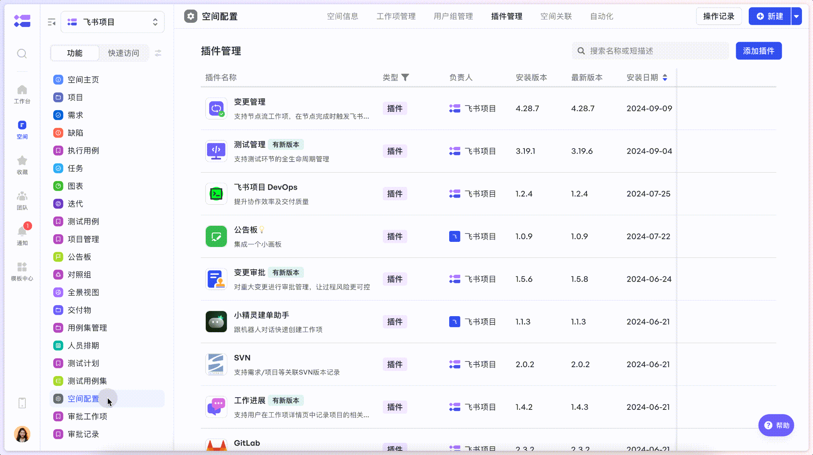
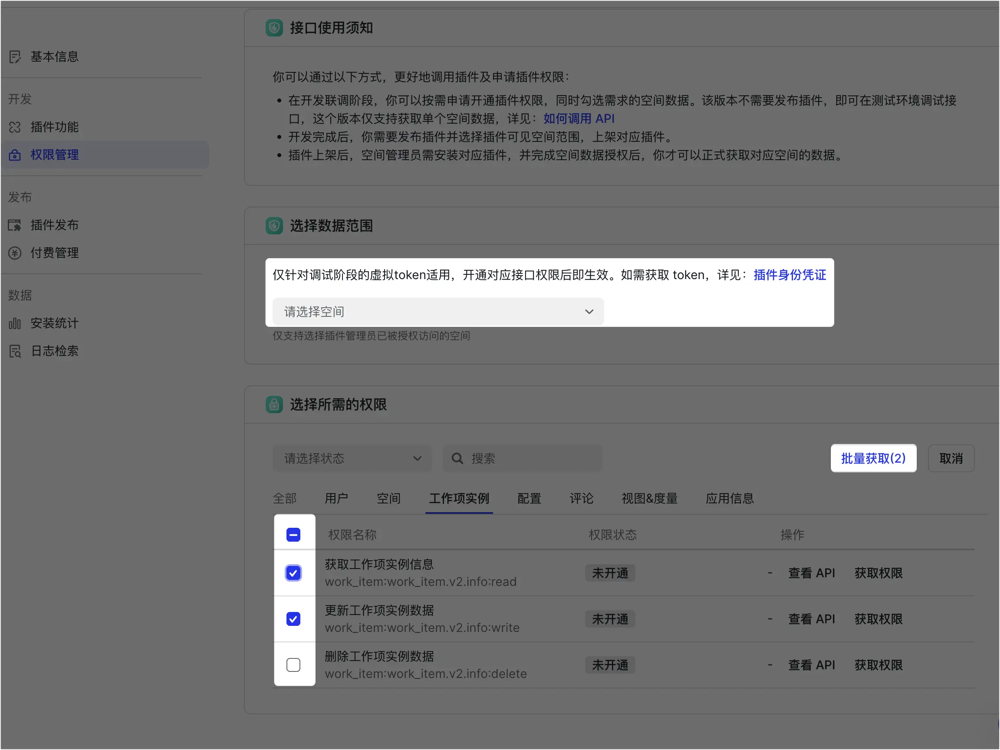
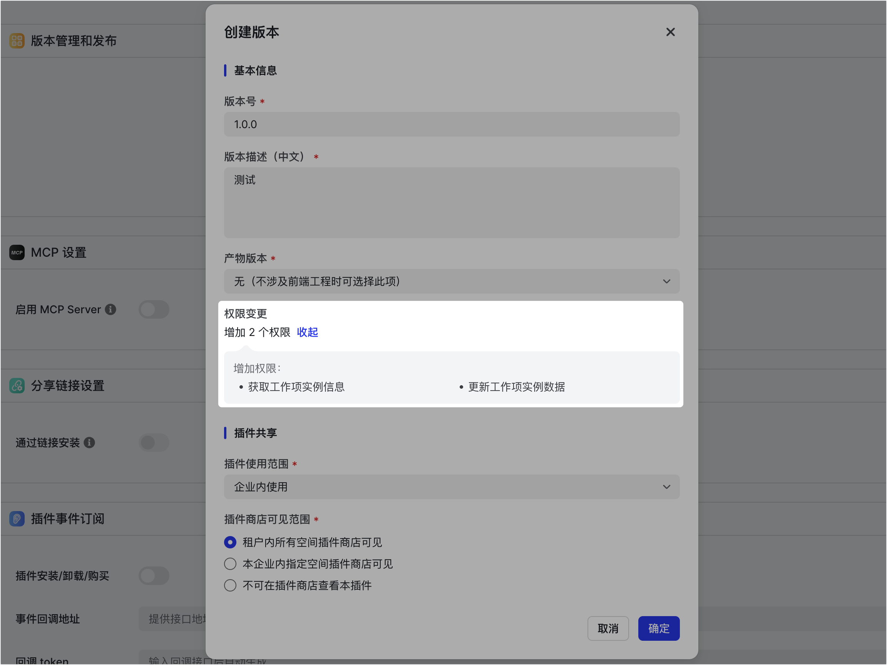
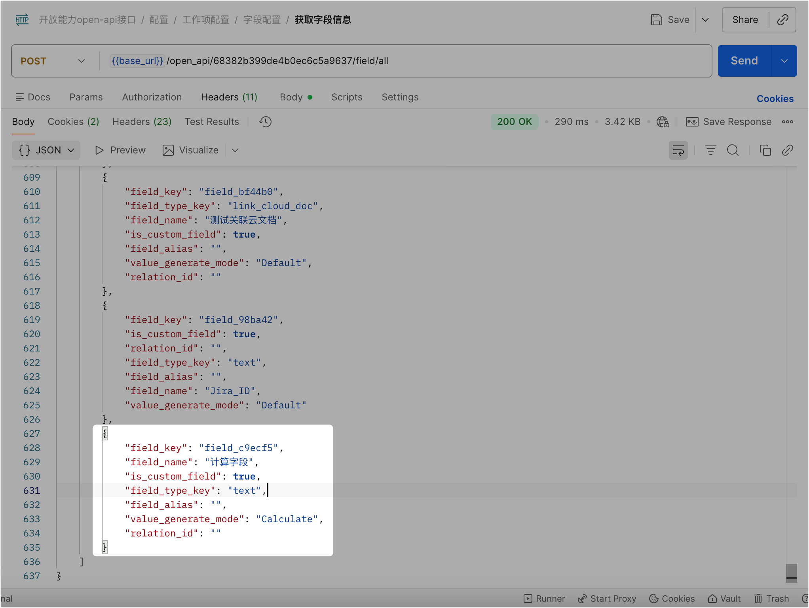
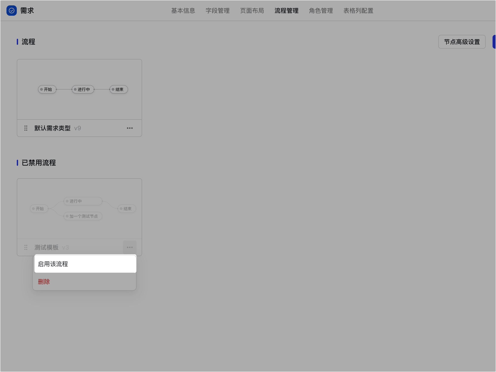

# Open API 错误码排查

<a id="ad6a9400"></a>

按实际接口、外层错误码、详细错误消息一起定位问题。下文已按[通用错误码](../formats/Open%20API%20错误码.md)和具体接口修正旧 FAQ 的错误归类。

<a id="a90cae14"></a>

## 排查入口

| 错误或消息 | 优先检查 |
| --- | --- |
| [10301：Check Token Perm Failed](#43907eab) | 接口权限、发布版本、安装版本、空间与用户 |
| [Calculated Fields Are Not Supported](#ecdc09bf) | 是否写入公式计算字段 |
| [20068：Search Param Is Not Support](#33dda802) | 搜索参数是否受支持，是否使用正确 field key |
| [20006：only support multi view](#be89a0f8) | 是否把普通视图 ID 传给全景视图接口 |
| [30006：User Not Found](#34f1aba6) | 插件类型是否支持用户详情接口 |
| [30009：can not find field](#bfe6d4a6) | 角色人员字段的键名和结构 |
| [Current Template is Disable](#9aa122a7) | 模板是否被禁用 |
| [获取用户详情失败](#3b1b718c) | 用户是否存在、查询参数格式是否正确 |

<a id="11fed20b"></a>
<a id="43907eab"></a>

## 10301：插件或用户权限校验失败

错误消息为 `Check Token Perm Failed`。原文列出五类原因：未申请接口权限、申请后未发布新版本、发布后未安装或更新、空间 ID 不存在、操作者无空间权限。

按以下顺序核对，避免只反复更换 token：

1. 用空间管理员身份进入「空间配置 → 插件管理 → 插件详情」，确认插件安装在目标空间且具备该接口权限。
2. 若缺权限，在开放平台插件的「权限与管理」中补充，然后发布包含权限变更的版本。
3. 检查 `X-PLUGIN-TOKEN`：`v-` 为虚拟插件 token，确认其授权空间与请求空间一致；`p-` 为正式插件 token，确认正式安装与权限版本。
4. 检查空间安装的插件是否已更新到最新权限版本；有权限变更提示时先重新发布，再在空间内更新。
5. 核对目标空间确实存在，且 `X-USER-KEY` 对应用户具有该操作权限。







权限申请、发布、安装是三个不同步骤，详情见[权限管理](../guides/权限管理.md)。

<a id="ecdc09bf"></a>

## Calculated Fields Are Not Supported：计算字段不可写

消息 `Calculated Fields Are Not Supported` 表示更新结构中包含不支持写入的公式计算字段，应从直接写入字段列表中排除。可通过空间字段配置确认计算字段，并使用[获取字段信息](../api/获取字段信息.md)定位其 `field_key`。

`value_generate_mode` 的可用枚举待核实。下方官方截图展示的是来源中的一次响应，与接口参数表的取值体系不同，不能作为通用判定规则。



`20090` 按通用错误码表表示拦截错误，不在此绑定到计算字段消息。计算字段错误的具体数字以接口实际返回为准。

<a id="33dda802"></a>

## 20068：搜索参数不受支持

消息为 `Search Param Is Not Support`。除搜索接口明确支持的固定参数外，字段筛选应使用[获取字段信息](../api/获取字段信息.md)返回的 `field_key`。

假设字段元数据如下，原展示名“名称-多行”在示例中译为英文，`field_key/field_alias` 保留原值：

```json
{
  "field_name": "Multiline name",
  "field_key": "field_935125",
  "field_alias": "multi_name"
}
```

对应筛选条件的键应为以下值。这是条件片段，需按[搜索参数格式](../formats/搜索参数格式及常用示例.md)补齐运算符、值和外层结构。

```json
{
  "param_key": "field_935125"
}
```

| 消息包含 | 原 FAQ 给出的处理 |
| --- | --- |
| `template_type:unSupport to search` | 使用 `template_id` 作为 `param_key` |
| `template:unSupport to search` | 使用 `template_id` 作为 `param_key` |
| `created_by:unSupport to search` | 核对该接口支持的固定参数及字段元数据，使用目标业务字段真实的 `field_key` |

创建人和负责人是不同的业务字段，不能通过换成负责人条件来实现创建人筛选。

<a id="be89a0f8"></a>

## 20006：视图类型与接口不匹配

消息为 `only support multi view` 时，检查是否把普通视图 ID 传给[全景视图工作项列表接口](../api/获取视图下工作项列表（全景视图）.md)。普通视图应调用[非全景视图工作项列表接口](../api/获取视图下工作项列表（非全景视图）.md)。这只是 `20006` 的一个具体场景，不能覆盖所有参数错误。

<a id="34f1aba6"></a>

## 30006：用户详情接口的插件类型限制

对于 `User Not Found`，本 FAQ 首先要求检查是否共享到插件市场。共享到市场的是 ISV 插件，原文说明不支持调用[获取用户详情](../api/获取用户详情.md)。

下面保留原查询示例。user key 即使全部由数字组成，也仍以字符串传递；它也可能是字母形式。

```json
{
  "user_keys": ["7012514555133820947", "xiaoming"],
  "emails": ["xiaoming@test.com"],
  "out_ids": ["on_************"]
}
```

这不是所有 `User Not Found` 的唯一原因，另见下文的[参数与用户存在性检查](#3b1b718c)。

<a id="bfe6d4a6"></a>

## 30009：角色人员字段结构错误

创建或更新角色人员时报 `can not find field`，检查是否以字段结构传入 `role_owners`。原正文的 `field_Key/field_vlaue` 是拼写错误，应为 `field_key/field_value`。

以下是字段片段，不是某个写接口的完整请求体。`role` 是角色标识，`owners` 是成员 user key 列表；空成员示例按原值保留为 `null`。完整定义见[角色与人员字段](../formats/字段与属性解析格式.md#10fb2f8d)。

```json
{
  "field_alias": "",
  "field_key": "role_owners",
  "field_value": [
    {"role": "Data", "owners": ["7311891981507100700"]},
    {"role": "Server", "owners": ["7311891981507100700"]},
    {
      "role": "UX_Writer",
      "owners": ["7311891981507100700", "7374823452487794692"]
    },
    {"owners": null, "role": "role_bb4853"}
  ],
  "field_type_key": "role_owners"
}
```

更新是否覆盖已有角色配置，应按具体[更新工作项接口](../api/更新工作项.md)的说明处理；本片段不定义合并行为。

<a id="9aa122a7"></a>

## Current Template is Disable：流程模板被禁用

传入的 `template_id` 对应模板处于禁用状态。核对是否选错模板；确需使用时，由空间管理员在「空间配置 → 工作项管理 → 流程管理」启用。



<a id="3b1b718c"></a>

## 获取用户详情失败：用户不存在或格式错误

消息 `User Not found` 也可能表示查询参数未匹配任何用户，或参数结构错误。确认真实用户标识及参数类型，下面是原 FAQ 的格式示例，掩码值需替换。

```json
{
  "user_keys": ["73567xxxxxx08297476"]
}
```

更新时间：2026-09-07
官方 URL：https://project.feishu.cn/b/helpcenter/1p8d7djs/3utghkpj
